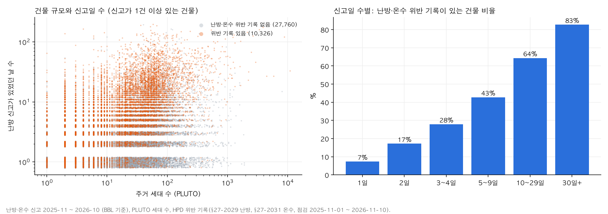
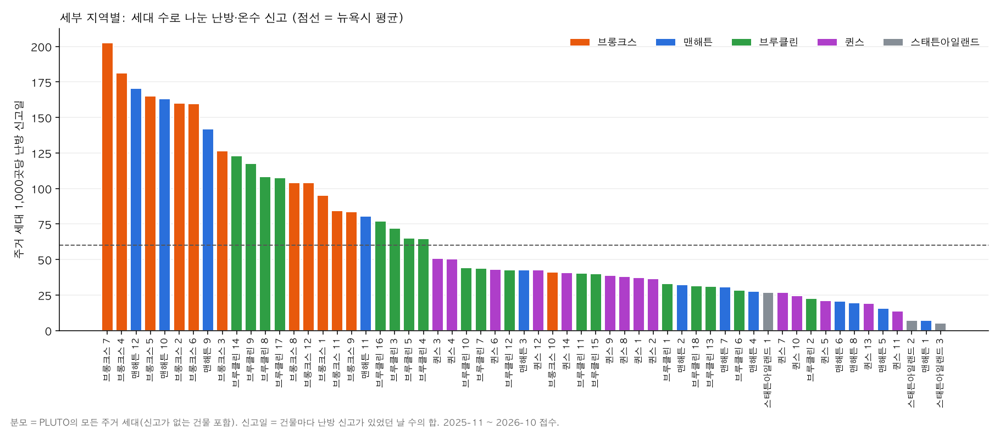

# 건물 규모로 본 난방·온수 신고

> 건물 규모(세대 수)를 감안해도 난방 신고가 많은 곳이 있는가? 신고가 많은 건물에는 실제 위반 기록도 있는가?

- **작성**: 2026-11-25
- **스크립트**: `scripts/building/building_analysis.py`
- **결과 파일**: `reports/building/` (표 11개, 그림 1개, `building_results.json`)
- **외부 자료** (받은 그대로 보관, 출처는 각 폴더의 `SOURCE.md`)
  - `data/external/nyc_pluto/`: PLUTO (세대 수·준공 연도·건물 유형)
  - `data/external/hpd_violations/`: HPD 난방(§27-2029)·온수(§27-2031) 위반 기록, 점검일 2025-11-01 ~ 2026-11-10
- **보존**: 원본·전처리 결과는 읽기만 했습니다.

---

## 0. 요약

**[사실] 세대 수로 나눠도 브롱크스의 난방 신고가 가장 많습니다.**
- 기준은 PLUTO의 모든 주거 세대 1,000곳당 「신고가 있었던 날」의 합입니다.

| 자치구 | 세대 1,000곳당 신고일 | 신고 건수 기준 |
|---|---:|---:|
| 브롱크스 | **125** | 201 |
| 브루클린 | 59 | 87 |
| 맨해튼 | 57 | 89 |
| 퀸스 | 35 | 51 |
| 스태튼아일랜드 | 14 | 19 |

**[사실] 오래된 중간 규모 건물에서 많습니다.** 모든 주거 세대 1,000곳당 신고일입니다.
- 규모: 20~49세대 132, 50~99세대 110, 6~19세대 109
  - 1~2세대 주택은 18, 200세대 이상 대형 건물은 20으로 적습니다.
- 준공 연도: 1946년 이전 84~87, 1947년 이후 24~35

**[사실] 신고는 일부 건물에 크게 몰려 있습니다.**
- 난방 신고가 있었던 건물은 39,718곳입니다.
- 상위 1% 건물이 신고의 24%, 상위 10%가 63%를 차지합니다.
- 40%는 1년에 하루만 신고가 있었습니다.
- 10일 이상 신고가 있었던 건물(15%)이 신고의 71%를 차지합니다.

**[사실] 신고가 오래 반복된 건물일수록 실제 위반 기록이 있는 비율이 높습니다.**

| 1년 중 신고가 있었던 날 | 1일 | 2일 | 3~4일 | 5~9일 | 10~29일 | 30일 이상 |
|---|---:|---:|---:|---:|---:|---:|
| 난방·온수 위반 기록이 있는 건물 | 7% | 17% | 28% | 43% | 64% | **83%** |

- **[주의] 일부는 구조적으로 생기는 관계입니다.** 위반 기록이 있는 건물 10,716곳 중 97%에 같은 기간 난방 신고가 있었습니다. HPD 점검은 대부분 신고를 계기로 이뤄지므로, 신고가 많으면 점검도 많고 위반이 발견될 기회도 많습니다.

**[사실] HPD가 「조건이 아직 남아 있음」으로 열어 둔 신고가 있는 건물(7,783곳)은 그렇지 않은 건물과 다릅니다.**
- 신고일 수 중앙값: 9일 vs 2일
- 위반 기록이 있는 비율: 53% vs 20%
- 세대 수 중앙값: 33 vs 8
- 열어 둔 기록은 실제로 문제가 남은 건물을 가리키는 단서일 가능성이 있습니다(`heat_record_change_report.md`).

**[사실] 세 조건을 모두 만족하는 건물은 1,422곳입니다.**
- 조건
  - 10일 이상 반복
  - 세대 대비 신고가 상위 10% (6세대 이상 건물 중, 세대 10곳당 신고일 6.7일 이상)
  - 위반 기록 있음
- 이 건물들이 난방 신고의 25%를 차지합니다.
- 맨해튼 506곳, 브롱크스 442곳, 브루클린 391곳, 퀸스 79곳, 스태튼아일랜드 4곳
- 순위가 아니라 「더 들여다볼 후보」의 범위를 좁힌 것입니다.

**[사실] 집중 주소(655 East 230th St)는 난방 문제 건물이 아닙니다.**
- 54세대, 1940년 준공, 6층 아파트(D1)입니다.
- 1년 동안 신고 47,105건 가운데 주거 소음이 47,013건(75일)이고, 난방은 25건(20일)입니다.
- 난방·온수 위반 기록은 없습니다.

---

## 1. 연결 범위

| 단계 | 난방 신고 | 비율 |
|---|---:|---:|
| 기간 내 난방·온수 신고 | 351,780 | 100% |
| 건물 번호(BBL) 있음 | 350,523 | 99.6% |
| PLUTO와 연결됨 | 349,551 | 99.4% |
| 주거 세대 수가 1 이상 | 344,957 | 98.1% |

---

## 2. 건물 규모와 준공 연도 (`tables/by_size_band.csv`, `tables/by_age_band.csv`)

**규모별**

| 세대 수 | 신고가 있었던 건물 | 그 규모 건물 중 비율 | 모든 세대 1,000곳당 신고일 | 신고 건물의 세대 10곳당 신고일 (중앙값) | 위반 기록이 있는 비율 |
|---|---:|---:|---:|---:|---:|
| 1~2 | 7,009 | 1.2% | 18 | 10.0 | 17% |
| 3~5 | 5,309 | 5.1% | 39 | 3.3 | 21% |
| 6~19 | 9,821 | 23.9% | 109 | 2.0 | 27% |
| 20~49 | 8,513 | 54.3% | **132** | 1.2 | 33% |
| 50~99 | 4,737 | 65.6% | 110 | 0.9 | 36% |
| 100~199 | 1,692 | 59.0% | 55 | 0.4 | 31% |
| 200+ | 1,005 | 56.6% | 20 | 0.2 | 36% |

- 「세대 10곳당 신고일」은 작은 건물일수록 크게 나옵니다(분모가 작음). 그래서 규모끼리 비교할 때는 「모든 세대 1,000곳당」을 봅니다.
- 건물 규모와 신고일 수의 순위 상관은 0.44입니다. 큰 건물일수록 신고일이 많지만, 세대 수에 비례하지는 않습니다.

**준공 연도별**

| 준공 | 신고 건물 | 모든 세대 1,000곳당 신고일 |
|---|---:|---:|
| ~1919 | 10,969 | 84 |
| 1920~46 | 17,861 | 87 |
| 1947~73 | 3,857 | 35 |
| 1974~2000 | 1,431 | 24 |
| 2001~ | 3,933 | 33 |

---

## 3. 자치구·세부 지역

- 자치구: 0절 표 (`tables/by_borough_per_unit.csv`)
- 세부 지역(커뮤니티 보드): 신고 수 상위는 맨해튼 12, 브롱크스 7, 브롱크스 4, 맨해튼 10, 브롱크스 5입니다(`tables/by_community_board.csv`).
  - 세부 지역의 「모든 세대 대비」 비율은 8절에 있습니다(2026-11-25 추가). 이 표의 세대 수는 「신고가 있었던 건물」의 세대 수입니다.

---

## 4. 반복 신고·위반 기록·열어 둔 기록

| 조건 조합 (반복 / 세대 대비 상위 / 위반) | 건물 | 신고 비중 |
|---|---:|---:|
| 셋 다 아님 | 26,984 | 19.4% |
| 위반만 | 5,884 | 7.9% |
| 반복만 | 1,536 | 11.0% |
| 반복 + 위반 | 2,701 | 28.9% |
| 반복 + 세대 대비 상위 | 385 | 5.7% |
| **셋 다** | **1,422** | **25.3%** |
| 그 밖 | 806 | 1.8% |

**셋 다 해당하는 건물의 예** (신고일 많은 순, 주소는 `tables/screening_all_three.csv`)

| 지역 | 세대 | 준공 | 신고 | 신고일 | 신고가 있었던 달 | 위반 | 열어 둔 기록 |
|---|---:|---:|---:|---:|---:|---:|---:|
| 맨해튼 10 | 58 | 1926 | 1,158 | 196 | 8 | 3 | 14 |
| 브롱크스 7 | 36 | 1936 | 1,661 | 189 | 10 | 1 | 10 |
| 브롱크스 12 | 67 | 1940 | 1,230 | 188 | 12 | 1 | 12 |
| 브롱크스 4 | 52 | 1924 | 407 | 180 | 8 | 2 | 3 |
| 브롱크스 6 | 170 | 1967 | 674 | 149 | 11 | 53 | 14 |

- 1년에 180일 넘게 난방 신고가 있었던 건물도 있습니다. 난방 시즌(10~5월) 대부분의 날입니다.
- 위반 기록이 1~3건뿐인 건물이 많습니다. 신고가 계속되는데 위반 확인은 적은 이유는 이 자료로 알 수 없습니다(출입 실패, 점검 시점에 복구됨 등).

---

## 5. 가능한 설명 (확인되지 않음)

| 결과 | 가능한 설명 |
|---|---|
| 브롱크스가 세대 대비로도 많음 | 오래된 중간 규모 임대 건물 비중, 건물 관리 상태, 신고 성향 차이 등. 이 자료로 구분할 수 없음 |
| 1946년 이전 건물이 많음 | 오래된 보일러·배관. 다만 준공 연도는 보일러 교체 여부를 알려 주지 않음 |
| 200세대 이상에서 적음 | 대형 단지의 관리 인력·설비 차이, 또는 단지 내부 민원 창구 이용 |
| 반복 건물에 위반이 많음 | 실제 문제가 지속됨 + 신고가 많아 점검·위반 발견 기회도 많음 (둘을 나눌 수 없음) |

## 6. 한계

- **세대 수 = PLUTO 현재값**: 기간 중 바뀐 정보는 반영되지 않습니다.
- **신고자 정보 없음**: 같은 세대의 반복인지 여러 세대인지 알 수 없습니다. 「신고일」은 같은 날 여러 건을 하루로 셉니다.
- **위반 기록 ≠ 실제 상태**: 위반이 없어도 문제가 없었다는 뜻이 아닙니다. 점검은 대부분 신고에서 시작되므로 위반과 신고는 서로 독립적이지 않습니다.
- **순위가 아님**: 세 조건은 더 들여다볼 범위를 좁히는 기준이며, 건물주·기관 평가가 아닙니다.

## 7. 검산

| 검사 | 결과 |
|---|---|
| 건물별 신고 합계 = BBL이 있는 난방 신고 수 | 350,523건 일치 |
| 위반 기록 BBL 중 PLUTO 주거 건물과 연결 | 신고 건물 10,428곳 (위반 건물 10,716곳의 97%) |
| 집중 주소 BBL (2048330028) = 기존 보고서의 집중 주소 | 신고 47,105건 일치 |

---

## 8. 세부 지역(커뮤니티 보드)별 세대 대비 (2026-11-25 추가)

- **스크립트**: `scripts/building/cb_per_unit_analysis.py`
- **추가 자료**: PLUTO의 건물 번호·커뮤니티 보드 열 (`data/external/nyc_pluto/pluto_bbl_cd_residential.csv`, 21MB)
- **분모**: 그 지역 PLUTO의 모든 주거 세대. 신고가 없는 건물도 포함합니다.
- **결과 표**: `tables/cb_heat_per_unit.csv`

**[사실] 신고 건수가 많은 지역은 세대 수로 나눠도 대부분 많습니다.**
- 두 순위의 순위 상관은 0.88입니다.
- 신고 건수 상위 5곳(맨해튼 12, 브롱크스 7, 브롱크스 4, 맨해튼 10, 브롱크스 5)이 세대 대비로도 상위 5곳입니다.
- 지역 구성 보고서의 「난방 다발 지역」은 **건물·세대가 많아서 생긴 결과가 아닙니다.**

| 지역 | 주거 세대 | 신고 건수 순위 | 세대 1,000곳당 신고일 | 세대 대비 순위 | 뉴욕시 평균 대비 | 세 조건 건물 |
|---|---:|---:|---:|---:|---:|---:|
| 브롱크스 7 | 56,571 | 2 | **203** | 1 | ×3.4 | 77 |
| 브롱크스 4 | 58,365 | 3 | 181 | 2 | ×3.0 | 61 |
| 맨해튼 12 | 75,871 | 1 | 171 | 3 | ×2.8 | 103 |
| 브롱크스 5 | 57,151 | 5 | 165 | 4 | ×2.7 | 59 |
| 맨해튼 10 | 61,899 | 4 | 163 | 5 | ×2.7 | 143 |
| 브루클린 14 | 65,404 | 6 | 123 | 10 | ×2.0 | 46 |
| 브롱크스 12 | 58,916 | 7 | 104 | 15 | ×1.7 | 25 |

- 뉴욕시 평균은 세대 1,000곳당 60일입니다.
- 각 지역에서 신고일이 가장 많은 건물 1곳을 빼도 순위는 거의 같습니다(위 5곳 그대로).

**[사실] 세대 대비로 보면 순위가 크게 바뀌는 지역도 있습니다.**
- **올라가는 곳**: 신고 건수는 중간이지만 세대 수가 적어 세대 대비로는 상위입니다.
  - 브롱크스 2: 24위 → 6위
  - 브롱크스 3: 18위 → 9위
  - 브롱크스 6: 11위 → 7위
- **내려가는 곳**: 세대가 많아 건수가 많아 보였던 곳입니다.
  - 브롱크스 12: 7위 → 15위
  - 브롱크스 9: 9위 → 18위
  - 맨해튼 7: 21위 → 44위
  - 퀸스 7: 31위 → 48위
- **가장 낮은 곳**: 스태튼아일랜드 3·2, 맨해튼 1·5, 퀸스 11 (세대 1,000곳당 5~16일)

**검산**
- 난방 신고의 98.4%가 PLUTO 커뮤니티 보드와 연결됐습니다.
- 311 신고에 적힌 커뮤니티 보드와 PLUTO 커뮤니티 보드의 일치율은 99.999%입니다.
- 세부 지역에 들어간 신고일은 224,562일입니다(전체 건물 228,540일의 98.3%). 나머지는 공원·공항 등 공동 관리 구역이거나 PLUTO에 커뮤니티 보드가 없는 건물입니다.

**[주의]**
- 세대 대비가 높은 지역은 오래된 중간 규모 건물이 많은 곳과 겹칠 가능성이 큽니다(2절). 지역 자체의 영향과 건물 구성의 영향을 이 분석은 나누지 않았습니다.
- 지역 순위나 평가가 아닙니다.

---

## 추가 주석: 공공임대주택(NYCHA) (2026-11-26)

- NYCHA 건물의 난방·온수 신고는 이 데이터에 거의 없습니다(350,523건 중 70건). NYCHA 자체 창구로 처리되는 것으로 보입니다(확인 안 됨).
- 그래서 이 보고서의 난방 분석은 **사실상 NYCHA를 뺀 민간 건물에 대한 결과**입니다. NYCHA 건물에 난방 문제가 없다는 뜻이 아닙니다.
- 「모든 세대 대비」의 분모에서 NYCHA 세대(4.3%)를 빼면 다음과 같습니다(`nycha_report.md` 5절).
  - 브롱크스: 125 → 136일
  - 세부 지역 순위: 거의 같음(순위 상관 0.99)
- 지난해(2024-11 ~ 2025-10)에도 세대 대비 난방 신고 상위 5곳은 브롱크스 7·4·5와 맨해튼 10·12로 같았습니다(59곳 순위 상관 0.99, `revalidation_report.md` 7절).

