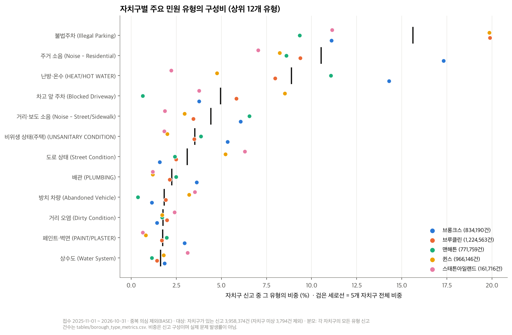
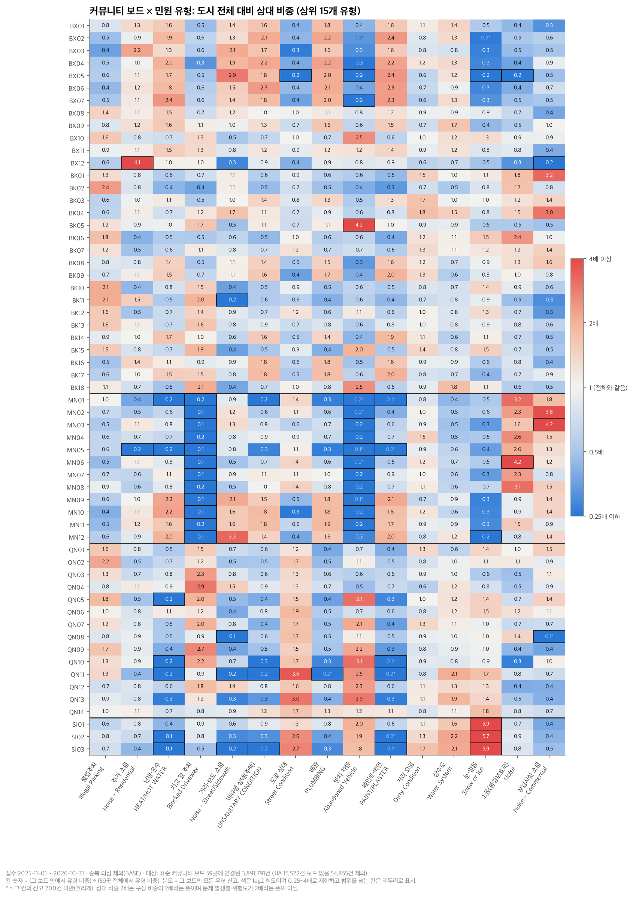
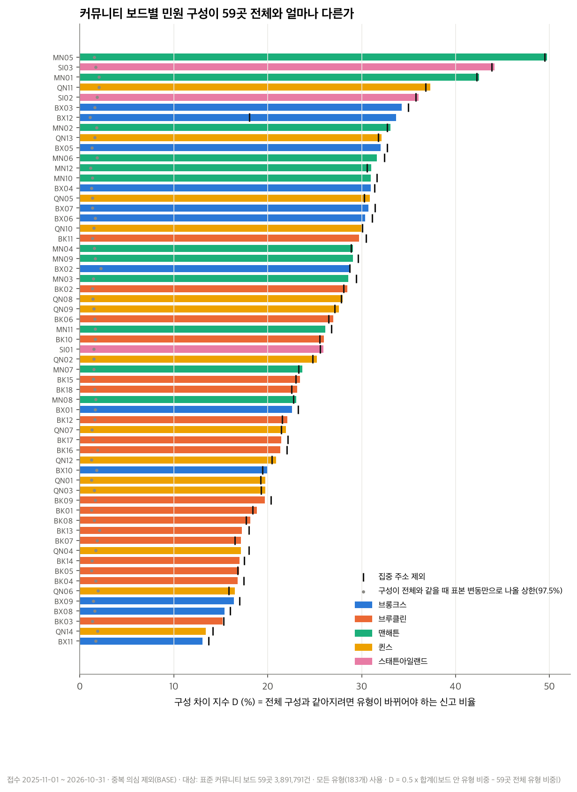
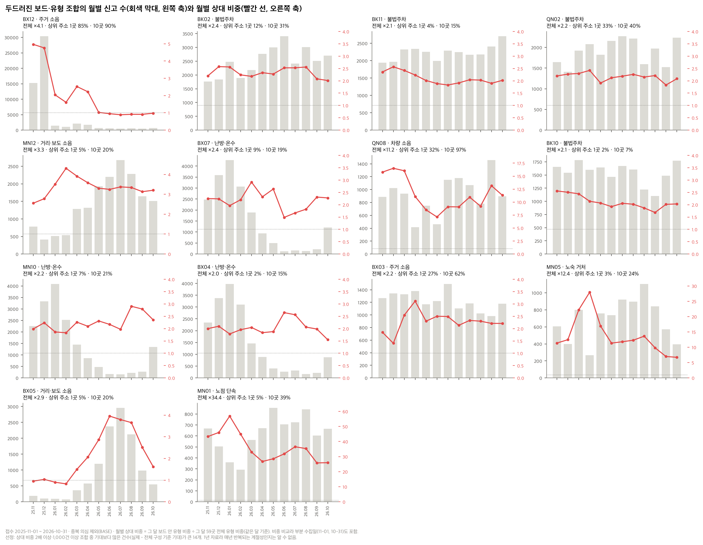

# 지역별 민원 유형 구성 분석

> 지역마다 민원 유형의 구성이 비슷한가, 아니면 특정 지역에 특정 민원이 집중되는가?

- **작성**: 2026-11-22
- **코드**: `scripts/composition/composition_analysis.py`(분석), `render_report.py`(표 채우기)
- **결과 파일**: `reports/composition/`(표 CSV, 그림, `composition_results.json`). 다시 실행해도 같은 결과가 나옵니다(난수 시드 311).
- **보존**: 원본·interim·processed 데이터, 기존 보고서, 대시보드는 수정하지 않았습니다. 전처리를 다시 실행하지 않았고, 대시보드에는 반영하지 않았습니다.

**이 분석이 보는 것과 보지 않는 것**
- 데이터에 **기록된 신고**의 지역별 분포와 구성입니다.
- 실제 문제 발생률, 위험도, 주민의 신고 성향이 아닙니다.
- 인구 대비 분석은 하지 않았습니다(별도 보고서 `population_report.md`).

**공통 기준**
- **기간**: 접수 2025-11-01 21:09 ~ 2026-10-31 21:09.
- **대상**: 중복 의심 제외(BASE) 3,962,168건.
- **유형**: 전처리의 `problem` 그대로입니다(194개). 기관이 다르다고 합치거나 나누지 않았습니다.
- **한국어 유형명**: 이해를 돕기 위한 번역이며, 원래 영문 유형을 괄호에 함께 적었습니다.

---

## 0. 질문별 답

### 1. 지역별 민원 구성은 대체로 비슷한가?

**비슷한 부분과 다른 부분이 함께 있습니다.**
- **[사실] 다른 정도**
  - 커뮤니티 보드 59곳은 모두 59곳 전체 구성과 13~50% 다릅니다. 중앙값은 26%입니다.
  - 이 값은 「전체와 같은 구성이 되려면 신고의 몇 %가 다른 유형이어야 하는가」를 뜻합니다(아래 D 지수).
  - 모든 보드의 구성이 전체와 같다면 표본 변동만으로 나올 수 있는 값은 2.2% 이하입니다. 따라서 이 차이는 우연한 변동보다 훨씬 큽니다.
- **[사실] 비슷한 부분**
  - 상위 15개 유형의 보드별 칸 중 71%는 상대 비중이 0.5~2배 안에 있습니다.
  - 가장 많은 유형은 33곳에서 불법주차, 14곳에서 난방·온수, 7곳에서 주거 소음입니다. 59곳 중 26곳은 1위 유형이 전체 1위(불법주차)와 다릅니다.
- **[사실] 자치구 단위**
  - 브루클린은 5개 자치구 전체와 가장 비슷하고(D 8.2%), 스태튼아일랜드가 가장 다릅니다(33.7%).
  - 큰 차이는 몇몇 유형에서 강하게 나타납니다.

### 2. 어떤 지역에서 어떤 유형이 두드러지는가?

**[사실]** 건수가 충분하고(1,000건 이상) 상대 비중이 2배 이상인 대표 조합은 다음과 같습니다.

| 묶음 | 지역 · 유형 |
|---|---|
| 주거 관련 | 브롱크스 4·7과 맨해튼 10의 난방·온수 (×2.0~2.4) |
| 주차 | 브루클린 2·10·11과 퀸스 2의 불법주차 (×2.1~2.4) |
| 거리 소음 | 맨해튼 12와 브롱크스 5의 거리·보도 소음 (×2.9~3.3) |
| 주거 소음 | 브롱크스 12 (×4.1), 브롱크스 3 (×2.2) |
| 맨해튼 중심부 | 맨해튼 5의 노숙 거처 (×12.4), 맨해튼 1의 노점 단속 (×34.4) |
| 특정 주소 | 퀸스 8의 차량 소음 (×11.2) |
| 날씨 | 스태튼아일랜드 3곳의 눈·얼음 (×5.7~5.9) |

### 3. 그 차이는 지역 전반에 걸친 것인가, 일부 주소 때문인가?

**조합마다 다릅니다.**

| 집중의 형태 | 해당 조합 |
|---|---|
| 지역 전반 | 불법주차(브루클린 10·11), 난방·온수(브롱크스 4·7, 맨해튼 10), 거리·보도 소음(맨해튼 12, 브롱크스 5), 노숙 거처(맨해튼 5), 노점 단속(맨해튼 1) |
| 일부 주소 | 주거 소음(브롱크스 12: 한 주소 85%, 브롱크스 3: 상위 10곳 62%), 차량 소음(퀸스 8: 상위 10곳 97%) |
| 섞임 | 불법주차(퀸스 2: 한 주소 33%, 브루클린 2: 한 주소 12%) |

- **지역 전반**은 상위 10개 주소를 빼도 2배 안팎이 유지되는 경우입니다.
- **일부 주소**는 상위 주소를 빼면 1배 근처로 내려가는 경우입니다.

### 4. 여러 달에 걸쳐 유지되는가?

- **[사실] 1년 내내 유지**: 불법주차, 거리 소음(맨해튼 12), 노숙 거처, 노점 단속, 차량 소음, 난방·온수는 월별 상대 비중이 대부분의 달에 1.5배 이상입니다.
  - 난방·온수는 여름에 건수가 크게 줄지만, 그 달의 도시 전체 비중과 비교한 상대 비중은 유지됩니다.
- **[사실] 특정 기간에 몰림**
  - 브롱크스 12 주거 소음: 2025-12 한 달에 54.7%가 몰렸고, 2026-05 이후 상대 비중이 1배 근처로 내려갑니다.
  - 브롱크스 5 거리 소음: 6~8월에 몰립니다.
  - 스태튼아일랜드 눈·얼음: 2026-02-23~24 이틀에 절반(7,581건)이 몰렸습니다.
- 1년 자료라 「매년 반복되는 계절성」인지는 알 수 없습니다.

### 5. 다음으로 자세히 볼 만한 조합

7절에 5개를 정리했습니다.

---

## 1. 분석 대상과 지역 연결

| 범위 | 신고 수 | BASE 대비 | 쓰는 곳 |
|---|---:|---:|---|
| BASE | 3,962,168 | 100% | |
| 자치구가 있는 신고 | 3,958,374 | 99.90% | 자치구 분석의 분모 (자치구 미상 3,794건 제외) |
| 표준 커뮤니티 보드 59곳(코드 01~18)에 연결 | 3,891,791 | 98.22% | 보드 분석의 분모 |
| 공동 관리 구역(JIA, 코드 26~95: 공원·공항 등) | 15,522 | 0.39% | 보드 분석에서 제외 |
| 커뮤니티 보드 값 없음 | 54,855 | 1.38% | 보드 분석에서 제외 |

**분모를 분석 단위별로 따로 씁니다.**
- 자치구 분석의 「도시 전체」는 자치구가 있는 신고 전체입니다.
- 보드 분석의 「도시 전체」는 표준 보드 59곳에 연결된 신고 전체입니다. 연결되지 않은 신고는 비교 기준에도 들어가지 않습니다.
- 보드 코드와 `borough` 값이 다른 신고(마블힐 2,751건, 라이커스섬 6건)는 고치지 않았습니다. 보드 분석은 보드 코드, 자치구 분석은 `borough` 값을 그대로 씁니다(인구 분석 보고서 1-2절과 같은 처리).

**유형마다 연결 누락률이 크게 다릅니다.**
- 신고 1,000건 이상인 111개 유형 중 누락률 중앙값은 0.9%입니다. 누락률이 5%를 넘는 유형은 18개입니다.
- 이 18개 유형이 보드에 연결되지 않은 신고의 61%를 차지합니다.
- 누락률이 높은 유형(택시 불만 42%, 구걸 36%, 노숙인 지원 요청 14% 등)은 보드 분석에서 실제보다 적게 잡히고, 남은 신고의 지역 분포도 원래와 다를 수 있습니다.

| 유형 | 전체 신고 | 표준 보드 연결 안 됨 |
|---|---:|---:|
| 고속도로 상태 (Highway Condition) | 6,638 | 100.0% |
| 주차 미터기 고장 (Broken Parking Meter) | 2,869 | 98.5% |
| 택시 불만 (Taxi Complaint) | 10,455 | 42.3% |
| 구걸 (Panhandling) | 11,601 | 36.4% |
| 분실물 (Lost Property) | 6,914 | 19.5% |
| 비둘기 위생 (Unsanitary Pigeon Condition) | 1,849 | 19.3% |
| 공원 내 동물 (Animal in a Park) | 5,738 | 18.2% |
| 노숙인 지원 요청 (Homeless Person Assistance) | 34,414 | 13.8% |
| 공원 규칙 위반 (Violation of Park Rules) | 4,877 | 12.8% |
| 공원 소음 (Noise - Park) | 8,211 | 11.4% |

---

## 2. 지표 정의

| 지표 | 계산 | 읽는 법 |
|---|---|---|
| ① 신고 건수 | 그 지역·유형의 신고 수 | |
| ② 지역 내 유형 비중 | 그 지역·유형 건수 ÷ **그 지역의 모든 유형 신고** | 지역 안에서 그 유형이 얼마나 큰 몫인가. 표시한 상위 유형의 합이 아니라 전체 유형을 분모로 씀 |
| ③ 상대 비중 (×) | ② ÷ (같은 분석 범위 전체에서 그 유형의 비중) | 1 = 전체와 같은 구성, 2 = 구성 비중이 2배. **문제 발생률이나 위험도가 2배라는 뜻이 아님** |
| ④ 유형의 지역별 분포 | 그 지역·유형 건수 ÷ **그 유형의 모든 신고(분석 범위)** | 그 유형이 어느 지역에 모였는가 |
| 구성 차이 지수 D (지역) | ½ Σ\|지역 내 유형 비중 − 전체 유형 비중\| (194개 유형 모두) | 전체와 같은 구성이 되려면 신고의 몇 %가 다른 유형이어야 하는가 (0~100%) |
| 분포 차이 지수 D (유형) | ½ Σ\|그 유형의 지역별 분포 − 전체 신고의 지역별 분포\| | 그 유형이 전체 신고와 얼마나 다르게 퍼져 있는가 |

- **②와 ④는 다른 질문입니다.**
  - 예: 맨해튼 1의 노점 단속은 지역 신고의 20.9%(②)이고, 59곳 노점 단속 신고의 31.5%(④)입니다.
  - 반대로 불법주차는 브루클린 2 신고의 37.0%(②)로 지역 안에서 매우 큰 몫이지만, 59곳 불법주차 신고 중 브루클린 2의 몫(④)은 4.9%입니다.
- **구성비는 합이 100%입니다.** 한 유형의 비중이 크면 다른 유형의 비중은 자동으로 작아집니다. 비중이 낮다고 건수가 적다는 뜻은 아닙니다.
  - 예: 집중 주소를 빼면 브롱크스 3의 주거 소음 상대 비중은 2.2배에서 2.5배로 오릅니다. 브롱크스 3의 신고는 그대로인데, 도시 전체의 주거 소음 비중이 10.7%에서 9.6%로 내려가기 때문입니다.

**최소 건수 기준**
- 「두드러진다」고 부르려면 그 칸이 **200건 이상**이고, 지역 내 비중이 1% 이상, 상대 비중이 2배 이상이어야 합니다.
- 200건이면 단순 포아송 변동의 상대 크기가 약 7%입니다. 다만 같은 장소·날짜의 반복 신고는 독립 관측이 아니라 실제 불확실성은 더 큽니다.
- 그래서 유의확률 대신 주소 분산과 월별 지속성으로 확인했습니다.
- 기준 근처(예: 1.9배, 2.1배)는 기준을 넘었는지보다 연속적인 값으로 읽어야 합니다. 실제로 집중 주소를 빼면 브롱크스 4 난방·온수가 2.02배에서 2.00배로 내려가 기준 밖으로 나갑니다.

**작은 표본**: 상대 비중 5배 이상인 칸 249개 중 187개는 200건 미만이고, 154개는 30건 미만입니다. 상대 비중만으로 고르면 대부분 작은 표본의 튐입니다.

---

## 3. 자치구 개괄 (5곳)

각 칸은 건수, 지역 내 비중 · 상대 비중입니다.
- **분모**: 그 자치구의 모든 유형 신고.
- **비교 기준**: 자치구가 있는 신고 3,958,374건.
- 기존 EDA 표 09(자치구 × 유형 비중)와 값이 일치합니다(스크립트가 검사).

| 유형 | 5개 자치구 전체 비중 | 브롱크스 | 브루클린 | 맨해튼 | 퀸스 | 스태튼아일랜드 |
|---|---:|---:|---:|---:|---:|---:|
| 불법주차 (Illegal Parking) | 15.6% | 92,661 11.1% · ×0.71 | 243,545 19.9% · ×1.27 | 72,116 9.3% · ×0.60 | 191,827 19.9% · ×1.27 | 18,005 11.1% · ×0.71 |
| 주거 소음 (Noise - Residential) | 10.5% | 144,495 17.3% · ×1.65 | 114,818 9.4% · ×0.89 | 66,347 8.6% · ×0.82 | 79,549 8.2% · ×0.78 | 11,382 7.0% · ×0.67 |
| 난방·온수 (HEAT/HOT WATER) | 8.9% | 119,264 14.3% · ×1.61 | 97,616 8.0% · ×0.90 | 85,416 11.1% · ×1.25 | 45,893 4.8% · ×0.53 | 3,590 2.2% · ×0.25 |
| 차고 앞 주차 (Blocked Driveway) | 5.0% | 31,410 3.8% · ×0.76 | 71,309 5.8% · ×1.18 | 4,939 0.6% · ×0.13 | 82,316 8.5% · ×1.72 | 6,075 3.8% · ×0.76 |
| 거리·보도 소음 (Noise - Street/Sidewalk) | 4.4% | 50,621 6.1% · ×1.37 | 42,112 3.4% · ×0.78 | 50,484 6.5% · ×1.48 | 28,602 3.0% · ×0.67 | 3,011 1.9% · ×0.42 |
| 비위생 상태(주택) (UNSANITARY CONDITION) | 3.5% | 44,581 5.3% · ×1.52 | 42,692 3.5% · ×0.99 | 29,820 3.9% · ×1.10 | 19,370 2.0% · ×0.57 | 2,961 1.8% · ×0.52 |
| 도로 상태 (Street Condition) | 3.1% | 13,158 1.6% · ×0.51 | 30,355 2.5% · ×0.80 | 18,634 2.4% · ×0.78 | 50,397 5.2% · ×1.68 | 10,196 6.3% · ×2.03 |
| 배관 (PLUMBING) | 2.3% | 30,289 3.6% · ×1.61 | 26,199 2.1% · ×0.95 | 19,242 2.5% · ×1.11 | 11,447 1.2% · ×0.53 | 1,938 1.2% · ×0.53 |
| 방치 차량 (Abandoned Vehicle) | 1.8% | 9,524 1.1% · ×0.62 | 23,355 1.9% · ×1.04 | 2,794 0.4% · ×0.20 | 30,951 3.2% · ×1.75 | 5,704 3.5% · ×1.93 |
| 거리 오염 (Dirty Condition) | 1.8% | 11,852 1.4% · ×0.81 | 24,209 2.0% · ×1.12 | 13,198 1.7% · ×0.97 | 16,492 1.7% · ×0.97 | 3,873 2.4% · ×1.36 |
| 페인트·벽면 (PAINT/PLASTER) | 1.8% | 24,668 3.0% · ×1.69 | 20,762 1.7% · ×0.97 | 15,197 2.0% · ×1.12 | 7,716 0.8% · ×0.46 | 1,033 0.6% · ×0.36 |
| 상수도 (Water System) | 1.6% | 15,443 1.9% · ×1.14 | 17,533 1.4% · ×0.88 | 8,844 1.1% · ×0.71 | 17,289 1.8% · ×1.10 | 5,044 3.1% · ×1.92 |
| **자치구 신고 전체 (분모)** | | 834,190 | 1,224,563 | 771,759 | 966,146 | 161,716 |
| 구성 차이 지수 D | | 22.6% | 8.2% | 21.6% | 18.8% | 33.7% |

**[사실]**
- **브롱크스**: 주거 소음(17.3%, ×1.6)과 난방·온수(14.3%, ×1.6)의 비중이 높습니다.
- **브루클린·퀸스**: 불법주차가 19.9%입니다. 퀸스는 차고 앞 주차(×1.7)와 도로 상태(×1.7)도 높습니다.
- **맨해튼**: 차고 앞 주차(0.6%)와 방치 차량(0.4%)이 거의 없습니다.
- **스태튼아일랜드**: 도로 상태·상수도·방치 차량의 비중이 높습니다. 눈·얼음은 2위 유형입니다.

자치구 안에도 차이가 큽니다. 예를 들어 브롱크스의 주거 소음 비중은 브롱크스 12와 3이 대부분을 만듭니다(4절).

---

## 4. 커뮤니티 보드 × 유형

### 4-1. 상대 비중 열지도 (상위 15개 유형)

상위 15개 유형은 59곳 신고의 65.6%를 차지합니다.

**표현 방식**
- 색은 log2 척도입니다. 1배가 흰색이고, 2배와 0.5배가 같은 거리입니다.
- 극단값 때문에 나머지 차이가 묻히지 않도록 0.25~4배로 색을 제한했습니다. 범위를 넘는 칸은 검은 테두리로 표시했습니다.
- `*`와 흐린 글씨는 200건 미만인 칸입니다.

같은 그림을 집중 주소를 빼고 다시 그린 것은 `composition/figures/02b_heatmap_excl_focus.png`입니다. 브롱크스 12의 주거 소음 칸이 4.1배에서 1.1배로 바뀌고, 나머지는 거의 같습니다.

### 4-2. 지역별로 두드러지는 유형 (59곳, 구성 차이 큰 순)

- 「두드러지는 유형」은 200건 이상이고 지역 내 비중 1% 이상인 유형 중 상대 비중이 큰 3개입니다.
- 상위 15개 밖의 유형도 포함합니다.
- 상대 비중이 높아도 지역 내 비중이 1~3%인 경우가 많습니다. 그 지역 신고의 큰 몫이라는 뜻은 아닙니다.

| 보드 | 신고 수 | 구성 차이 D | 가장 많은 유형 3개 (지역 내 비중) | 두드러지는 유형 (상대 비중, 건수, 지역 내 비중) |
|---|---:|---:|---|---|
| MN05 | 60,203 | 49.7% | 노숙 거처 13.8%; 불법주차 10.1%; 노숙인 지원 요청 9.3% | 택시 불만 ×19.7 (1,840건, 3.1%); 분실물 ×16.2 (1,398건, 2.3%); 이동식 음식 노점 ×14.9 (629건, 1.0%) |
| SI03 | 49,438 | 44.2% | 불법주차 11.6%; 눈·얼음 9.5%; 도로 상태 8.2% | 불법 게시물 ×10.7 (726건, 1.5%); 나무뿌리·하수·보도 상태 ×5.9 (766건, 1.5%); 눈·얼음 ×5.9 (4,673건, 9.5%) |
| MN01 | 35,602 | 42.5% | 노점 단속 20.9%; 불법주차 15.8%; 소음(환경보호국) 5.0% | 노점 단속 ×34.4 (7,454건, 20.9%); 노숙인 지원 요청 ×5.8 (1,565건, 4.4%); 헬리콥터 소음 ×3.6 (358건, 1.0%) |
| QN11 | 36,519 | 37.3% | 불법주차 21.2%; 도로 상태 10.7%; 주거 소음 4.8% | 죽거나 죽어가는 나무 ×5.1 (533건, 1.5%); 나무뿌리·하수·보도 상태 ×4.5 (429건, 1.2%); 웃자란 나무·가지 ×4.4 (973건, 2.7%) |
| SI02 | 43,297 | 36.1% | 불법주차 12.6%; 눈·얼음 9.1%; 도로 상태 7.7% | 눈·얼음 ×5.7 (3,953건, 9.1%); 가로등 상태 ×4.4 (1,799건, 4.2%); 나무뿌리·하수·보도 상태 ×4.0 (451건, 1.0%) |
| BX03 | 62,176 | 34.3% | 주거 소음 23.6%; 난방·온수 12.1%; 거리·보도 소음 9.3% | 비긴급 경찰 사안 ×3.5 (1,343건, 2.2%); 엘리베이터 ×2.6 (1,132건, 1.8%); 가전(주택) ×2.3 (966건, 1.6%) |
| BX12 | 128,204 | 33.7% | 주거 소음 43.3%; 난방·온수 9.3%; 불법주차 8.9% | 주거 소음 ×4.1 (55,561건, 43.3%); 폐차 상태 차량 ×1.4 (1,605건, 1.3%); 전기(주택) ×1.1 (1,291건, 1.0%) |
| MN02 | 47,590 | 33.1% | 불법주차 10.6%; 상업시설 소음 5.9%; 난방·온수 5.8% | 야외 영업 공간 ×17.9 (708건, 1.5%); 분실물 ×10.8 (735건, 1.5%); 영업용 차량 불만 ×6.8 (1,473건, 3.1%) |
| QN13 | 59,170 | 32.1% | 불법주차 14.0%; 도로 상태 8.9%; 주거 소음 8.3% | 나무뿌리·하수·보도 상태 ×4.5 (699건, 1.2%); 하수 ×4.0 (1,364건, 2.3%); 웃자란 나무·가지 ×4.0 (1,418건, 2.4%) |
| BX05 | 90,995 | 32.0% | 난방·온수 15.8%; 거리·보도 소음 12.7%; 주거 소음 11.8% | 거리·보도 소음 ×2.9 (11,597건, 12.7%); FLOORING/STAIRS ×2.7 (1,940건, 2.1%); 페인트·벽면 ×2.4 (3,894건, 4.3%) |
| MN06 | 41,646 | 31.6% | 주거 소음 11.5%; 노숙 거처 8.2%; 난방·온수 7.7% | 헬리콥터 소음 ×12.3 (1,444건, 3.5%); 분실물 ×7.7 (457건, 1.1%); 노숙 거처 ×7.3 (3,404건, 8.2%) |
| MN12 | 117,731 | 31.0% | 난방·온수 17.7%; 거리·보도 소음 14.5%; 주거 소음 9.1% | 거리·보도 소음 ×3.3 (17,091건, 14.5%); FLOORING/STAIRS ×2.3 (2,210건, 1.9%); 페인트·벽면 ×2.0 (4,207건, 3.6%) |
| MN10 | 84,927 | 31.0% | 난방·온수 20.2%; 주거 소음 12.2%; 거리·보도 소음 7.1% | 난방·온수 ×2.2 (17,150건, 20.2%); 문·창문 ×2.1 (2,555건, 3.0%); 쥐 등 설치류 ×2.1 (1,170건, 1.4%) |
| BX04 | 95,312 | 31.0% | 난방·온수 18.3%; 주거 소음 10.4%; 거리·보도 소음 8.5% | 엘리베이터 ×2.4 (1,604건, 1.7%); FLOORING/STAIRS ×2.3 (1,762건, 1.8%); 배관 ×2.2 (4,886건, 5.1%) |
| QN05 | 83,669 | 30.8% | 불법주차 29.0%; 차고 앞 주차 10.0%; 방치 차량 5.7% | 방치 차량 ×3.1 (4,762건, 5.7%); 차고 앞 주차 ×2.0 (8,382건, 10.0%); 불법주차 ×1.8 (24,231건, 29.0%) |
| BX07 | 84,997 | 30.7% | 난방·온수 21.8%; 주거 소음 12.0%; 불법주차 8.0% | 난방·온수 ×2.4 (18,570건, 21.8%); 페인트·벽면 ×2.3 (3,503건, 4.1%); FLOORING/STAIRS ×2.2 (1,533건, 1.8%) |
| BX06 | 54,819 | 30.4% | 난방·온수 16.6%; 주거 소음 12.7%; 비위생 상태(주택) 8.4% | 가전(주택) ×2.7 (1,020건, 1.9%); 문·창문 ×2.4 (1,817건, 3.3%); 비위생 상태(주택) ×2.3 (4,581건, 8.4%) |
| QN10 | 69,581 | 30.1% | 불법주차 19.9%; 차고 앞 주차 10.8%; 주거 소음 10.1% | 건물 용도 ×10.3 (4,637건, 6.7%); 방치 차량 ×3.1 (4,005건, 5.8%); 통행 방해 ×2.7 (1,057건, 1.5%) |
| BK11 | 81,749 | 29.7% | 불법주차 32.8%; 주거 소음 16.0%; 차고 앞 주차 10.0% | 불법주차 ×2.1 (26,809건, 32.8%); 차고 앞 주차 ×2.0 (8,179건, 10.0%); 손상된 나무 ×1.5 (1,406건, 1.7%) |
| MN04 | 58,809 | 29.1% | 노숙 거처 12.3%; 불법주차 9.9%; 주거 소음 7.9% | 노숙 거처 ×11.0 (7,206건, 12.3%); 택시 불만 ×10.8 (986건, 1.7%); 분실물 ×8.1 (681건, 1.2%) |
| MN09 | 58,730 | 29.1% | 난방·온수 19.7%; 주거 소음 10.5%; 거리·보도 소음 9.4% | 난방·온수 ×2.2 (11,568건, 19.7%); 페인트·벽면 ×2.1 (2,237건, 3.8%); 거리·보도 소음 ×2.1 (5,515건, 9.4%) |
| BX02 | 29,560 | 28.8% | 난방·온수 17.2%; 주거 소음 9.9%; 비위생 상태(주택) 7.5% | 문·창문 ×2.5 (1,020건, 3.5%); 가전(주택) ×2.5 (494건, 1.7%); 페인트·벽면 ×2.4 (1,250건, 4.2%) |
| MN03 | 73,180 | 28.6% | 주거 소음 12.2%; 불법주차 8.3%; 난방·온수 7.6% | 교통 ×20.3 (4,017건, 5.5%); 낙서(그래피티) ×6.6 (2,027건, 2.8%); 영업용 차량 불만 ×5.8 (1,928건, 2.6%) |
| BK02 | 80,811 | 28.5% | 불법주차 37.0%; 주거 소음 8.6%; 거리·보도 소음 4.7% | 노점 단속 ×3.5 (1,725건, 2.1%); 영업용 차량 불만 ×3.4 (1,250건, 1.5%); 불법주차 ×2.4 (29,939건, 37.0%) |
| QN08 | 74,380 | 28.0% | 차량 소음 14.8%; 불법주차 13.0%; 주거 소음 9.7% | 종교시설 소음 ×33.2 (1,685건, 2.3%); Drug Activity ×14.0 (2,368건, 3.2%); 차량 소음 ×11.2 (11,015건, 14.8%) |
| QN09 | 68,116 | 27.6% | 불법주차 26.5%; 차고 앞 주차 13.3%; 주거 소음 9.4% | 차고 앞 주차 ×2.7 (9,082건, 13.3%); 방치 차량 ×2.2 (2,724건, 4.0%); 하수 ×2.0 (795건, 1.2%) |
| BK06 | 58,786 | 27.0% | 불법주차 28.0%; 난방·온수 4.9%; 주거 소음 4.5% | 납 ×2.7 (588건, 1.0%); 영업용 차량 불만 ×2.6 (709건, 1.2%); 소음(환경보호국) ×2.4 (2,211건, 3.8%) |
| MN11 | 55,649 | 26.1% | 난방·온수 14.3%; 주거 소음 13.0%; 불법주차 7.2% | 공원 소음 ×5.9 (613건, 1.1%); 일반(주택) ×2.2 (1,400건, 2.5%); 배관 ×1.9 (2,396건, 4.3%) |
| BK10 | 55,949 | 26.0% | 불법주차 33.1%; 차고 앞 주차 7.5%; 난방·온수 6.9% | 불법주차 ×2.1 (18,543건, 33.1%); 손상된 나무 ×1.9 (1,178건, 2.1%); 공원 시설 관리 ×1.8 (695건, 1.2%) |
| SI01 | 67,019 | 25.9% | 불법주차 9.9%; 눈·얼음 9.4%; 주거 소음 8.7% | 눈·얼음 ×5.9 (6,316건, 9.4%); 쓰레기 미수거 ×4.5 (2,728건, 4.1%); 가로등 상태 ×3.6 (2,262건, 3.4%) |
| QN02 | 66,867 | 25.2% | 불법주차 34.2%; 차고 앞 주차 6.0%; 난방·온수 6.0% | 불법주차 ×2.2 (22,854건, 34.2%); 신호등 상태 ×1.8 (1,616건, 2.4%); 도로 상태 ×1.7 (3,364건, 5.0%) |
| MN07 | 65,903 | 23.7% | 불법주차 10.4%; 난방·온수 9.8%; 헬리콥터 소음 7.4% | 헬리콥터 소음 ×26.2 (4,849건, 7.4%); 불법 수목 훼손 ×6.8 (805건, 1.2%); 노숙인 지원 요청 ×3.7 (1,849건, 2.8%) |
| BK15 | 68,696 | 23.4% | 불법주차 24.4%; 차고 앞 주차 9.6%; 주거 소음 8.3% | 일반 공사·배관 ×2.5 (1,748건, 2.5%); 보도 상태 ×2.1 (991건, 1.4%); 방치 차량 ×2.0 (2,518건, 3.7%) |
| BK18 | 60,966 | 23.1% | 불법주차 17.3%; 차고 앞 주차 10.4%; 주거 소음 8.0% | 웃자란 나무·가지 ×3.0 (1,113건, 1.8%); 폐차 상태 차량 ×2.7 (1,497건, 2.5%); 방치 차량 ×2.5 (2,832건, 4.6%) |
| MN08 | 52,331 | 23.0% | 불법주차 14.3%; 난방·온수 7.6%; 주거 소음 6.2% | 분실물 ×9.5 (708건, 1.4%); 택시 불만 ×7.2 (586건, 1.1%); 음식점 ×4.6 (883건, 1.7%) |
| BX01 | 51,437 | 22.6% | 난방·온수 14.2%; 주거 소음 14.2%; 불법주차 12.6% | 엘리베이터 ×2.3 (830건, 1.6%); 가전(주택) ×2.2 (776건, 1.5%); 배관 ×1.8 (2,116건, 4.1%) |
| BK12 | 60,026 | 22.1% | 불법주차 24.7%; 차고 앞 주차 7.1%; 난방·온수 6.2% | 일반 공사·배관 ×2.9 (1,783건, 3.0%); 쓰레기 미수거 ×1.9 (1,070건, 1.8%); 손상된 나무 ×1.9 (1,269건, 2.1%) |
| QN07 | 87,622 | 21.9% | 불법주차 19.4%; 차고 앞 주차 10.2%; 주거 소음 8.9% | 연석 상태 ×4.9 (976건, 1.1%); 건물 용도 ×3.0 (1,725건, 2.0%); 방치 차량 ×2.1 (3,418건, 3.9%) |
| BK17 | 75,929 | 21.5% | 난방·온수 13.4%; 주거 소음 10.7%; 불법주차 9.1% | 누수 ×2.1 (2,044건, 2.7%); 전기(주택) ×2.1 (1,475건, 1.9%); 가전(주택) ×2.1 (1,070건, 1.4%) |
| BK16 | 41,488 | 21.3% | 주거 소음 15.0%; 난방·온수 10.0%; 불법주차 7.7% | 비긴급 경찰 사안 ×2.6 (667건, 1.6%); 가전(주택) ×2.2 (632건, 1.5%); 전기(주택) ×2.1 (833건, 2.0%) |
| QN12 | 97,863 | 20.9% | 불법주차 11.5%; 차고 앞 주차 9.0%; 주거 소음 8.6% | 통행 방해 ×2.8 (1,534건, 1.6%); 폐차 상태 차량 ×2.7 (2,426건, 2.5%); 하수 ×2.6 (1,454건, 1.5%) |
| BX10 | 46,416 | 19.9% | 불법주차 24.9%; 주거 소음 8.2%; 차고 앞 주차 6.8% | 방치 차량 ×2.5 (2,147건, 4.6%); 가로등 상태 ×2.3 (1,016건, 2.2%); 폐차 상태 차량 ×2.0 (841건, 1.8%) |
| QN01 | 99,938 | 19.8% | 불법주차 24.9%; 주거 소음 8.7%; 차고 앞 주차 7.7% | 일반(주택) ×3.1 (3,541건, 3.5%); 쥐 등 설치류 ×1.9 (1,286건, 1.3%); 불법주차 ×1.6 (24,847건, 24.9%) |
| QN03 | 65,487 | 19.7% | 불법주차 20.2%; 차고 앞 주차 11.7%; 주거 소음 7.4% | 차량 소음 ×3.6 (3,129건, 4.8%); 노점 단속 ×3.6 (1,426건, 2.2%); 차고 앞 주차 ×2.3 (7,654건, 11.7%) |
| BK09 | 58,616 | 19.7% | 난방·온수 13.5%; 불법주차 11.8%; 주거 소음 11.6% | FLOORING/STAIRS ×2.3 (1,066건, 1.8%); 누수 ×2.1 (1,548건, 2.6%); 페인트·벽면 ×2.0 (2,069건, 3.5%) |
| BK01 | 99,201 | 18.9% | 불법주차 20.4%; 주거 소음 8.9%; 상업시설 소음 5.0% | 낙서(그래피티) ×6.4 (2,673건, 2.7%); 상업시설 소음 ×3.2 (5,007건, 5.0%); 공원 시설 관리 ×2.1 (1,431건, 1.4%) |
| BK08 | 63,039 | 18.2% | 불법주차 13.1%; 난방·온수 12.9%; 주거 소음 8.6% | 헬리콥터 소음 ×10.1 (1,793건, 2.8%); 쥐 등 설치류 ×1.9 (809건, 1.3%); 누수 ×1.9 (1,516건, 2.4%) |
| BK13 | 36,082 | 17.2% | 불법주차 24.7%; 주거 소음 11.5%; 차고 앞 주차 8.3% | 소비자 불만 ×2.4 (460건, 1.3%); 공원 시설 관리 ×2.0 (510건, 1.4%); 차고 앞 주차 ×1.6 (2,988건, 8.3%) |
| BK07 | 47,282 | 17.2% | 불법주차 19.2%; 난방·온수 5.7%; 차고 앞 주차 5.6% | 낙서(그래피티) ×2.7 (543건, 1.1%); 공원 시설 관리 ×2.2 (715건, 1.5%); 통행 방해 ×1.9 (512건, 1.1%) |
| QN04 | 50,478 | 17.1% | 차고 앞 주차 14.8%; 불법주차 13.2%; 주거 소음 11.8% | Drug Activity ×6.0 (685건, 1.4%); 차고 앞 주차 ×2.9 (7,452건, 14.8%); 거리·보도 소음 ×1.5 (3,285건, 6.5%) |
| BK14 | 84,680 | 17.0% | 난방·온수 15.1%; 불법주차 13.8%; 주거 소음 10.6% | 페인트·벽면 ×1.9 (2,822건, 3.3%); FLOORING/STAIRS ×1.8 (1,209건, 1.4%); 누수 ×1.7 (1,855건, 2.2%) |
| BK05 | 98,387 | 17.0% | 불법주차 19.2%; 주거 소음 9.9%; 난방·온수 8.6% | 방치 차량 ×4.2 (7,540건, 7.7%); 폐차 상태 차량 ×1.9 (1,746건, 1.8%); 차고 앞 주차 ×1.7 (8,213건, 8.3%) |
| BK04 | 58,808 | 16.8% | 주거 소음 11.6%; 불법주차 9.8%; 거리·보도 소음 7.5% | 낙서(그래피티) ×3.0 (740건, 1.3%); 상업시설 소음 ×3.0 (2,706건, 4.6%); 웃자란 나무·가지 ×1.8 (650건, 1.1%) |
| QN06 | 40,905 | 16.5% | 불법주차 16.2%; 난방·온수 9.9%; 주거 소음 8.4% | 비긴급 경찰 사안 ×7.0 (1,748건, 4.3%); 공원 시설 관리 ×2.0 (561건, 1.4%); 도로 상태 ×1.9 (2,307건, 5.6%) |
| BX09 | 70,986 | 16.4% | 난방·온수 14.3%; 주거 소음 13.3%; 불법주차 12.9% | 엘리베이터 ×1.8 (910건, 1.3%); 상수도 ×1.7 (1,930건, 2.7%); 배관 ×1.6 (2,673건, 3.8%) |
| BX08 | 58,864 | 15.4% | 불법주차 22.5%; 난방·온수 13.8%; 주거 소음 11.6% | 엘리베이터 ×1.7 (705건, 1.2%); 난방·온수 ×1.5 (8,096건, 13.8%); 불법주차 ×1.4 (13,229건, 22.5%) |
| BK03 | 78,206 | 15.2% | 주거 소음 10.2%; 난방·온수 10.0%; 불법주차 9.7% | 쥐 등 설치류 ×2.7 (1,417건, 1.8%); 누수 ×1.8 (1,798건, 2.3%); 전기(주택) ×1.7 (1,233건, 1.6%) |
| QN14 | 42,126 | 13.4% | 불법주차 15.5%; 주거 소음 11.2%; 난방·온수 6.7% | 하수 ×2.0 (486건, 1.2%); 눈·얼음 ×1.8 (1,208건, 2.9%); 가로등 상태 ×1.8 (701건, 1.7%) |
| BX11 | 54,548 | 13.1% | 불법주차 14.8%; 난방·온수 13.5%; 주거 소음 11.6% | 엘리베이터 ×1.5 (580건, 1.1%); 난방·온수 ×1.5 (7,362건, 13.5%); 가로등 상태 ×1.5 (752건, 1.4%) |

### 4-3. 주요 유형별로 신고가 모인 지역 (상위 15개 유형)

- **분포 차이 D**: 0%면 그 유형이 전체 신고와 같은 비율로 59곳에 퍼져 있다는 뜻입니다.
- **건수 상위 3곳**은 「그 유형이 어디에 많이 모였나」(④), **상대 비중 상위 3곳**은 「어느 지역 안에서 그 유형이 유독 큰 몫인가」(③)입니다. 두 목록이 다를 수 있습니다.

| 유형 | 59곳 신고 | 전체 비중 | 분포 차이 D | 건수 상위 3곳 (유형 신고 중 비중, 지역 내 비중, 상대 비중) | 상대 비중 상위 3곳 (200건 이상) |
|---|---:|---:|---:|---|---|
| 불법주차 (Illegal Parking) | 613,477 | 15.8% | 22% | BK02 29,939건 (유형의 4.9%, 지역 내 37.0%, ×2.4); BK11 26,809건 (유형의 4.4%, 지역 내 32.8%, ×2.1); QN01 24,847건 (유형의 4.1%, 지역 내 24.9%, ×1.6) | BK02 ×2.4 (29,939건, 지역 내 37.0%); QN02 ×2.2 (22,854건, 지역 내 34.2%); BK10 ×2.1 (18,543건, 지역 내 33.1%) |
| 주거 소음 (Noise - Residential) | 415,935 | 10.7% | 17% | BX12 55,561건 (유형의 13.4%, 지역 내 43.3%, ×4.1); BX03 14,674건 (유형의 3.5%, 지역 내 23.6%, ×2.2); BK11 13,085건 (유형의 3.1%, 지역 내 16.0%, ×1.5) | BX12 ×4.1 (55,561건, 지역 내 43.3%); BX03 ×2.2 (14,674건, 지역 내 23.6%); BK11 ×1.5 (13,085건, 지역 내 16.0%) |
| 난방·온수 (HEAT/HOT WATER) | 351,754 | 9.0% | 26% | MN12 20,866건 (유형의 5.9%, 지역 내 17.7%, ×2.0); BX07 18,570건 (유형의 5.3%, 지역 내 21.8%, ×2.4); BX04 17,410건 (유형의 4.9%, 지역 내 18.3%, ×2.0) | BX07 ×2.4 (18,570건, 지역 내 21.8%); MN10 ×2.2 (17,150건, 지역 내 20.2%); MN09 ×2.2 (11,568건, 지역 내 19.7%) |
| 차고 앞 주차 (Blocked Driveway) | 195,723 | 5.0% | 30% | QN09 9,082건 (유형의 4.6%, 지역 내 13.3%, ×2.7); QN07 8,902건 (유형의 4.5%, 지역 내 10.2%, ×2.0); QN12 8,845건 (유형의 4.5%, 지역 내 9.0%, ×1.8) | QN04 ×2.9 (7,452건, 지역 내 14.8%); QN09 ×2.7 (9,082건, 지역 내 13.3%); QN03 ×2.3 (7,654건, 지역 내 11.7%) |
| 거리·보도 소음 (Noise - Street/Sidewalk) | 173,071 | 4.4% | 26% | MN12 17,091건 (유형의 9.9%, 지역 내 14.5%, ×3.3); BX05 11,597건 (유형의 6.7%, 지역 내 12.7%, ×2.9); BX04 8,086건 (유형의 4.7%, 지역 내 8.5%, ×1.9) | MN12 ×3.3 (17,091건, 지역 내 14.5%); BX05 ×2.9 (11,597건, 지역 내 12.7%); MN09 ×2.1 (5,515건, 지역 내 9.4%) |
| 비위생 상태(주택) (UNSANITARY CONDITION) | 139,414 | 3.6% | 24% | BX04 7,343건 (유형의 5.3%, 지역 내 7.7%, ×2.2); MN12 5,997건 (유형의 4.3%, 지역 내 5.1%, ×1.4); BX05 5,867건 (유형의 4.2%, 지역 내 6.4%, ×1.8) | BX06 ×2.3 (4,581건, 지역 내 8.4%); BX04 ×2.2 (7,343건, 지역 내 7.7%); BX02 ×2.1 (2,230건, 지역 내 7.5%) |
| 도로 상태 (Street Condition) | 116,916 | 3.0% | 24% | QN13 5,294건 (유형의 4.5%, 지역 내 8.9%, ×3.0); QN12 4,831건 (유형의 4.1%, 지역 내 4.9%, ×1.6); QN07 4,453건 (유형의 3.8%, 지역 내 5.1%, ×1.7) | QN11 ×3.6 (3,905건, 지역 내 10.7%); QN13 ×3.0 (5,294건, 지역 내 8.9%); SI03 ×2.7 (4,066건, 지역 내 8.2%) |
| 배관 (PLUMBING) | 89,067 | 2.3% | 26% | BX04 4,886건 (유형의 5.5%, 지역 내 5.1%, ×2.2); BX05 4,265건 (유형의 4.8%, 지역 내 4.7%, ×2.0); MN12 4,258건 (유형의 4.8%, 지역 내 3.6%, ×1.6) | BX04 ×2.2 (4,886건, 지역 내 5.1%); BX02 ×2.2 (1,469건, 지역 내 5.0%); BX06 ×2.1 (2,620건, 지역 내 4.8%) |
| 방치 차량 (Abandoned Vehicle) | 71,507 | 1.8% | 39% | BK05 7,540건 (유형의 10.5%, 지역 내 7.7%, ×4.2); QN05 4,762건 (유형의 6.7%, 지역 내 5.7%, ×3.1); QN12 4,150건 (유형의 5.8%, 지역 내 4.2%, ×2.3) | BK05 ×4.2 (7,540건, 지역 내 7.7%); QN10 ×3.1 (4,005건, 지역 내 5.8%); QN05 ×3.1 (4,762건, 지역 내 5.7%) |
| 페인트·벽면 (PAINT/PLASTER) | 69,370 | 1.8% | 31% | MN12 4,207건 (유형의 6.1%, 지역 내 3.6%, ×2.0); BX05 3,894건 (유형의 5.6%, 지역 내 4.3%, ×2.4); BX04 3,768건 (유형의 5.4%, 지역 내 4.0%, ×2.2) | BX05 ×2.4 (3,894건, 지역 내 4.3%); BX02 ×2.4 (1,250건, 지역 내 4.2%); BX07 ×2.3 (3,503건, 지역 내 4.1%) |
| 거리 오염 (Dirty Condition) | 68,958 | 1.8% | 12% | BK01 2,592건 (유형의 3.8%, 지역 내 2.6%, ×1.5); BK03 2,336건 (유형의 3.4%, 지역 내 3.0%, ×1.7); QN01 2,331건 (유형의 3.4%, 지역 내 2.3%, ×1.3) | BK04 ×1.8 (1,832건, 지역 내 3.1%); SI03 ×1.7 (1,519건, 지역 내 3.1%); BK03 ×1.7 (2,336건, 지역 내 3.0%) |
| 상수도 (Water System) | 64,092 | 1.6% | 15% | MN12 2,234건 (유형의 3.5%, 지역 내 1.9%, ×1.2); QN12 2,148건 (유형의 3.4%, 지역 내 2.2%, ×1.3); BX04 2,080건 (유형의 3.2%, 지역 내 2.2%, ×1.3) | SI02 ×2.2 (1,550건, 지역 내 3.6%); SI03 ×2.1 (1,731건, 지역 내 3.5%); QN11 ×2.1 (1,237건, 지역 내 3.4%) |
| 눈·얼음 (Snow or Ice) | 62,528 | 1.6% | 29% | SI01 6,316건 (유형의 10.1%, 지역 내 9.4%, ×5.9); SI03 4,673건 (유형의 7.5%, 지역 내 9.5%, ×5.9); SI02 3,953건 (유형의 6.3%, 지역 내 9.1%, ×5.7) | SI03 ×5.9 (4,673건, 지역 내 9.5%); SI01 ×5.9 (6,316건, 지역 내 9.4%); SI02 ×5.7 (3,953건, 지역 내 9.1%) |
| 소음(환경보호국) (Noise) | 60,920 | 1.6% | 27% | MN06 2,743건 (유형의 4.5%, 지역 내 6.6%, ×4.2); BK01 2,718건 (유형의 4.5%, 지역 내 2.7%, ×1.8); MN08 2,550건 (유형의 4.2%, 지역 내 4.9%, ×3.1) | MN06 ×4.2 (2,743건, 지역 내 6.6%); MN01 ×3.2 (1,764건, 지역 내 5.0%); MN08 ×3.1 (2,550건, 지역 내 4.9%) |
| 상업시설 소음 (Noise - Commercial) | 60,518 | 1.6% | 28% | BK01 5,007건 (유형의 8.3%, 지역 내 5.0%, ×3.2); MN03 4,782건 (유형의 7.9%, 지역 내 6.5%, ×4.2); MN02 2,823건 (유형의 4.7%, 지역 내 5.9%, ×3.8) | MN03 ×4.2 (4,782건, 지역 내 6.5%); MN02 ×3.8 (2,823건, 지역 내 5.9%); BK01 ×3.2 (5,007건, 지역 내 5.0%) |

**[사실]**
- 주요 유형 중 지역 분포가 가장 고른 것은 거리 오염(D 12%)과 상수도(15%)입니다.
- 가장 치우친 것은 방치 차량(39%)과 차고 앞 주차(30%)입니다.
- 주거 소음은 D가 17%로 낮지만 건수 상위 3곳이 20%를 차지합니다. 브롱크스 12 한 곳(13.4%)의 영향입니다.

### 4-4. 상위 15개 밖의 유형

- **대상**: 59곳 신고 1,000건 이상인 나머지 94개 유형. 그중 10개는 분포 차이 D가 50% 이상입니다.
- 아래 표는 D가 큰 순서입니다.
- 연결 누락률이 높은 유형(택시 불만 등)은 남은 신고만으로 계산한 분포라는 점에 주의하세요.

| 유형 | 59곳 신고 | 분포 차이 D | 가장 많은 보드 (유형 신고 중 비중) | 상대 비중 최고 보드 (×, 건수, 지역 내 비중) | 보드 연결 누락 |
|---|---:|---:|---|---|---:|
| 분실물 (Lost Property) | 5,564 | 81% | MN05 (25%) | MN05 ×16.2 (1,398건, 2.3%) | 19.5% |
| 헬리콥터 소음 (Noise - Helicopter) | 10,943 | 80% | MN07 (44%) | MN07 ×26.2 (4,849건, 7.4%) | 0.3% |
| 택시 불만 (Taxi Complaint) | 6,037 | 75% | MN05 (30%) | MN05 ×19.7 (1,840건, 3.1%) | 42.3% |
| 종교시설 소음 (Noise - House of Worship) | 2,654 | 64% | QN08 (63%) | QN08 ×33.2 (1,685건, 2.3%) | 0.3% |
| 야외 영업 공간 (Outdoor Dining) | 3,238 | 60% | MN02 (22%) | MN02 ×17.9 (708건, 1.5%) | 0.1% |
| 노점 단속 (Vendor Enforcement) | 23,689 | 58% | MN01 (31%) | MN01 ×34.4 (7,454건, 20.9%) | 0.7% |
| 노숙 거처 (Encampment) | 43,312 | 57% | MN05 (19%) | MN05 ×12.4 (8,293건, 13.8%) | 8.6% |
| 교통 (Traffic) | 10,547 | 54% | MN03 (38%) | MN03 ×20.3 (4,017건, 5.5%) | 7.0% |
| 영업용 차량 불만 (For Hire Vehicle Complaint) | 17,720 | 53% | MN05 (12%) | MN05 ×7.6 (2,081건, 3.5%) | 6.7% |
| 불법 게시물 (Illegal Posting) | 5,348 | 52% | QN07 (15%) | SI03 ×10.7 (726건, 1.5%) | 1.6% |
| 노숙인 지원 요청 (Homeless Person Assistance) | 29,678 | 47% | MN05 (19%) | MN05 ×12.2 (5,610건, 9.3%) | 13.8% |
| 이동식 음식 노점 (Mobile Food Vendor) | 2,736 | 43% | MN05 (23%) | MN05 ×14.9 (629건, 1.0%) | 1.0% |

**[사실]**
- 맨해튼 중심부(맨해튼 1·2·3·5·7)에 몰린 유형이 많습니다: 분실물, 헬리콥터 소음, 택시 불만, 야외 영업 공간, 노점 단속, 노숙 거처, 교통.
- 종교시설 소음은 퀸스 8에 64%가 몰려 있습니다.
- 맨해튼 3의 교통(Traffic) 신고 4,017건 중 3,921건이 한 주소(`20 CLINTON STREET`)입니다. 이 표의 높은 상대 비중 중에는 이런 한 주소의 영향이 섞여 있으니, 5절과 같은 주소 확인 없이 지역 특징으로 읽지 마세요.

**[가능한 설명]** 업무·관광 지역이라 거주자가 아닌 사람의 신고나 상업 활동 관련 신고가 많을 수 있습니다. 확인하려면 유동 인구, 상업 시설, 접수 경로 자료가 필요합니다.

---

## 5. 지역 전반인가, 일부 주소·기간인가

### 5-1. 선정한 조합과 확인 결과

**선정 기준**
- 상대 비중 2배 이상, 1,000건 이상인 조합 중 「기대보다 많은 건수」가 큰 14개입니다.
- 기대 건수 = 그 지역 신고 × 전체 유형 비중. 「기대보다 많은 건수」는 실제 건수 − 기대 건수입니다.
- 이렇게 고르면 비율과 절대량이 모두 큰 조합이 선택됩니다.

**확인 항목**
- **주소 단위**: 자치구 + `address_key`.
- **상위 주소 비중의 분모**: 그 조합의 전체 신고입니다. 14개 조합 모두 주소 결측이 0%라서, 주소가 있는 신고만 분모로 쓴 보조 지표와 값이 같습니다.
  - 59곳 전체에서는 3.0%(117,966건)가 주소 비교 키가 없습니다. 모두 교차로 신고이고, 신호등·도로 상태 유형에 몰려 있습니다. 이 신고들을 한 장소로 묶지 않았습니다.
- **「상위 1곳 제외 / 10곳 제외」 상대 비중**: 그 주소들의 신고를 지역 분모, 유형 분모, 59곳 전체 분모에서 모두 뺀 뒤 다시 계산한 값입니다.
- **월별 상대 비중**: 그 달 보드 안 유형 비중 ÷ 그 달 59곳 전체 유형 비중.

| 보드·유형 | 건수 | 지역 내 비중 | 상대 비중 | 유형 중 이 보드 비중 | 고유 주소 | 상위 1곳 / 10곳 비중 | 상위 1곳 주소 | 상대 비중: 상위 1곳 제외 / 10곳 제외 | 월별 상대 비중 1.5배 이상 달 (최저~최고) | 최다 달 (비중) | 그룹 기준 상대 비중 | 집중 주소 제외 |
|---|---:|---:|---:|---:|---:|---|---|---|---|---|---:|---:|
| BX12 주거 소음 (Noise - Residential) | 55,561 | 43.3% | ×4.06 | 13.4% | 1,503 | 85% / 90% | 655 EAST 230 STREET | ×1.10 / ×0.76 | 6/12 (0.9~5.0) | 2025-12 (55%) | ×1.00 | ×1.10 |
| BK02 불법주차 (Illegal Parking) | 29,939 | 37.0% | ×2.35 | 4.9% | 4,611 | 12% / 31% | 298 CLASSON AVENUE | ×2.18 / ×1.86 | 12/12 (2.0~2.6) | 2026-06 (11%) | ×1.94 | ×2.32 |
| BK11 불법주차 (Illegal Parking) | 26,809 | 32.8% | ×2.08 | 4.4% | 5,653 | 4% / 15% | 1715 67 STREET | ×2.02 / ×1.88 | 12/12 (1.8~2.6) | 2026-10 (10%) | ×2.24 | ×2.06 |
| QN02 불법주차 (Illegal Parking) | 22,854 | 34.2% | ×2.17 | 3.7% | 3,596 | 33% / 40% | 5-47 50 AVENUE | ×1.65 / ×1.54 | 12/12 (1.8~2.4) | 2026-05 (10%) | ×1.64 | ×2.14 |
| MN12 거리·보도 소음 (Noise - Street/Sidewalk) | 17,091 | 14.5% | ×3.26 | 9.9% | 2,457 | 5% / 20% | 500 WEST 175 STREET | ×3.14 / ×2.75 | 12/12 (2.6~4.3) | 2026-07 (16%) | ×2.99 | ×3.22 |
| BX07 난방·온수 (HEAT/HOT WATER) | 18,570 | 21.8% | ×2.42 | 5.3% | 1,217 | 9% / 19% | 2800 CRESTON AVENUE | ×2.26 / ×2.08 | 11/12 (1.5~2.9) | 2026-01 (23%) | ×2.34 | ×2.39 |
| QN08 차량 소음 (Noise - Vehicle) | 11,015 | 14.8% | ×11.15 | 21.3% | 173 | 32% / 97% | 82-68 164 STREET | ×8.64 / ×0.62 | 12/12 (7.1~16.5) | 2026-09 (13%) | ×3.81 | ×11.02 |
| BK10 불법주차 (Illegal Parking) | 18,543 | 33.1% | ×2.10 | 3.0% | 4,680 | 2% / 7% | 515 73 STREET | ×2.08 / ×2.00 | 12/12 (1.7~2.6) | 2026-01 (10%) | ×2.09 | ×2.08 |
| MN10 난방·온수 (HEAT/HOT WATER) | 17,150 | 20.2% | ×2.23 | 4.9% | 1,334 | 7% / 21% | 225 CENTRAL PARK NORTH | ×2.12 / ×1.90 | 12/12 (1.8~2.9) | 2026-01 (24%) | ×2.17 | ×2.21 |
| BX04 난방·온수 (HEAT/HOT WATER) | 17,410 | 18.3% | ×2.02 | 4.9% | 1,120 | 2% / 15% | 957 WOODYCREST AVENUE | ×2.03 / ×1.85 | 12/12 (1.5~2.6) | 2026-01 (23%) | ×2.02 | ×2.00 |
| BX03 주거 소음 (Noise - Residential) | 14,674 | 23.6% | ×2.21 | 3.5% | 779 | 27% / 62% | 1465 WASHINGTON AVENUE | ×1.78 / ×1.06 | 11/12 (1.4~3.1) | 2026-05 (10%) | ×1.74 | ×2.46 |
| MN05 노숙 거처 (Encampment) | 8,293 | 13.8% | ×12.38 | 19.1% | 1,145 | 3% / 24% | 69 EAST 17 STREET | ×12.15 / ×10.32 | 12/12 (6.7~28.0) | 2026-07 (13%) | ×10.90 | ×12.23 |
| BX05 거리·보도 소음 (Noise - Street/Sidewalk) | 11,597 | 12.7% | ×2.87 | 6.7% | 1,526 | 5% / 20% | 150 WEST BURNSIDE AVENUE | ×2.75 / ×2.40 | 8/12 (0.8~4.0) | 2026-07 (25%) | ×2.45 | ×2.83 |
| MN01 노점 단속 (Vendor Enforcement) | 7,454 | 20.9% | ×34.40 | 31.5% | 650 | 5% / 39% | 26 BROADWAY | ×33.53 / ×26.18 | 12/12 (25.8~56.9) | 2026-05 (11%) | ×32.21 | ×33.98 |

### 5-2. 집중의 형태로 나누기

**A. 여러 장소·여러 달에 걸친 특징** (상위 10곳을 빼도 상대 비중이 거의 유지되고, 대부분의 달에 1.5배 이상)

| 조합 | 확인 결과 |
|---|---|
| 브루클린 10·11 불법주차 | 고유 주소 4,680·5,653곳. 상위 10곳 비중 7~15%. 12개월 모두 1.5배 이상 |
| 맨해튼 12·브롱크스 5 거리·보도 소음 | 상위 10곳 비중 20%. 맨해튼 12는 12개월 모두 2배 이상. 브롱크스 5는 여름(6~8월)에 몰리고 겨울에는 1배 근처 |
| 브롱크스 7·4, 맨해튼 10 난방·온수 | 상위 10곳 비중 15~21%. 건수는 겨울에 몰리지만, 같은 달 도시 전체와 비교한 상대 비중은 11~12개월 1.5배 이상 |
| 맨해튼 5 노숙 거처, 맨해튼 1 노점 단속 | 상위 10곳 비중 24%, 39%. 12개월 모두 상대 비중 6배 이상 |

**B. 일부 주소가 만든 특징**

| 조합 | 확인 결과 |
|---|---|
| 브롱크스 12 주거 소음 | 집중 주소 한 곳이 85%. 이 주소를 빼면 상대 비중 4.1배 → 1.1배. 2025-12 한 달에 54.7%. 기존 EDA 3-1절과 같은 결론 |
| 브롱크스 3 주거 소음 | `1465 WASHINGTON AVENUE` 한 곳이 27%, 상위 10곳이 62%. 상위 10곳을 빼면 2.2배 → 1.1배. 반복 신고가 많은 몇 개 주소의 특징으로 보는 것이 맞음 |
| 퀸스 8 차량 소음 | 고유 주소 173곳뿐이고 상위 10곳이 97%(1위 `82-68 164 STREET` 32%). 상위 10곳을 빼면 11.2배 → 0.6배. 여러 달 유지되지만, 소수 주소의 지속적인 반복 |

**C. 섞인 경우**
- **퀸스 2 불법주차**: `5-47 50 AVENUE` 한 곳이 33%(도시 전체 3위 주소)입니다. 이 주소를 빼도 1.65배라서 지역 전반의 특징과 한 주소의 영향이 함께 있습니다.
- **브루클린 2 불법주차**: 상위 1곳 12%를 빼도 2.2배로 유지됩니다.

**D. 특정 기간이 만든 특징**
- **스태튼아일랜드 눈·얼음**
  - 세 보드가 ×5.7~5.9, 합계 14,959건으로 59곳 눈·얼음 신고의 24%입니다.
  - 주소는 9,793곳으로 넓게 퍼져 있습니다.
  - 하지만 2026-02-23~24 이틀에 7,581건(51%)이 몰렸습니다. 12~3월에만 신고가 있습니다.
  - 따라서 「지역 전반 + 특정 기간」의 특징입니다. 원인(눈의 양, 제설 범위, 도로 구조)은 기상·제설 자료 없이 단정할 수 없습니다.

### 5-3. 다른 지역의 주요 집중 주소

도시 전체에서 신고가 가장 많은 주소 10곳과 그 주소의 주요 유형입니다. 삭제하지 않았습니다.

| 자치구 | 주소 비교 키 | 가장 많은 유형 | 그 유형 신고 | 주소 신고 중 그 유형 비중 |
|---|---|---|---:|---:|
| 브롱크스 | 655 EAST 230 STREET | 주거 소음 (Noise - Residential) | 47,013 | 99.8% |
| 브루클린 | 1869 83 STREET | 주거 소음 (Noise - Residential) | 8,829 | 99.8% |
| 퀸스 | 5-47 50 AVENUE | 불법주차 (Illegal Parking) | 7,604 | 99.9% |
| 퀸스 | 34-16 ASTORIA BLVD SOUTH | 불법주차 (Illegal Parking) | 5,574 | 99.8% |
| 브루클린 | 100 MESEROLE AVENUE | 불법주차 (Illegal Parking) | 5,258 | 99.9% |
| 브롱크스 | 1465 WASHINGTON AVENUE | 주거 소음 (Noise - Residential) | 4,019 | 70.3% |
| 맨해튼 | 20 CLINTON STREET | 교통 (Traffic) | 3,921 | 99.6% |
| 브루클린 | 191 UNION STREET | 불법주차 (Illegal Parking) | 3,859 | 99.6% |
| 브루클린 | 298 CLASSON AVENUE | 불법주차 (Illegal Parking) | 3,560 | 99.9% |
| 퀸스 | 82-68 164 STREET | 차량 소음 (Noise - Vehicle) | 3,501 | 82.9% |

- 10곳 중 8곳은 한 주소의 신고가 한 유형에 99% 이상 몰려 있습니다. 예외는 `1465 WASHINGTON AVENUE`(주거 소음 70%)와 `82-68 164 STREET`(차량 소음 83%)입니다.
- 이 주소들은 해당 보드·유형의 상대 비중을 끌어올립니다(퀸스 2 불법주차, 브루클린 11 주거 소음 등).

---

## 6. 민감도: 신고 그룹 기준과 집중 주소 제외

| 기준 | 보드 구성 차이 D 중앙값 | 상위 15개 유형 상대 비중의 순위 상관 (기본 대비) | 「두드러진」 칸 수 (200건 이상, 1% 이상, 2배 이상) |
|---|---:|---:|---:|
| 신고 수 (기본) | 25.9% | — | 257 |
| 동일 조건 신고 그룹 수 | 22.8% | 0.98 | 237 (두 기준 공통 218) |
| 집중 주소 제외 | 24.8% | 0.99 | 245 |

**신고 그룹**
- 신고 그룹은 같은 접수일·자치구·주소 비교 키·유형·세부유형의 묶음입니다. 실제 사건 수가 아닙니다.
- 그룹은 월·유형·자치구·집중 주소 여부를 넘나들지 않습니다(검사함).
- 다만 표준 보드 두 곳 이상에 걸친 그룹이 2,266개 있습니다. 대부분 번지 없는 도로명 주소입니다(인구 분석 보고서 5절).
- **처리 방법**
  - 집계 단위를 「(그룹, 보드) 쌍」으로 정했습니다. 여러 보드에 걸친 그룹은 각 보드에서 한 번씩 세고, 한 보드에 임의로 배정하지 않았습니다.
  - 분자(지역·유형), 지역 분모, 59곳 전체 분모를 모두 같은 단위로 셉니다. 쌍의 합(3,268,502)은 서로 다른 그룹 수(3,266,031)보다 2,471개 많습니다.

**그룹 기준으로 바뀌는 것**
- **브롱크스 12 주거 소음**: 4.06배 → 1.00배(그룹 5,482개).
- **퀸스 8 차량 소음**: 11.2배 → 3.8배.
- **퀸스 2 불법주차**: 2.17배 → 1.64배.
- **브롱크스 3 주거 소음**: 2.21배 → 1.74배.
- 반복 신고가 많은 주소가 만든 차이는 그룹 기준에서 크게 줄어듭니다. 반대로 브루클린 11 불법주차(2.08 → 2.24), 난방·온수, 거리 소음, 노숙 거처, 노점 단속은 거의 그대로입니다.
- 두드러진 칸 중 39개가 그룹 기준에서 2배 아래로 내려갑니다. 대부분 2배 근처이거나 반복 주소가 있는 칸입니다(`composition_results.json`의 `prominent_lost_with_groups`).

**집중 주소 제외** (보드·유형·59곳 전체 분모를 모두 다시 계산)
- 브롱크스 12의 구성 차이 D가 33.7%에서 18.1%로 내려갑니다.
- 다른 칸의 변화는 대부분 2배 기준 근처의 칸이 넘나드는 정도입니다(13개 빠지고 1개 추가).
- 새로 들어온 1개는 브롱크스 12의 폐차 상태 차량입니다. 주거 소음이 빠지면서 다른 유형의 지역 내 비중이 올라간 구성비 효과입니다.

---

## 7. 다음으로 자세히 볼 조합 (추천 5개)

**1. 브롱크스 3 주거 소음 (`1465 WASHINGTON AVENUE` 등)**
- **이유**: 집중 주소와 비슷한 형태의 두 번째 사례입니다. 상위 10곳이 62%이고, 그룹 기준이나 상위 주소를 빼면 차이가 사라집니다.
- **볼 것**: 주소별 신고 일자 분포, 접수 경로, 처리 결과.

**2. 퀸스 8 차량 소음 (`82-68 164 STREET` 등 10곳)**
- **이유**: 상대 비중 11배인데 97%가 10개 주소에서 나왔고, 1년 내내 지속됩니다.
- **볼 것**: 한 장소의 지속 문제인지, 소수 신고자의 반복인지. 주소의 성격(상가, 주차장 등)과 처리 결과를 확인해야 합니다.

**3. 맨해튼 12·브롱크스 5 거리·보도 소음**
- **이유**: 여러 장소·여러 달에 걸친 지역 전반의 특징입니다. 브롱크스 5는 여름 집중이 뚜렷해 계절과의 관계를 볼 수 있습니다.
- **필요 자료**: 상업·유흥 시설 분포, 기상 자료, 다른 연도 자료.

**4. 브롱크스 4·7, 맨해튼 10 난방·온수**
- **이유**: 넓은 주소에 걸쳐 1년 내내 유지되는, 가장 「지역 전반적」인 주거 관련 차이입니다.
- **필요 자료**: 건물 연식, 임대 비중, HPD 건물 등록·위반 자료. 이 자료가 있어야 주택 재고의 차이인지 판단할 수 있습니다.

**5. 맨해튼 중심부(1·2·3·5) 비거주형 민원 (노점 단속, 노숙 거처, 택시 불만, 분실물)**
- **이유**: 상대 비중이 10배 이상이고 여러 장소·여러 달에 걸쳐 있습니다.
- **주의**: 택시 불만(42%)·노숙인 지원 요청(14%)처럼 보드 연결 누락이 많은 유형이 섞여 있습니다. 연결 누락의 영향을 먼저 확인해야 합니다.

**참고**: 브롱크스 12 주거 소음은 기존 EDA에서 이미 자세히 분석했습니다. 스태튼아일랜드 눈·얼음은 기상 자료 없이는 더 나아가기 어렵습니다.

---

## 8. 해석상 주의

- **인과 해석 금지**: 상대 비중이나 지역 차이는 원인을 말해 주지 않습니다. 「이 지역은 ~ 때문에 많다」고 쓰지 않았습니다.
- **비중과 건수는 다릅니다**: 구성비는 합이 100%라서, 한 유형이 커지면 다른 유형의 비중은 줄어듭니다. 비중이 줄었다고 신고 건수가 줄었다는 뜻이 아닙니다.
- **다중 비교**: 59곳 × 194개 유형(8,576칸)을 한꺼번에 보면 우연히 극단적인 칸이 나옵니다. 그래서 건수 기준, 주소 분산, 월별 지속성, 민감도를 함께 확인했습니다.
- **독립성**: 같은 장소·날짜의 반복 신고는 독립 관측이 아닙니다. 신고 그룹 기준은 이를 일부만 줄입니다(같은 주소가 날마다 신고하면 날마다 다른 그룹).
- **비교 기준의 범위**: 「도시 전체」 비교 기준은 지역 연결이 가능한 신고만 포함합니다. 연결 누락이 많은 유형은 비교가 불완전합니다.
- **기간**: 1년 자료라 계절성인지, 그 해만의 특징인지 구분할 수 없습니다.

---

## 9. 검증

| 검사 | 결과 |
|---|---|
| 보드 × 유형 칸의 합 = 보드 분석 대상 (3,891,791) | 일치 |
| 자치구 × 유형 칸의 합 = 자치구 분석 대상 (3,958,374) | 일치 |
| 표준 보드 + JIA + 보드 없음 = BASE | 일치 |
| 지역 내 유형 비중의 합 = 1 (지역마다), 유형의 지역 분포 합 = 1 (유형마다) | 통과 |
| 보드 59곳, 보드 × 유형 칸 중복 없음 | 통과 |
| 그룹이 월·유형·자치구·집중 주소 여부를 넘나들지 않음 | 통과 |
| 집중 주소 제외 범위 = 보드 분석 대상 − 47,105 | 일치 |
| 자치구 × 유형 비중 = 기존 EDA 표 09 | 일치 (반올림 차이 0.006%p 미만) |
| 다시 실행했을 때 같은 결과 | 결과 JSON 해시 동일 |

---

## 10. 대시보드 반영 제안 (이번에는 반영하지 않음)

**1. 지역 탭에 「구성」 보기 추가**
- 보드 또는 자치구를 고르면 지역 내 유형 비중(②, 도넛)과 상대 비중(③)을 나란히 보여 줍니다.
- 상대 비중 옆에 건수와 지역 내 비중을 항상 함께 표시합니다.
- 200건 미만 칸은 흐리게 표시합니다.

**2. 유형을 고르면 그 유형의 지역별 분포(④) 표시**
- 지역 내 비중(②)과 다른 질문이라는 안내를 붙입니다.

**3. 상대 비중 열지도**
- log2 척도, 0.25~4배 제한, 범위를 넘는 칸 표시를 이 보고서와 같게 합니다.

**4. 「집중의 형태」 표시**
- 두드러진 칸을 누르면 상위 1·10개 주소 비중, 그룹 기준 상대 비중, 월별 상대 비중을 함께 보여 줍니다.
- 이렇게 하면 지역 전반의 특징인지, 일부 주소·기간의 특징인지 바로 구분할 수 있습니다.

**5. 분모 안내**
- 보드 화면에는 「표준 커뮤니티 보드 59곳에 연결된 신고 기준」과 제외 건수를 표시합니다.
- 연결 누락률이 높은 유형에는 경고를 붙입니다.

**6. 데이터 구성**
- 대시보드의 기존 집계에는 보드 차원이 없습니다. 반영하려면 생성 스크립트에 보드 × 유형 × 월 집계를 추가해야 합니다.
- 이 보고서의 표(`cd_type_metrics.csv`)를 그대로 쓰면 필터(기간·기관)와 맞지 않으니, 필터를 지원하려면 원 데이터에서 다시 집계해야 합니다.
