# 뉴욕 311 민원 탐색적 데이터 분석(EDA) 보고서

- 대상: `data/processed/311_requests_clean.parquet` (전처리 결과, 읽기만 함)
- 코드: `scripts/eda.py` → 그래프 `reports/figures/eda/`, 표 `reports/tables/eda/`, 주요 숫자 `reports/eda_results.json`
- 보충 분석: `scripts/eda_mix_standardization.py` → 표 24·25, `reports/eda_mix_standardization.json`, 방법 설명 `reports/eda_mix_standardization.md` (3-4절)
- 다시 만들기: `.venv/bin/python scripts/eda.py` (약 20초), `.venv/bin/python scripts/eda_mix_standardization.py` (약 1분)
- EDA 스크립트는 데이터를 읽기만 합니다. 원본·interim 데이터는 바뀌지 않았음을 체크섬으로 확인했습니다.
- 검증(2026-11-19): 스크립트를 두 번 연속 실행해 표와 숫자가 똑같이 나오는 것을 확인했습니다. 보고서의 주요 숫자 약 30개는 스크립트와 별도로 만든 쿼리로 다시 계산해 대조했습니다. 이때 발견한 오류 1건(3-2절 유형 이름)과 표현 3건을 고쳤습니다.
- 2차 수정(2026-11-19): 기간 표현, 봉우리 요약, 관측 기준일, 중복·그룹 용어, 처리 시간 해석의 근거 수준을 바로잡고 한계를 명시했습니다. 분석 기준(BASE·FULL_DAY·RESOLVED)과 전처리 기준은 바꾸지 않았습니다.
- 3차 수정(2026-11-19): 전처리에 주소 비교 키(`address_key`)와 자치구를 포함한 신고 그룹 기준이 추가되어, 주소 관련 결과(3-1·3-2절, 표 14~17·22·27~32, 그래프 11·12)를 다시 계산했습니다. 같은 주소의 두 표기(`655 EAST  230 STREET` 공백 두 칸 / `655 EAST 230 STREET` 공백 한 칸)를 합산하면서 3-1절 수치가 바뀌었습니다. 변경 전 결과는 `data/archive/20261119_before_address_key/`에 보관돼 있고, 전처리 변경 전후 비교는 `reports/preprocessing_change_check.json`에 있습니다.

이 보고서에서는 문장의 성격을 세 가지로 구분해 표시합니다.
- **[사실]** 데이터에서 직접 확인한 내용
- **[가능한 설명]** 데이터와 맞지만 확정할 수 없는 해석
- **[추가 확인]** 다른 자료나 분석이 더 필요한 내용
- **[가정]** 확인하지 못했지만 해당 지표를 쓰기 위해 전제한 내용

---

## 0. EDA를 이렇게 진행했습니다

| 단계 | 하는 일 | 목적 |
|---|---|---|
| 1. 전체 모습 | 크기, 기간, 유형·기관·지역 건수, 시간 분포, 처리 시간 | 데이터가 "대략 어떻게 생겼는지" 지도를 그립니다. 이상한 점을 알아차리려면 먼저 평범한 모습을 알아야 합니다 |
| 2. 차이 살펴보기 | 지역별·시기별로 나눠서 비교 | 전체 평균에 가려진 차이를 찾습니다. 전체로는 평평해 보여도 나눠 보면 다른 경우가 많습니다 |
| 3. 특징 확인 | 결론을 바꿀 수 있는 요인만 골라 포함·제외 비교 | 발견한 특징이 진짜인지, 소수의 특이한 데이터 때문에 생긴 것인지 구분합니다 |

### 각 집계에 쓴 데이터

전처리 문서(`docs/preprocessing.md`)의 플래그를 기준으로 데이터 범위를 세 가지로 정했습니다.

| 이름 | 조건 | 행 수 | 쓰는 곳 |
|---|---|---:|---|
| **BASE** | 중복 의심(`flag_system_duplicate`) 제외 | 3,962,168 | 건수·비중 |
| **FULL_DAY** | BASE 중 하루 전체가 포함된 날(2025-11-02 ~ 2026-10-30, 363일) | 3,951,440 | 월·요일·시간대·일별 분석 |
| **RESOLVED** | BASE 중 Closed이고, 처리 시간 > 0이며, 상태·종료일 불일치가 아닌 건 (미래 날짜 플래그는 제외 조건이 아님) | 3,729,839 | 처리 시간 |

- **중복 의심**은 요청 번호만 다르고 나머지 값(접수·종료 시각, 처리 결과 문구 포함)이 모두 같은 1,791건(0.05%)입니다. 데이터 컬럼 이름은 `flag_system_duplicate`이지만, 시스템 오류로 생긴 것인지는 확인하지 못했습니다. 같은 그룹 안 요청 번호가 연속인 경우는 약 10%뿐이고, 접수 시각이 :00초인 비율(35%)이 전체(8.8%)보다 높습니다. 호수(세대) 정보가 없어서 같은 건물의 서로 다른 신고일 가능성도 남습니다(`tables/eda/27_duplicate_and_group_evidence.csv`). 수가 적어 결과에 주는 영향은 작고, 같은 신고가 두 번 세어질 가능성을 줄이려고 기본으로 제외했습니다.
- **첫날**(2025-11-01, 21:09 이후 1,734건)과 **마지막 날**(2026-10-31, 21:09까지 8,994건)은 하루 중 일부 시간만 들어 있습니다. 하루 단위로 비교하는 분석에서는 두 날을 뺐습니다.
- 월별 비교는 단순 건수가 아니라 **하루 평균**(월 건수 ÷ 그 달의 관측 일수)으로 했습니다. 달마다 일수가 다르기 때문입니다(28~31일, 11월과 10월은 관측일 29·30일).
- **주소 기준**: 주소별 집계는 원문 `incident_address`가 아니라 **자치구 + `address_key`**로 묶었습니다. `address_key`는 앞뒤 공백 제거, 연속 공백을 한 칸으로, 대문자 통일만 적용한 비교용 값입니다. 약어(ST/STREET 등)와 문장부호 차이는 합치지 않았습니다. 같은 주소 문자열이라도 자치구가 다르면 다른 장소로 봅니다.

---

## 1단계. 전체 모습

### 1-1. 크기와 기간
- **[사실]** 3,963,959행 × 58개 컬럼(비교용 키 7개 포함)이고, 중복 의심을 빼면 3,962,168건입니다.
- **[사실]** 접수 기간은 2025-11-01 21:09:28 ~ 2026-10-31 21:09:02입니다. 세 가지로 나눠 보면 다음과 같습니다.
  - 실제 경과 시간: 363일 23시간 59분 34초 (약 364일)
  - 포함된 달력 날짜: 365일 (빠진 날짜 없음)
  - 하루 전체가 포함된 날: 363일 (첫날·마지막 날 제외)
- **[사실]** 하루 신고 수의 중앙값은 10,801건입니다(하루 전체가 포함된 363일 기준). 일부 시간만 포함된 첫날·마지막 날까지 넣은 365개 날짜 기준으로는 10,796건입니다.

### 1-2. 민원 유형

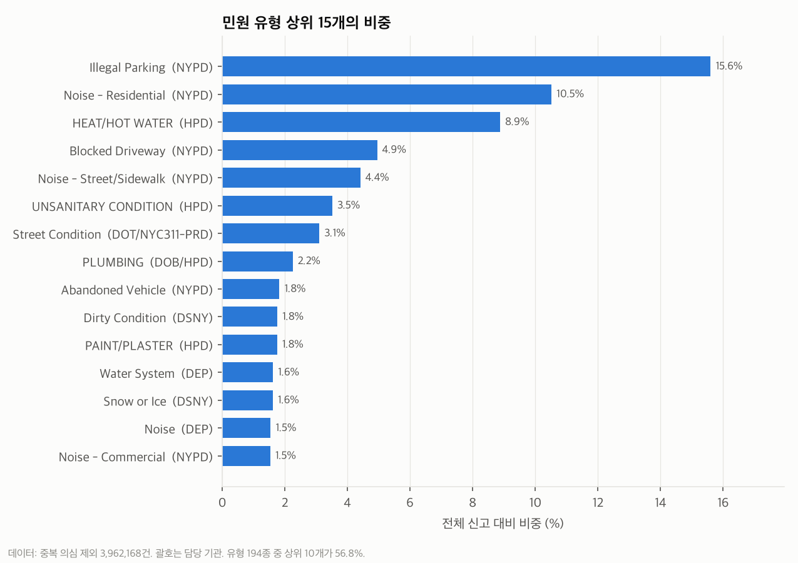

**그래프 설명:** 194개 민원 유형 중 신고가 많은 15개가 전체에서 차지하는 비중입니다. 괄호 안은 담당 기관입니다.

**읽는 법**
- **[사실]** 불법주차(15.6%), 주거 소음(10.5%), 난방·온수(8.9%)가 세 가지만으로 35%입니다.
- **[사실]** 상위 10개 유형이 56.8%, 상위 20개가 71.5%를 차지합니다. 유형이 200개 가까이 되지만 대부분의 신고는 소수 유형에 몰려 있습니다.
- 주의: 신고가 많다고 해서 그 문제가 더 심각하다는 뜻은 아닙니다. 신고하기 쉬운 문제, 자주 반복되는 문제일수록 건수가 많아집니다.

표: `tables/eda/01_problem_counts.csv`

### 1-3. 기관

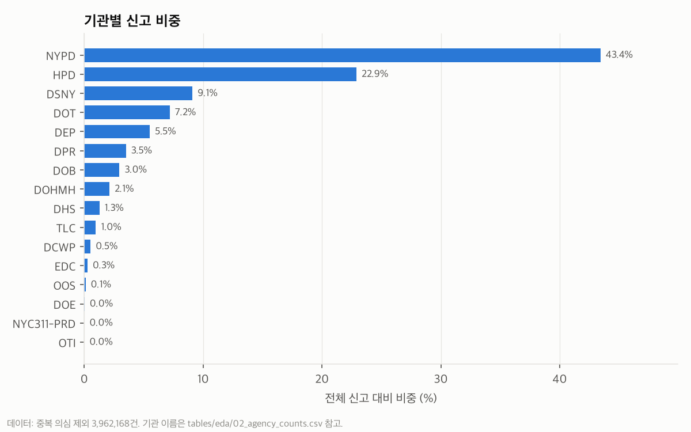

**그래프 설명:** 16개 기관이 각각 신고의 몇 %를 담당했는지 보여 줍니다.

**읽는 법**
- **[사실]** 경찰(NYPD)이 43.4%, 주택보존개발국(HPD)이 22.9%로, 두 기관이 3분의 2를 맡았습니다.
- 다른 집계를 볼 때도 이 두 기관의 특성이 전체 숫자를 좌우한다는 점을 기억해야 합니다(1-6절, 3단계 참고).

표: `tables/eda/02_agency_counts.csv` (기관 이름 포함)

### 1-4. 자치구

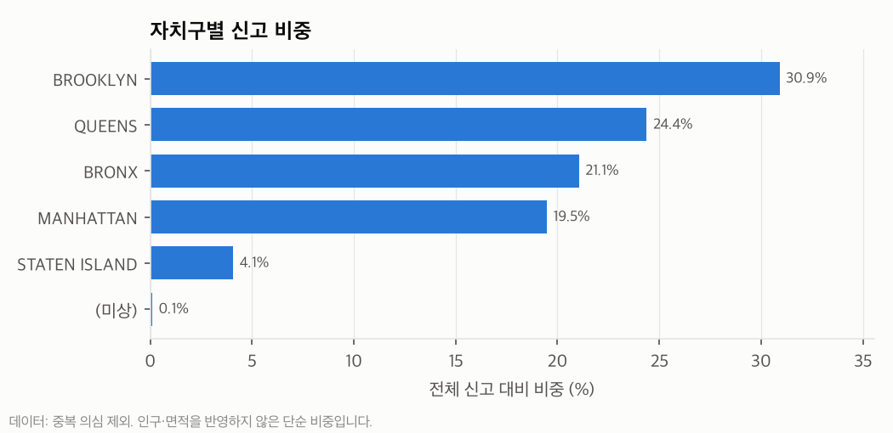

**그래프 설명:** 5개 자치구의 신고 비중입니다.

**읽는 법**
- **[사실]** 브루클린 30.9%, 퀸스 24.4%, 브롱크스 21.1%, 맨해튼 19.5%, 스태튼아일랜드 4.1%입니다.
- 주의: 인구와 면적을 반영하지 않은 단순 비중입니다. 브루클린이 가장 많은 것은 인구가 가장 많기 때문일 수 있습니다.
- **[추가 확인]** 인구 규모 차이를 보정하려면 인구 데이터가 필요합니다. 인구 대비 비율로 바꿔도 유동 인구(출퇴근·관광), 신고 성향, 주택·도로 규모의 차이는 그대로 남습니다.
- 주소는 신고자의 주소가 아니라 문제가 생긴 장소입니다.

### 1-5. 시간 분포

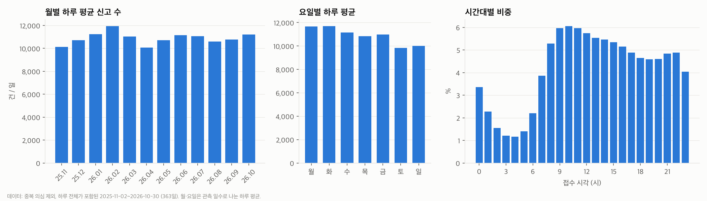

**그래프 설명:** 왼쪽부터 월별 하루 평균, 요일별 하루 평균, 시간대별 비중입니다.

**읽는 법**
- **[사실] 월별:** 하루 평균이 10,068건(4월)~11,946건(2월)으로, 달마다 차이가 크지 않습니다(최대/최소 약 1.2배).
- **[사실] 요일별:** 월·화요일이 가장 많고(약 11,700건), 주말은 평일보다 11.9% 적습니다.
- **[사실] 시간대별:** 오전 10시 전후가 가장 많고 새벽 4시가 가장 적습니다. 그런데 자정(0시)에 다시 3.4%로 솟아오릅니다.
  - **[가능한 설명]** 야간 소음 신고 때문으로 보입니다. 2-2절의 시간대 그래프에서 소음 민원의 0시 비중이 높게 나타납니다.
- 정리하면, 전체 합계는 평평하지만 **유형별로 나눠 보면 시기에 따라 크게 출렁입니다**(2단계).

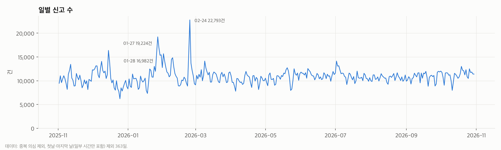

**그래프 설명:** 하루하루의 신고 수입니다. 일부 시간만 포함된 첫날과 마지막 날은 뺐습니다.

**읽는 법**
- **[사실]** 가장 많은 날은 2026-02-24(22,793건)로 평소의 약 2배입니다. 그다음은 01-27(19,224건), 01-28(16,982건)입니다.
- **[사실]** 2026-02-24 신고 중 11,370건이 '눈·얼음(Snow or Ice)' 유형이었습니다.
- **[가능한 설명]** 폭설 등 기상 사건과 관련 있을 가능성이 있습니다.
- **[추가 확인]** 기상 자료와 대조하지 않았으므로 원인을 확정할 수 없습니다.

### 1-6. 처리 상태와 처리 시간

**처리 상태 [사실]**

| 상태 | 건수 | 비중 |
|---|---:|---:|
| Closed | 3,784,173 | 95.5% |
| In Progress | 101,998 | 2.6% |
| Open | 56,397 | 1.4% |
| Assigned / Pending / Started | 19,423 | 0.5% |
| 미상 | 177 | 0.0% |

- 미종료(Closed가 아닌 건)는 177,995건으로 **4.5%**입니다.

**처리 시간 계산 조건**
- 처리 시간 = 종료 일시 − 접수 일시입니다.
- RESOLVED 3,729,839건만 썼습니다. 다음은 제외했습니다.
  - 미종료 177,995건
  - Closed인데 종료일이 없는 18건
  - 처리 시간이 0 이하인 54,316건
  - 상태와 종료일이 맞지 않는 건
- **미종료 건은 처리 시간을 알 수 없어서 빠집니다.** 그래서 오래 걸리는 건이 아직 끝나지 않았다면, 처리 시간이 실제보다 짧게 계산됩니다(3-4절).
- **미래 종료일 1건은 포함돼 있습니다.** 요청 번호 67996481(DOT 신호등, 2026-02-14 접수, 종료일 2026-12-14, 처리 시간 7,274시간)은 종료일이 데이터 파일 날짜보다 늦어 `flag_future_date`로 표시돼 있지만, RESOLVED의 제외 조건이 아니어서 들어 있습니다. 빼도 중앙값은 8.63시간으로 같고, 평균은 161.167시간에서 161.165시간으로 바뀌는 정도라 결과에는 영향이 없습니다. 제외 기준은 바꾸지 않았습니다.

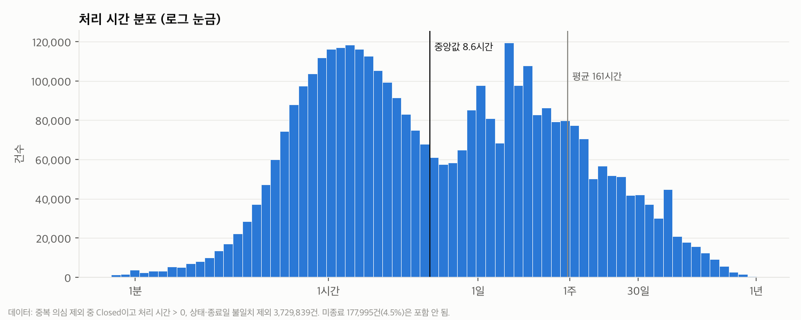

**그래프 설명:** 처리 시간의 분포입니다. 가로축은 로그 눈금이라 1분, 1시간, 1일, 1주, 30일이 비슷한 간격으로 보입니다.

**읽는 법**
- **[사실]** 중앙값은 8.6시간인데 평균은 161시간입니다. 소수의 아주 긴 건이 평균을 끌어올립니다. 상위 1%(2,527시간, 약 105일 이상)의 처리 시간을 모두 더하면 전체 처리 시간 합계의 22.9%이고, 상위 10%는 76.6%입니다.
  - 그래서 처리 시간은 **평균 대신 중앙값과 분위수**로 봐야 합니다.
- **[사실]** 봉우리가 두 개입니다. 하나는 **약 1.5시간**(1.3~1.6시간 구간), 다른 하나는 **약 2일**(41~51시간 구간)입니다.
  - **[가능한 설명]** 성격이 다른 두 집단이 섞여 있기 때문입니다. 3-3절에서 보듯 NYPD 민원은 중앙값이 1.4시간이고, 나머지 기관은 대부분 하루 이상입니다.
- 이렇게 봉우리가 여러 개인 분포는 **"전체 평균 하나로 요약하면 안 된다"는 신호**입니다.

---

## 2단계. 차이 살펴보기

### 2-1. 자치구마다 많이 신고되는 민원이 다를까?

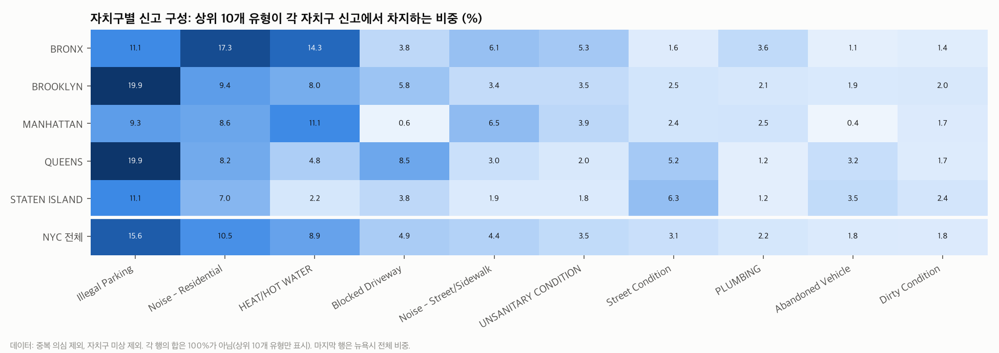

**그래프 설명:** 각 칸은 "그 자치구 신고 중 해당 유형의 비중(%)"입니다. 맨 아래 줄은 뉴욕시 전체 비중입니다.
- 단순 건수 대신 비중을 쓴 이유: 신고가 많은 자치구가 모든 칸에서 크게 나오는 것을 피하고 **구성**을 비교하기 위해서입니다.

**읽는 법: 맨 아래 줄(뉴욕시 전체)과 색이 크게 다른 칸을 찾으면 됩니다.**
- **[사실]** 브롱크스는 주거 소음(17.3%)과 난방·온수(14.3%)가 시 전체(10.5%, 8.9%)보다 뚜렷이 높습니다.
- **[사실]** 브루클린과 퀸스는 불법주차가 19.9%로 높고, 퀸스는 차고 앞 주차(8.5%)도 높습니다.
- **[사실]** 맨해튼은 난방·온수가 1위(11.1%)이고, 차고 앞 주차는 0.6%로 거의 없습니다.
- **[사실]** 스태튼아일랜드는 눈·얼음(9.4%)이 2위입니다.
- **[가능한 설명]** 지역마다 주거 형태(아파트 비중), 차량 보유, 도로 환경이 달라서일 수 있습니다.
- **[추가 확인]** 주거 형태, 차량 보유 같은 외부 자료로 확인해야 합니다.
- 주의: 브롱크스의 주거 소음 비중은 한 주소의 영향을 크게 받습니다(3-1절).

표: `tables/eda/09_borough_problem_share.csv`, `10_borough_top3.csv`

### 2-2. 주요 민원은 시기별로 어떻게 달라질까?

#### 월별

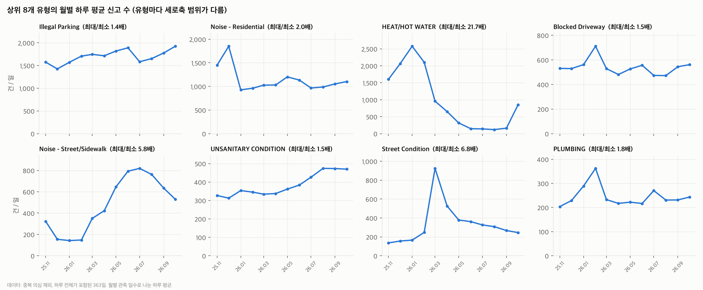

**그래프 설명:** 상위 8개 유형의 월별 하루 평균 신고 수입니다. 유형마다 신고 수의 규모가 달라서 세로축 범위를 각각 다르게 했습니다. 모양(오르내림)을 비교하는 그래프이고, 높이를 서로 비교하면 안 됩니다. 제목 옆 숫자는 가장 많은 달 ÷ 가장 적은 달입니다.

**읽는 법**
- **[사실]** 난방·온수는 1월(하루 2,576건)과 8월(119건)의 차이가 **21.7배**입니다. 가장 뚜렷한 계절 패턴입니다.
- **[사실]** 거리 소음은 6~7월에 많고 겨울에 적습니다(5.8배).
- **[사실]** 도로 상태(Street Condition)는 3월에 갑자기 늘었습니다(6.8배).
  - **[가능한 설명]** 겨울이 지난 뒤 도로 파손(포트홀 등)이 드러나는 시기일 수 있습니다.
  - **[추가 확인]** 세부 유형으로 확인해야 합니다.
- **[사실]** 불법주차, 차고 앞 주차, 비위생 상태는 1년 내내 비교적 고릅니다(1.4~1.5배).
- **주의:** 주거 소음의 11~12월 급증은 3-1절에서 보듯 **한 주소 때문**입니다. 이 주소를 빼면 하루 약 950건으로 평소 수준입니다. 이 주소는 2026년 1~4월에도 주거 소음 하루 평균을 23~51건 높였습니다(`tables/eda/22_noise_residential_month_focus.csv`).
- **[추가 확인]** 1년치 데이터라서 이런 패턴이 매년 반복되는 계절성인지 이번 해만의 일인지는 구분할 수 없습니다.

#### 시간대별

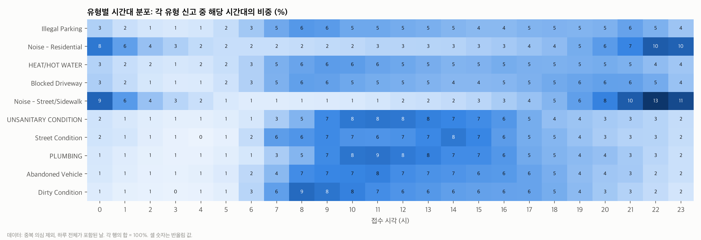

**그래프 설명:** 각 줄은 한 유형의 신고를 100%로 놓고 시간대별로 나눈 것입니다. 색이 진할수록 그 시간대에 몰려 있다는 뜻입니다.

**읽는 법: 두 가지 리듬이 보입니다.**
- **[사실] 밤형:** 주거 소음과 거리 소음은 밤 10시~새벽 3시에 각각 40.7%, 46.2%가 몰려 있습니다.
- **[사실] 낮형:** 비위생 상태, 배관, 도로 상태 등 건물·시설 민원은 같은 시간대 비중이 6~10%에 그치고, 오전 9시~오후 3시에 몰립니다.
- **[가능한 설명]** 소음은 생기는 그 순간에 신고하고, 시설 문제는 낮에 알아차리거나 업무 시간에 신고하는 것일 수 있습니다.

#### 요일별

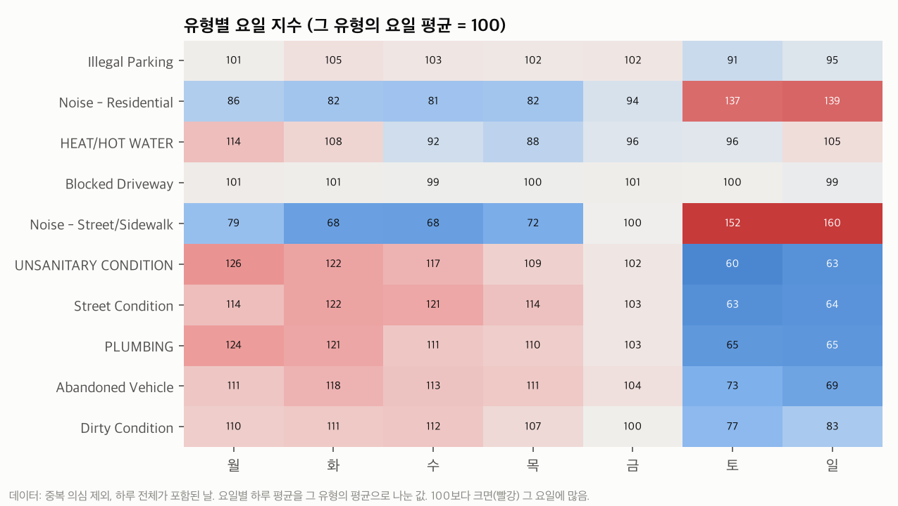

**그래프 설명:** 유형마다 요일별 하루 평균을 그 유형의 평균으로 나눈 지수입니다(평균 = 100). 빨간색은 평균보다 많은 요일, 파란색은 적은 요일입니다.

**읽는 법**
- **[사실]** 거리 소음은 토·일요일이 152~160으로 평일의 약 2배입니다. 주거 소음도 주말에 137~139입니다.
- **[사실]** 반대로 비위생 상태, 도로, 배관은 주말에 60~65로 줄어듭니다.
- **[사실]** 불법주차와 차고 앞 주차는 요일 차이가 거의 없습니다(91~105).
- 1-5절에서 본 "주말이 12% 적다"는 전체 결과는, **주말에 늘어나는 유형과 줄어드는 유형이 섞인 결과**입니다.

---

## 3단계. 결론을 바꿀 수 있는 특징 확인

1~2단계에서 결론에 영향을 줄 수 있는 요인 네 가지를 발견했습니다. 각각 **왜 확인이 필요한지** 밝히고 필요한 범위에서만 비교했습니다.

### 3-1. 한 주소에 몰린 신고

**왜 확인했나요?** 2-1절에서 브롱크스의 주거 소음이 눈에 띄었고, 2-2절에서 주거 소음이 11~12월에만 급증했습니다. 둘 다 같은 주소 하나 때문일 수 있어서 확인했습니다.

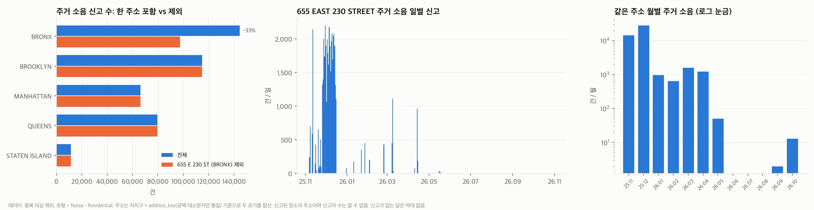

**대상 주소:** 자치구 `BRONX` + `address_key` `655 EAST 230 STREET`. 원문 표기는 두 가지이고, 둘 다 같은 BBL(2048330028)입니다(`tables/eda/29_focus_address_spellings.csv`).

| 원문 표기 | 전체 민원 | 주거 소음 | 신고 기간(전체 민원) | 신고가 있었던 날 |
|---|---:|---:|---|---:|
| `655 EAST  230 STREET` (공백 두 칸) | 42,572 | 42,517 | 2025-11-07 ~ 2026-10-28 | 66 |
| `655 EAST 230 STREET` (공백 한 칸) | 4,533 | 4,496 | 2026-01-11 ~ 2026-10-31 | 69 |
| 합계 | **47,105** | **47,013** | | |

- 이전 보고서는 공백 두 칸 표기만 대상으로 해서 4,496건(주거 소음)이 빠져 있었습니다.
- 표기는 시기에 따라 바뀝니다. NYPD 신고 주소의 연속 공백 비율이 2025-12월 33.7%에서 2026-02월 이후 0%로 떨어졌습니다(이번 검증에서 확인, 원인은 미확인).

**그래프 설명:** 왼쪽은 자치구별 주거 소음 신고 수를 이 주소를 포함했을 때(파랑)와 제외했을 때(주황)로 비교한 것입니다. 가운데는 이 주소의 일별 주거 소음 신고 수, 오른쪽은 월별 신고 수(로그 눈금)입니다.

**[사실] 주거 소음 기준** (BASE, 유형 = Noise - Residential)
- 이 주소의 주거 소음 신고는 **47,013건**입니다. 뉴욕시 전체 주거 소음의 **11.3%**입니다.
- 첫 신고는 2025-11-07, 마지막 신고는 2026-10-31입니다(359일 범위). 그중 신고가 있었던 날은 **75일**이고, 하루 최대 2,195건입니다.
- **월별** (`tables/eda/30_focus_address_monthly.csv`): 2025-11월 14,361건, 12월 28,156건으로 두 달에 90%가 몰려 있습니다. 2026-01~04월에도 월 641~1,591건이 있고, 5월 50건 이후로는 거의 없습니다(6~8월 0건, 9월 2건, 10월 13건).
- **접수 경로** (`31_focus_address_channel.csv`): 모바일이 46,992건(99.96%)입니다. 뉴욕시 전체 신고에서 모바일은 약 21%입니다.
- **처리 결과** (`32_focus_address_resolution.csv`): 가장 많은 문구는 "경찰이 출동했으나 위반 증거를 확인하지 못함" 유형으로 27,568건(58.6%)입니다. "범죄 위반이 없다고 판단" 유형이 10,142건(21.6%)입니다.
- 일반적인 주거 소음은 40.7%가 밤(22~3시)에 몰리는데, 이 주소는 23.6%로 시간 패턴이 다릅니다.

**포함·제외 비교** (`15_noise_residential_focus_address.csv`, `22_noise_residential_month_focus.csv`)
- 이 주소를 빼면 브롱크스 주거 소음이 **32.5% 줄고**(144,495 → 97,482건), 자치구 순위가 1위에서 **2위**(브루클린 114,818건 다음)로 바뀝니다.
- 주거 소음의 11~12월 하루 평균이 1,450~1,851건에서 **약 943~955건**으로 내려가 다른 달과 비슷해집니다. 2026년 1~4월은 하루 23~51건 줄어듭니다.

**상위 주소 순위와 비중** (자치구 + `address_key` 기준, `14_top_addresses.csv`, `28_top_address_share.csv`)
- 이전에는 같은 주소가 두 표기로 나뉘어 1위(42,572건)와 9위(4,533건)에 따로 올라 있었습니다. 합치면 1위 한 번(47,105건)이 되고, 10위에 `82-68 164 STREET`(퀸스, 4,221건)가 새로 들어옵니다.

| 지표 | 분자 | 분모 | 비중 |
|---|---:|---|---:|
| 이 주소 단독 | 47,105 | BASE 전체 3,962,168 | 1.19% |
| 상위 10개 주소 (이 주소 포함) | 102,970 | BASE 전체 3,962,168 | 2.60% |
| 상위 10개 주소 (이 주소 제외, 11위까지 올려 채움) | 59,801 | BASE 전체 3,962,168 | 1.51% |
| 위와 같음 | 59,801 | BASE에서 이 주소를 뺀 3,915,063 | 1.53% |

- 이전 보고서의 "이 주소를 제외하면 상위 10개 주소는 전체 신고의 2.5%"는 실제로는 이 주소를 **포함**한 값(원문 표기 기준 2.49%)이었습니다. 위 표로 바로잡았습니다.

**[가능한 설명]** 소수의 신고자가 같은 모바일 경로로 반복해서 대량 신고했거나, 자동화된 신고일 수 있습니다.

**[추가 확인]** 데이터에 신고자 정보가 없으므로 위 설명은 확인할 수 없습니다. "이 주소에 신고가 집중됐다"까지만 말할 수 있습니다.

표: `tables/eda/14_top_addresses.csv`, `15_noise_residential_focus_address.csv`, `16_focus_address_daily.csv`, `22_noise_residential_month_focus.csv`, `28_top_address_share.csv`, `29_focus_address_spellings.csv`, `30_focus_address_monthly.csv`, `31_focus_address_channel.csv`, `32_focus_address_resolution.csv`

### 3-2. 반복 신고: 신고 수와 동일 조건 신고 그룹 수

**왜 확인했나요?** 같은 날 같은 곳에서 같은 문제가 여러 번 신고되면 신고 수가 커집니다. 이 반복 정도가 유형마다 다르면 유형 간 비교가 달라질 수 있습니다.

**동일 조건 신고 그룹**은 같은 접수일·같은 자치구·같은 `address_key`·같은 유형·같은 세부유형의 신고를 하나로 묶은 것입니다(데이터 컬럼 `incident_group_id`). 실제 사건 수가 아닙니다.
- 이전 기준은 자치구를 보지 않고 원문 주소 문자열로 묶었습니다. 그래서 다른 자치구의 같은 거리 이름(예: `BROADWAY`)이 한 그룹에 섞인 경우가 988개 있었고, 이번에 0개가 됐습니다.
- 주소 또는 자치구가 없는 146,888건(BASE)은 각각 그룹 1개로 셉니다.
- 같은 문제가 이틀 이상 이어지면 날마다 다른 그룹이 됩니다. 주소·자치구가 있는 그룹 전체 중 8.6%는 바로 전날에도 같은 조건의 그룹이 있습니다(`tables/eda/27_duplicate_and_group_evidence.csv`).
- 호수(세대) 정보가 없어 같은 건물의 서로 다른 문제가 한 그룹으로 묶일 수 있습니다.

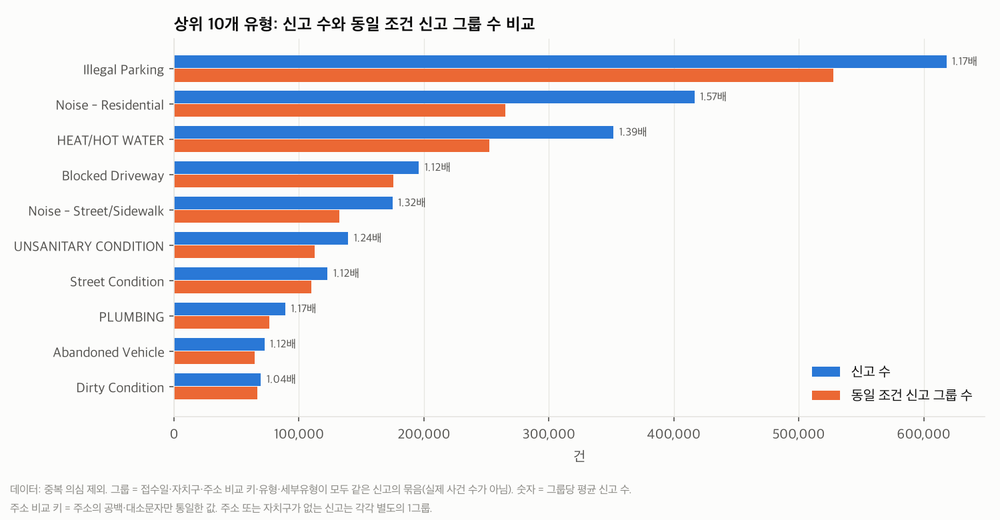

**그래프 설명:** 상위 10개 유형의 신고 수(파랑)와 동일 조건 신고 그룹 수(주황)입니다. 숫자는 그룹당 평균 신고 수입니다.

**[사실]**
- 그룹당 평균 신고 수가 주거 소음은 **1.57**, 난방·온수는 1.39, 거리 소음은 1.32입니다. 불법주차(1.17)와 거리 오염(Dirty Condition, DSNY, 1.04)은 낮습니다. 주택 내부의 비위생 상태(UNSANITARY CONDITION, HPD)는 1.24로 중간입니다.
- 주거 소음은 신고 수로는 불법주차의 67%인데, 신고 그룹 수로는 50%로 줄어듭니다.
- 다만 상위 10개의 순위는 9·10위가 서로 바뀌는 것 말고는 그대로입니다.

**해석:** 순위는 크게 바뀌지 않지만 **유형 사이의 격차는 기준에 따라 달라집니다.** 소음이나 난방처럼 한 건물·한 장소의 여러 사람이 겪는 문제일수록 반복 신고가 많은 것으로 보입니다 **[가능한 설명]**.

**주의:** 신고 그룹 수는 묶음 기준에 따라 달라지는 근사 지표입니다. 실제로 몇 건의 문제가 있었는지는 이 데이터로 확인할 수 없습니다.

표: `tables/eda/17_requests_vs_groups.csv`

### 3-3. 기관별 처리 시간과 민원 종류의 차이

**왜 확인했나요?** 1-6절의 두 봉우리 분포가 기관 차이 때문인지 확인하고 싶었습니다. 다만 기관마다 맡는 민원 종류와 "종료"의 의미가 달라서, 단순 비교가 어디까지 가능한지도 따져야 했습니다.

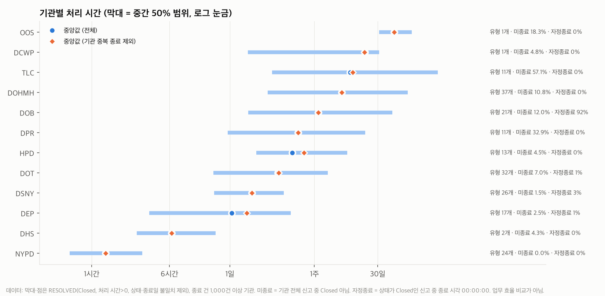

**그래프 설명:**
- 막대는 처리 시간의 중간 50% 범위(25%~75% 분위)입니다.
- 파란 점은 중앙값, 주황 마름모는 "기관이 중복 신고로 판정해 종료한 건"을 뺀 중앙값입니다.
- 오른쪽 글은 각 기관이 맡는 유형 수, 미종료 비율, 자정 종료 비율입니다.
  - 미종료 비율 = 그 기관의 BASE 신고 중 상태가 Closed가 아닌 비율
  - 자정 종료 비율 = 그 기관의 BASE 신고 중 상태가 Closed인 건을 분모로, 종료 시각이 00:00:00인 건을 분자로 한 비율
- 종료 건이 1,000건 이상인 기관만 표시했습니다.

**[사실]**
- 중앙값이 NYPD 1.4시간부터 OOS 1,054시간까지 약 750배 차이가 납니다.
- **같은 기관 안에서도 유형에 따라 크게 다릅니다.**
  - HPD: 난방·온수 43시간, 문·창문 317시간
  - DOT: 신호등 3시간, 가로등 239시간
- **같은 유형도 기관에 따라 다릅니다.**
  - 노숙인 거처(Encampment): NYPD 1.1시간, DHS 9.7시간
  - 그래피티(Graffiti): NYPD 1.6시간, DSNY 234시간
- **중복 판정 종료를 빼면 중앙값이 달라집니다.** HPD 101→132시간, DEP 25→36시간. 이 두 기관은 "이미 접수된 건"이라며 빠르게 닫는 경우가 13~20%이기 때문입니다.
- **DOB의 종료 시각은 대부분 정확히 00:00:00입니다.**
  - **[사실]** 상태가 Closed인 DOB 신고 103,536건 중 95,055건(91.8%)이 자정 종료입니다. 나머지 8,481건은 모두 처리 시간이 0 이하라 RESOLVED에서 빠집니다.
  - **[사실]** 그래서 처리 시간 계산에 쓰인 DOB RESOLVED 95,055건은 100%가 자정 종료입니다. 처리 갱신 시각도 모두 자정이고 종료 시각과 같습니다. 반면 접수 시각이 자정인 경우는 없습니다.
  - **[가능한 설명]** 종료가 시각 없이 날짜만 입력되는 방식일 수 있습니다.
  - **[추가 확인]** 실제 기록 방식은 확인하지 못했습니다. 그 날짜가 실제 종료일인지, 처리일이나 일괄 입력일인지 알 수 없으므로 오차의 크기도 정할 수 없습니다. DOB의 처리 시간(중앙값 183시간)은 시간 단위로 다른 기관과 비교하지 말고 대략적인 일 단위로만 읽는 게 안전합니다.
- **미종료 비율이 높은 기관이 있습니다.** TLC 57%, DPR 33%. 끝난 건만 보면 이 기관들의 처리 시간은 짧게 계산됐을 가능성이 있습니다. EDC는 100% 미종료라 계산할 수 없습니다.

**해석:** 기관 사이의 처리 시간 차이는 **업무 효율 차이가 아닙니다.** 다음 요인이 섞여 있기 때문입니다.
- 맡는 민원의 성격: 현장 확인 vs 수리 공사
- "종료"의 의미: 출동 완료, 중복 판정, 수리 완료 등
- 기록 방식: 날짜만 기록하는지, 시각까지 기록하는지

**유형을 맞춘 기관 비교가 가능한 범위** (`tables/eda/26_problem_agency_coverage.csv`, RESOLVED 기준)

| 유형 구분 | 유형 수 | RESOLVED 비중 |
|---|---:|---:|
| 한 기관만 처리한 유형 | 175 | 91.5% |
| 둘 이상 기관이 처리했지만, 100건 이상인 기관이 둘 미만 | 4 | 1.1% |
| 둘 이상 기관이 각각 100건 이상 처리 | 7 | 7.5% |

- **[사실]** 이 데이터에서 RESOLVED의 91.5%는 한 기관만 처리한 유형입니다. 이런 유형은 같은 유형 안에서 기관을 비교할 대상이 없습니다.
- 1.1%는 여러 기관이 처리했지만, 이 보고서에서 정한 표본 기준(기관별 100건)에 못 미쳐 비교에서 뺀 것입니다. 기준을 바꾸면 비교 범위가 달라집니다.
- 따라서 기관별 처리 시간 차이는 "기관마다 접수부터 종료 기록까지 걸린 시간이 다르다"는 사실까지만 말할 수 있습니다. 유형을 맞춘 비교는 7.5% 범위에서만 가능하고, 이때도 기관마다 종료의 의미가 다를 수 있습니다.

표: `tables/eda/18_agency_resolution.csv`, `19_agency_problem_resolution.csv`, `20_shared_problem_resolution.csv`, `26_problem_agency_coverage.csv`

### 3-4. 기간별 처리 시간: 아직 안 끝난 건과 민원 구성의 영향

**왜 확인했나요?** "최근 처리가 빨라졌다/느려졌다" 같은 기간 비교는 두 가지 함정에 빠지기 쉬워서 확인했습니다.
1. 최근 접수분은 아직 안 끝난 건이 많습니다.
2. 달마다 민원 구성이 다릅니다.

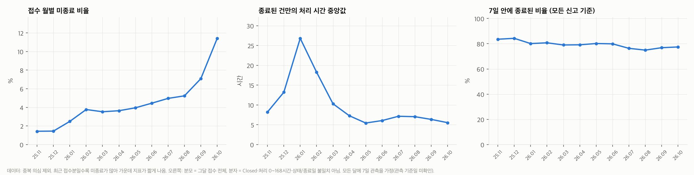

**그래프 설명:** 접수 월별로 왼쪽은 미종료 비율, 가운데는 종료된 건만으로 계산한 처리 시간 중앙값, 오른쪽은 7일 안 종료율입니다.

**7일 안 종료율의 정의** (`tables/eda/21_month_censoring.csv`)
- 분모: 그달에 접수된 BASE 신고 전체(미종료 포함)
- 분자: 상태가 Closed이고, 처리 시간이 0시간 이상 168시간 이하이며, 상태·종료일 불일치가 아닌 건
- 처리 시간이 0인 건은 분자에 들어갑니다(예: 10월 1,544건).
- 처리 시간이 음수인 건은 분모에만 들어갑니다(10월 311건).
- 종료일이 7일 안이지만 현재 상태가 Closed가 아닌 건은 분자에서 빠집니다. 이런 건은 최근 달일수록 많습니다(2025-11월 216건 → 2026-10월 4,214건). 상태와 관계없이 종료일만 보면 10월 값은 77.5%에서 78.7%로 바뀝니다.

**관측 기준일에 대한 가정과 한계**
- **[사실]** 데이터 안에 추출 시각이나 상태 관측 시각은 기록돼 있지 않습니다. 원본 파일 이름의 날짜는 2026-11-12입니다.
- **[사실]** 데이터에 있는 가장 늦은 종료일은 2026-11-11 03:25, 가장 늦은 처리 갱신일은 2026-11-11 12:00입니다(2026-12-14로 기록된 1건 제외). 가장 늦게 접수된 신고(2026-10-31 21:09)부터 이 시점까지는 약 10.6일, 파일 날짜 0시까지는 약 11.1일입니다.
- **[가정]** 7일 안 종료율은 모든 신고의 상태가 접수 후 최소 7일 이상 지난 시점까지 반영됐다는 가정에 기대고 있습니다. 마지막 갱신 기록은 이 가정과 어긋나지 않지만, 모든 요청의 상태가 그 시점까지 반영됐다는 증거는 아닙니다.
- **[추가 확인]** 일부 기관의 갱신이 더 일찍 멈췄거나, 종료가 늦게 입력되는 경우가 있다면 최근 달의 7일 안 종료율은 낮게 잡힐 수 있습니다. 실제 관측 기준일은 데이터 제공처의 정보로 확인해야 합니다.

**[사실]**
- 미종료 비율은 2025-11월 접수분 1.4%에서 2026-10월 접수분 11.4%로 늘어납니다. 최근 접수분일수록 아직 처리 중인 건이 많기 때문입니다.
- 종료된 건만의 중앙값은 1월에 26.8시간으로 가장 높고, 5월 이후에는 5~7시간입니다.
- 그런데 같은 기간 **NYPD 중앙값은 매달 1.2~1.5시간으로 거의 같습니다.** 1월에는 처리 시간이 긴 HPD 민원 비중이 37%로 가장 높았고(6월 14%), NYPD 비중은 34%로 가장 낮았습니다(5월 49%).
- **HPD 안에서는 반대로** 여름(7~8월)의 중앙값이 263~297시간으로 겨울(1월 73시간)보다 깁니다. 여름에는 비교적 빨리 끝나는 난방 민원이 줄고(HPD 신고 중 난방 비중: 1월 62% → 8월 7%), 오래 걸리는 수리 민원 비중이 커지기 때문입니다.
- 7일 안 종료율은 75~84%입니다. 위 가정이 맞다면 월별로 큰 변화가 없다고 볼 수 있습니다.

**유형 구성을 고정한 비교** (방법: `reports/eda_mix_standardization.md`, 표: `tables/eda/24_month_mix_standardized.csv`)

월마다 민원 유형 구성이 달라서 중앙값이 바뀌는지 확인하려고, 각 달의 유형 구성을 연간 구성으로 맞춘 가중 중앙값을 계산했습니다. **종료된 요청(RESOLVED)만 대상**입니다.

| 지표 | 월별 최소~최대 | 최대/최소 |
|---|---|---:|
| 실제 중앙값 | 5.44~26.82시간 | 4.93배 |
| 유형 구성을 연간으로 고정한 중앙값 | 7.70~9.48시간 | 1.23배 |
| 유형별 분포는 연간으로 두고 구성만 그달 것으로 바꾼 중앙값 | 5.30~23.15시간 | 4.37배 |

- **[사실]** 유형 구성을 고정하면 월별 중앙값의 차이가 4.93배에서 1.23배로 줄어듭니다. 24시간 안 종료 비율의 월별 표준편차도 4.79%p에서 0.98%p로 줄어듭니다.
- **[사실]** 같은 유형 안에서도 월별 차이가 남는 유형이 있습니다. 상위 8개 유형의 월별 중앙값 최대/최소는 도로 상태 4.2배, 비위생 상태 2.7배, 배관 2.0배, 난방·온수 1.8배이고, 불법주차·차고 앞 주차는 1.2배입니다(`tables/eda/25_problem_month_resolution_median.csv`).
- **해석:** 관찰된 월별 차이의 대부분은 유형 구성 차이와 함께 움직입니다. 이것은 "구성을 맞추면 차이가 줄어든다"는 관찰이고, 처리 속도가 실제로 변하지 않았다는 증명은 아닙니다. 종료된 요청만 보았기 때문에, 최근 달처럼 미종료가 많은 달은 오래 걸리는 건이 빠져 짧게 나올 수 있습니다. 이렇게 "전체로 보면 A인데 나눠 보면 다른" 현상은 EDA에서 자주 만나는 함정입니다(심슨의 역설과 비슷합니다).

**[추가 확인]** 최근 몇 달의 처리 시간은 미종료 건이 많아 짧게 보일 수 있습니다. 기간별 처리 시간을 비교하려면 "N일 안 종료율"처럼 모든 달에 같은 관찰 기간을 두는 지표(관측 기준일 확인 필요)를 쓰거나, 미종료를 고려하는 생존분석이 필요합니다.

표: `tables/eda/21_month_censoring.csv`, `23_month_mix_resolution.csv`, `24_month_mix_standardized.csv`, `25_problem_month_resolution_median.csv`

---

## 4. 요약

### 4-1. 중요한 특징 세 가지

**1. 신고는 소수 유형·기관·장소에 몰려 있고, 한 장소가 결론을 바꿀 수 있습니다.**
- 상위 10개 유형이 57%이고, NYPD와 HPD가 66%를 맡습니다.
- 주소 하나(브롱크스 `655 EAST 230 STREET`, 두 표기 합산)가 뉴욕시 주거 소음의 11.3%를 차지합니다. 신고의 99.96%가 모바일 경로였습니다.
- 이 주소 하나 때문에 "브롱크스가 주거 소음 1위"이고 "11~12월에 주거 소음이 급증"한 것처럼 보였습니다. 빼면 둘 다 사라집니다.

**2. 전체 합계는 평평하지만, 유형별로는 뚜렷한 시간 리듬이 있습니다.**
- 월별 전체 신고는 하루 1.0만~1.2만 건으로 고릅니다.
- 하지만 유형별로 나누면 크게 다릅니다.
  - 난방·온수: 겨울과 여름의 차이가 22배
  - 소음: 밤과 주말에 집중
  - 시설 민원: 평일 낮에 집중
- 서로 다른 리듬이 섞여 있어서 전체로 합치면 평평하게 보이는 것입니다.

**3. 처리 시간은 "누가, 무엇을, 어떻게 종료했는가"의 섞임으로 결정됩니다.**
- 분포에 봉우리가 두 개입니다(약 1.5시간 / 약 2일).
- 기관 사이에 중앙값이 최대 750배 차이 납니다. 하지만 RESOLVED의 91.5%는 한 기관만 처리한 유형이라, 이 차이는 기관 차이와 유형 차이가 섞인 값입니다.
- 같은 기관 안에서도 유형에 따라 7배 이상 다르고, 중복 판정 종료나 자정 기록 같은 기록 방식의 영향도 큽니다.
- 종료된 요청만 보면, 월별 유형 구성을 고정할 때 월별 중앙값의 차이가 4.93배에서 1.23배로 줄어듭니다. 다만 도로 상태처럼 같은 유형 안에서도 월별 차이가 남는 유형이 있습니다.

### 4-2. 해석할 때 주의할 점

1. **신고 수 ≠ 실제 문제 수 ≠ 심각도.** 반복 신고(동일 조건 신고 그룹당 1.04~1.57건)와 집중 주소 때문에 신고 수가 커질 수 있습니다. 신고 그룹 수도 실제 사건 수는 아닙니다. 신고가 많다고 그 문제가 더 심각하다는 뜻도 아닙니다.
2. **처리 시간 차이 ≠ 업무 효율 차이.** 민원 종류, 종료 의미, 기록 방식이 다릅니다. 대부분의 유형은 한 기관만 처리해 유형을 맞춘 기관 비교가 어렵습니다. 평균 대신 중앙값을 쓰고, 미종료 비율을 함께 보고하세요.
3. **기간 비교의 함정.**
   - 최근 접수분은 미종료가 많아 처리 시간이 짧게 보입니다(10월 미종료 11.4%).
   - 상태 관측 기준일이 데이터에 없습니다. 7일 안 종료율은 모든 요청에 7일 이상 관측 기간이 있었다는 가정에 기댑니다.
   - 첫날과 마지막 날은 일부 시간만 있습니다.
   - 1년치라 계절성인지 이번 해만의 일인지 구분할 수 없습니다.
4. **원인은 데이터에 없습니다.** "폭설 때문", "한 사람의 대량 신고" 같은 원인은 외부 자료로 확인하기 전까지 가능성으로만 표현하세요.
5. **자치구 비교는 인구 미반영.** 건수 비교는 인구 차이를 그대로 반영합니다. 인구 대비로 바꿔도 인구 규모 차이만 보정되고, 유동 인구·신고 성향·주택과 도로 규모의 차이는 남습니다. 주소는 문제가 생긴 장소이지 신고자가 사는 곳이 아닙니다.

### 4-3. 다음에 더 깊게 분석하면 좋을 질문

**질문 1. 같은 민원 유형 안에서 처리 시간이 지역과 시기에 따라 다른가?**
(예: 난방·온수, 주거 소음, 도로 상태를 자치구·월별로 비교하고, 지표는 7일 안 종료율 사용)
- 추천 이유: 종료된 요청만 보면 월별 처리 시간 차이의 대부분이 **유형 구성 차이**와 함께 움직였습니다. 같은 유형 안에서 비교하면 이 영향을 줄일 수 있고, 도로 상태처럼 같은 유형 안에서도 남는 차이를 따로 볼 수 있습니다. 7일 안 종료율은 미종료 문제를 줄여 주지만, 실제 관측 기준일을 먼저 확인해야 합니다.

**질문 2. 신고가 몰리는 주소에는 어떤 특징이 있고, 신고 수 지표를 얼마나 왜곡하는가?**
(예: 주소·유형별로 하루 신고가 비정상적으로 많은 경우를 정의하고, 유형·지역별 결과가 바뀌는 정도를 측정)
- 추천 이유: 주소 하나가 자치구 순위와 월별 추세를 뒤집었습니다. 다른 유형·지역에도 비슷한 경우가 있는지 체계적으로 확인하지 않으면, 모든 건수 분석에 같은 위험이 남습니다.

**질문 3. 인구를 반영하면 자치구·커뮤니티 보드별 민원 구성 차이가 어떻게 보이는가?**
(인구 데이터를 `data/external/`에 추가해야 함)
- 추천 이유: 지금의 자치구 비교는 인구 규모 차이를 반영하지 않습니다. 인구 대비 비율로 바꾸면 인구 규모 차이를 보정한 비교가 됩니다. 다만 유동 인구, 신고 성향, 주택·도로 규모의 차이는 남으므로 결과를 "지역별 실제 문제의 양"으로 읽으면 안 됩니다.

---

## 5. 전처리 기준 변경 제안

EDA를 하면서 발견한, 다음 단계에 도움이 될 수 있는 변경입니다. 4번 일부를 제외하면 적용하지 않았습니다.

1. **신고 집중 플래그 추가:** 같은 주소·유형에서 하루 신고 수가 기준(예: 50건) 이상이면 표시합니다. 그러면 3-1절 같은 포함·제외 비교를 매번 쉽게 할 수 있습니다. 기준값은 분포를 보고 정해야 합니다.
2. **DOB 처리 시간 단위:** DOB는 상태가 Closed인 건의 91.8%(처리 시간 계산 대상 중에서는 100%)가 자정 종료로 기록돼 있습니다. 실제 기록 방식은 확인하지 못했지만, 시간 단위 비교에서 DOB를 구분하는 표시를 검토할 만합니다.
3. **`missing_markers` 범위 조정:** 지금은 99.96%의 행에 값이 있습니다. 거의 모든 행이 `park_facility_name`의 `Unspecified` 때문에 채워졌습니다. 보조 테이블로 옮긴 컬럼은 이 표시에서 빼면 쓸모가 커집니다.
4. **신고 그룹 묶음 기준 보완 (일부 적용):** 자치구와 `address_key`를 기준에 넣는 부분은 3차 수정에서 적용했습니다. 남은 검토: 지금은 "같은 날" 기준입니다. 자정을 넘기거나 며칠 이어지는 문제를 위해 "같은 주소·유형, N시간 이내"로 묶는 방식을 함께 검토할 수 있습니다.
5. **철자만 다른 유형 이름 통합:** `Building Marshal's Office`(20건)와 `Building Marshals office`(1건)처럼 대소문자가 아닌 문장부호까지 다른 이름이 있습니다. 지금 전처리는 대소문자 차이만 합칩니다. 영향은 작지만 유형 수(194개)를 셀 때 1개가 더 잡힙니다.
6. **중복 의심 플래그 이름:** 컬럼 `flag_system_duplicate`는 시스템 오류라는 근거 없이 붙은 이름입니다. 문서에서는 "중복 의심"으로 부르고 있으며, 다음 전처리 버전에서 컬럼 이름 변경을 검토할 수 있습니다(지금은 유지).
7. **주소 약어 차이 (미적용, 판단 필요):** `5 AVE`/`5 AVENUE`, `34-16 ASTORIA BLVD SOUTH`/`BOULEVARD SOUTH`처럼 약어만 다른 주소 후보가 같은 자치구 안에 467개(41,715행) 있습니다. 같은 BBL로 확인되는 것은 142개(8,367행)뿐이고, `ST`가 `SAINT`인 경우(`ST NICHOLAS AVENUE`)도 있어 자동 통합하지 않았습니다.
8. **세부유형의 문장부호 차이 (미적용, 판단 필요):** `DOOR FRAME`/`DOOR/FRAME`, `WINDOW FRAME`/`WINDOW/FRAME`(HPD), `Other (Explain Below)`/`Other - Explain Below`(DOHMH)는 같은 기관 안의 별개 분류일 수 있어 그대로 두었습니다.
9. **추가 설명의 기관별 대소문자 (미적용):** `NO HEAT`(HPD)와 `No Heat`(DOE)처럼 기관마다 표기가 다릅니다. 기관별 어휘일 수 있어 합치지 않았습니다.
10. **같은 BBL의 여러 주소 (유지):** 한 BBL에 주소가 여러 개인 경우가 53,149개 BBL입니다. 모퉁이 건물이나 단지일 수 있어 주소를 BBL로 합치지 않았습니다. 건물(필지) 단위 분석이 필요하면 BBL 기준 집계를 따로 검토할 수 있습니다.
11. **브롱크스 신고의 맨해튼 BBL (유지):** 3,462행이 자치구는 BRONX인데 BBL은 맨해튼(1로 시작)이며, 모두 우편번호 10463입니다. 마블힐처럼 행정구역과 지리가 다른 지역으로 추정되며 확인하지 않았습니다.
12. **주소 표기의 시기별 변화 (참고):** NYPD 신고 주소의 연속 공백이 2026-02월 이후 사라졌습니다. 원문 주소로 기간별 추이를 보면 표기 변화가 추이처럼 보일 수 있으므로 `address_key`를 써야 합니다.

---

## 부록: 파일 목록

| 그래프 | 표 |
|---|---|
| 01 유형 상위 15 | 01 유형별 건수 |
| 02 기관 | 02 기관별 건수 |
| 03 자치구 | 03 자치구별 건수 |
| 04 월·요일·시간대 | 04 월, 05 요일, 06 시간대 |
| 05 일별 | 07 일별 |
| 06 처리 시간 분포 | 08 처리 상태 |
| 07 자치구×유형 | 09 자치구×유형 비중, 10 자치구별 상위 3 |
| 08 유형×월 | 11 유형×월 |
| 09 유형×시간대 | 12 유형×시간대 |
| 10 유형×요일 | 13 유형×요일 지수 |
| 11 주소 집중 | 14 상위 주소(자치구+address_key), 15 주거 소음 포함·제외, 16 집중 주소 일별, 22 주거 소음 월별 포함·제외, 28 상위 10개 주소 비중(분모별), 29 집중 주소 표기, 30 월별, 31 접수 경로, 32 처리 결과 |
| 12 신고 수 vs 신고 그룹 수 | 17 신고 수 vs 신고 그룹 수, 27 중복 의심·신고 그룹 근거 |
| 13 기관별 처리 시간 | 18 기관별 처리 시간, 19 기관×유형, 20 여러 기관 공통 유형, 26 유형별 처리 기관 수 |
| 14 월별 미종료·처리 시간 | 21 월별 미종료·7일 안 종료율 분자·분모, 23 월별 구성과 처리 시간, 24 유형 구성 고정 비교, 25 유형×월 처리 시간 중앙값 |
