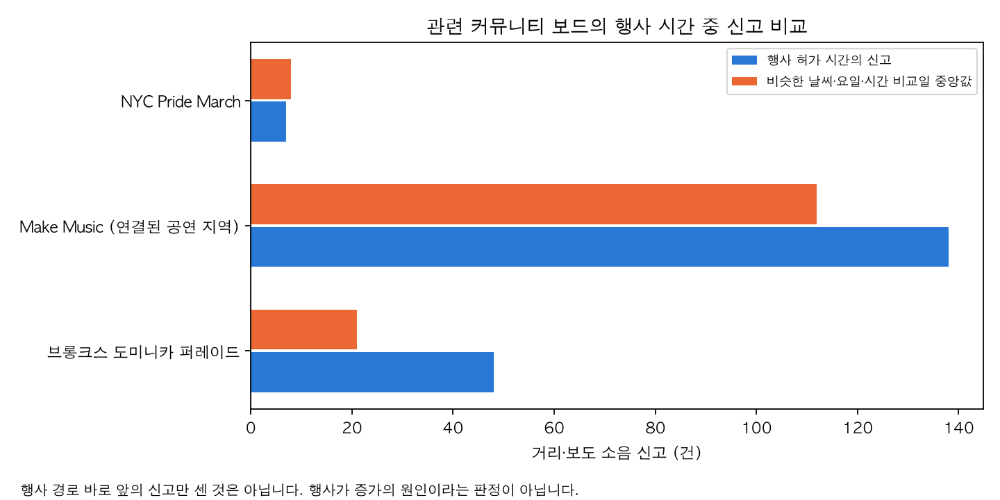
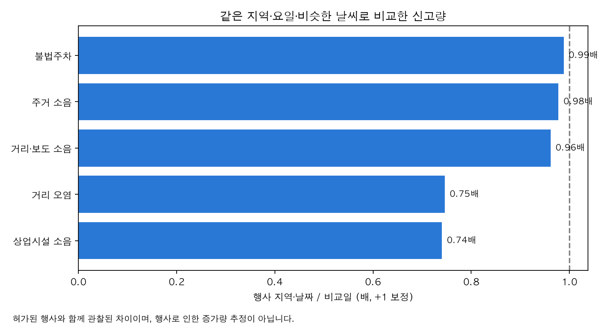

# 허가 행사와 311 신고의 지역·시간 연결 분석

- 작성: 2026-11-26
- 코드: `scripts/events/fetch_events.py`, `scripts/events/event_analysis.py`
- 결과: `reports/events/` (CSV 표, 그림, JSON). 원자료 출처: `data/external/nyc_events/`.
- 기존 processed 데이터와 대시보드의 체크섬 동일 여부: **확인됨**. 대시보드 갱신·배포는 하지 않음.

## 먼저 읽을 결과

- **행사일 전체의 일괄 증가를 확인한 것은 아니다.** 비교 가능한 지역·날짜에서 기온·비·눈 조건까지 맞춘 거리 소음은 약 0.96배, 불법주차 0.99배, 주거 소음 0.98배다. 이 값이 행사가 신고를 줄였다는 뜻도 아니다.
- **브롱크스 도미니카 퍼레이드(7/26)는 구체적인 후속 조사 가치가 높다.** 공식 허가 ID 897730, 12:30~16:00, 브롱크스 4·5번 CB. 해당 시간 거리 소음 48건, 날씨 비교일 중앙값 21.0건(4개 비교일), +1 보정 배율 2.23배다.
- 종료 후 다음 날 06시까지 거리 소음 727건, 같은 요일·시간 비교일 중앙값 193.5건이다. 신고 그룹도 345개 vs 113.5개로 차이가 남는다. 단, 다음 날 날씨까지 맞춘 비교일은 1개뿐이므로 날씨와 무관한 행사 효과라고 할 수 없다.
- **Make Music(6/21)은 허가 시간·지역을 연결하면 증가가 훨씬 완만하다.** 거리 소음 138건 vs 비슷한 날씨 비교일 중앙값 112.0건. 도시 전체 하루 급증을 전부 음악 행사로 돌리지 않는다. 개별 공연별 관객 수·음향 정보는 없다.
- **Pride(6/28)는 행사 중과 종료 후가 다르다.** 허가 시간 거리 소음 7건 vs 날씨 비교일 8.0건으로 증가가 확인되지 않았다. 종료 후는 42건 vs 같은 요일·시간 7.5건이지만 날씨 비교일 2개로 판단 보류다.
- **선택 범위가 제한적이다.** 날씨까지 맞춰 비교 가능한 것은 행사 지역·날짜 3,391칸 중 558칸(16.5%)이다. 모든 행사나 뉴욕 전체에 일반화하지 않는다. 불꽃놀이·공원 소음·교통은 평소 5건 이상 조건까지 적용하면 날씨 비교 표본이 1~5칸뿐이라 전체 경향 판단에서 제외한다.

## 1. 무엇을 연결했는가

NYC Permitted Event Information - Historical (`bkfu-528j`)에서 2025-11-01~2026-10-31에 시간상 겹치는 허가 기록 **151,787행**을 내려받았다. 이 중 원문이 완전히 같은 행 0개를 정리했다. 행사 ID는 38,881개이고, 같은 ID라도 일시·자치구가 다르면 별도 회차로 취급해 151,787회차가 된다. 원문 파일은 보존했다.

여기에는 정기 스포츠 이용, 촬영·시설 사용·준비·우천 예비 일정도 섞인다. 주 분석은 퍼레이드·거리 축제·블록파티·광장 행사 등 명시된 유형과, 이름에 음악·축제·시위 등 키워드가 있는 Special Event로 한정했다. 최대 72시간이며 준비·예비일로 식별되는 이름은 제외했다. 세부 규칙은 코드의 PUBLIC/MUSIC/EXCLUDE에 공개했다.

선정 회차 4,588개 중 표준 커뮤니티 보드(59곳)에 연결 가능한 것은 4,497개다. 연결된 날짜·지역 조합은 3,391개다. CB 55·64 등 공원/비표준 번호를 일반 주거지역 번호로 임의 배정하지 않았다. 원자료의 잘못된 지역 표기 가능성까지 지리적으로 검증한 것은 아니다.

311은 기존 BASE(중복 의심 제외), 하루 전체가 포함된 2025-11-02~2026-10-30만 사용한다. 자치구+커뮤니티 보드로 연결하므로 **공연장 바로 앞 신고라는 뜻은 아니다**. 311의 지역 번호 접미 자치구 불일치 2,752건은 지역 연결에서 제외하고 도시 전체 합계에는 보존했다. 행사 기록 중 시작·종료 시각이 없거나 같거나 역전된 원문 8,406행은 시간 비교 대상에서 제외했다. 같은 시각 표기가 실제 데이터 오류인지는 확정하지 않았다.

## 2. 비교 방법

- 같은 지역·같은 요일의 전후 7·14·21·28일을 후보로 사용한다.
- 주 분석 비교일에서는 등록된 선정 행사 당일과 그 다음 날, 명시한 연방 휴일/7월 4일을 제외한다. 제외 목록은 코드 HOLIDAYS에 있다. 모든 종교·문화 기념일을 제외한 것은 아니다.
- 날씨를 맞춘 비교는 센트럴파크 최고기온 차이 5°C 이내, 비 1mm 이상 여부, 눈이 내렸는지까지 맞춘다. 비교일이 3개 미만이면 계산하지 않는다.
- 배율은 (당일 신고+1)/(비교일 신고 중앙값+1). 희소 신고에서 배율이 과장되는 것을 줄이고자 요약에는 비교일 중앙값 5건 이상인 칸만 쓴다.
- 여러 허가가 같은 지역·날짜에 겹쳐도 그 지역·날짜는 한 번만 센다. 여러 지역에 걸친 행사는 지역별 관측이지만, 그것을 행사 건수로 더하지 않는다.
- 기본 신고 수 외에 같은 조건 신고 그룹 수, 집중 주소 제외, 가장 큰 한 지역·날짜 제외 결과를 함께 확인한다.

## 3. 전체 연결 결과

calendar = 달력 조건 비교, weather = 날씨 조건까지 비교. 각 행은 비교 가능한 지역·날짜 구성이 서로 다를 수 있다. 배율의 기하평균은 합계 신고 건수의 배율과 다르다. 가장 큰 칸 하나를 빼는 검사는 특정 행사 전체를 뺀 검사가 아니다.

| mode | label | district_days | ratio | group_ratio | nofocus_ratio | without_largest | support |
|---|---|---|---|---|---|---|---|
| calendar | 상업시설 소음 | 374 | 0.84 | 0.91 | 0.84 | 0.84 | 비교 30칸 이상 (인과·유의성 판정 아님) |
| calendar | 거리 오염 | 375 | 0.74 | 0.75 | 0.74 | 0.74 | 비교 30칸 이상 (인과·유의성 판정 아님) |
| calendar | 불법 불꽃놀이 | 12 | 0.44 | 0.45 | 0.44 | 0.40 | 참고 표본 30칸 미만 |
| calendar | 공원 소음 | 10 | 0.85 | 1.07 | 0.85 | 0.72 | 참고 표본 30칸 미만 |
| calendar | 불법주차 | 1968 | 1.00 | 0.99 | 1.00 | 1.00 | 비교 30칸 이상 (인과·유의성 판정 아님) |
| calendar | 주거 소음 | 1816 | 1.00 | 0.99 | 1.00 | 1.00 | 비교 30칸 이상 (인과·유의성 판정 아님) |
| calendar | 거리·보도 소음 | 1071 | 0.95 | 0.96 | 0.95 | 0.94 | 비교 30칸 이상 (인과·유의성 판정 아님) |
| calendar | 교통 | 9 | 1.57 | 1.10 | 1.57 | 1.25 | 참고 표본 30칸 미만 |
| weather | 상업시설 소음 | 90 | 0.74 | 0.81 | 0.74 | 0.74 | 비교 30칸 이상 (인과·유의성 판정 아님) |
| weather | 거리 오염 | 104 | 0.75 | 0.75 | 0.75 | 0.74 | 비교 30칸 이상 (인과·유의성 판정 아님) |
| weather | 불법 불꽃놀이 | 1 | 0.62 | 0.71 | 0.62 | — | 참고 표본 30칸 미만 |
| weather | 공원 소음 | 4 | 0.35 | 0.76 | 0.35 | 0.29 | 참고 표본 30칸 미만 |
| weather | 불법주차 | 549 | 0.99 | 0.98 | 0.99 | 0.99 | 비교 30칸 이상 (인과·유의성 판정 아님) |
| weather | 주거 소음 | 516 | 0.98 | 0.98 | 0.98 | 0.98 | 비교 30칸 이상 (인과·유의성 판정 아님) |
| weather | 거리·보도 소음 | 306 | 0.96 | 0.94 | 0.96 | 0.96 | 비교 30칸 이상 (인과·유의성 판정 아님) |
| weather | 교통 | 5 | 1.17 | 1.02 | 1.17 | 1.04 | 참고 표본 30칸 미만 |

이 표는 모든 선정 행사의 평균적인 연결을 살피는 용도다. 대형 행사와 작은 동네 행사가 섞이고, 같은 비교일이 반복 사용되며, 행사는 좋은 날씨·주말·상업지역에 선택적으로 열린다. **행사가 원인인 증가율, 통계적 유의성, 특정 공동체의 신고 성향으로 읽지 않는다.**

## 4. 이름을 확인한 주요 행사: 시간대까지 비교

`permit_hours`는 허가 시작~종료의 실제 시각, `after_until_06`은 종료 후 다음 날 오전 6시까지다. 허가가 여러 개면 지역별 시간 구간의 합집합을 사용해 신고를 한 번만 센다. 12:30 시작을 12:00으로 반올림하지 않는다. 표의 신고는 해당 행사 관련 표준 CB 전체에서 접수된 신고다.

이 표의 비교일은 같은 시간·지역·요일로 맞추며 휴일은 제외하지만 **다른 행사가 열렸을 수 있다**. 일부 지역은 행사가 너무 빈번해 완전히 행사 없는 시간만으로 비교하기 어렵기 때문이다. 날씨 비교일이 3개 미만이면 값을 비워 둔다. 짧은 시간 창에서 0→몇 건 차이는 과장될 수 있어 실제 건수를 반드시 함께 읽는다.

| case | window | label | actual | baseline | ratio | weather_controls | weather_ratio |
|---|---|---|---|---|---|---|---|
| bronx_dominican | permit_hours | 거리·보도 소음 | 48 | 10.50 | 4.26 | 4 | 2.23 |
| bronx_dominican | after_until_06 | 거리·보도 소음 | 727 | 193.50 | 3.74 | 1 | — |
| make_music | permit_hours | 거리·보도 소음 | 138 | 110.50 | 1.25 | 4 | 1.23 |
| make_music | after_until_06 | 거리·보도 소음 | 859 | 633.00 | 1.36 | 0 | — |
| pride_march | permit_hours | 거리·보도 소음 | 7 | 7.00 | 1.00 | 5 | 0.89 |
| pride_march | after_until_06 | 거리·보도 소음 | 42 | 7.50 | 5.06 | 2 | — |
| dance_parade | permit_hours | 거리·보도 소음 | 17 | 5.00 | 3.00 | 1 | — |
| dance_parade | after_until_06 | 거리·보도 소음 | 78 | 26.50 | 2.87 | 0 | — |
| no_kings | permit_hours | 거리·보도 소음 | 2 | 2.00 | 1.00 | 2 | — |
| no_kings | after_until_06 | 거리·보도 소음 | 15 | 24.00 | 0.64 | 1 | — |
| macys_fireworks | permit_hours | 거리·보도 소음 | 0 | 0.00 | 1.00 | 1 | — |
| macys_fireworks | permit_hours | 불법 불꽃놀이 | 0 | 0.00 | 1.00 | 1 | — |
| macys_fireworks | after_until_06 | 거리·보도 소음 | 0 | 1.00 | 0.50 | 1 | — |
| macys_fireworks | after_until_06 | 불법 불꽃놀이 | 0 | 0.00 | 1.00 | 1 | — |
| thanksgiving | permit_hours | 거리·보도 소음 | 5 | 3.00 | 1.50 | 6 | 1.50 |
| thanksgiving | after_until_06 | 거리·보도 소음 | 3 | 13.50 | 0.28 | 3 | 0.25 |

행사 ID·이름·허가 시각·표준/비표준 CB는 `named_event_permit_links.csv`, 모든 민원 유형별 결과는 `named_event_time_windows.csv`에 있다. 한 ID의 허가 기록이 행사 전체를 포괄한다는 보장은 없다. Macy's Loc 1 같은 일부 허가를 뉴욕시 전체 불꽃놀이로 확대하지 않는다. West Indian 이름으로 못 찾은 경우에도 행사 부재를 뜻하지 않는다.

## 5. 증가가 큰 지역·날짜 (탐색 후보)

비슷한 날씨의 비교일 3개 이상, 실제 20건 이상·비교일 중앙값 5건 이상인 결과 중 상위 15개다. 이 표는 많은 조합을 탐색해 고른 것이어서 확인된 행사 효과가 아니다. names는 같은 지역·날짜에 허가된 모든 선정 행사 이름이며, 어느 행사가 관련됐는지 분리하지 못한다.

| d | boro | cb | g | n | baseline | ratio | group_ratio | controls | names |
|---|---|---|---|---|---|---|---|---|---|
| 2025-12-12 00:00:00 | BROOKLYN | 6 | parking | 77 | 13.00 | 5.57 | 4.86 | 3 | Feast of our Lady of Guadalupe procession / Our Lady of Guadalupe Procession / Our Lady of Guadalupe Run |
| 2025-11-20 00:00:00 | BROOKLYN | 16 | residential | 39 | 8.00 | 4.44 | 1.25 | 3 | OPEN STREETS PARTNER EVENTS PS 137 |
| 2026-08-02 00:00:00 | BROOKLYN | 6 | street | 29 | 6.00 | 4.29 | 2.00 | 3 | Summer Block Party |
| 2025-12-12 00:00:00 | QUEENS | 13 | residential | 27 | 6.00 | 4.00 | 2.20 | 3 | Our Lady of Guadalupe Feast |
| 2025-12-17 00:00:00 | BRONX | 5 | residential | 70 | 17.00 | 3.94 | 1.92 | 3 | Street Health Outreach Wellness Program |
| 2026-04-03 00:00:00 | BRONX | 5 | street | 33 | 8.00 | 3.78 | 2.86 | 3 | GOOD FRIDAY - WAY OF THE CROSS / Good Friday Street Procession / Good Friday procession / Station of the Cross - Good Friday / Stations of the Cross |
| 2026-07-14 00:00:00 | BRONX | 7 | street | 38 | 10.00 | 3.55 | 2.30 | 3 | FIFA World Cup 2026 Public Viewing |
| 2026-03-21 00:00:00 | QUEENS | 1 | commercial | 21 | 6.00 | 3.14 | 2.14 | 3 | Astoria Halal Annual Ramadan Fest |
| 2025-12-12 00:00:00 | STATEN ISLAND | 3 | parking | 26 | 8.00 | 3.00 | 2.67 | 3 | Sing for a cause |
| 2026-02-19 00:00:00 | MANHATTAN | 9 | residential | 28 | 9.00 | 2.90 | 2.44 | 4 | West Harlem Campaign Against Hunger |
| 2026-06-19 00:00:00 | QUEENS | 7 | residential | 30 | 10.00 | 2.82 | 1.86 | 3 | Dragon Boat Festival Art Sketching Workshop / NYC CEC Poll Site Language Assistance Services |
| 2026-06-19 00:00:00 | QUEENS | 7 | street | 29 | 10.00 | 2.73 | 0.80 | 3 | Dragon Boat Festival Art Sketching Workshop / NYC CEC Poll Site Language Assistance Services |
| 2026-06-19 00:00:00 | QUEENS | 13 | residential | 29 | 10.00 | 2.73 | 2.11 | 3 | 45th Gregorian Festival / NYC CEC Poll Site Language Assistance Services |
| 2026-04-30 00:00:00 | BROOKLYN | 3 | residential | 23 | 8.00 | 2.67 | 2.12 | 3 | Chauncey St Open Streets Event / Project Street Beat - Keith Haring Foundation Mobile Health Center Community Event |
| 2026-03-19 00:00:00 | QUEENS | 8 | residential | 44 | 16.00 | 2.65 | 1.43 | 3 | Jamaica Bangladesh Eid Chaad Night Celebration 2026 |

## 6. 전체 신고 급증일에도 행사는 있었다

| d | n | eligible_permits |
|---|---|---|
| 2026-02-24 00:00:00 | 22793 | 3 |
| 2026-01-27 00:00:00 | 19224 | 1 |
| 2026-01-28 00:00:00 | 16982 | 1 |
| 2025-12-15 00:00:00 | 16377 | 6 |
| 2026-01-26 00:00:00 | 15723 | 1 |
| 2026-02-01 00:00:00 | 15673 | 2 |
| 2026-01-30 00:00:00 | 15447 | 2 |
| 2026-02-23 00:00:00 | 15423 | 1 |
| 2026-01-29 00:00:00 | 15356 | 3 |
| 2026-02-09 00:00:00 | 14832 | 0 |
| 2026-02-08 00:00:00 | 14505 | 1 |
| 2026-02-02 00:00:00 | 14170 | 2 |
| 2026-03-09 00:00:00 | 14131 | 1 |
| 2026-07-02 00:00:00 | 14130 | 6 |
| 2025-12-09 00:00:00 | 14071 | 5 |

뉴욕에는 일상적으로 여러 행사가 있다. 급증일에 허가가 존재한다는 것만으로 원인을 행사로 바꾸면 안 된다. 2월 24일 전체 22,793건 중 눈·얼음 11,370건이었던 기존 결과와 날씨 분석은 그대로 고려해야 한다.

## 7. 한계와 다음 확인

1. 허가는 예정/승인 기록이다. 실제 개최·취소·참가자 수를 증명하지 않는다. 이름에 예비일이 없어도 실제 취소됐을 수 있다.
2. 미등록 모임·즉흥 공연·모든 시위가 포함되는 것은 아니다. 해당 행사 기록이 없다는 이유로 사건이 없었다고 할 수 없다.
3. 커뮤니티 보드는 넓다. 다른 장소의 신고가 섞인다. 행사 도로 구간·정확한 좌표와 신고 좌표를 연결하는 후속 확인이 필요하다.
4. 지역×날짜 분석에는 행사 전 새벽 신고가 섞일 수 있다. 주요 행사는 허가 시각과 종료 후 야간을 따로 확인했다. 후속 신고 지연까지는 분리하지 못한다.
5. 관측소 하나의 날씨, 제한적인 공휴일 목록, 1년 자료다. 행사 장소 선택·일상 상업 활동·인파·방학·다른 행사를 모두 통제하지 않았다.
6. 같은 날·주소 신고 그룹은 실제 사건 수가 아니다. 낮은 신고량을 행사 성공이나 피해 없음으로 읽지 않는다.
7. 우선 후속 검증: 브롱크스 도미니카 퍼레이드 경로·시간, Make Music 개별 공연장, Pride의 행사 중과 종료 후 비교. 7월 4일 공식 행사 허가와 개인 불꽃놀이 신고는 구분한다.

## 8. 재현과 검증

- 수집: `.venv/bin/python scripts/events/fetch_events.py` (캐시 파일 재사용).
- 분석: `.venv/bin/python scripts/events/event_analysis.py`.
- raw 페이지 합계, 마지막 페이지 미만 여부, 날짜/지역 연결, 시간 구간 중복 제거, 기존 데이터·대시보드 체크섬 보존을 검사했다.
- 결과 JSON에는 원자료 건수, 방법, 기존 파일 체크섬을 기록했다. 비교일은 결과 CSV에 행별 기록했다.
- 기존 CSV, interim, processed, 기존 분석 보고서·대시보드에 대한 쓰기 작업은 없다.
