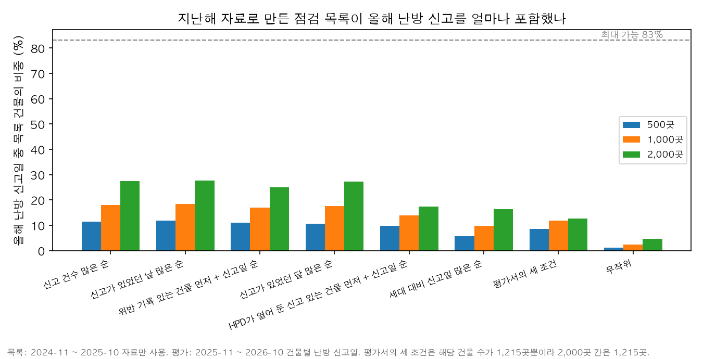

# 제안: 지난해 신고 기록으로 난방 선제 점검 목록 만들기

> 겨울이 시작되기 전에, 지난해 난방·온수 신고가 **여러 날 반복된 건물 1,000곳**을 먼저 점검하자.
> 2024-25년 자료로 만든 목록은 2025-26년 난방 신고일의 **18.4%**, HPD 난방·온수 위반의 **14.3%**를 미리 짚었다. 무작위로 고른 1,000곳(2.3%)의 약 8배다.

- **작성**: 2026-11-28
- **대상 사용자**: 뉴욕시 주택보존개발국(HPD) 난방 점검팀, 세입자 단체
- **근거 자료**: 311 난방·온수 신고(두 해), HPD 난방·온수 위반 기록, PLUTO 세대 수
- **주의**: 신고는 사건이 아니고, 신고가 많은 건물이 곧 문제 건물이라는 뜻도 아니다. 건물주·기관 평가가 아니며, 대시보드에는 건물 주소를 싣지 않는다.

---

## 1. 문제

- 난방 신고는 매년 30만 건이 넘는다(2025-26년 351,780건). 대부분 겨울 몇 달에 몰리고, 점검은 신고를 받은 뒤에 이뤄진다.
- 그런데 신고는 일부 건물에 몰린다. 올해 난방 신고가 있었던 건물 39,718곳 중 **상위 1%가 신고의 24%**, 상위 10%가 63%다.
- 같은 건물이 해마다 다시 나온다면, 겨울이 오기 전에 그 건물을 먼저 살피는 편이 신고를 기다리는 것보다 빠르다.

## 2. 제안

| 항목 | 내용 |
|---|---|
| 무엇을 | 지난 1년 동안 난방·온수 신고가 **있었던 날이 많은 건물** 순으로 점검 목록을 만든다(같은 날 여러 건은 하루로 셈) |
| 언제 | 난방 시즌(10월 1일) 전, 지난 시즌 자료가 닫히는 시점 |
| 몇 곳 | 점검 여력에 맞춰 500 / 1,000 / 2,000곳 (아래는 1,000곳 기준) |
| 누가 | HPD 점검팀(선제 점검), 세입자 단체(해당 건물 세입자에게 권리 안내) |
| 무엇을 하지 않는가 | 목록을 공개하거나 건물주를 평가하지 않는다. 신고 대응(지금 방식)을 줄이지 않는다 |

## 3. 근거: 지난해로 만든 목록은 올해 얼마나 맞았나

**방법** (결과를 보기 전에 정함)
- 목록은 2024-11 ~ 2025-10 자료로만 만들었다. 대상은 그 기간 난방 신고가 1건 이상 있었던 건물 35,938곳이다.
- 평가는 2025-11 ~ 2026-10 자료로 했다.
  - 주 지표: 그 건물들이 올해 **난방 신고가 있었던 건물·날짜**에서 차지한 비중
  - 함께 본 지표: 신고 건수 비중, HPD 위반 비중(점검일 2025-11-01 ~ 2026-11-10, 신고가 없던 건물 포함), 목록 중 올해 10일 이상 신고된 건물 비율
- 목록 규칙 7가지를 같은 조건으로 비교하고, 무작위 목록 200개의 평균을 기준선으로 삼았다.
- 「신고 건수 순」과 「평가서의 세 조건」은 이 분석 전에 한 번 비교해 본 적이 있다. 나머지 규칙과 지표는 결과를 보기 전에 정했다.

**[사실] 1,000곳 목록의 결과**

| 목록 규칙 | 올해 난방 신고일 | 신고 건수 | HPD 위반 | 올해 10일+ 신고 | 세대 수 |
|---|---:|---:|---:|---:|---:|
| **신고가 있었던 날 많은 순 (제안)** | **18.4%** | 25.8% | 14.3% | 89% | 15.2만 |
| 신고 건수 많은 순 | 17.9% | 26.6% | 14.6% | 87% | 14.8만 |
| 신고가 있었던 달 많은 순 | 17.6% | 25.2% | 15.3% | 89% | 15.5만 |
| 위반 기록 있는 건물 먼저 + 신고일 순 | 16.9% | 23.4% | **15.7%** | 88% | 14.4만 |
| HPD가 열어 둔 신고 있는 건물 먼저 + 신고일 순 | 13.8% | 18.0% | 12.2% | 81% | 13.6만 |
| 세대 대비 신고일 많은 순 (6세대 이상) | 9.8% | 13.0% | 9.9% | 58% | 1.9만 |
| 무작위 (200번 평균) | 2.3% | 2.4% | 2.2% | 16% | 3.7만 |

- 500곳이면 11.9%, 2,000곳이면 27.6%다(신고일 순, 주 지표).
- 지난해 신고가 있었던 건물 전체가 올해 신고일의 83%를 차지했다. 지난해 신고 기록으로 만드는 어떤 목록도 이보다 높을 수 없다.

**[사실] 평가서가 권장한 세 조건 목록은 덜 맞았다**
- 세 조건은 10일 이상 반복, 세대 대비 상위 10%, 위반 기록이다. 지난해에 이 조건을 모두 만족한 건물은 1,215곳이다.
  - 그 1,215곳은 올해 난방 신고일의 12.6%였다.
  - 같은 수를 「신고일 순」으로 고르면 20.6%였다.
- 「세대 대비 상위」 조건이 작은 건물을 많이 고르기 때문이다.
- 평가서의 「1,422곳이 신고의 25%」는 **같은 해** 자료로 고르고 같은 해로 잰 값이라, 다음 해를 미리 짚는 힘은 그보다 낮다.

## 4. 기대 효과

- 1,000곳(지난해 난방 신고가 있었던 건물 35,938곳의 약 2.8%)을 먼저 점검하면, 다음 겨울 난방 신고일의 약 5분의 1이 나오는 건물에 먼저 닿는다.
- 목록 건물의 89%가 다음 해에도 10일 이상 신고가 있었다. 한 번 반짝한 건물이 아니라 해마다 반복되는 건물을 고른다는 뜻이다.
- 목록 건물에 사는 세대는 약 15만 세대다.
- 위반을 더 많이 찾는 것이 목표라면 「위반 기록 있는 건물 먼저」가 약간 낫다(15.7% 대 14.3%). 대신 신고 대응 부담을 줄이는 효과는 조금 작다.

**[가능한 설명]** 난방 문제는 보일러·배관처럼 건물에 붙어 있는 원인이 많아 해마다 같은 건물에서 반복되는 것으로 보인다. 이 분석은 반복을 보여 줄 뿐 원인을 확인하지 않았다.

## 5. 한계와 주의

1. **새로 생기는 문제는 못 잡는다.** 올해 신고일의 17%는 지난해 신고가 없던 건물 18,460곳에서 나왔다. 선제 점검은 신고 대응을 보완할 뿐 대신할 수 없다.
2. **신고를 많이 하는 건물에 치우친다.** 같은 문제라도 덜 신고하는 건물·주민은 목록에 오르기 어렵다.
   - 공공임대주택(NYCHA)의 난방 문제는 311 자료에 거의 없어 이 목록으로는 다룰 수 없다.
   - 「세대 대비」 규칙은 작은 건물에 닿지만 적중률이 낮다.
3. **점검 효과는 검증하지 않았다.** 선제 점검이 실제로 난방 문제를 줄이는지는 시범 운영으로 확인해야 한다(예: 목록 건물 일부를 무작위로 먼저 점검하고 비교).
4. **한 방향, 한 번의 검증이다.** 자료가 두 해뿐이라 「지난해 → 올해」 한 번만 시험했다.
5. **HPD 위반은 신고와 독립적이지 않다.** 점검 대부분이 신고로 시작되므로, 신고가 많은 건물에서 위반이 더 많이 발견되는 구조다.
6. **HPD가 열어 둔 신고는 해마다 기록 방식이 달랐다**(지난해 2,663곳, 올해 7,783곳). 그래서 신호로 쓰기에 안정적이지 않았다.

## 6. 목록의 모습 (1,000곳, 신고일 순)

| 자치구 | 건물 | 세대 |
|---|---:|---:|
| 브롱크스 | 414 | 62,511 |
| 브루클린 | 240 | 32,872 |
| 맨해튼 | 213 | 32,294 |
| 퀸스 | 122 | 21,277 |
| 스태튼아일랜드 | 11 | 3,275 |

- 규모로는 20~199세대 건물이 74%다.
- 건물 목록(주소 포함)은 `proposal/tables/best_list_1000_buildings.csv`에만 두고 대시보드에는 싣지 않는다.

---

자료와 재현: `scripts/proposal/heat_priority_backtest.py`, 결과 표 `reports/proposal/tables/`.
