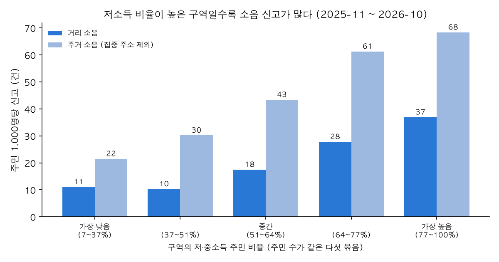
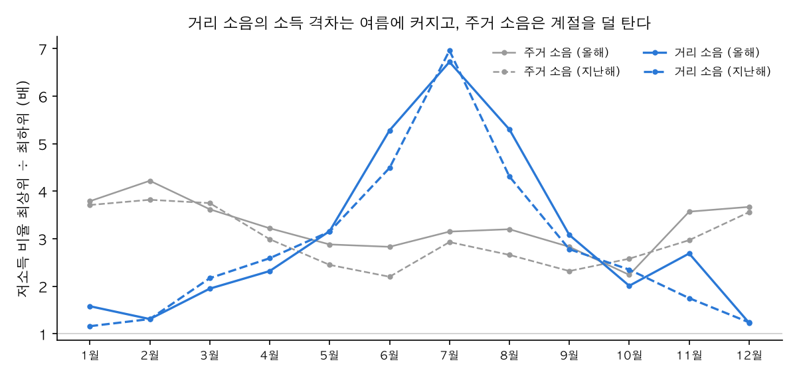

# 저소득 지역과 311 신고: 소음은 많이, 문제에 비해서는 적게

> 저·중소득 주민이 많은 센서스 구역일수록 거리 소음과 주거 소음 신고가 주민 수 대비 약 3배 많습니다. 인구 밀도, 술집 수, 자치구를 맞춰도, 두 해 모두 같습니다.
> 그런데 난방은 실제로 확인된 문제(위반) 1건당 신고가 오히려 적습니다. 「저소득 지역은 신고가 많다」와 「저소득 지역은 문제에 비해 덜 신고한다」는 함께 성립합니다.

- **작성**: 2026-11-28
- **자료**: 311 신고 두 해(2024-11 ~ 2025-10, 2025-11 ~ 2026-10), 2020 센서스 구역 경계, 구역별 저·중소득 주민 비율(HUD, 2016 ~ 2020 ACS), OpenStreetMap 술집, HPD 난방·온수 위반
- **주의**: 모두 구역 단위의 관계입니다. 「저소득 주민이 신고를 많이 한다」는 뜻이 아니고, 신고 수는 실제 소음이나 문제의 양이 아닙니다. 원인을 주장하지 않으며, 특정 동네의 낙인이나 순위로 쓰지 않습니다.

---

## 1. 무엇을 어떻게 보았나

| 항목 | 내용 |
|---|---|
| 단위 | 2020 센서스 구역. 주민 500명 이상인 2,204곳 (공원·공항처럼 주민이 거의 없는 구역 제외) |
| 소득 지표 | 구역 주민 가운데 저·중소득 주민의 비율. 지역 중위소득 80% 미만 가구에 사는 사람(미국 주택도시개발부 기준, 2016 ~ 2020 ACS) |
| 신고 연결 | 신고의 위도·경도로 그 신고가 들어온 구역을 찾음 |
| 비교 방법 | 저소득 비율 순으로 구역을 늘어놓고, 주민 수가 같은 다섯 묶음(각 약 164만 명)으로 나눔 |
| 다른 요인 맞추기 | 구역 인구 밀도, 술집 수, 주거 면적 비중, 자치구를 함께 넣은 포아송 모델(주민 수 대비 신고율) |
| 주거 소음 | 브롱크스 집중 주소 한 곳의 신고는 뺌 |

## 2. 확인된 사실

### 2-1. 저소득 비율이 높은 구역일수록 소음 신고가 많다

| 저소득 비율 묶음 | 거리 소음 (1,000명당) | 주거 소음 (1,000명당) | 전체 신고 중 거리 소음 | 술집 (1만 명당) |
|---|---:|---:|---:|---:|
| 가장 낮음 (7 ~ 37%) | 11.1 | 21.5 | 2.7% | 4.5 |
| 37 ~ 51% | 10.3 | 30.2 | 2.5% | 2.5 |
| 51 ~ 64% | 17.5 | 43.4 | 3.6% | 2.0 |
| 64 ~ 77% | 27.8 | 61.3 | 5.2% | 1.4 |
| 가장 높음 (77 ~ 100%) | **36.9** | **68.4** | **7.5%** | 0.4 |

- 2025-11 ~ 2026-10 기준입니다. 지난해도 거리 소음 11.3 → 35.2건, 주거 소음 21.1 → 61.0건으로 같은 모습입니다.
- 가장 높은 묶음의 거리 소음은 가장 낮은 묶음의 약 3.3배, 주거 소음은 약 3.2배입니다.
- 전체 신고 중 거리 소음의 비중도 커집니다. 신고가 전반적으로 많아서 생긴 차이만은 아닙니다.
- 술집은 오히려 저소득 비율이 낮은 구역에 많아, 이 차이를 설명하지 못합니다.

**같은 자치구 안에서도 같은 방향입니다** (자치구마다 저소득 비율로 셋으로 나눔, 올해, 거리 소음 1,000명당)

| 자치구 | 낮은 3분의 1 | 중간 | 높은 3분의 1 |
|---|---:|---:|---:|
| 브롱크스 | 14.2 | 35.2 | 56.4 |
| 맨해튼 | 12.8 | 26.6 | 56.6 |
| 퀸스 | 6.8 | 9.4 | 19.0 |
| 브루클린 | 12.6 | 17.9 | 18.4 |
| 스태튼아일랜드 | 2.7 | 3.3 | 13.0 |

- 브루클린만 차이가 작습니다.

**다른 요인을 맞춘 모델** (저소득 비율 10%p당 신고율 배수, 95% 범위)

| | 지난해 | 올해 |
|---|---|---|
| 거리 소음 | 1.30 (1.26 ~ 1.36) | 1.30 (1.25 ~ 1.36) |
| 주거 소음 | 1.21 (1.17 ~ 1.25) | 1.22 (1.18 ~ 1.26) |
| 거리 소음, 맨해튼 제외 | 1.27 | 1.26 |
| 거리 소음, 신고 최다 1% 구역 제외 | 1.29 | 1.30 |

- 구역 단위 순위 상관은 거리 소음 0.36, 주거 소음 0.43 ~ 0.46입니다. 중간 밀도 구역에서는 0.17 ~ 0.18로 약해집니다.

### 2-2. 거리 소음의 격차는 여름에 커지고, 주거 소음은 계절을 덜 탄다

- 저소득 비율 최상위 묶음 ÷ 최하위 묶음(주민 1,000명당)을 달마다 계산했습니다.
- **거리 소음**: 12 ~ 2월 1.2 ~ 1.6배, 7월 6.7 ~ 7.0배. 두 해 모두 같습니다.
- **주거 소음**: 2.2 ~ 4.2배로 고르고, 오히려 겨울에 조금 큽니다.

### 2-3. 저소득 지역은 「모든 신고」가 아니라 특정 유형을 많이 신고한다

신고가 많은 15개 유형을 같은 방식으로 비교했습니다(최상위 ÷ 최하위 묶음, 주민 1,000명당, 두 해 범위).

| 저소득 지역에서 많은 유형 | 배수 | 고소득 지역에서 많은 유형 | 배수 |
|---|---:|---|---:|
| 페인트·회벽 | 5.4 ~ 6.1 | 노숙 거처 | 0.2 |
| 비위생 상태 | 3.7 ~ 4.2 | 환경보호국 소음(공사 등) | 0.3 ~ 0.4 |
| 배관 | 3.8 ~ 4.0 | 눈·얼음 | 0.3 |
| 난방·온수 | 3.5 ~ 3.8 | 도로 상태 | 0.4 |
| 거리 소음 | 3.1 ~ 3.3 | 방치 차량 | 0.5 |
| 주거 소음 | 2.9 ~ 3.2 | 불법 주차 | 0.6 ~ 0.7 |

- 다른 요인을 맞춘 모델에서도 방향이 같습니다. 주택 상태와 소음은 저소득 비율 10%p당 1.14 ~ 1.30배, 도로·주차·눈은 0.91 ~ 0.94배입니다.

### 2-4. 거리 소음이 많은 이유: 신고하는 곳이 많고, 같은 곳의 반복도 많다

| 올해 | 저소득 비율 가장 낮음 | 가장 높음 | 배수 |
|---|---:|---:|---:|
| 신고 (1,000명당) | 11.1 | 36.9 | 3.3 |
| 신고가 나온 주소 (1,000명당) | 2.2 | 4.9 | 2.2 |
| 같은 날·장소 묶음 (1,000명당) | 9.8 | 25.7 | 2.6 |
| 주소 1곳당 신고 | 5.0 | 7.5 | 1.5 |
| 한 해 10건 넘게 신고된 주소에서 나온 비율 | 28% | 62% | |
| 접수 경로 (앱 / 온라인 / 전화) | 40 / 54 / 7% | 40 / 52 / 9% | |

- 3.3배 가운데 약 2.2배는 **신고가 나오는 주소가 더 많아서**, 약 1.5배는 **같은 주소의 반복**에서 나옵니다.
- 접수 경로는 거의 같습니다. 앱·온라인 사용 차이로 생긴 결과가 아닙니다.
- 경찰이 「위반 흔적 없음」으로 닫은 비율도 소득 묶음과 관계없이 약 40 ~ 44%로 비슷합니다(같은 해 안에서 비교. 경찰 종결 문구가 2025-11부터 바뀌어 두 해 사이 비교는 하지 않음).

### 2-5. 난방: 신고는 많지만, 위반 1건당 신고는 적다

| 저소득 비율 묶음 | 난방 신고 (1,000명당) | 난방·온수 위반 (1,000명당) | 위반 1건당 신고 |
|---|---:|---:|---:|
| 가장 낮음 | 19.2 | 1.35 | **14.2** |
| 중간 | 45.3 | 3.31 | 13.7 |
| 가장 높음 | 67.4 | 6.55 | **10.3** |

- 올해 기준입니다. 지난해도 15.6 → 10.5건으로 같은 모습입니다.
- 위반은 필지 번호만 있어, 같은 필지의 311 신고 위치로 구역을 찾았습니다(위반의 99.7%가 연결됨).
- 위반은 4.9배 많은데 신고는 3.5배만 많습니다.

## 3. 다른 연구와의 대조

| 연구 | 연구가 찾은 것 | 이 보고서 | 판정 |
|---|---|---|---|
| Ramphal 외 2021 (뉴욕시 소음 신고 428만 건, 2010 ~ 2021, 센서스 구역) | 저소득 가구 비율이 높은 구역일수록 소음 신고가 많고, 인구·밀도를 맞춰도 유지. 따뜻한 달에 격차가 가장 큼 | 2-1, 2-2와 같은 방향. 여름 격차는 거리 소음에서 나옴 | 같음 |
| Boxer·Kontokosta 외 2025, Kontokosta 외 2017 (뉴욕 난방·온수) | 건물 조건에 비해 신고가 적은 과소 신고가 있고, 지역 특성과 관련 | 저소득 구역은 위반 1건당 신고가 적음(2-5) | 같은 방향 |
| Kontokosta·Hong 2021 (캔자스시티) | 신고 성향이 사회·공간적으로 달라, 신고 자료를 그대로 쓰면 불공평한 결정이 될 수 있음 | 유형마다 소득 방향이 다름(2-3) | 같은 방향 |
| O'Brien (보스턴, 「돌봄」 연구) | 공공 공간 신고는 집 근처에 몰리고, 시민 참여·정부 신뢰가 높은 곳에서 많음 | 도로·주차·눈 신고가 고소득 쪽에 많음(2-3) | 같은 방향 |
| Legewie·Schaeffer 2015 (뉴욕) | 이웃 갈등 신고는 민족 집단의 경계가 흐릿한 곳에서 26% 더 많음 | 민족 구성은 보지 않음 | 확인 못 함 |
| 지역사회봉사회(CSS) 2019 (뉴욕) | 경찰로 넘어간 생활 불편 신고(87%가 소음)는 백인 유입이 큰 저소득·유색인 지역에서 더 빨리 늘었고, 소환장·체포로 이어지는 비율도 3배 | 인구 변화 자료가 없음 | 확인 못 함 |

- NYU 연구 세 편은 본문 수치를 읽지 못하고 초록과 보도자료만 참고했습니다.

## 4. 의미

**1. 「신고가 적은 곳이 문제」와 「저소득 지역은 신고가 많다」는 모순이 아닙니다.**
- 과소 신고는 「문제의 양에 비해」 적게 신고하는가의 문제입니다. 저소득 지역은 문제(위반)가 훨씬 많아 신고 수도 많지만, 문제 1건당 신고는 약 30% 적습니다(2-5).
- 신고 수로 점검이나 자원을 나누면 저소득 지역의 실제 필요를 덜 반영할 수 있습니다.
- 제안 1(난방 선제 점검)의 형평성 점검에서 「위반은 있지만 신고가 적은 필지」 몫을 따로 두자는 보완이 이 결과로 더 분명해집니다.

**2. 소음 부담은 저소득 지역에 몰려 있을 가능성이 큽니다.**
- 신고가 나오는 주소 자체가 2.2배 많고, 경찰의 「위반 흔적 없음」 비율도 같습니다. 일부의 과도한 신고보다는 소음을 겪는 곳이 실제로 많을 가능성에 더 가깝습니다(확인되지 않음).
- **[가능한 설명]** 여름에 커지는 거리 소음 격차는 바깥 생활(밀집 주거, 야외 모임·음악)과, 계절을 덜 타는 주거 소음은 건물 방음과 맞아떨어집니다.
- 술집 중심의 단속으로는 이 차이를 설명하기 어렵습니다. 주거 밀집 지역의 생활 소음에 맞는 접근(이웃 조정, 방음, 여름철 거리 행사 안내)이 필요할 수 있습니다.

**3. 311 신고는 유형별로 나눠 써야 합니다.**
- 고소득 지역은 공공 공간(도로·주차·눈·공사)을, 저소득 지역은 집 안과 이웃 소음을 더 신고합니다.
- 311 신고 전체를 하나의 「생활 불편 지표」로 쓰면 이 차이가 섞입니다.

## 5. 한계

1. **지역 단위 관계입니다.** 누가 왜 신고했는지 알 수 없습니다(생태학적 오류).
2. **신고는 실제 소음이 아닙니다.** 실제 소음을 알려면 소음 측정 자료와 비교해야 합니다.
3. **소득 자료가 오래됐습니다.** 2016 ~ 2020 ACS이고, 구역 추정치는 오차가 큽니다.
4. **위반은 독립적인 문제 척도가 아닙니다.** 대부분 신고로 시작된 점검에서 나오므로 「위반 1건당 신고」는 근사치입니다.
5. **다른 설명을 다 맞추지는 못했습니다.** 민족 구성, 젠트리피케이션, 건물 연식, 세입자 비율 등은 모델에 넣지 않았습니다.
6. **두 해 자료뿐입니다.** 추세나 변화는 보지 않았습니다.

---

## 재현 정보와 수정 이력

- **스크립트**: `scripts/income/noise_by_income_tract.py`(구역 집계·모델), `scripts/income/reporting_vs_income.py`(유형별·신고 방식·난방 위반), `scripts/income/income_noise_figures.py`(그림)
- **결과 파일**: `reports/income_noise/` (표, 그림, json)
- **바깥 자료**: `data/external/cdbg_tract/`(NYC Open Data qmcw-ur37), `data/external/census_tracts_2020/`(NYC Open Data 63ge-mke6). 출처는 각 폴더의 `SOURCE.md`. 인구조사국 ACS API는 키가 필요해 쓰지 않았습니다.
- 2026-11-28 처음 작성.

출처
- Ramphal 외 2021, Environmental Research: https://pmc.ncbi.nlm.nih.gov/articles/PMC8838876
- Boxer 외 2025 보도자료: https://www.eurekalert.org/news-releases/1085707
- NYU Marron Institute, Equity in 311 Reporting: https://marroninstitute.nyu.edu/blog/equity-in-311-reporting
- Kontokosta·Hong 2021: https://marroninstitute.nyu.edu/papers/bias-in-smart-city-governance-how-socio-spatial-disparities-in-311-complaint-behavior-impact-the-fairness-of-data-driven-decisions
- O'Brien, Custodianship in the Urban Commons: https://cssh.northeastern.edu/bari/projects/custodianship-in-the-urban-commons/
- Legewie·Schaeffer 2015 보도자료: https://www.eurekalert.org/pub_releases/2015-08/nyu-su3081315.php
- 지역사회봉사회(CSS) 2019: https://www.cssny.org/news/entry/New-Neighbors
