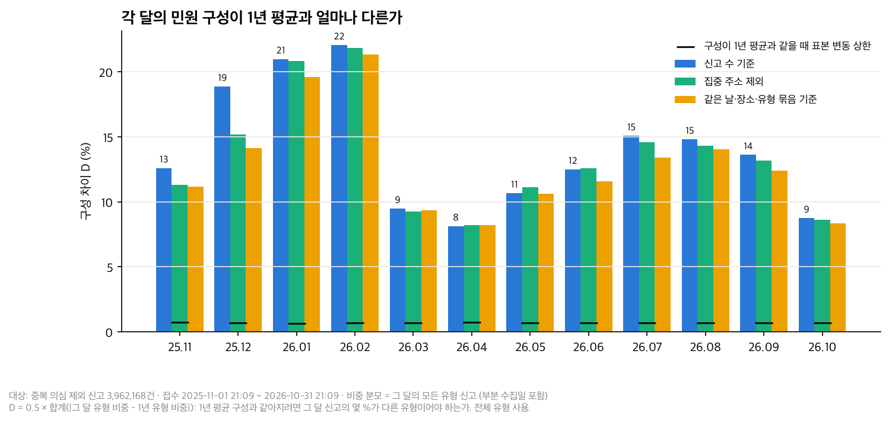
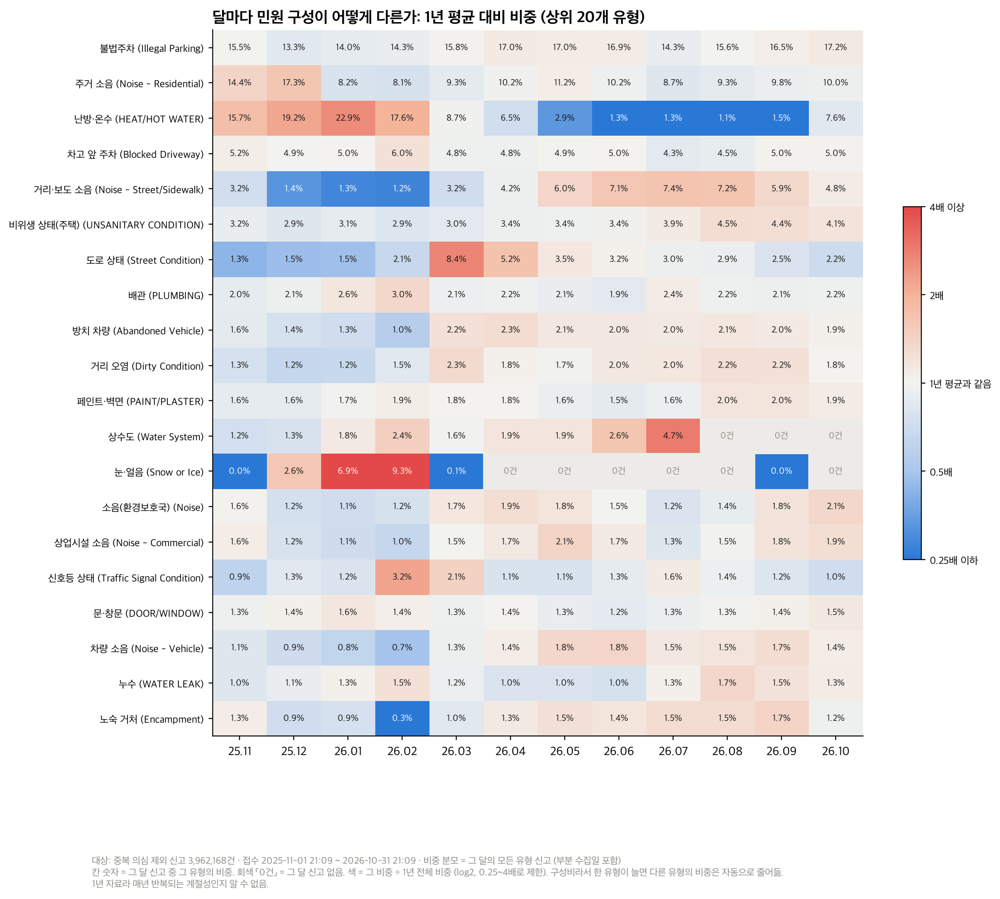
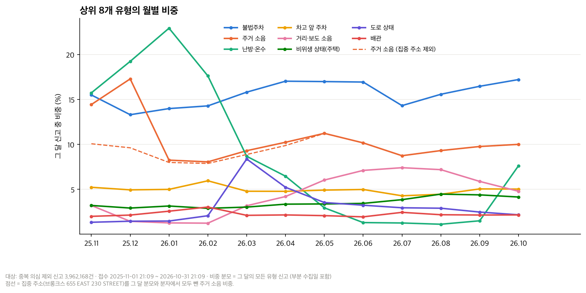

# 월별 민원 구성의 차이

> 달마다 민원 유형의 구성이 어떻게 다른가? 그 차이는 여러 날·여러 장소에 걸친 것인가, 특정 날이나 주소 때문인가?

- **작성**: 2026-11-23
- **코드**: `scripts/monthly_composition/monthly_composition_analysis.py`
- **결과 파일**: `reports/monthly_composition/`(표 CSV, 그림, `monthly_composition_results.json`)
- **보존**: 원본·interim·processed 데이터와 기존 보고서는 수정하지 않았습니다. 전처리를 다시 실행하지 않았습니다.

**공통 기준**
- **대상**: 중복 의심을 뺀 기본 분석 대상 3,962,168건, 접수 2025-11-01 21:09 ~ 2026-10-31 21:09.
- **비중의 분모**: 그 달의 모든 유형 신고입니다.
  - 일부 시간만 수집된 첫날·마지막 날도 넣었습니다. 비중은 날의 길이에 영향을 덜 받기 때문입니다.
  - 건수의 크기는 기존 EDA와 같이 하루 전체가 포함된 날만으로 계산한 하루 평균으로 봅니다.
- **1년 자료의 한계**: 이 보고서는 1년 자료로 계산했습니다. (2026-11-28 갱신) 지난해 자료로 다시 계산해 일부는 두 해 모두 나타났습니다(`revalidation_report.md`). 두 해만으로 매년 반복된다고 단정할 수는 없습니다. 2025년 11월과 2026년 9~10월은 서로 다른 해의 가을입니다.

---

## 0. 요약

**[사실] 달마다 구성이 뚜렷하게 다릅니다.**
- 각 달의 구성은 1년 평균과 8~22% 다릅니다. 구성이 같다면 표본 변동만으로는 0.7% 이하로 나와야 하므로 실제 차이입니다.
  - 가장 다른 달: 겨울(12~2월) 19~22%.
  - 가장 비슷한 달: 3·4·10월 8~10%.
- 이웃한 두 달 사이의 변화는 **2월 → 3월**이 24%로 가장 큽니다. 난방·눈 민원이 빠지고 도로 상태 민원이 들어오는 시점입니다.

**[사실] 유형별로 나누면**

| 묶음 | 유형 |
|---|---|
| 1년 내내 비슷한 비중 | 불법주차(13~17%), 차고 앞 주차, 비위생 상태, 페인트·벽면, 문·창문 |
| 겨울 | 난방·온수(1월 22.9%, 1년 평균 8.9%의 2.6배) |
| 봄 | 도로 상태(3월 8.4%, 2.7배. 포트홀의 30%가 3월) |
| 여름 | 거리·보도 소음(6~8월 1.6배), 손상된 나무(6~7월 2배), 소화전 긴급 신고(1년의 90%가 7월) |
| 특정 날짜의 급증 | 눈·얼음(2월 신고의 37%가 2월 24일 하루), 불법 불꽃놀이(7월 신고의 33%가 7월 4일) |

**[사실] 한 주소 때문인 경우**
- 12월 주거 소음 비중(17.3%, 1.64배)은 집중 주소 한 곳 때문입니다.
- 그 주소를 빼면 1.02배로 1년 평균과 같습니다.

**[주의] 2026-07-29에 분류 체계가 바뀐 것으로 보입니다.**
- 환경보호국(DEP)의 「상수도(Water System)」·「하수(Sewer)」 유형이 이날 끝나고, 같은 내용이 「상수도 유지보수(Water Maintenance)」·「하수 유지보수(Sewer Maintenance)」로 이어집니다.
- 그래서 8~10월에 「유지보수」 비중이 크게 높게 나오는 것은 민원이 바뀐 것이 아니라 **유형 이름이 바뀐 것**입니다(5절).

---

## 1. 각 달의 구성은 1년 평균과 얼마나 다른가

| 달 | 신고 수 | 하루 평균 | 구성 차이 D | 집중 주소 제외 | 묶음 기준 | 가장 많은 유형 4개 (그 달 비중) |
|---|---:|---:|---:|---:|---:|---|
| 2025-11 | 295,960 | 10,146 | 12.6% | 11.3% | 11.2% | 난방·온수 15.7, 불법주차 15.5, 주거 소음 14.4, 차고 앞 주차 5.2 |
| 2025-12 | 331,974 | 10,709 | 18.9% | 15.2% | 14.1% | 난방·온수 19.2, 주거 소음 17.3, 불법주차 13.3, 차고 앞 주차 4.9 |
| 2026-01 | 348,355 | 11,237 | 21.0% | 20.8% | 19.6% | 난방·온수 22.9, 불법주차 14.0, 주거 소음 8.2, 눈·얼음 6.9 |
| 2026-02 | 334,484 | 11,946 | 22.1% | 21.8% | 21.3% | 난방·온수 17.6, 불법주차 14.3, 눈·얼음 9.3, 주거 소음 8.1 |
| 2026-03 | 342,172 | 11,038 | 9.5% | 9.3% | 9.4% | 불법주차 15.8, 주거 소음 9.3, 난방·온수 8.7, 도로 상태 8.4 |
| 2026-04 | 302,038 | 10,068 | 8.1% | 8.2% | 8.2% | 불법주차 17.0, 주거 소음 10.2, 난방·온수 6.5, 도로 상태 5.2 |
| 2026-05 | 331,815 | 10,704 | 10.7% | 11.1% | 10.6% | 불법주차 17.0, 주거 소음 11.2, 거리·보도 소음 6.0, 차고 앞 주차 4.9 |
| 2026-06 | 334,722 | 11,157 | 12.5% | 12.6% | 11.6% | 불법주차 16.9, 주거 소음 10.2, 거리·보도 소음 7.1, 차고 앞 주차 5.0 |
| 2026-07 | 342,877 | 11,061 | 15.1% | 14.6% | 13.4% | 불법주차 14.3, 주거 소음 8.7, 거리·보도 소음 7.4, 상수도 4.7 |
| 2026-08 | 328,821 | 10,607 | 14.8% | 14.3% | 14.0% | 불법주차 15.6, 주거 소음 9.3, 거리·보도 소음 7.2, 비위생 상태 4.5 |
| 2026-09 | 323,572 | 10,786 | 13.6% | 13.2% | 12.4% | 불법주차 16.5, 주거 소음 9.8, 거리·보도 소음 5.9, 차고 앞 주차 5.0 |
| 2026-10 | 345,378 | 11,213 | 8.7% | 8.6% | 8.3% | 불법주차 17.2, 주거 소음 10.0, 난방·온수 7.6, 차고 앞 주차 5.0 |

**표 읽는 법**
- **구성 차이 D**: 1년 평균 구성과 같아지려면 그 달 신고의 몇 %가 다른 유형이어야 하는가입니다.
- **하루 평균**: 하루 전체가 포함된 날만으로 계산했습니다. 기존 EDA 표 04와 같습니다.

**[사실] 하루 평균 신고 수 자체는 달마다 비슷합니다(약 1만~1.2만 건). 구성이 바뀌는 것입니다.**
- **집중 주소의 영향**: 12월만 크게 받습니다(D 18.9% → 15.2%).
- **묶음 기준**: 같은 날·장소·유형 신고를 하나로 묶어 세도 달 사이의 순서는 거의 같습니다.

---

## 2. 어떤 유형이 어느 달에 두드러지나

### 2-1. 두드러진 달·유형 조합과 그 형태

**선정 기준**: 그 달 신고가 200건 이상, 그 달 비중 1% 이상, 1년 평균 비중의 1.5배 이상인 조합 30개입니다.
- 지역 분석(2배)보다 낮은 기준을 쓴 이유: 달 사이의 차이가 지역 사이보다 작습니다.

**형태 구분**
- **여러 날·여러 장소**: 26개
- **특정 날 집중**: 3개 (가장 많은 날이 그 달 신고의 30% 이상)
- **한 주소 집중**: 1개 (가장 많은 주소가 30% 이상)

**민감도**
- 집중 주소를 빼거나 묶음 기준으로 세도 30개 중 29개가 1.5배 이상으로 남습니다.
- 빠지는 1개는 12월 주거 소음입니다.

**기대보다 많은 건수가 큰 순** (`tables/distinctive_month_type.csv`)

| 달 | 유형 | 신고 | 그 달 비중 | 1년 대비 | 집중 주소 제외 / 묶음 기준 | 형태 |
|---|---|---:|---:|---:|---|---|
| 2026-01 | 난방·온수 | 79,870 | 22.9% | ×2.58 | ×2.56 / ×2.55 | 여러 날·여러 장소 |
| 2025-12 | 난방·온수 | 63,861 | 19.2% | ×2.17 | ×2.34 / ×2.41 | 여러 날·여러 장소 |
| 2026-02 | 난방·온수 | 58,940 | 17.6% | ×1.98 | ×1.96 / ×1.93 | 여러 날·여러 장소 |
| 2026-02 | 눈·얼음 | 30,943 | 9.3% | ×5.73 | ×5.68 / ×5.66 | **특정 날** (2/24에 37%) |
| 2025-12 | 주거 소음 | 57,386 | 17.3% | ×1.64 | **×1.02 / ×0.98** | **한 주소** (49%) |
| 2025-11 | 난방·온수 | 46,574 | 15.7% | ×1.77 | ×1.84 / ×1.88 | 여러 날·여러 장소 |
| 2026-01 | 눈·얼음 | 24,079 | 6.9% | ×4.28 | ×4.24 / ×4.42 | 여러 날 (가장 많은 날 25%) |
| 2026-03 | 도로 상태 | 28,661 | 8.4% | ×2.70 | ×2.68 / ×2.47 | 여러 날·여러 장소 |
| 2026-07 | 상수도 | 15,973 | 4.7% | ×2.88 | ×2.84 / ×2.67 | 여러 날 (가장 많은 날 19%) |
| 2026-07 | 거리·보도 소음 | 25,405 | 7.4% | ×1.68 | ×1.66 / ×1.53 | 여러 날·여러 장소 |
| 2026-08 | 상수도 유지보수 | 8,925 | 2.7% | ×4.82 | ×4.76 / ×4.61 | **분류 변경의 영향** (5절) |
| 2026-07 | 불법 불꽃놀이 | 6,923 | 2.0% | ×7.35 | ×7.26 / ×6.95 | **특정 날** (7/4에 33%) |
| 2026-02 | 신호등 상태 | 10,702 | 3.2% | ×2.20 | ×2.18 / ×2.20 | 여러 날 (가장 많은 날 25%) |
| 2026-07 | 손상된 나무 | 7,987 | 2.3% | ×2.08 | ×2.06 / ×2.05 | 여러 날·여러 장소 |
| 2026-08 | 하수 유지보수 | 5,060 | 1.5% | ×4.96 | ×4.90 / ×4.84 | **분류 변경의 영향** |

### 2-2. 계절을 만드는 세부 유형

| 유형 | 세부 유형 | 1년 신고 | 가장 많은 달 (그 달 몫) |
|---|---|---:|---|
| 도로 상태 | 포트홀 | 75,744 | 3월 (30%) |
| 도로 상태 | 도로 함몰 | 19,305 | 7월 (16%), 비교적 고름 |
| 눈·얼음 | 보도 | 34,099 | 2월 (40%) |
| 눈·얼음 | 제설 확인(Snow Tracking) | 15,165 | 2월 (84%) |
| 난방·온수 | 건물 전체 / 세대만 | 230,806 / 120,974 | 둘 다 1월 (22~24%) |
| 상수도 | 소화전 긴급(FHE) | 10,585 | **7월 (90%)** |
| 손상된 나무 | 가지 떨어짐 / 나무 쓰러짐 | 19,003 / 8,490 | 7월·6월 (약 20%) |
| 거리·보도 소음 | 시끄러운 음악·파티 | 139,418 | 7월 (16%) |
| 주거 소음 | 시끄러운 음악·파티 | 230,362 | 12월 (18%), 집중 주소 영향 |

**[가능한 설명]** (확인하지 않음)
- **3월 포트홀**: 겨울이 지난 뒤 도로 파손이 드러나는 시기와 맞습니다.
- **7월 소화전 긴급 신고**: 더위에 소화전을 여는 일과 관련될 수 있습니다.
- **6~7월 나무 신고**: 여름 폭풍과 관련될 수 있습니다.

**[추가 확인 필요]** 기온·강수·폭풍 같은 일별 날씨 자료와 대조해야 합니다.

---

## 3. 유형별 계절 패턴 (신고 5,000건 이상인 74개 유형)

| 패턴 | 유형 수 | 예 |
|---|---:|---|
| 1년 내내 고름 (가장 많은 달 ÷ 가장 적은 달 < 1.6) | 18 | 불법주차(1.35), 차고 앞 주차, 비위생 상태, 페인트·벽면, 문·창문, 전기(주택) |
| 여름 집중 (6~8월이 1년의 40% 이상) | 7 | 거리·보도 소음(5.8배), 손상된 나무(11.7배) |
| 봄 집중 | 3 | 도로 상태(6.8배) |
| 겨울 집중 | 1 | 난방·온수(21.7배, 겨울 58%) |
| 가을 집중 | 1 | 교통(Traffic) |
| 특정 날 급증 (하루가 1년의 5% 이상) | 2 | 눈·얼음(2/24에 1년의 18%), 불법 불꽃놀이(7/4) |
| 뚜렷한 계절 없음 | 42 | 주거 소음(집중 주소 영향), 노숙 거처(5.3배이지만 한 계절에 몰리지 않음) 등 |

- **판정 기준**: 계절별 몫은 하루 평균으로 계산합니다. 4계절이 같으면 각 25%입니다.
- **주의**: 「뚜렷한 계절 없음」에는 달마다 오르내림은 크지만 한 계절에 몰리지 않은 유형도 들어 있습니다(`tables/type_seasonality.csv`).

---

## 4. 자치구마다 같은 달에 오르내리나

| 유형 | 자치구별 가장 많은 달 | 해석 |
|---|---|---|
| 난방·온수 | 4개 자치구 1월, 스태튼아일랜드 2월 (최다/최소 18~28배) | 도시 전체의 공통 패턴 |
| 도로 상태 | 5개 자치구 모두 3월 | 도시 전체의 공통 패턴 |
| 거리·보도 소음 | 6~8월(브롱크스·브루클린·맨해튼·스태튼아일랜드), 퀸스만 11월 (퀸스는 2.7배로 약함) | 대체로 공통, 퀸스는 약함 |
| 주거 소음 | 브롱크스만 12월(5.0배, 집중 주소), 나머지 5~6월 (1.4~2.1배) | 브롱크스의 겨울 정점은 한 주소 때문 |
| 불법주차 | 달마다 1.3~1.6배 | 계절 차이 거의 없음 |

---

## 5. 분류 체계 변경 (2026-07-29)

| 달 | 상수도 (Water System) | 상수도 유지보수 (Water Maintenance) | 합계 | 하수 (Sewer) | 하수 유지보수 (Sewer Maintenance) | 합계 |
|---|---:|---:|---:|---:|---:|---:|
| 2026-05 | 6,246 | 174 | 6,420 | 4,335 | 151 | 4,486 |
| 2026-06 | 8,847 | 299 | 9,146 | 2,696 | 197 | 2,893 |
| 2026-07 | 15,973 | 2,164 | 18,137 | 2,977 | 1,461 | 4,438 |
| 2026-08 | **0** | 8,925 | 8,925 | **0** | 5,060 | 5,060 |
| 2026-09 | 0 | 5,381 | 5,381 | 0 | 3,121 | 3,121 |
| 2026-10 | 0 | 5,158 | 5,158 | 0 | 2,091 | 2,091 |

- **[사실]** 두 유형 모두 마지막 신고가 2026-07-29입니다. 같은 기관(환경보호국)의 「유지보수」 유형이 그 뒤를 이어받습니다.
  - 세부 유형도 같은 내용입니다(소화전 물 흐름, 누수, 탁한 물, 소화전 긴급 등). 기존 유형은 코드가 붙은 이름이었고, 새 유형은 코드가 없는 이름입니다.
  - 「유지보수」 유형은 그 전에도 소수 있었습니다.
- **[가능한 설명]** 311 시스템에서 분류 체계가 바뀐 것으로 보입니다. 공식 공지로 확인하지는 않았습니다.
- **이번 분석에서의 처리**: 원래 유형을 그대로 두었습니다. 위 표처럼 두 유형을 나란히 보면 해당 업무의 신고는 이어지고 있습니다.
- **기존 분석에 미치는 영향**
  - **지역 구성 보고서**(`composition_report.md`): 「상수도」·「하수」는 11~7월분만, 「유지보수」는 주로 8~10월분만 들어 있습니다. 유형별 1년 합계를 비교할 때 이 점을 고려해야 합니다.
  - **종료 시간 비교 보고서**(`resolution_playbook_report.md`): 「상수도」 비교는 월을 맞춘 비교라 결론의 방향은 그대로입니다. 다만 결과는 2025-11 ~ 2026-07 신고에 대한 것입니다.
- **전처리 제안 (적용하지 않음)**: 분류 변경이 공식으로 확인되면, 원래 유형은 보존하고 「같은 업무」를 묶는 비교용 열을 별도로 추가하는 것을 검토할 수 있습니다.

같은 방식으로 찾은 다른 경우: 「유해 물질(Hazardous Materials)」은 2026-07-28에 끝나고, 「고인 물(Standing Water)」은 2026-04-01에 시작합니다. 후자는 계절 접수일 수 있지만 확인하지 않았습니다.

---

## 6. 해석상 주의

- **구성비의 성질**: 합이 100%라서 한 유형이 늘면 다른 유형의 비중은 자동으로 줄어듭니다. 예를 들어 7월 불법주차 비중(14.3%)이 낮은 것은 건수가 줄었기 때문이 아니라, 소화전·거리 소음·나무 민원이 늘었기 때문일 수 있습니다.
- **원인은 단정하지 않습니다**: 날씨, 행사, 기관 운영은 이 자료에 없습니다.
- **1년 자료**: 이 보고서 안에서는 같은 달이 반복되지 않습니다. (2026-11-28 갱신) 지난해 자료로 다시 계산해 일부는 두 해 모두 나타났습니다(`revalidation_report.md`). 두 해만으로 매년 반복된다고 단정할 수는 없습니다. 「가을」 묶음은 2025년 11월과 2026년 9~10월을 섞은 것입니다.

## 7. 검증

| 검사 | 결과 |
|---|---|
| 달 × 유형 칸의 합 = 3,962,168 | 일치 |
| 달마다 비중의 합 = 1, 유형마다 달별 분포의 합 = 1 | 통과 |
| 묶음이 달·유형·집중 주소 여부를 넘나들지 않음 | 통과 |
| 집중 주소 제외 대상 = 전체 − 47,105 | 일치 |
| 난방·온수 1월 하루 평균 = 기존 EDA 표 11 (2,576건) | 일치 |

## 8. 다음으로 볼 만한 것

1. **일별 날씨 자료와 대조**: 눈·얼음, 포트홀, 소화전, 나무 신고의 급증일이 기상 사건과 맞는지 확인합니다.
2. **분류 변경 확인**: 311 공지나 자료 설명에서 2026-07-29 변경을 확인하고, 비교용 「같은 업무」 열을 추가할지 결정합니다.
3. **처리 시간과의 연결**: 신고가 몰리는 달(1월 난방, 3월 포트홀, 7월 소화전)에 같은 유형의 처리 시간이나 7일 미종결률이 달라지는지 봅니다. 기존 「맞춘 비교」 방법을 쓸 수 있습니다.

---

## 추가: 지난해와 비교 (2026-11-26)

지난해(2024-11 ~ 2025-10) 자료로 같은 방식의 비교를 했습니다(`revalidation_report.md`).
- **반복됨**
  - 난방·온수의 1월 집중(두 해 모두 22~23%)
  - 자치구별 유형 구성(상대 비중의 두 해 상관 0.98)
  - 상위 30개 유형 중 18개의 월 패턴(상관 0.7 이상)
- **올해의 특수성**
  - 포트홀 3월 집중의 크기(지난해 11%, 올해 30%)
  - 눈·얼음 급증(지난해 신고는 올해의 7분의 1, 가장 많은 달은 1월)
- **달이 다름**: 소화전 긴급 신고가 지난해 6월, 올해 7월에 가장 많았습니다.
- 「1년 자료라 계절성인지 알 수 없다」는 단서는 두 해로 일부 보완됐습니다. 두 해도 짧은 기간이라 「해마다 반복된다」고 단정하지는 않습니다.

