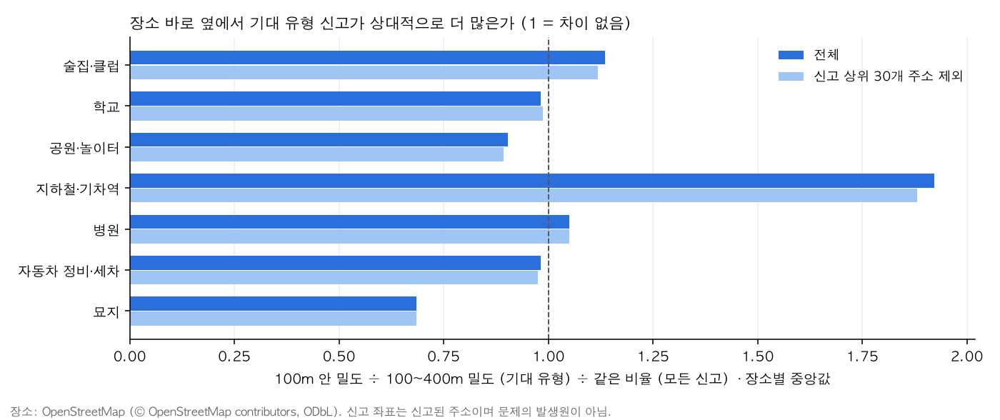

# 장소 주변의 신고: 무엇이, 언제 더 많은가

> 술집·학교·공원·역·병원·자동차 정비소·묘지 **바로 옆(100m 안)**에서는 **조금 떨어진 곳(100~400m)**보다 어떤 신고가 더 많고, 그 신고가 장소의 성격에 맞는 시간대에 몰리는가?

- **작성**: 2026-11-25
- **스크립트**: `scripts/poi/place_centred_analysis.py`
- **결과 파일**: `reports/poi/tables/place_*.csv`, `reports/poi/figures/02_place_relative_density.png`, `reports/poi/place_results.json`
- **지도 자료**: OpenStreetMap (© OpenStreetMap contributors, ODbL), 2026-07 기준 (`data/external/osm_nyc_poi/`)
- **신고**: 기본 분석 대상 중 좌표가 있는 3,879,214건 (2025-11 ~ 2026-10)

---

## 0. 요약

| 장소 | 바로 옆에서 더 많은 신고 | 장소에 맞는 시간대인가 | 판단 |
|---|---|---|---|
| **술집·클럽** | 상업시설 소음 비중 **×4.0** (5.5% vs 1.4%), 음주 ×2.2 | 상업시설 소음의 **금·토 밤 비중 35.9% vs 29.7% (+6.2%p)** | **장소·시간 모두 맞음** |
| **지하철·기차역** | 노숙인 지원 **×4.6**, 노숙 거처 ×2.8, 구걸 ×11, 노점 ×7 | 노숙인 지원 출퇴근 시간 +4.2%p (노숙 거처는 -3.3%p) | **장소는 뚜렷, 시간은 일부만** |
| **학교** | 불법 주차 비중은 거의 같음(×1.02) | 불법 주차의 **평일 등하교 시간 비중 20.9% vs 15.4% (+5.5%p)** | **양보다 시간대가 다름** |
| **자동차 정비·세차** | 불법 주차 ×1.17, 폐차 직전 차량 ×1.24 | 불법 주차의 **평일 낮 비중 53.2% vs 43.4% (+9.8%p)** | **시간대가 맞음** |
| **공원·놀이터** | 공원 내 동물 ×5.0, 공원 소음 ×3.8 (이름부터 공원 관련) | 여름·주말 비중은 바로 옆이 오히려 약간 낮음 | **장소는 맞지만 시간 신호 없음** |
| 병원 | 차량 소음은 오히려 적음(×0.22), 불법 주차 ×1.29 (상위 주소 빼면 약해짐) | 해당 없음 | **관계 없음** |
| 묘지 | 불법 투기·거리 오염 ×0.97~0.99 | 해당 없음 | **관계 없음** |

- 비율 「×」는 「100m 안에서 그 신고가 차지하는 비중 ÷ 100~400m에서의 비중」입니다. 1이면 같습니다.
- **신고 상위 30개 주소를 빼도** 위 결론은 같습니다.
  - 단, 학교 주변 「교통(Traffic)」 신고(×6.1)는 한 주소(트럭 경로 위반 신고가 많은 20 Clinton St)의 영향이었고, 빼면 크게 약해집니다.

**[해석]**
- 술집 주변의 상업시설 소음, 역 주변의 노숙 관련 신고는 **장소와 신고 내용이 맞고**, 술집은 **시간대까지** 맞습니다. 장소가 신고의 배경일 가능성을 뒷받침합니다.
- 학교·자동차 정비소 주변 불법 주차는 양은 비슷하지만 **등하교·영업 시간에 더 몰립니다.** 장소의 이용 시간과 함께 움직이는 신고로 보입니다.
- 병원·묘지는 주변 신고와 뚜렷한 관계가 없습니다.
- 어느 것도 인과로 확정하지 않습니다. 신고 좌표는 신고된 주소이며, 소음이나 문제의 실제 발생원이 아닙니다.

---

## 1. 방법

| 항목 | 기준 |
|---|---|
| 바로 옆 / 고리 | 가장 가까운 그 종류 장소까지 100m 이하 / 100~400m. 400m보다 먼 신고는 그 장소 분석에서 제외 |
| ① 구성 비율 | 기대 유형이 전체 신고 중 차지하는 비중: 바로 옆 ÷ 고리 |
| ② 상대 밀도 | 장소마다 (100m 안 밀도 ÷ 100~400m 밀도)를 기대 유형과 모든 신고에 대해 각각 구해 나눔. 번화가라서 모든 신고가 많은 효과를 뺌. 장소별 중앙값과 전체 합계 기준 두 가지 |
| ③ 시간대 | 장소에 맞는 시간대 비중: 바로 옆 − 고리 (%p). 「그 밖의 유형」과도 비교 |
| 확인 | 신고 상위 30개 주소 제외 |

**장소별 기대 유형과 시간대** (결과를 보기 전에 정함)

| 장소 (OSM 수) | 기대 유형 | 시간대 |
|---|---|---|
| 술집·클럽 (2,096) | 상업시설 소음, 거리 소음, 음주, 노상 방뇨 | 금·토 밤 (금·토 22시~, 토·일 ~3시) |
| 학교 (3,106) | 불법 주차, 차고 앞 주차, 교통 | 평일 7~8시·14~15시, 여름방학(7~8월) |
| 공원·놀이터 (5,565) | 공원 소음, 거리 소음, 불꽃놀이, 노점, 공원 내 동물 | 여름(6~8월), 주말 |
| 지하철·기차역 (661) | 노숙 거처, 노숙인 지원, 거리 오염, 비긴급 경찰 사안 | 평일 7~9시·17~19시 |
| 병원 (120) | 차량 소음, 불법 주차, 차고 앞 주차 | 밤 (22~3시) |
| 자동차 정비·세차 (1,048) | 불법 주차, 방치 차량, 폐차 직전 차량, 차고 앞 주차 | 평일 8~18시 |
| 묘지 (262) | 불법 투기, 거리 오염 | 주말 |

---

## 2. 결과

### 2-1. 구성 비율과 상대 밀도 (`place_composition.csv`, `place_density_ratio.csv`)

| 장소 | 기대 유형 | 바로 옆 건수 | 비중: 바로 옆 / 고리 | 구성 비율 | 상대 밀도 (합계 기준) | 상위 30 주소 제외 |
|---|---|---:|---|---:|---:|---:|
| 술집·클럽 | 상업시설 소음 | 27,157 | 5.45% / 1.37% | **×3.99** | ×1.65 | ×1.63 |
| 술집·클럽 | 음주 | 989 | 0.20% / 0.09% | ×2.15 | ×1.65 | ×1.63 |
| 술집·클럽 | 거리 소음 | 26,231 | 5.27% / 4.47% | ×1.18 | ×1.25 | ×1.23 |
| 지하철·기차역 | 노숙인 지원 | 9,916 | 4.45% / 0.96% | **×4.62** | ×2.36 | ×2.29 |
| 지하철·기차역 | 노숙 거처 | 8,703 | 3.90% / 1.40% | ×2.78 | ×1.67 | ×1.63 |
| 지하철·기차역 | 거리 오염 | 6,587 | 2.95% / 1.74% | ×1.70 | ×1.70 | ×1.65 |
| 공원·놀이터 | 공원 내 동물 | 2,924 | 0.45% / 0.09% | ×5.02 | ×3.72 | ×3.93 |
| 공원·놀이터 | 공원 소음 | 3,609 | 0.56% / 0.15% | ×3.76 | ×2.82 | ×2.83 |
| 학교 | 불법 주차 | 71,657 | 15.6% / 15.2% | ×1.02 | ×1.07 | ×1.12 |
| 학교 | 교통 | 4,592 | 1.00% / 0.16% | ×6.10 | ×1.68 | **×1.18** |
| 자동차 정비·세차 | 불법 주차 | 27,781 | 21.1% / 18.0% | ×1.17 | ×1.13 | ×1.06 |
| 자동차 정비·세차 | 폐차 직전 차량 | 1,544 | 1.18% / 0.95% | ×1.24 | ×1.32 | ×1.36 |
| 병원 | 불법 주차 | 1,718 | 13.5% / 10.4% | ×1.29 | ×1.28 | ×1.09 |
| 병원 | 차량 소음 | 71 | 0.56% / 2.57% | ×0.22 | ×0.25 | ×0.47 |
| 묘지 | 불법 투기 | 149 | 1.17% / 1.21% | ×0.97 | ×0.91 | ×0.90 |

- 장소별 중앙값 기준의 상대 밀도(그림)는 드문 유형에서 0이 많아(대부분 장소 주변에 그 신고가 없음) 합계 기준보다 작게 나옵니다. 드문 유형은 합계 기준으로 봅니다.

### 2-2. 시간대 (`place_time_signature.csv`)

| 장소 | 유형 | 시간대 | 바로 옆 | 고리 | 차이 | 상위 30 주소 제외 |
|---|---|---|---:|---:|---:|---:|
| 술집·클럽 | 상업시설 소음 | 금·토 밤 | 35.9% | 29.7% | **+6.2%p** | +6.2 |
| 술집·클럽 | 음주 | 금·토 밤 | 14.3% | 11.8% | +2.4%p | +2.4 |
| 술집·클럽 | 그 밖의 유형 | 금·토 밤 | 5.6% | 5.3% | +0.3%p | +0.3 |
| 학교 | 불법 주차 | 평일 등하교 | 20.9% | 15.4% | **+5.5%p** | +5.6 |
| 학교 | 그 밖의 유형 | 평일 등하교 | 15.8% | 15.3% | +0.5%p | +0.3 |
| 학교 | 불법 주차 | 여름방학 | 14.8% | 15.8% | -1.0%p | -1.0 |
| 자동차 정비·세차 | 불법 주차 | 평일 낮 | 53.2% | 43.4% | **+9.8%p** | +10.3 |
| 자동차 정비·세차 | 차고 앞 주차 | 평일 낮 | 46.8% | 40.4% | +6.4%p | +6.4 |
| 지하철·기차역 | 노숙인 지원 | 출퇴근 | 29.3% | 25.0% | +4.2%p | +4.2 |
| 지하철·기차역 | 노숙 거처 | 출퇴근 | 29.2% | 32.4% | -3.3%p | -3.3 |
| 공원·놀이터 | 기대 유형 합계 | 여름 | 40.9% | 42.6% | -1.7%p | +0.2 |
| 공원·놀이터 | 기대 유형 합계 | 주말 | 40.7% | 42.4% | -1.7%p | -1.1 |

- 「그 밖의 유형」은 시간대 차이가 거의 없습니다(±0.5%p 안팎). 그래서 기대 유형의 시간대 차이는 동네 전체의 생활 리듬이 아니라 그 신고에만 나타나는 차이입니다.
- 병원 주변 차량 소음의 밤 비중(47.9% vs 18.8%)은 바로 옆 건수가 71건뿐이라 판단하지 않습니다.

### 2-3. 예상하지 않았지만 바로 옆에서 많은 신고 (`place_top_overrepresented.csv`, 탐색용)

| 장소 | 유형 | 구성 비율 |
|---|---|---:|
| 지하철·기차역 | 구걸 | ×11.2 |
| 지하철·기차역 | 노점 단속 | ×7.0 |
| 술집·클럽 | 야외 식사 | ×7.2 |
| 술집·클럽 | 식중독·음식점 | ×2.8~3.2 |
| 공원·놀이터 | 공원 시설 관리·공원 규칙 위반 | ×5.2~5.6 |
| 묘지 | 노점 단속 | ×6.4 (묘지 1~2곳 주변에 몰린 것으로 보임, 확인 필요) |
| 자동차 정비·세차 | 교통 | ×13.2 (특정 주소 영향 가능, 확인 필요) |

- 기대 유형을 정하기 전에 본 결과가 아니라 결과를 본 뒤의 탐색입니다. 그래서 「발견」이 아니라 「더 확인할 후보」로 둡니다.

---

## 3. 한계

- **신고 좌표 ≠ 발생원**: 술집 소음 신고도 신고된 주소(주로 신고자가 지목한 건물)의 좌표입니다.
- **OSM 누락**: 술집·클럽은 실제보다 적게 들어가 있을 수 있습니다. 누락된 술집 주변의 신고는 「고리」나 「400m 밖」으로 분류됩니다. 그러면 차이가 실제보다 작게 나오는 방향으로 작용할 가능성이 큽니다.
- **장소가 겹침**: 술집이 많은 곳에는 역·식당도 많습니다. 장소 종류별 효과를 서로 떼어 내지 않았습니다.
- **자료 시점**: 지도는 2026-07 기준이고, 신고는 2025-11 ~ 2026-10입니다.
- **인과 아님**: 장소와 신고 내용·시간대가 함께 맞는다는 관찰입니다.

## 4. 검산

| 검사 | 결과 |
|---|---|
| 좌표가 있는 신고 | 3,879,214건 (기본 분석 대상의 97.9%) |
| 상위 30개 주소 제외 시 주요 결론 | 술집·역·학교·정비소 모두 같은 방향, 크기 비슷 (학교 「교통」만 크게 약해짐) |
| 「그 밖의 유형」의 시간대 차이 | 모두 ±2.7%p 이내 |
