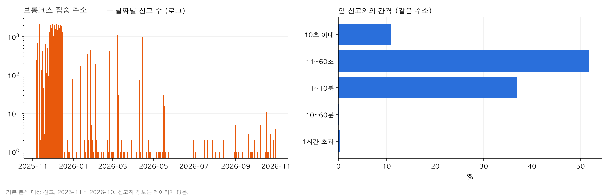

# 신고가 몰린 주소: 주변 장소와 신고 패턴

> 특정 주소에 신고가 몰리는 이유가 주변 장소(학교, 클럽·술집, 카지노, 묘지, 공원, 쇼핑몰 등) 때문인가?

- **작성**: 2026-11-25
- **스크립트**: `scripts/poi/address_surroundings.py`
- **결과 파일**: `reports/poi/` (표 11개, 그림 1개, `poi_results.json`)
- **지도 자료**: OpenStreetMap(Overpass API)의 뉴욕시 장소 32,654곳. 자료 기준 시각은 2026-07-15입니다.
  - 받은 파일: `data/external/osm_nyc_poi/` (출처·질의는 `SOURCE.md`)
  - © OpenStreetMap contributors, ODbL
- **보존**: 원본·전처리 결과는 읽기만 했습니다.

---

## 0. 요약

**[사실] 주변 장소로는 신고 집중을 설명하기 어렵습니다.**
- **비교 방법**: 신고가 가장 많은 30개 주소를, 같은 자치구·같은 유형 신고가 5건 이상인 다른 주소와 비교했습니다.
  - 비교 주소는 주소마다 6~7,932곳입니다.
  - 기준은 반경 250m 안의 장소 수입니다.
- **결과**: 집중 주소 주변의 장소 수는 비교 주소들 가운데 **대체로 중간쯤**입니다.
  - 장소 종류별 순위(백분위)의 중앙값이 37~56입니다.
- **더 넓게 확인한 결과**: 비교 주소 전체(유형·자치구 12개 묶음)에서 「신고 수」와 「주변 장소 수」의 순위 상관도 거의 0입니다.
  - 주소가 많은 묶음에서는 모두 -0.12 ~ +0.06입니다.
  - 학교나 술집이 가까운 주소일수록 신고가 많아지는 경향은 보이지 않습니다.
- **카지노**: 뉴욕시 안에 OSM 기준 12곳뿐이고, 30개 주소 반경 250m 안에는 하나도 없습니다.

**[사실] 대신 「신고가 들어오는 방식」이 일반 주소와 크게 다릅니다.**

| 주소 (주된 유형) | 신고 | 접수 경로 | 앞 신고와 1분 안에 들어온 비율 | 신고가 있었던 날 |
|---|---:|---|---:|---:|
| 브롱크스 집중 주소 (주거 소음) | 47,105 | **모바일 앱 99.8%** (비교 주소 24%) | **62.8%** (비교 주소 0.4%) | 128일, 신고가 있었던 날 평균 368건 |
| 78-15 Parsons Blvd (차량 소음 등) | 9,523 | 온라인 100% (비교 47%) | 36.3% (비교 1.4%) | 353일 |
| 1869 83rd St (주거 소음) | 8,847 | 전화 56%·온라인 44% | 0.0% | 364일, 하루 평균 24건 |
| 5-47 50th Ave (불법 주차: 보도 막힘) | 7,610 | 온라인 96% (비교 48%) | 0.1% | 343일, 하루 평균 22건 |
| 1465 Washington Ave (주거 소음) | 5,718 | 온라인 99.6% (비교 62%) | 0.1% | 364일 |
| 불법 주차 상위 5곳 (보도 막힘) | 2,555~7,610 | 온라인 87~100% | 0.0~0.1% | 269~362일 |

- 집중 주소 30곳 가운데 다수가 **한 가지 접수 경로로만**(온라인 또는 모바일 앱 거의 100%) 신고가 들어왔습니다.
- 신고가 들어오는 모습은 두 가지로 나뉩니다.
  - **(가) 몰아서 연속 접수**: 1분 안에 연달아 들어옴. 예: 브롱크스 집중 주소, 78-15 Parsons Blvd, 20 Clinton St
  - **(나) 거의 매일 꾸준히 접수**: 1년 300일 이상, 하루 10~25건씩. 예: 불법 주차·보도 막힘 주소들, 1869 83rd St

**[가능한 설명, 확인 안 됨]**
- 적은 수의 신고자가 같은 앱·웹으로 반복해서 접수했을 가능성이 있습니다.
- 이 데이터에는 신고자 정보가 없어 확인할 수 없고, 특정 개인을 추정하지 않습니다.
- 반복 신고가 실제 문제를 반영하는지(예: 보도가 실제로 매일 막힘)도 이 자료로는 판단할 수 없습니다.

**[사실] 브롱크스 집중 주소를 자세히 보면 다음과 같습니다.**
- 47,010건이 주거 소음 「Loud Music/Party」입니다.
- 2025-11 ~ 12월에 하루 2,000건 안팎이 몰렸고, 그 뒤로는 드문드문 들어옵니다.
- 앞 신고와의 간격
  - 11~60초: 52%
  - 1~10분: 37%
  - 10초 이내: 11%
- 종결 문구는 거의 모두 「경찰이 출동했으나 위반 증거 없음 / 조치 불필요」입니다.
- 주변 250m에는 공립학교(176m)와 병원(201m)이 있습니다. 비교 주소에 비해 두드러진 것은 병원 1곳뿐이고, 학교 수는 평범합니다.
- 바로 옆 비공개 주소 14336(19위, 2,065건)도 같은 모습입니다. 모바일 앱 100%, 9일 동안 몰림.

**결론**: 이번 자료로는 「주변에 특정 장소가 있어서 신고가 몰린다」는 근거를 찾지 못했습니다. 신고 집중은 주변 환경보다 **신고가 접수되는 방식**(한 경로, 연속·매일 반복)과 더 잘 맞습니다. 다만 예외적으로 장소 자체가 이유로 보이는 주소가 있습니다(2절).

---

## 1. 방법

| 항목 | 기준 |
|---|---|
| 주소 | 번지 주소(반복 주소 보고서와 같음). 좌표 = 그 주소 신고들의 위도·경도 중앙값 |
| 집중 주소 | 1년 신고 수 상위 30개 주소. 주된 유형 = 가장 많은 유형 |
| 비교 주소 | 같은 자치구에서 같은 유형 신고가 5건 이상인 다른 주소 (집중 주소 30곳 제외) |
| 주변 장소 | OSM 13종: 학교, 술집·클럽, 주류 판매점, 카지노·도박, 묘지, 공원·놀이터, 쇼핑몰·백화점, 종교시설, 병원, 공연·행사·경기장, 역, 주차장, 자동차 정비·세차 |
| 지표 | 반경 100m·250m 안의 수, 가장 가까운 거리(1km까지), 비교 주소 가운데 백분위 |
| 「두드러짐」 | 250m 안의 수가 비교 주소의 90백분위 이상이고 1곳 이상 |
| 신고 패턴 | 신고가 있었던 날 수, 하루 최대 비중, 앞 신고와 1분 안에 들어온 비율, 접수 경로, 밤 비중, 세부 유형, 장소 유형, 종결 문구. 같은 자치구·유형의 다른 주소들과 비교 |

---

## 2. 주소별 결과 (`tables/top30_surroundings.csv`, `tables/top30_patterns.csv`, `tables/top30_nearest_places.csv`)

**주변 장소가 두드러진 주소** (30곳 중 일부)

| 순위 | 주소 | 주된 유형 | 250m 안에서 비교 주소보다 두드러진 장소 | 해석 |
|---:|---|---|---|---|
| 4 | 5-47 50th Ave (퀸스, 롱아일랜드시티 강변) | 불법 주차 (보도 막힘) | 공원·놀이터 9곳(비교 평균 1.1), 술집·클럽 5곳(0.6), 학교 2곳 | 강변 공원(Gantry Plaza State Park)과 술집이 모인 곳. 방문 차량이 많을 수 있으나 신고는 매일 온라인으로 꾸준히 들어옴 |
| 10 | 20 Clinton St (맨해튼) | 트럭 경로 위반 | 술집·클럽 14곳(3.2), 학교 6곳(1.5) | 번화가. 신고의 38%가 1분 안에 연속 접수 |
| 8 | 30-70 34th St (퀸스, 아스토리아) | 가스 냄새 등 | 술집·클럽 8곳(0.9), 주류 판매점 | 1분 안 연속 접수 31% |
| 18 | 1000 5th Ave (메트로폴리탄 미술관) | 공원 내 동물·무허가 노점 | (비교 주소 37곳뿐) | 장소 자체가 관광지라 노점 신고가 모임. **장소가 이유로 보이는 드문 경우** |
| 27 | 비공개 주소 1543 (브루클린) | 주거 소음 | 묘지 1곳, 주류 판매점 2곳, 쇼핑몰 1곳 | 묘지가 근처에 있지만, 묘지와 주거 소음의 관련은 근거가 없음 |

**주변 장소가 평범한 주소**
- 집중 1위 브롱크스 집중 주소를 포함해 30곳 중 다수는 두드러진 장소가 없거나 1~2종만 조금 많습니다.
  - 예: 78-15 Parsons Blvd, 1465 Washington Ave, 1040B East 217th St, 2800 Creston Ave

**장소 종류별 요약** (`tables/category_summary.csv`)

| 장소 | 250m 안에 1곳 이상 있는 집중 주소 | 비교 주소보다 두드러진 집중 주소 | 백분위 중앙값 |
|---|---:|---:|---:|
| 학교 | 17 / 30 | 5 | 56 |
| 술집·클럽 | 11 | 4 | 47 |
| 주류 판매점 | 10 | 7 | 47 |
| 카지노·도박 | 0 | 0 | 50 |
| 묘지 | 1 | 1 | 49 |
| 공원·놀이터 | 19 | 5 | 54 |
| 쇼핑몰·백화점 | 3 | 3 | 48 |
| 종교시설 | 23 | 4 | 50 |
| 병원 | 3 | 3 | 49 |
| 공연·행사·경기장 | 6 | 3 | 46 |
| 지하철·기차역 | 7 | 7 | 37 |
| 주차장 | 19 | 7 | 54 |
| 자동차 정비·세차 | 4 | 2 | 45 |

- 백분위 50은 「비교 주소들 가운데 딱 중간」이라는 뜻입니다. 어느 장소 종류도 집중 주소에서 뚜렷하게 높지 않습니다.

---

## 3. 신고 수와 주변 장소의 관계 (`tables/requests_vs_places_spearman.csv`)

비교 주소 전체에서 「그 유형 신고 수」와 「250m 안의 장소 수」의 순위 상관입니다.

| 묶음 (주소 수) | 학교 | 술집·클럽 | 공원 | 종교시설 | 역 | 주차장 |
|---|---:|---:|---:|---:|---:|---:|
| 브롱크스 주거 소음 (3,317) | 0.05 | -0.02 | 0.03 | -0.02 | 0.02 | 0.02 |
| 브루클린 주거 소음 (3,785) | -0.02 | -0.07 | 0.02 | -0.04 | -0.02 | 0.02 |
| 맨해튼 주거 소음 (2,416) | -0.02 | -0.12 | 0.02 | -0.05 | -0.04 | 0.05 |
| 브루클린 불법 주차 (7,932) | 0.02 | -0.07 | -0.01 | -0.05 | -0.01 | 0.00 |
| 퀸스 불법 주차 (6,277) | 0.04 | 0.03 | 0.02 | -0.01 | 0.03 | 0.00 |
| 브롱크스 난방 (4,291) | -0.01 | 0.01 | 0.02 | -0.02 | 0.05 | 0.00 |

- 모두 0에 가깝습니다. 주변에 이런 장소가 많은 주소라고 신고가 많지 않습니다.
- 주소 수가 적은 묶음(퀸스 차량 소음 236곳, 맨해튼 공원 내 동물 37곳)은 ±0.1~0.4로 흔들리지만, 표본이 작아 판단하지 않습니다.

---

## 4. 브롱크스 집중 주소 신고 패턴 (`tables/focus_*.csv`)

| 항목 | 값 |
|---|---|
| 신고 | 47,105건 (주거 소음 「Loud Music/Party」 47,010건) |
| 신고가 있었던 날 | 128일 (2025-11-12 ~ 12-13에 하루 2,000건 안팎) |
| 접수 경로 | 모바일 앱 99.8% |
| 앞 신고와의 간격 | 10초 이내 11%, 11~60초 52%, 1~10분 37%, 10분 초과 0.4% |
| 밤(22~3시) 비중 | 23.6% (브롱크스 주거 소음의 다른 주소 42.5%) |
| 종결 문구 | 「위반 증거 없음」 27,571건, 「위반 없음으로 판단」 10,153건, 「조치 불필요」 5,447건 등 |
| 건물 (PLUTO) | 54세대, 1940년 준공 |
| 주변 250m | 공립학교 1곳(176m), 병원 1곳(201m, Montefiore Wakefield) |

**[가능한 설명, 확인 안 됨]**
- 몇 시간 동안 30초 안팎 간격으로 앱 신고가 이어진 패턴은, 많은 이웃이 각자 신고한 모습보다 **적은 수의 신고자가 반복 접수한 모습**에 가깝습니다.
- 밤 비중이 오히려 낮다는 점도 「밤마다 파티 소음」과는 다른 패턴입니다.
- 신고자 정보가 없어 확인할 수 없습니다. 특정 주민을 추정하거나 판단하는 근거로 쓰면 안 됩니다.

---

## 5. 한계

- **OSM은 자원봉사자 자료**입니다. 빠지거나 위치가 다른 장소가 있을 수 있습니다(예: 뉴욕시 카지노·도박 시설 12곳).
- **자료 시점 차이**: 신고는 2025-11 ~ 2026-10, 지도는 2026-07 기준입니다. 그 사이 열고 닫은 장소는 반영되지 않습니다.
- **좌표 1개 = 주소 1개**: 큰 건물·단지의 실제 범위는 반영되지 않습니다.
- **250m 기준**: 거리를 다르게 잡으면 결과가 달라질 수 있습니다. 100m 결과도 표에 함께 있습니다.
- **인과 아님**: 장소가 가까워도 신고의 원인이라는 뜻이 아니고, 멀어도 영향이 없다는 뜻이 아닙니다.
- **신고자 정보 없음**: 반복 신고의 주체를 알 수 없습니다.

## 6. 검산

| 검사 | 결과 |
|---|---|
| 집중 1위 주소의 신고 수 | 47,105건 (기존 보고서와 같음) |
| 비교 주소에서 집중 주소 30곳 제외 | 적용 |
| 주변 장소 수 (13종) | 학교 3,290, 술집·클럽 2,097, 공원·놀이터 5,571, 주차장 13,036 등 (`poi_results.json`) |

---

## 추가: 지난해와 비교 (2026-11-26)

- 브롱크스 집중 주소는 지난해(2024-11 ~ 2025-10)에도 1위였습니다.
  - 신고는 **104,261건**(주거 소음 103,797건)으로 올해의 두 배가 넘었고, 108일 동안 들어왔습니다.
  - 접수 경로는 모바일 앱 99.6%입니다.
- 많았던 달은 2024-12 ~ 2025-01과 2025-09 ~ 10입니다.
- 바로 옆 비공개 주소 14336도 지난해 3위(8,523건)였습니다.
- 그래서 이 주소의 집중은 2024년 가을부터 2025년 연말까지 같은 방식으로 이어진 일입니다(`revalidation_report.md` 3절).
- 신고 상위 10개 주소 중 6곳이 두 해 모두 상위 10위였습니다.

