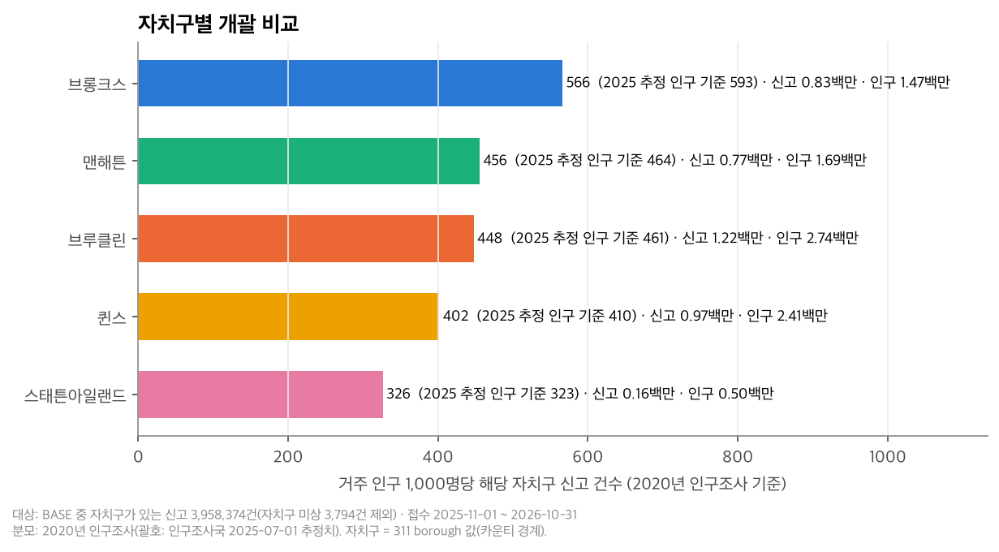
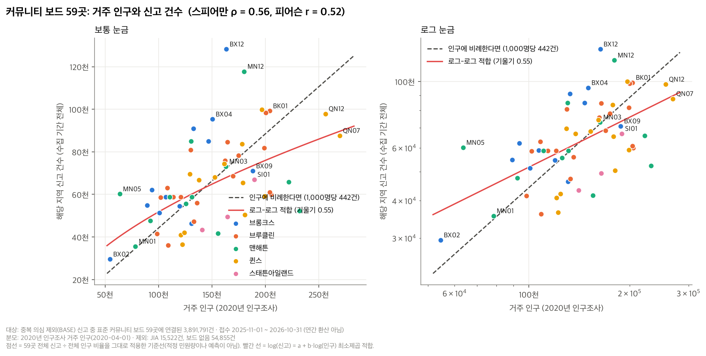
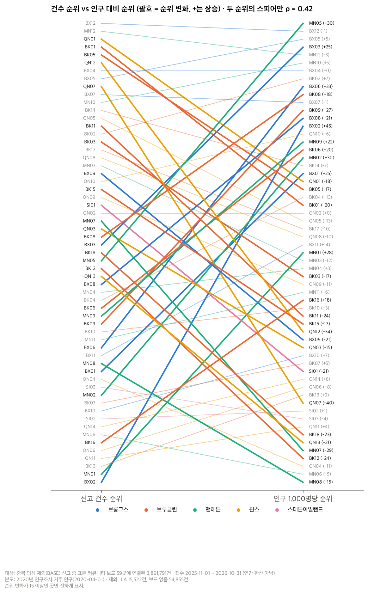
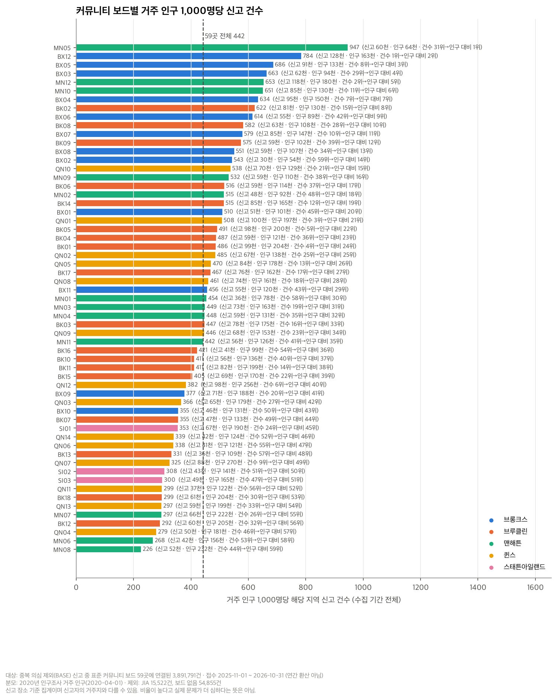
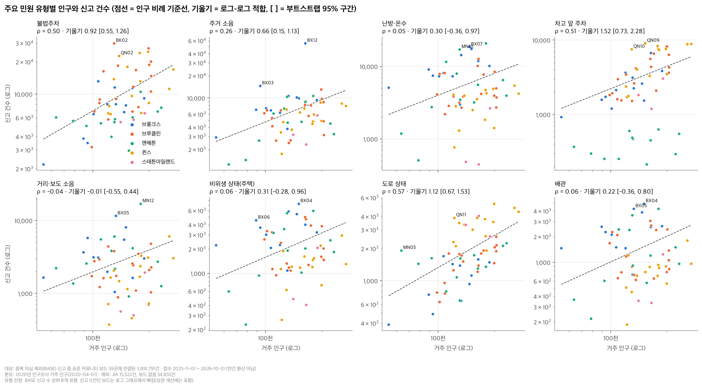
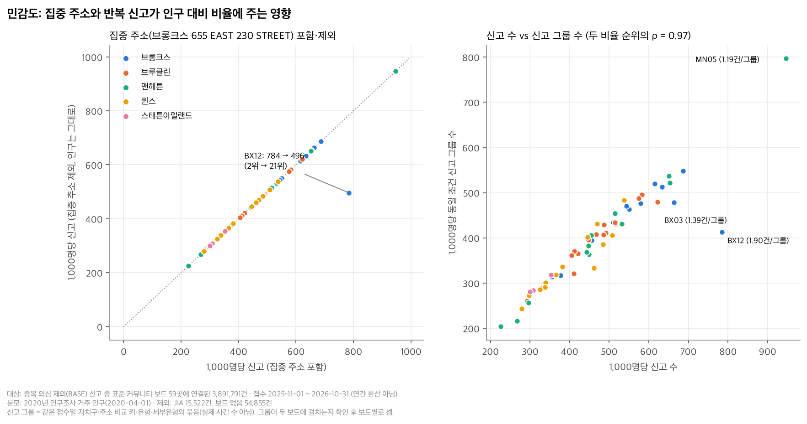

# 인구 규모와 311 신고량 분석

> 인구가 많아서 신고가 많은가, 아니면 인구 규모를 고려해도 상대적으로 신고가 많은 지역이 있는가?

- **작성**: 2026-11-22
- **코드**: `scripts/population/population_analysis.py`(분석), `render_tables.py`(표)
- **결과 파일**: `reports/population/`(표 CSV, 그림, `population_results.json`)
- **보존**: 원본·interim·processed 데이터, 기존 EDA 결과, 대시보드는 수정하지 않았습니다. 전처리를 다시 실행하지 않았고, processed Parquet만 읽었습니다.

**모든 표·그림의 공통 기준**
- **대상 기간**: 접수일 2025-11-01 21:09 ~ 2026-10-31 21:09. 이 기간의 건수 그대로이며 연간 환산하지 않았습니다.
- **대상 신고**: 기존 BASE(중복 의심 제외, 3,962,168건) 중 표준 커뮤니티 보드 59곳에 연결된 3,891,791건.
- **분모**: 2020년 인구조사 거주 인구(2020-04-01).
- **지표 이름**: 「거주 인구 1,000명당 해당 지역 신고 건수」. 신고 장소 기준이며, 신고자가 그 지역 주민이라는 뜻이 아닙니다.

---

## 0. 한눈에 보기

### [사실] 데이터로 확인된 것
- **인구와 신고는 함께 늘지만, 비례하지는 않습니다.**
  - 59곳의 인구와 신고 건수의 상관은 스피어만 ρ = 0.56(95% 구간 0.37~0.71), 피어슨 r = 0.52입니다.
  - 로그-로그 기울기는 0.55(95% 구간 0.35~0.76)입니다. 정비례라면 1이어야 하는데, 구간이 1을 포함하지 않습니다.
  - 인구 차이가 설명하는 부분은 신고 건수(로그) 차이의 약 1/3입니다(R² = 0.33).
- **인구를 고려하면 순위가 크게 바뀝니다.**
  - 건수 순위와 1,000명당 순위의 상관은 ρ = 0.42입니다.
  - 순위가 움직인 폭의 중앙값은 14계단이고, 59곳 중 37곳이 10계단 이상 움직였습니다.
- **인구 대비 신고가 많은 곳**
  - 맨해튼 5(MN05, 미드타운)는 1,000명당 947건으로 1위입니다. 인구는 59곳 중 두 번째로 적습니다.
  - 브롱크스 12(BX12) 784건, 브롱크스 5 686건, 브롱크스 3 663건이 뒤를 잇습니다.
- **인구 대비 신고가 적은 곳**: 맨해튼 8(226건), 맨해튼 6(268건), 퀸스 4(279건)입니다.
- **민원 유형에 따라 관계가 전혀 다릅니다.**
  - 불법주차·도로 상태·차고 앞 주차는 인구와 중간 정도의 양의 관계가 있습니다(ρ 0.50~0.57).
  - 난방·온수, 비위생 상태, 배관 같은 주거 관련 유형과 거리 소음은 인구와 거의 무관합니다(ρ −0.04~0.06). 대신 어느 자치구에 있느냐로 비율이 크게 갈립니다.
- **집중 주소의 영향은 브롱크스 12와 주거 소음에 한정됩니다.**
  - 집중 주소(브롱크스 655 EAST 230 STREET)를 빼면 브롱크스 12의 1,000명당 신고가 784건에서 496건으로 줄고, 순위는 2위에서 21위로 내려갑니다.
  - 나머지 58곳의 순위는 최대 1계단만 움직입니다.
- **신고 수 대신 신고 그룹 수로 세도 전체 결론은 거의 같습니다.** 두 비율 순위의 상관이 ρ = 0.97입니다.
  - 브롱크스 12만은 그룹 기준으로 2위에서 22위로 내려갑니다.

### [가능한 설명] 데이터와 맞지만 확정할 수 없는 것
- 미드타운(MN05)처럼 거주 인구는 적고 통근·방문·상업 활동이 많은 지역에서는 거주 인구가 신고 발생의 크기를 잘 나타내지 못할 수 있습니다.
- 주거 관련 신고는 사람 수보다 주택 재고, 임대 비중, 건물 노후도, 신고 습관에 더 가깝게 움직일 수 있습니다.
  - 주거 관련 유형은 자치구가 비율 차이의 43~53%를 설명합니다.
- 차고 앞 주차는 퀸스에서 많고 맨해튼에서는 거의 없습니다. 차고가 있는 주택이 얼마나 되는지와 관련될 수 있습니다.

### [판단 불가] 현재 자료로 판단할 수 없는 것
- 1,000명당 신고가 높은 지역에서 실제 문제가 더 심한지, 주민이 더 자주 신고하는지, 외부인이 신고한 것인지.
- 인구 대비 차이의 원인: 주택 구조, 소득, 방문객 수, 기관 대응 방식 등.
- 2025~2026년 실제 CD별 인구. CD 단위의 최신 전수 자료는 없습니다.

---

## 1. 인구 자료와 지역 연결 품질

### 1-1. 사용한 인구 자료와 선택 이유

| 용도 | 자료 | 기준 시점 | 비고 |
|---|---|---|---|
| **주 분석 (CD 59곳)** | 뉴욕시 도시계획국(DCP) 『2020 Census Data』의 커뮤니티 디스트릭트별 인구 (`GeoType = CD`) | 2020-04-01 전수조사 | CD 경계 그대로의 집계. 59곳 인구 합 8,803,220명, 공동 관리 구역(JIA) 12곳 970명, 합계 = 뉴욕시 8,804,190명 |
| 자치구 개괄 | 같은 파일의 자치구 인구 + 인구조사국 인구추정(Vintage 2025) | 2020-04-01 / 2025-07-01 | 2025년 값은 모형 기반 추정치 |
| 연결 검증 | DCP 커뮤니티 디스트릭트 경계 (NYC Open Data `5crt-au7u`) | 내려받은 날 기준 | 인구 배분에는 쓰지 않음 |

출처 URL, 내려받은 날짜, 파일 해시는 `data/external/population/SOURCES.md`에 기록했습니다.

**검토 결과, 요청에 있던 ACS 5년 추정치 대신 2020년 인구조사를 썼습니다.**
- **경계가 정확히 같습니다.** DCP는 2020년 인구조사를 CD 경계 그대로 집계해 공개합니다. 311 신고의 `community_board`도 같은 CD 체계(번호 01~18, JIA 26~95)를 씁니다. 이름이 비슷해서가 아니라 코드 체계와 경계 파일로 확인했습니다(1-2절).
- **ACS의 CD 단위 값은 근사 경계입니다.** ACS 5년 추정치는 CD 단위로 직접 나오지 않고, CD와 경계가 다른 PUMA로 근사합니다. 표본 오차도 있습니다.
- **전수조사라 표본 오차가 없습니다.** 다만 인구조사 자체의 포함 오차(과소·과다 집계)는 있습니다.

**시점 차이**
- 인구 기준 시점(2020-04)과 신고 기간(2025-11~2026-10) 사이에 약 5년 반의 차이가 있습니다.
- 인구조사국 추정으로 2020년 기준값 대비 2025-07 인구 변화는 다음과 같습니다.
  - 브롱크스 −4.5%, 브루클린 −3.0%, 퀸스 −2.0%, 맨해튼 −1.8%, 스태튼아일랜드 +1.0%
- 같은 자치구 안에서도 CD마다 변화가 다를 수 있지만, CD별 최신 추정치는 없습니다. 자치구 변화율을 CD에 임의로 나눠 적용하지 않았습니다.
- 자치구 수준에서는 2025년 추정 인구로 바꿔도 순위가 같았습니다(1-3절). 1,000명당 신고가 2~5% 커질 뿐입니다.
- 이 정도의 변화는 CD 간 1,000명당 신고 차이(최저 226 ~ 최고 947, 4.2배)보다 훨씬 작습니다. 다만 변화가 큰 일부 CD의 순위는 몇 계단 달라질 수 있습니다.

### 1-2. 신고와 지역의 연결

| 구분 | 신고 수 | 비중 | 인구 대비 계산 |
|---|---:|---:|---|
| 표준 커뮤니티 보드 59곳에 연결 | 3,891,791 | 98.22% | O |
| 공동 관리 구역(JIA: 공원·공항 등, 코드 26~95) | 15,522 | 0.39% | X (JIA 인구 0~566명, 라과디아 공항은 0명) |
| 커뮤니티 보드 값 없음 | 54,855 | 1.38% | X |
| **합계 (BASE)** | **3,962,168** | 100% | |

- **1:1 연결**: 59곳 모두 인구 자료와 1:1로 연결됐습니다. 행 중복이나 누락은 없습니다(스크립트가 검사).
- **좌표 검사**: 신고 좌표가 그 신고의 보드 코드와 같은 CD 경계 안에 있는지 표본 약 10%(384,187건)로 확인했습니다.
  - 99.62%가 일치했습니다. 가장 낮은 곳도 맨해튼 4의 98.3%입니다.
  - 다른 CD 경계 안에 찍힌 신고는 0.35%로, 대부분 경계선 근처로 보입니다.
- **자치구 경계를 넘는 곳**: 보드 코드의 자치구와 `borough` 값이 다른 신고가 있습니다.
  - 마블힐(브롱크스 CD 8이지만 맨해튼 카운티) 2,751건, 라이커스섬(퀸스 CD 1이지만 브롱크스 카운티) 6건입니다.
  - DCP가 설명한 「자치구 경계를 넘는 CD 2곳」과 정확히 같습니다. CD 분석은 보드 코드 기준이라 인구와 경계가 맞습니다.
- **분모 크기**: 가장 작은 CD의 인구는 브롱크스 2의 54,454명입니다. 작은 분모 때문에 비율이 튀는 문제는 59곳 안에서는 크지 않습니다. 인구가 사실상 없는 JIA는 제외했습니다.
- **시설 거주자**: 퀸스 1에는 교정시설 거주자 3,745명(라이커스섬)이 포함돼 있습니다.
  - 분모를 시설 거주자를 뺀 가구원 인구로 바꿔도 1,000명당 순위의 상관이 ρ = 0.995로 거의 같습니다.

### 1-3. 자치구 개괄 (5곳)

대상: BASE 중 자치구가 있는 신고. 자치구 미상 3,794건은 제외했습니다. 자치구는 311의 `borough` 값(카운티 경계)입니다.

| 자치구 | 거주 인구 2020 | 2025-07 추정 인구 | 신고 건수 | 1,000명당 (2020 인구) | 1,000명당 (2025 추정) | 건수 순위 | 인구 대비 순위 (2020 / 2025 추정) |
|---|---:|---:|---:|---:|---:|---:|---:|
| 브롱크스 | 1,472,654 | 1,406,332 | 834,190 | 566 | 593 | 3 | 1 / 1 |
| 맨해튼 | 1,694,251 | 1,664,862 | 771,759 | 456 | 464 | 4 | 2 / 2 |
| 브루클린 | 2,736,074 | 2,653,963 | 1,224,563 | 448 | 461 | 1 | 3 / 3 |
| 퀸스 | 2,405,464 | 2,358,182 | 966,146 | 402 | 410 | 2 | 4 / 4 |
| 스태튼아일랜드 | 495,747 | 501,290 | 161,716 | 326 | 323 | 5 | 5 / 5 |

- **[사실]** 건수는 브루클린이 가장 많지만(1위), 1,000명당은 브롱크스(566건)가 가장 높습니다. 2025년 추정 인구를 써도 순위가 같습니다.
- 자치구 다섯 곳만으로는 인구와 신고의 관계를 판단하기에 관측치가 너무 적습니다. 그래서 주 분석은 CD 59곳으로 했습니다.

---

## 2. 인구와 신고 건수의 관계 (CD 59곳)

| 항목 | 값 | 읽는 법 |
|---|---|---|
| 스피어만 ρ (순위 상관) | 0.56 [0.37, 0.71] | 인구가 많은 곳이 신고도 많은 경향이 중간 정도 |
| 피어슨 r (원래 값) | 0.52 [0.34, 0.68] | 순위 상관과 비슷 |
| 피어슨 r (로그 값) | 0.57 | |
| 로그-로그 적합 log(신고) = a + b·log(인구) | b = 0.55 (부트스트랩 95% 구간 0.35~0.76), R² = 0.33 | b = 1이면 인구에 정비례. 1보다 작음 = 인구가 2배여도 신고는 약 1.5배 |
| 한 곳씩 빼고 다시 계산 | 기울기 0.51~0.61, ρ 0.54~0.60 | 특정 한 지역이 결론을 좌우하지 않음 |
| 영향이 가장 큰 관측치 (Cook's D) | MN05 0.19, MN08 0.10, BX02 0.09 | 모두 1보다 훨씬 작음 |

- **방법 선택**
  - 신고 건수(왜도 0.74)와 1,000명당 비율(왜도 0.87)이 오른쪽으로 치우쳐 있습니다. 그래서 순위 상관(스피어만)을 주 지표로 쓰고, 피어슨은 참고로 함께 적었습니다.
  - 정비례 여부는 로그-로그 기울기 하나로만 봤습니다. 관측치가 59개이고 분포가 치우쳐 있어서, 그 이상의 복잡한 모형은 쓰지 않았습니다.
- **인구 범위가 좁습니다.** CD 인구의 상하위 10% 비율은 2.1배(54,454~269,587명)뿐입니다. 신고 건수의 차이(2.3배)와 비슷한 수준이라, 인구만으로 큰 차이가 생기기 어려운 구조입니다.
- **관측치가 서로 독립이 아닙니다.**
  - 1,000명당 비율(로그)의 차이 중 23%를 자치구가 설명합니다(순열검정 p = 0.007).
  - 같은 자치구, 인접 지역끼리 비슷하다는 뜻이라 관측치가 완전히 독립이 아닙니다.
  - 그래서 위의 신뢰구간과 유의성은 실제보다 좁게 계산됐을 수 있습니다. 결론을 상관계수나 p값 하나에 기대지 않았습니다.
- **해석 범위**: 지역 단위의 관계입니다. 개인의 신고 성향(「이 지역 주민은 신고를 많이 한다」)으로 해석하지 마세요.

### 「인구에 비례한다면」 기준선

- **계산**: 기대 신고 = 59곳 신고 합계 × (그 지역 인구 ÷ 59곳 인구 합계).
  - 1,000명당 442.1건(= 3,891,791 ÷ 8,803,220 × 1,000)을 모든 지역에 똑같이 적용한 것입니다.
  - 지역별 비율의 단순 평균(461.6)이 아니라 전체 합계로 나눈 값입니다.
- **의미**: 이 값은 통계 모형의 예측이나 적정 민원량이 아닙니다. 「인구에 비례한다면」이라는 비교용 기준선일 뿐입니다.
- **실제/기대 비율**: 1,000명당 신고를 442.1로 나눈 것과 같습니다. 별도의 발견이 아니므로 표에서는 1,000명당 신고만 보여 줍니다. CSV에는 `actual_to_expected` 열로 들어 있습니다.
- **잔차**: 로그-로그 적합의 잔차는 「인구 규모로 설명되지 않는 차이」입니다. 「인구와 관계없는 민원」이 아닙니다.

---

## 3. 건수 순위 vs 인구 대비 순위

**[사실] 순위가 크게 오르는 곳 (건수 → 1,000명당)**

| 보드 | 건수 순위 → 1,000명당 순위 | 1,000명당 | 인구 |
|---|---|---:|---|
| BX02 | 59위 → 14위 (+45) | 543 | 59곳 중 가장 적음 |
| BX06 | 42위 → 9위 (+33) | 614 | |
| MN05 | 31위 → 1위 (+30) | 947 | 63,600명 |
| MN02 | 48위 → 18위 (+30) | 515 | 92,445명 |

**[사실] 순위가 크게 내려가는 곳**

| 보드 | 건수 순위 → 1,000명당 순위 | 1,000명당 | 인구 |
|---|---|---:|---|
| QN07 | 9위 → 49위 (−40) | 325 | 59곳 중 가장 많음 (269,587명) |
| QN12 | 6위 → 40위 (−34) | 382 | 256,278명 |
| MN07 | 26위 → 55위 (−29) | 297 | 222,129명 |
| BK12 | 32위 → 56위 (−24) | 292 | 205,377명 |
| BK11 | 14위 → 38위 (−24) | 411 | 198,870명 |
| QN01 | 3위 → 21위 (−18) | 508 | 196,803명 |

### 지역별 전체 표 (59곳, 1,000명당 순위 순)

- **순위 변화**: 건수 순위 − 1,000명당 순위. +는 인구를 고려하면 순위가 오른다는 뜻입니다.
- **집중 주소 제외**: 집중 주소의 신고만 빼고 인구는 그대로 둔 값입니다.
- **신고 그룹**: 같은 접수일·자치구·주소 비교 키·유형·세부유형의 묶음입니다. 실제 사건 수가 아닙니다.

| 인구 대비 순위 | 보드 | 자치구 | 거주 인구(2020) | 신고 건수 | 1,000명당 신고 | 건수 순위 | 순위 변화 | 집중 주소 제외 시 1,000명당 (순위) | 1,000명당 신고 그룹 (순위) | 그룹당 신고 |
|---:|---|---|---:|---:|---:|---:|---:|---:|---:|---:|
| 1 | MN05 | 맨해튼 | 63,600 | 60,203 | 947 | 31 | +30 | 947 (1) | 797 (1) | 1.19 |
| 2 | BX12 | 브롱크스 | 163,489 | 128,204 | 784 | 1 | -1 | 496 (21) | 413 (22) | 1.90 |
| 3 | BX05 | 브롱크스 | 132,584 | 90,995 | 686 | 8 | +5 | 686 (2) | 548 (2) | 1.25 |
| 4 | BX03 | 브롱크스 | 93,755 | 62,176 | 663 | 29 | +25 | 663 (3) | 479 (11) | 1.39 |
| 5 | MN12 | 맨해튼 | 180,206 | 117,731 | 653 | 2 | -3 | 653 (4) | 522 (4) | 1.25 |
| 6 | MN10 | 맨해튼 | 130,440 | 84,927 | 651 | 11 | +5 | 651 (5) | 537 (3) | 1.21 |
| 7 | BX04 | 브롱크스 | 150,436 | 95,312 | 634 | 7 | 0 | 634 (6) | 513 (6) | 1.23 |
| 8 | BK02 | 브루클린 | 130,021 | 80,811 | 622 | 15 | +7 | 622 (7) | 479 (10) | 1.30 |
| 9 | BX06 | 브롱크스 | 89,216 | 54,819 | 614 | 42 | +33 | 614 (8) | 520 (5) | 1.18 |
| 10 | BK08 | 브루클린 | 108,259 | 63,039 | 582 | 28 | +18 | 582 (9) | 496 (7) | 1.17 |
| 11 | BX07 | 브롱크스 | 146,813 | 84,997 | 579 | 10 | -1 | 579 (10) | 477 (12) | 1.21 |
| 12 | BK09 | 브루클린 | 102,000 | 58,616 | 575 | 39 | +27 | 575 (11) | 487 (8) | 1.18 |
| 13 | BX08 | 브롱크스 | 106,924 | 58,864 | 551 | 34 | +21 | 551 (12) | 463 (14) | 1.19 |
| 14 | BX02 | 브롱크스 | 54,454 | 29,560 | 543 | 59 | +45 | 543 (13) | 471 (13) | 1.15 |
| 15 | QN10 | 퀸스 | 129,411 | 69,581 | 538 | 21 | +6 | 538 (14) | 483 (9) | 1.11 |
| 16 | MN09 | 맨해튼 | 110,458 | 58,730 | 532 | 38 | +22 | 532 (15) | 431 (18) | 1.23 |
| 17 | BK06 | 브루클린 | 113,933 | 58,786 | 516 | 37 | +20 | 516 (16) | 431 (20) | 1.20 |
| 18 | MN02 | 맨해튼 | 92,445 | 47,590 | 515 | 48 | +30 | 515 (17) | 454 (15) | 1.13 |
| 19 | BK14 | 브루클린 | 164,568 | 84,680 | 515 | 12 | -7 | 515 (18) | 434 (16) | 1.18 |
| 20 | BX01 | 브롱크스 | 100,929 | 51,437 | 510 | 45 | +25 | 510 (19) | 434 (17) | 1.17 |
| 21 | QN01 | 퀸스 | 196,803 | 99,938 | 508 | 3 | -18 | 508 (20) | 406 (27) | 1.25 |
| 22 | BK05 | 브루클린 | 200,293 | 98,387 | 491 | 5 | -17 | 491 (22) | 410 (23) | 1.20 |
| 23 | BK04 | 브루클린 | 120,747 | 58,808 | 487 | 36 | +13 | 487 (23) | 429 (21) | 1.14 |
| 24 | BK01 | 브루클린 | 204,125 | 99,201 | 486 | 4 | -20 | 486 (24) | 407 (25) | 1.19 |
| 25 | QN02 | 퀸스 | 137,981 | 66,867 | 485 | 25 | 0 | 485 (25) | 385 (31) | 1.26 |
| 26 | QN05 | 퀸스 | 178,178 | 83,669 | 470 | 13 | -13 | 470 (26) | 431 (19) | 1.09 |
| 27 | BK17 | 브루클린 | 162,446 | 75,929 | 467 | 17 | -10 | 467 (27) | 408 (24) | 1.14 |
| 28 | QN08 | 퀸스 | 161,402 | 74,380 | 461 | 18 | -10 | 461 (28) | 334 (39) | 1.38 |
| 29 | BX11 | 브롱크스 | 119,666 | 54,548 | 456 | 43 | +14 | 456 (29) | 394 (30) | 1.16 |
| 30 | MN01 | 맨해튼 | 78,390 | 35,602 | 454 | 58 | +28 | 454 (30) | 406 (26) | 1.12 |
| 31 | MN03 | 맨해튼 | 163,141 | 73,180 | 449 | 19 | -12 | 449 (31) | 363 (36) | 1.24 |
| 32 | MN04 | 맨해튼 | 131,351 | 58,809 | 448 | 35 | +3 | 448 (32) | 382 (32) | 1.17 |
| 33 | BK03 | 브루클린 | 174,960 | 78,206 | 447 | 16 | -17 | 447 (33) | 396 (29) | 1.13 |
| 34 | QN09 | 퀸스 | 152,839 | 68,116 | 446 | 23 | -11 | 446 (34) | 401 (28) | 1.11 |
| 35 | MN11 | 맨해튼 | 125,771 | 55,649 | 442 | 41 | +6 | 442 (35) | 369 (34) | 1.20 |
| 36 | BK16 | 브루클린 | 98,506 | 41,488 | 421 | 54 | +18 | 421 (36) | 366 (35) | 1.15 |
| 37 | BK10 | 브루클린 | 136,071 | 55,949 | 411 | 40 | +3 | 411 (37) | 370 (33) | 1.11 |
| 38 | BK11 | 브루클린 | 198,870 | 81,749 | 411 | 14 | -24 | 411 (38) | 321 (40) | 1.28 |
| 39 | BK15 | 브루클린 | 169,632 | 68,696 | 405 | 22 | -17 | 405 (39) | 362 (37) | 1.12 |
| 40 | QN12 | 퀸스 | 256,278 | 97,863 | 382 | 6 | -34 | 382 (40) | 336 (38) | 1.14 |
| 41 | BX09 | 브롱크스 | 188,249 | 70,986 | 377 | 20 | -21 | 377 (41) | 317 (44) | 1.19 |
| 42 | QN03 | 퀸스 | 179,134 | 65,487 | 366 | 27 | -15 | 366 (42) | 318 (42) | 1.15 |
| 43 | BX10 | 브롱크스 | 130,763 | 46,416 | 355 | 50 | +7 | 355 (43) | 314 (45) | 1.13 |
| 44 | BK07 | 브루클린 | 133,230 | 47,282 | 355 | 49 | +5 | 355 (44) | 319 (41) | 1.11 |
| 45 | SI01 | 스태튼아일랜드 | 189,663 | 67,019 | 353 | 24 | -21 | 353 (45) | 318 (43) | 1.11 |
| 46 | QN14 | 퀸스 | 124,173 | 42,126 | 339 | 52 | +6 | 339 (46) | 301 (46) | 1.13 |
| 47 | QN06 | 퀸스 | 120,955 | 40,905 | 338 | 55 | +8 | 338 (47) | 291 (47) | 1.16 |
| 48 | BK13 | 브루클린 | 108,905 | 36,082 | 331 | 57 | +9 | 331 (48) | 289 (48) | 1.15 |
| 49 | QN07 | 퀸스 | 269,587 | 87,622 | 325 | 9 | -40 | 325 (49) | 286 (49) | 1.14 |
| 50 | SI02 | 스태튼아일랜드 | 140,795 | 43,297 | 308 | 51 | +1 | 308 (50) | 284 (50) | 1.08 |
| 51 | SI03 | 스태튼아일랜드 | 164,723 | 49,438 | 300 | 47 | -4 | 300 (51) | 281 (51) | 1.07 |
| 52 | QN11 | 퀸스 | 122,211 | 36,519 | 299 | 56 | +4 | 299 (52) | 278 (52) | 1.07 |
| 53 | BK18 | 브루클린 | 204,095 | 60,966 | 299 | 30 | -23 | 299 (53) | 274 (53) | 1.09 |
| 54 | QN13 | 퀸스 | 199,218 | 59,170 | 297 | 33 | -21 | 297 (54) | 273 (54) | 1.09 |
| 55 | MN07 | 맨해튼 | 222,129 | 65,903 | 297 | 26 | -29 | 297 (55) | 257 (56) | 1.16 |
| 56 | BK12 | 브루클린 | 205,377 | 60,026 | 292 | 32 | -24 | 292 (56) | 261 (55) | 1.12 |
| 57 | QN04 | 퀸스 | 181,025 | 50,478 | 279 | 46 | -11 | 279 (57) | 243 (57) | 1.15 |
| 58 | MN06 | 맨해튼 | 155,614 | 41,646 | 268 | 53 | -5 | 268 (58) | 216 (58) | 1.24 |
| 59 | MN08 | 맨해튼 | 231,983 | 52,331 | 226 | 44 | -15 | 226 (59) | 204 (59) | 1.11 |

---

## 4. 민원 유형별 관계

**유형 선정 기준**
- BASE 신고 수 상위 8개 유형입니다. 각 89,000건 이상이고, 95~100%가 표준 CD에 연결됩니다.
- 요청한 네 유형(난방·온수, 주거 소음, 불법주차, 거리 소음)이 모두 들어갑니다.
- 같은 59곳, 같은 인구, 같은 기간을 씁니다. 신고가 0건인 CD는 없었습니다.

| 유형 | 59곳 신고 | 1,000명당 (59곳 전체) | 인구와 스피어만 ρ [95% 구간] | 로그-로그 기울기 [95% 구간] | 최고/최저 비율 배수 | 상위 5곳 신고 비중 (그 5곳 인구 비중) | 자치구가 설명하는 비율 차이(η²) | 1,000명당 최고 3곳 |
|---|---:|---:|---|---|---:|---|---:|---|
| 불법주차 | 613,477 | 69.7 | 0.50 [0.28, 0.67] | 0.92 [0.55, 1.26] | 12배 | 21% (10%) | 0.26 | BK02 230, QN02 166, BK06 144 |
| 주거 소음 | 415,935 | 47.2 | 0.26 [-0.00, 0.49] | 0.66 [0.15, 1.13] | 24배 | 25% (9%) | 0.34 | BX12 340, BX03 157, BX05 81 |
| 난방·온수 | 351,754 | 40.0 | 0.05 [-0.18, 0.30] | 0.30 [-0.36, 0.97] | 48배 | 25% (8%) | 0.53 | MN10 131, BX07 126, MN12 116 |
| 차고 앞 주차 | 195,723 | 22.2 | 0.51 [0.26, 0.71] | 1.52 [0.73, 2.28] | 45배 | 22% (12%) | 0.81 | QN09 59, QN10 58, QN05 47 |
| 거리·보도 소음 | 173,071 | 19.7 | -0.04 [-0.28, 0.19] | -0.01 [-0.55, 0.44] | 34배 | 28% (10%) | 0.34 | MN12 95, BX05 87, BX03 62 |
| 비위생 상태(주택) | 139,414 | 15.8 | 0.06 [-0.19, 0.30] | 0.31 [-0.28, 0.96] | 24배 | 22% (8%) | 0.43 | BX06 51, BX04 49, BX05 44 |
| 도로 상태 | 116,916 | 13.3 | 0.57 [0.38, 0.73] | 1.12 [0.67, 1.53] | 6배 | 19% (11%) | 0.53 | QN11 32, MN05 30, QN10 27 |
| 배관 | 89,067 | 10.1 | 0.06 [-0.20, 0.29] | 0.22 [-0.36, 0.80] | 21배 | 23% (8%) | 0.46 | BX04 32, BX05 32, BX06 29 |

- **기울기**: 로그-로그 기울기와 [ ] 안 구간은 부트스트랩 95% 구간입니다.
- **η²**: 1,000명당 비율(로그)의 차이 중 자치구가 설명하는 비율입니다.
- **상위 5곳 신고 비중**: 1,000명당이 아니라 건수 기준 상위 5곳이 그 유형 신고에서 차지하는 비중입니다.

### 유형별 해석과 분모의 적절성

**주거 관련 (난방·온수, 비위생 상태, 배관)**
- **[사실]**
  - 인구와 거의 무관합니다(ρ 0.05~0.06, 기울기 구간이 0과 1을 모두 포함).
  - 1,000명당 비율이 지역 간 21~48배 차이 나고, 자치구가 그 차이의 43~53%를 설명합니다.
  - 상위권은 브롱크스(BX04~BX07)와 북부 맨해튼(MN10, MN12)입니다.
- **분모**: 거주 인구보다 「주택 수」가 더 직접적인 분모입니다. 거주 중인 주택 1,000호당으로 바꿔도 순위의 상관이 ρ = 0.95로 거의 같았습니다.
- **[가능한 설명]** 임대주택 비중이나 건물 노후도가 더 적절한 분모일 수 있지만 이번에는 쓰지 않았습니다. 원인은 단정하지 않습니다.

**주거 소음**
- **[사실]**
  - 인구와 약한 관계입니다(ρ 0.26, 구간 하한이 0 근처).
  - 브롱크스 12가 1,000명당 340건으로 압도적입니다. 집중 주소를 빼면 52건으로 22위가 됩니다.
  - 집중 주소를 빼면 상위 5곳의 신고 비중이 25%에서 16%로 줄어듭니다.
- **분모**: 주거 소음은 거주자가 겪는 문제라 거주 인구나 주택 수가 분모로 적절한 편입니다. 다만 한 주소에서 반복된 신고가 지역 값을 좌우할 수 있습니다.

**불법주차·차고 앞 주차**
- **[사실]**
  - 불법주차는 인구와 중간 정도의 관계입니다(ρ 0.50, 기울기 0.92로 비례에 가까움).
  - 차고 앞 주차는 자치구 영향이 매우 큽니다(η² 0.81). 퀸스가 상위이고 맨해튼은 1,000명당 1~2건입니다.
- **분모**: 주차 문제는 거주 인구보다 차량 수, 주차 공간, 차고가 있는 주택 수, 방문 차량과 관련될 수 있습니다. 이 자료가 없으므로 거주 인구 대비 값은 참고로만 보세요.

**거리·보도 소음**
- **[사실]**
  - 인구와 무관합니다(ρ −0.04, 기울기 −0.01).
  - 1,000명당 상위는 맨해튼 12, 브롱크스 5, 브롱크스 3이고, 최고/최저 차이는 34배입니다.
- **분모**: 거리 소음은 유동 인구, 상업·유흥 활동, 차량 통행과 더 관련될 수 있어 거주 인구는 적절한 분모가 아닐 가능성이 큽니다.

**도로 상태**
- **[사실]** 인구와 비례에 가까운 관계입니다(ρ 0.57, 기울기 1.12). 지역 간 차이도 가장 작습니다(6배).
- **분모**: 도로 길이나 교통량이 더 직접적인 분모일 수 있습니다.

**유형별 1,000명당 순위와 전체 1,000명당 순위의 상관**

| 유형 | ρ |
|---|---:|
| 주거 관련 유형, 주거 소음 | 0.67~0.68 |
| 거리 소음 | 0.71 |
| 불법주차 | 0.30 |
| 차고 앞 주차 | −0.08 |
| 도로 상태 | −0.32 |

**[사실]** 「전체 1,000명당 신고가 높은 지역」은 주로 주거·소음 민원이 많은 지역이고, 주차·도로 민원이 많은 지역과는 다릅니다.

---

## 5. 민감도: 집중 주소와 신고 그룹

| 기준 | 59곳 1,000명당 | 인구와 ρ | 로그-로그 기울기 [95%] | 기본 결과와 1,000명당 순위 상관 | 브롱크스 12 (1,000명당, 순위) |
|---|---:|---:|---|---:|---|
| 신고 수 (기본) | 442.1 | 0.56 | 0.55 [0.35, 0.76] | — | 784, 2위 |
| 신고 수, 집중 주소 제외 (인구는 그대로) | 436.7 | 0.56 | 0.54 [0.34, 0.74] | 0.99 | 496, 21위 |
| 동일 조건 신고 그룹 수 | 371.0 | 0.62 | 0.56 [0.37, 0.74] | 0.97 | 413, 22위 |

**집중 주소**
- 신고 47,105건이 모두 브롱크스 12에 있습니다. 제외하면 브롱크스 12 외 지역의 1,000명당 순위는 최대 1계단만 바뀝니다.
- 즉 이 주소는 「브롱크스 12가 인구 대비 상위」라는 결과를 거의 혼자 만듭니다. 전체 관계(기울기·상관)는 바꾸지 않습니다.
- 제외 결과가 정답이라는 뜻은 아닙니다. 그 주소의 신고도 실제로 접수된 신고입니다.

**신고 그룹**

먼저 그룹이 여러 지역에 걸치는지 확인했습니다.
- 표준 CD 두 곳 이상에 걸친 그룹이 2,266개(신고 7,089건)였습니다.
  - 대부분은 「QUEENS BOULEVARD」 「BROADWAY」처럼 번지 없이 거리 이름만 있는 주소입니다. 번지가 있는 주소는 751개입니다.
  - 그룹이 같은 날·같은 주소 키로 묶이기 때문에, 긴 도로는 여러 CD에 걸칠 수 있습니다.
- **처리 방법**
  - CD별로는 그룹이 걸친 각 CD에서 한 번씩 셌습니다.
  - CD별 그룹 수의 합(3,268,502)은 실제 서로 다른 그룹 수(3,266,031)보다 2,471개 많습니다. 그래서 전체 값에는 서로 다른 그룹 수를 썼습니다.

그룹 기준 결과
- 그룹당 신고 수는 CD별로 1.07~1.90입니다. 브롱크스 12가 1.90으로 가장 높고, 같은 날 같은 주소의 반복이 많다는 뜻입니다.
- 그룹으로 세면 브롱크스 12는 2위에서 22위가 되고, 그 밖의 순위는 거의 같습니다(ρ 0.97).
- 유형별로도 신고 수와 그룹 수의 순위 상관이 0.92~1.00입니다. 가장 낮은 것은 주거 소음 0.92입니다.

---

## 6. 검증

| 검사 | 결과 |
|---|---|
| 59곳 신고 합계 = 표준 보드에 연결된 신고 수 (3,891,791) | 일치 |
| 연결 + JIA + 보드 없음 = BASE (3,962,168) | 일치 |
| 보드 코드 ↔ 인구 자료 1:1, 59곳 모두 연결, 중복 없음 | 통과 |
| CD 59 + JIA 12 인구 합 = 뉴욕시 인구 (8,804,190) | 일치 |
| 자치구별 신고 합 + 자치구 미상 = BASE | 일치 |
| 유형별 59곳 합계 = 유형별 표준 보드 연결 신고 수 | 일치 |
| 집중 주소 신고 47,105건 전부 BX12 | 일치 |
| CD별 그룹 합 − 서로 다른 그룹 수 = 여러 CD에 걸친 그룹의 추가 카운트 | 일치 (2,471) |
| 전체 비율 = 전체 합 ÷ 전체 인구 (단순 평균 461.6 아님) | 442.1 사용 |
| 다시 실행했을 때 같은 결과 (난수 시드 311) | 표 파일 해시 동일 |
| 신고 좌표 ↔ 보드 경계 일치 (표본 10%) | 99.62% |

---

## 7. 대시보드 반영 제안 (이번에는 반영하지 않음)

세 지표는 서로 다른 질문에 답합니다. 하나만 고르기보다 질문에 맞게 나란히 보여 주는 것을 권합니다.

| 지표 | 답하는 질문 | 이번 결과에서 본 장단점 | 표시 제안 |
|---|---|---|---|
| **전체 신고 건수** | 어디에 처리해야 할 신고가 많이 들어오나? (업무량, 자원 배치) | 인구가 많은 곳이 커 보입니다(QN07이 건수 9위지만 1,000명당 49위). 지역 간 「상대적으로 많다」 비교에는 부적합합니다. | 기본 지표로 유지하되, 지역 비교 화면에는 인구 대비 지표와 함께 표시 |
| **거주 인구 1,000명당 신고** | 주민 수에 비해 신고가 많은 지역은? | 순위를 크게 바꿉니다(ρ 0.42). 다만 미드타운처럼 거주 인구가 적고 유동 인구가 많은 곳이 커 보이고, 주차·거리 소음은 분모가 맞지 않습니다. | CD 단위 화면에 추가. 주거 관련·주거 소음 유형에서 우선 사용하고, 주차·거리 소음에는 「거주 인구가 적절한 분모가 아닐 수 있음」 안내 |
| **반복 정도 (그룹당 신고 수, 신고 그룹 기준 비율)** | 많은 신고가 넓게 퍼진 것인지, 몇 곳의 반복인지? | 전체 순위는 거의 같지만(ρ 0.97), BX12처럼 한 주소가 만든 높은 값을 가려냅니다(2위 → 22위). | 인구 대비 순위 옆에 「그룹 기준 순위」 「집중 주소 제외 순위」를 함께 표시해 민감도를 보이기 |

**구현 시 지킬 점**
- **표기**: 지표 이름은 「거주 인구 1,000명당 해당 지역 신고 건수(2020년 인구조사 기준)」로 쓰고, 기간을 함께 표시합니다. 연간 환산은 하지 않습니다.
- **분모**: 59곳 전체 비율은 합계 ÷ 합계로 계산합니다. 대시보드의 기존 필터(기간·유형)를 적용해도 분모(인구)는 바뀌지 않으므로, 한 달만 고르면 「그 달 신고 ÷ 인구」임을 명시해야 합니다.
- **제외 표시**: JIA와 보드 없는 신고(1.78%)는 인구 대비 화면에서 제외되므로 건수를 함께 표시합니다.
- **유형별 분모**: 유형별로 분모 적합성이 다릅니다. 주거 관련 유형은 「거주 중인 주택 1,000호당」도 같은 자료로 계산할 수 있습니다.
- **추가 자료 후보**: 차량 등록 수, 상업 활동, 유동 인구 자료를 확보하면 주차·거리 소음의 분모 문제를 다시 검토할 수 있습니다.

---

## 8. 한계

- **인구 시점**: 인구는 2020년 4월 기준이고 신고는 2025-11~2026-10입니다. 자치구 단위 추정으로는 −4.5%~+1.0%의 변화가 있었고, CD별 변화는 알 수 없습니다.
- **장소와 거주지의 차이**: 신고 장소는 신고자 거주지와 다릅니다. 외부인의 신고, 통근·관광 인구는 분모에 들어 있지 않습니다.
- **기간**: 1년 치 데이터라 계절성이나 해마다의 변동은 알 수 없습니다.
- **관측치 독립성**: 59곳은 인접·같은 자치구끼리 비슷해서 독립이 아닙니다. 신뢰구간은 참고용입니다.
- **신고 그룹**: 그룹은 실제 사건 수가 아니고, 번지 없는 도로명 주소는 여러 CD를 묶을 수 있습니다.
- **커뮤니티 보드 코드 신뢰도**: 표본 검사로 99.6% 일치를 확인했습니다. 보드 값이 없는 1.38%가 특정 지역에 몰려 있다면 그 지역의 값이 낮게 나올 수 있습니다(지역별 분포는 확인하지 않음).
