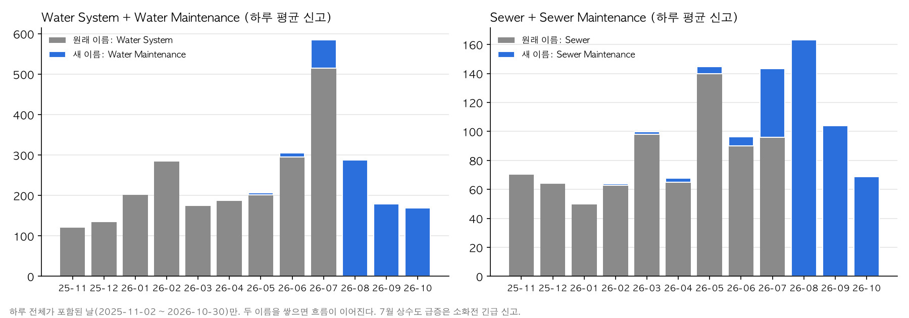

# 유형 이름 변경이 심화 분석에 미치는 영향

> 2026-07-29에 「상수도·하수」가 「상수도 유지보수·하수 유지보수」로 이름이 바뀐 것을, 「더 자세히 분석하기」(월별 변동·상관·군집)에도 반영하면 결과가 달라지는가?

- **작성**: 2026-11-25
- **스크립트**: `scripts/reclass_check/reclass_check.py`
- **결과 파일**: `reports/reclass_check/` (표 10개, 그림 1개, `reclass_check_results.json`)
- **보존**: 원본·전처리 결과·대시보드 파일은 읽기만 했습니다. 원래 유형 이름도 그대로 둡니다.

---

## 0. 요약

- **[사실] 두 이름을 합치면 「계절 변동」 이상값이 사라집니다.**

  | 유형 | 합치기 전 | 합친 뒤 |
  |---|---|---|
  | 상수도 유지보수 | 111개 유형 중 3위 (z 3.24, 이상값) | 상수도(통합) 109개 중 22위 (z 0.47) |
  | 하수 유지보수 | 4위 (z 3.21, 이상값) | 하수(통합) 33위 (z 0.09) |

  - 「계절 변동」 이상값 중 두 개는 신고 패턴이 아니라 **이름 변경 때문에 생긴 것**입니다.
- **[사실] 지표 사이의 상관은 거의 그대로입니다.** 모든 지표 쌍에서 변화가 0.05 미만입니다.
- **[사실] 세부 지역(커뮤니티 보드) 군집은 그대로입니다.**
  - 유형 보정 처리 시간 지수의 변화는 최대 0.0005입니다.
  - 군집 소속은 k=2~8 모두 같습니다.
- **[사실] 유형 군집은 바뀝니다.** 그 이유는 이름 변경 자체보다 군집 경계가 약하기 때문입니다.
  - 대시보드 기본값(k=3)에서 이름 변경과 **무관한** 105개 유형 중 10개의 소속이 바뀌었습니다(일치도 ARI 0.68).
    - 예: 난방·온수, 신호등 상태, 비긴급 경찰 사안, 택시 불만
  - k=4~6에서는 16~23개가 바뀝니다. k=2, 7에서는 하나도 바뀌지 않습니다.
  - 밤·주말 비중이 높은 경찰청 소음·주차 묶음(7개)은 어떤 경우에도 그대로입니다.
  - 흔들리는 것은 「오래 걸리는 업무」와 「중간 업무」 사이의 경계입니다.
- **[해석] 유형 군집은 「정해진 분류」가 아니라 「참고용 묶음」으로 읽어야 한다는 근거가 하나 더 생겼습니다.** 입력에서 유형 두 개만 합쳐도 다른 유형 10개의 소속이 바뀝니다.
- **[사실] 같은 방식의 변경이 더 있습니다** (4절).
  - DEP 「유해 물질」: 코드 붙은 이름이 코드 없는 이름으로 바뀌는 같은 형태입니다.
  - 노숙 거처(Encampment): 2026-10에 담당 기관이 경찰청에서 노숙인서비스국으로 넘어갔습니다.

---

## 1. 무엇을 했나

1. 원래 유형 이름은 그대로 두고, 비교용 「같은 업무」 이름을 따로 만들었습니다.
   - `Water System` + `Water Maintenance` → 상수도(통합)
   - `Sewer` + `Sewer Maintenance` → 하수(통합)
   - 이 묶음은 **가정**입니다. 공식 공지로 확인하지 않았습니다. 근거는 `monthly_composition_report.md` 5절입니다.
     - 날짜가 이어짐
     - 세부 유형이 1:1로 대응함
     - 같은 기관
     - 새 이름이 7/29 전에는 전화 외 경로로만 들어옴
2. `dashboard/build_relations_data.py`와 **같은 계산**을 두 번 했습니다. 한 번은 원래 이름으로, 한 번은 합친 이름으로 했습니다.
   - K-Means·실루엣·상관 함수는 그 스크립트에서 그대로 가져와 썼습니다.
3. **검산**
   - 원래 이름으로 다시 계산한 값이 대시보드 값과 일치합니다. 최대 차이 0.00005는 소수점 반올림 차이입니다.
   - 군집 소속도 대시보드와 같습니다.

---

## 2. 월별 변동 (현재 화면 이름: 「계절 변동」)

| 유형 | 신고 수 | 신고가 있는 달 | 변동 값 | 전체 순위 |
|---|---:|---:|---:|---:|
| 상수도 (원래 이름) | 64,153 | 9 | 0.80 | 11 / 111 |
| 상수도 유지보수 (원래 이름) | 22,329 | 12 | **1.53** | **3** / 111 |
| **상수도 (통합)** | 86,482 | 12 | 0.50 | 22 / 109 |
| 하수 (원래 이름) | 22,362 | 9 | 0.68 | 14 / 111 |
| 하수 유지보수 (원래 이름) | 12,284 | 12 | **1.52** | **4** / 111 |
| **하수 (통합)** | 34,646 | 12 | 0.38 | 33 / 109 |

- 「유지보수」는 12달 모두 신고가 있지만, 7월 전에는 한 달 수십~수백 건뿐이라 변동 값이 커졌습니다.
- 합친 뒤에도 상수도(통합)는 평균보다 변동이 큰 편입니다(22위). 7월 소화전 긴급 신고 급증 때문이고, 이것은 실제 신고 패턴입니다.

**[권장] 화면 이름은 「월별 변동」이 맞습니다.** 1년치라서 해마다 반복되는 「계절성」은 확인할 수 없습니다.

---

## 3. 군집

### 3-1. 유형 군집

| k | 실루엣 (전 → 후) | 다른 105개 유형의 일치도 (ARI) | 소속이 바뀐 유형 수 |
|---:|---|---:|---:|
| 2 | 0.383 → 0.389 | 1.00 | 0 |
| **3 (기본값)** | 0.302 → 0.277 | 0.68 | **10** |
| 4 | 0.254 → 0.305 | 0.43 | 23 |
| 5 | 0.273 → 0.279 | 0.66 | 18 |
| 6 | 0.279 → 0.277 | 0.81 | 16 |
| 7 | 0.307 → 0.302 | 1.00 | 0 |
| 8 | 0.265 → 0.286 | 0.83 | 8 |

- **ARI**: 두 군집 결과가 얼마나 같은지 나타내는 값입니다. 1 = 완전히 같음, 0 = 우연 수준.
- 실루엣이 가장 높은 k(3~6 중)는 합치기 전후 모두 3입니다.

**k=3 묶음의 모습** (각 묶음의 평균)

| 묶음 | 전: 유형 수 | 후: 유형 수 | 특징 |
|---|---:|---:|---|
| 오래 걸리는 업무 | 78 | 72 | 처리 시간 중앙값 약 100~150시간, 미종료 10~12% |
| 중간 업무 | 24 | 28 | 처리 시간 약 4~7시간, 한 자치구 쏠림 46~51% |
| 밤·주말 업무 (경찰청 소음 등) | 7 | 7 | 처리 시간 약 1시간, 밤 비중 43%, 주말 44%. **변화 없음** |

**k=3에서 소속이 바뀐 10개**
- 오래 걸리는 업무 → 중간 업무: 난방·온수, 신호등 상태, 비긴급 경찰 사안, 동물 학대, 긴급대응팀(ERT), 자전거·스케이트, 유해 물질
- 중간 업무 → 오래 걸리는 업무: 택시 불만, 거리 청소 불만, 비위생 비둘기

**[해석]**
- 바뀐 유형들은 두 묶음의 경계에 있던 유형입니다.
- 유형 두 개를 합치면 지표마다 평균·표준편차(z-점수 기준)가 조금 달라집니다. 그 정도의 차이만으로도 경계에 있던 유형이 넘어갑니다.
- 앞서 제안서가 지적한 「실루엣이 낮아 경계가 강하지 않다」는 점이 실제로 확인된 것입니다.

### 3-2. 세부 지역(커뮤니티 보드) 군집

- 세부 지역 군집에서 유형 이름을 쓰는 지표는 「유형 보정 처리 시간 지수」 하나뿐입니다. 이 지수는 같은 유형의 뉴욕시 전체 중앙값과 비교해 계산합니다.
- 합친 뒤 지수 변화는 최대 0.0005입니다. 군집 소속은 k=2~8, 집중 주소 포함·제외 모두 **완전히 같습니다**(ARI 1.00).

### 3-3. 상관

- 지표 45쌍의 Spearman 상관 변화는 최대 0.044입니다(계절 변동 × 최다 주소 비중: -0.07 → -0.03).
- 해석이 바뀌는 쌍은 없습니다.

---

## 4. 같은 방식으로 찾은 다른 변경 (500건 이상, 기간 중간에 시작하거나 끝나는 유형)

| 유형 | 기관 | 기간 | 판단 |
|---|---|---|---|
| 상수도 / 하수 | DEP | ~ 2026-07-29 | 이번 보고서의 대상 |
| **유해 물질 (Hazardous Materials, 1,481건)** | DEP | ~ 2026-07-28 | **같은 형태의 이름 변경으로 보임.** 「Hazardous Material」(900건)이 이어받음. 세부 유형도 코드가 빠진 같은 내용(예: `Chemical Odor (HD1)` → `Chemical Odor`) |
| **노숙 거처 (Encampment)** | NYPD → DHS | NYPD는 2026-09-22까지 | **담당 기관 변경.** 2026-10에 경찰청 0건, 노숙인서비스국 3,984건. 이름은 그대로 |
| 석면 (Asbestos) | DEP | ~ 2026-07-25 | DEP 접수만 끝남. 보건정신위생국(DOHMH) 접수는 계속됨 |
| 눈·얼음 | DSNY | 2025-11-10 ~ 2026-09-18 | 계절 접수 |
| 고인 물, 모기 | DOHMH | 2026-04-01 ~ | 계절 접수로 보임 |
| 학교 시설 관리 | DOE | ~ 2026-03-19 | 확인하지 않음 |

**[추가 확인 필요]**
- **유해 물질**: 「Hazardous Material」이 1,000건 미만이라 심화 분석에서 빠집니다. 「Hazardous Materials」만 남아 변동 값이 부풀려집니다(이번 k=3에서도 소속이 바뀐 유형 중 하나).
  - 상수도·하수와 함께 합치는 것을 권합니다.
- **노숙 거처의 기관 변경**: 기관을 조건으로 쓰는 분석에 영향이 있습니다.
  - 같은 업무끼리 맞춘 비교(종료 시간, 요일·시간대): 기관과 월을 함께 맞추므로 결론은 유지됩니다. 다만 2026-10 노숙 거처는 DHS 쪽 결과에만 들어 있습니다.
  - 기관별 화면: 10월에 NYPD 노숙 거처가 사라지고 DHS가 늘어난 것은 업무 이관 때문입니다.

---

## 5. 결론과 권장

| 할 일 | 권장 | 이유 |
|---|---|---|
| 「계절 변동」 → 「월별 변동」 이름 변경 | **반영** | 1년치라 계절성은 확인할 수 없음 |
| 심화 분석에 「같은 업무」 이름 사용 | **반영** (상수도·하수, 가능하면 유해 물질까지) | 이상값 2~3개가 이름 변경 때문에 생긴 것. 원래 이름은 표시 문구로 남김 |
| 유형 군집 설명 보강 | **반영** | 「입력이 조금만 바뀌어도 경계의 유형 10여 개가 다른 묶음으로 옮겨 감. 묶음 번호보다 지표 값으로 비교할 것」 |
| 세부 지역 군집 | 변경 불필요 | 결과가 완전히 같음 |
| 노숙 거처 기관 변경 | 기관별 화면·보고서에 주의 문구 | 업무 이관을 실적 변화로 오해하지 않게 |
| 공식 확인 | 계속 필요 | 311·DEP 공지나 데이터셋 변경 기록 |

## 6. 대시보드 반영 (2026-11-25)

- 백업: `backup/20261125_before_reclass_merge/`
- `dashboard/build_relations_data.py`: 상수도·하수에 **유해 물질까지 3쌍**을 합친 「같은 업무」 이름으로 계산합니다(`SAME_WORK`). 「계절 변동」은 「월별 변동」으로 바꿨습니다.
- 반영 결과: 유형 109개, k=3 실루엣 0.302 → 0.340. 합치기 전과 비교하면 다른 104개 유형 중 5개의 묶음이 바뀌었습니다(ARI 0.82).
  - 바뀐 유형: 거리 청소 불만, 고속도로 상태, 실시간 단속, 방치 자전거, 상업 폐기물
  - 위 3절의 10개는 상수도·하수 두 쌍만 합친 결과라, 유해 물질까지 합친 대시보드 결과와 다릅니다. 경계가 약하다는 결론은 같습니다.
- 화면 문구: 묶기 화면에 합친 사실과 경계 주의를 표시했습니다. 기관별 화면(NYPD·DHS·DEP)에 이름·기관 변경 주의를 표시했고, 용어 도움말에 「담당 기관 변경」 항목을 추가했습니다.
- 세부 지역 군집은 변하지 않았습니다.
