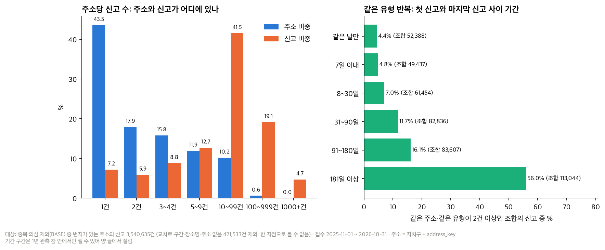
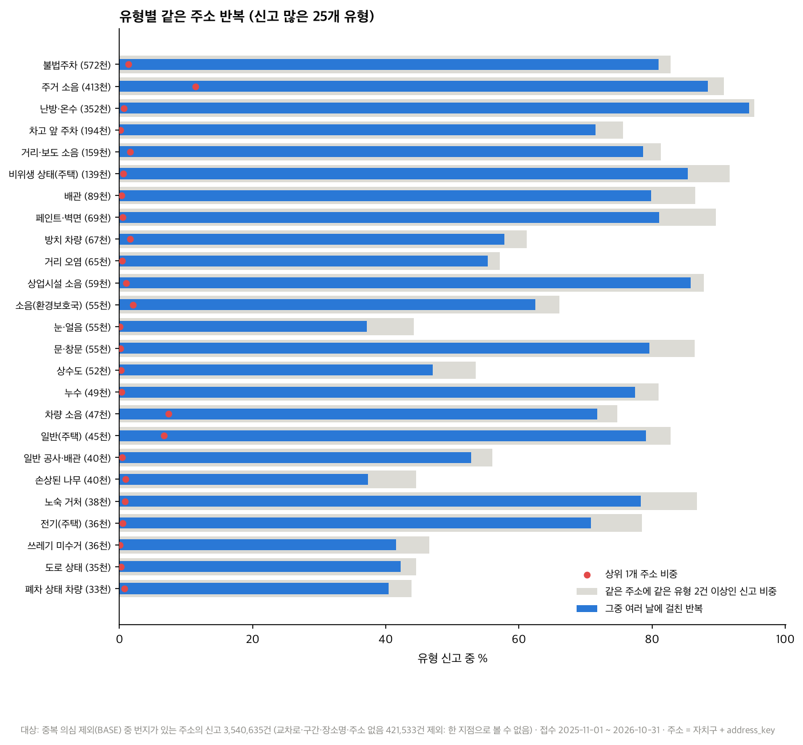

# 동일 주소의 민원 반복 여부

> 민원이 여러 주소에 분산되는가, 아니면 같은 주소에서 반복적으로 접수되는가?

- **작성**: 2026-11-23
- **기준 문서**: `Repeated_Address_Research_Question.md`
- **코드**: `scripts/repeat_address/repeat_address_analysis.py`
- **결과 파일**: `reports/repeat_address/`(표 CSV, 그림, `repeat_address_results.json`)
- **보존**: 원본·interim·processed 데이터, 기존 보고서, 대시보드는 수정하지 않았습니다. 전처리를 다시 실행하지 않았습니다.

**공통 기준**
- **기간**: 접수 2025-11-01 21:09 ~ 2026-10-31 21:09 (1년).
- **관찰 기준일**: 2026-11-12 (원본 추출일). 이 날 전까지 기록된 종결만 「종결」로 봅니다.
- **대상**: 중복 의심 제외(BASE) 3,962,168건.

---

## 0. 요약

**[사실] 신고 대부분은 같은 주소에서 반복 접수된 신고입니다.**
- 번지가 있는 주소 584,362곳 중 56.5%는 1년 동안 2건 이상 접수됐습니다. 이 주소들에 신고의 92.8%가 들어 있습니다.
- 한 번만 신고된 주소는 43.5%지만, 그 신고는 전체의 7.2%뿐입니다.
- 신고가 가장 많은 주소 1%(약 5,800곳)가 신고의 29.2%를, 상위 10%가 64.1%를 차지합니다.

**[사실] 반복의 형태**
- **같은 유형 반복과 여러 유형 혼재가 한 주소에서 겹칩니다.** 「여러 유형이 섞이고, 그중 한 유형도 반복된」 주소가 28.6%이고, 신고의 79.1%가 이런 주소에 있습니다.
- **반복은 한날보다 여러 날에 걸쳐 들어옵니다.**
  - 같은 주소·같은 유형으로 2건 이상인 조합 중 같은 날에만 들어온 조합은 11.8%(신고의 4.4%)입니다.
  - 첫 신고와 마지막 신고가 181일 이상 떨어진 조합이 신고의 56.0%를 차지합니다.
- **앞 신고가 열려 있을 때 다시 들어오는 경우도 많습니다.**
  - 같은 주소·같은 유형의 다음 신고 중 36.8%는 앞 신고가 아직 열려 있을 때 들어왔습니다.
  - 63.1%는 앞 신고가 닫힌 뒤에 들어왔고, 그중 25.1%는 종결 후 24시간 안이었습니다.

**[사실] 지역과 유형에 따라 다릅니다.**
- 반복 주소에 있는 신고의 비중은 브롱크스·맨해튼 96%, 스태튼아일랜드 79%입니다. 커뮤니티 보드별로는 74~98%입니다.
- 유형별로는 난방·온수 95%가 가장 높고, 눈·얼음 44%, 납 검사 키트 18%로 낮습니다.
- 신고가 가장 많은 3개 유형(불법주차·주거 소음·난방·온수)을 빼도 89.3%가 반복 주소에 있습니다.

**[판단 불가]** 같은 주소의 반복이 다음 중 무엇인지는 이 자료로 구분할 수 없습니다.
- 한 문제가 계속 남은 것인지
- 해결 후 다시 생긴 것인지
- 큰 건물 안 여러 세대의 별개 문제인지
- 소수 신고자의 반복인지

---

## 1. 데이터에 먼저 물어본 것

### 1-1. 같은 주소의 범위

| 확인 항목 | 결과 |
|---|---|
| 주소의 뜻 | `incident_address`는 신고된 문제가 있는 장소입니다(자료 설명). 신고자 주소가 아닙니다. 서비스 제공 장소와도 같다고 볼 근거가 없습니다. |
| 대소문자·공백 표기 | `address_key`(앞뒤 공백 제거, 연속 공백 한 칸, 대문자 통일)로 같은 주소를 식별합니다. 약어(ST/STREET)나 문장부호 차이는 합치지 않았습니다(기존 EDA 5절 7번: 후보 467개, 확인되지 않아 미적용). |
| 같은 문자열, 다른 자치구 | 다른 장소로 봅니다(자치구 + `address_key`). |
| 건물·필지·호실 | 필지 번호(BBL)는 BASE의 88%에 있습니다. **호실(세대)을 나타내는 항목은 없습니다.** 그래서 「주소」는 사실상 건물(또는 필지) 단위입니다. |
| 주소 키와 BBL의 관계 | 주소 키가 여러 BBL에 걸친 경우 646개. 한 BBL에 주소 키가 여러 개인 경우 53,624개(모퉁이 건물, 번지 범위 등) |

**주소 키가 한 지점이 아닌 경우가 있어서 분석 단위를 나눴습니다.**

| 단위 | 신고 수 | 주소 키 수 | 처리 |
|---|---:|---:|---|
| 번지가 있는 주소 (`address_type = ADDRESS`, 번지로 시작) | 3,540,635 | 584,362 | **주 분석** |
| 교차로·구간 (키가 도로 이름뿐: `BROADWAY` 등) | 245,122 | 20,708 | 한 지점이 아니라서 민감도 분석에만 사용 |
| 장소명 (공항, 공원 등) | 29,523 | 2,725 | 넓은 장소라서 민감도 분석에만 사용 |
| 주소 없음 (주소 또는 자치구 결측) | 146,888 | — | 한 장소로 묶지 않음. 교차로 신고가 대부분이고, 신호등(39%)·도로 상태(19%) 유형에 몰림 |
| **합계 (BASE)** | **3,962,168** | | |

### 1-2. 별도 접수의 기준

- **요청 번호 중복**: 같은 번호가 두 번 나온 경우는 0건입니다.
- **번호만 다른 중복**: 번호만 다르고 나머지 값이 모두 같은 1,791건은 BASE에서 제외돼 있습니다. 다시 포함해도 결과는 소수점 둘째 자리까지 거의 같습니다(5절).
- **같은 날 여러 건**: 그 신고들이 서로 다른 문제인지 확인할 항목이 없습니다. 같은 날 같은 주소·유형의 신고는 기존 「동일 조건 신고 그룹」으로 묶어 볼 수 있을 뿐, 다른 신고자인지는 알 수 없습니다.

### 1-3. 빠진 기록과 비교 범위

- **결측**: 유형·접수 시각이 빠진 행은 없습니다. 주소 없는 신고(3.7%)는 교차로·도로 시설 유형에 몰려 있어, 이 유형들의 반복은 이 분석으로 판단할 수 없습니다.
- **관측 창**: 1년입니다. 기간 첫날 전이나 마지막 날 뒤의 신고는 보이지 않습니다. 그래서 「첫 신고~마지막 신고 간격」은 양 끝에서 잘리고, 한 번만 보인 주소 중에도 기간 밖에서 반복된 곳이 있을 수 있습니다.

---

## 2. 반복의 규모

대상: 번지가 있는 주소의 신고 3,540,635건.

| 주소당 신고 수 | 주소 수 | 주소 비중 | 신고 수 | 신고 비중 |
|---|---:|---:|---:|---:|
| 1건 | 254,463 | 43.5% | 254,463 | 7.2% |
| 2건 | 104,752 | 17.9% | 209,504 | 5.9% |
| 3~4건 | 92,266 | 15.8% | 312,067 | 8.8% |
| 5~9건 | 69,811 | 11.9% | 450,403 | 12.7% |
| 10~99건 | 59,480 | 10.2% | 1,469,668 | 41.5% |
| 100~999건 | 3,541 | 0.6% | 677,401 | 19.1% |
| 1,000건 이상 | 49 | 0.01% | 167,129 | 4.7% |

- **[사실]** 주소당 신고 수의 중앙값은 2건, 평균은 6.1건입니다. 소수 주소가 신고를 많이 가져갑니다.
- **[사실]** 상위 10개 주소가 2.9%, 상위 100개 주소가 5.8%를 차지합니다. 집중 주소(브롱크스 집중 주소) 하나가 1.3%입니다.
- **주의**: 이 반복은 대부분 수많은 주소에 넓게 퍼진 반복입니다.
  - 상위 100곳(신고의 5.8%, 모두 반복 주소)을 빼고 다시 계산해도 반복 주소의 신고 비중은 약 92.4%입니다(위 두 수치로 계산한 값).
  - 집중 주소만 뺀 결과는 6절에 있습니다.

---

## 3. 같은 유형과 다른 유형

| 주소 패턴 | 주소 수 | 주소 비중 | 신고 비중 |
|---|---:|---:|---:|
| 신고 1건 | 254,463 | 43.5% | 7.2% |
| 한 유형만 반복 | 67,015 | 11.5% | 7.0% |
| 여러 유형, 어느 유형도 반복 안 됨 | 95,767 | 16.4% | 6.7% |
| **여러 유형 + 그중 한 유형 이상 반복** | 167,117 | 28.6% | **79.1%** |

- **[사실]** 두 패턴은 같은 주소에서 많이 겹칩니다. 신고가 많은 주소일수록 여러 유형이 섞여 있습니다.
- **[사실]** 반복 주소에서 가장 많은 유형의 비중 중앙값은 45~50%입니다.
  - 그 유형이 90% 이상인 주소는 2~4건 주소에서 28.7%, 100건 이상 주소에서 14.4%입니다.
  - 예외도 있습니다. 집중 주소는 주거 소음이 99.8%이고, 상위 주소 중 불법주차가 대부분인 곳도 여럿입니다.
- **[사실]** 같은 주소·같은 유형으로 2건 이상인 조합(442,766개)에 신고의 75.1%가 있습니다.
- **[가능한 설명]** 여러 유형이 한 주소에 섞이는 것은 큰 공동주택(여러 세대·여러 문제)일 때 자연스럽습니다.
  - 예: 난방·온수 신고의 주소당 평균은 8.2건으로 높습니다.
  - 세대 수 자료(예: 건물별 주거 세대 수)가 없어서 확인하지 못했습니다.

---

## 4. 같은 날과 다른 날짜

**같은 주소·같은 유형으로 2건 이상인 조합 442,766개: 첫 신고와 마지막 신고 사이**

| 간격 | 조합 비중 | 신고 비중 |
|---|---:|---:|
| 같은 날만 | 11.8% | 4.4% |
| 7일 이내 | 11.2% | 4.8% |
| 8~30일 | 13.9% | 7.0% |
| 31~90일 | 18.7% | 11.7% |
| 91~180일 | 18.9% | 16.1% |
| 181일 이상 | 25.5% | 56.0% |

**바로 앞 신고와의 간격 (같은 주소·같은 유형의 두 번째 이후 신고 2,215,524건)**

| 앞 신고로부터 | 비중 |
|---|---:|
| 1시간 안 | 22.3% |
| 1~24시간 | 18.9% |
| 1~7일 | 22.3% |
| 8~30일 | 17.9% |
| 30일 이상 | 18.5% |

- 앞 신고와 같은 날: 32.8%. 간격의 중앙값: 51.8시간.
- **앞 신고가 아직 열려 있을 때 접수**: 36.8%.
  - 열려 있다 = 관찰 기준일까지 종결 기록이 없거나, 종결 시각이 다음 신고보다 늦음.
- **앞 신고가 닫힌 뒤 접수**: 63.1%. 종결 후 얼마 만에 들어왔는지는 다음과 같습니다.
  - 24시간 안 25.1%, 1~7일 26.4%, 8~30일 23.0%, 30일 이상 25.4%.
- 앞 신고의 종결 시각이 접수보다 빠른 기록(0.01%)은 판단에서 뺐습니다.

**[사실]** 반복은 한날에 몰리는 형태(같은 날 여러 건)와 여러 달에 걸친 형태가 섞여 있습니다. 건수로는 여러 달에 걸친 반복이 더 많습니다.

**[가능한 설명]**
- 앞 신고가 열려 있을 때의 재신고는 같은 문제의 추가 신고일 가능성이 있습니다.
- 종결 직후의 재신고는 「닫혔지만 문제는 남은」 경우일 가능성이 있습니다.
- 다만 다른 세대·다른 신고자일 수도 있어서 단정할 수 없습니다.

---

## 5. 지역과 유형 간 차이

### 자치구 (번지 주소 기준)

| 자치구 | 신고 | 주소 | 반복 주소 비중 | 반복 주소의 신고 비중 | 같은 주소·같은 유형 반복의 신고 비중 | 상위 1개 주소 비중 |
|---|---:|---:|---:|---:|---:|---:|
| 브롱크스 | 777,692 | 74,665 | 60.3% | 96.2% | 84.0% | 6.1% |
| 브루클린 | 1,117,091 | 198,701 | 56.9% | 92.3% | 73.5% | 0.8% |
| 맨해튼 | 682,140 | 72,463 | 67.3% | 96.5% | 78.3% | 0.6% |
| 퀸스 | 829,481 | 187,783 | 53.6% | 89.5% | 69.4% | 1.1% |
| 스태튼아일랜드 | 134,231 | 50,750 | 43.8% | 78.8% | 54.6% | 0.6% |

- **[사실]** 주소 하나당 신고가 많은 자치구(브롱크스·맨해튼)일수록 반복 비중이 높습니다.
- **커뮤니티 보드 59곳**: 반복 주소의 신고 비중은 74.1~98.3%(중앙값 93.4%)입니다.
  - 높은 곳: 맨해튼 12, 브롱크스 5·4·7, 맨해튼 9.
  - 낮은 곳: 스태튼아일랜드 3·2, 퀸스 11·13, 스태튼아일랜드 1.
- **[가능한 설명]** 큰 공동주택이 많은 지역과 단독·소규모 주택이 많은 지역의 차이와 맞아떨어집니다. 하지만 주택 형태 자료로 확인하지 않았습니다.

### 유형 (신고 5,000건 이상 66개 유형, 단위 = 주소 × 유형)

| 묶음 | 같은 주소·같은 유형 2건 이상인 신고의 비중 |
|---|---|
| 높음 | 난방·온수 95.3%, 공원 소음 95.1%, 비위생 상태 91.6%, 주거 소음 90.8%, 헬리콥터 소음 90.3%, 페인트·벽면 89.5%, 상업시설 소음 87.8%, 노숙 거처 86.7% |
| 중간 | 불법주차 82.8%, 거리·보도 소음 81.3%, 차고 앞 주차 75.6% |
| 낮음 | 눈·얼음 44.2%, 손상된 나무 44.6%, 납 검사 키트 18.2% |

- 66개 유형 중 41개는 신고의 50% 이상이 같은 주소 반복이고, 20% 미만은 1개(납)뿐입니다.
- **[사실] 큰 유형을 빼도 반복은 유지됩니다.** 상위 3개 유형을 빼면 반복 주소의 신고 비중은 89.3%(전체 92.8%), 같은 유형 반복의 신고 비중은 66.9%(전체 75.1%)입니다.
- **[사실] 반복이 한 주소에 몰린 유형**: 주거 소음(상위 1곳 11.4%, 집중 주소), 공원 소음(9.6%), 헬리콥터 소음(8.8%), 차량 소음(7.4%), 주택 일반(6.7%).
- **[사실] 넓게 퍼진 반복**: 난방·온수는 상위 1곳이 0.6%뿐인데 반복 비중이 가장 높습니다.

---

## 6. 민감도

| 기준 | 주소 수 | 반복 주소 비중 | 반복 주소의 신고 비중 | 상위 1% 주소의 신고 비중 |
|---|---:|---:|---:|---:|
| **번지 주소 (주 분석)** | 584,362 | 56.5% | 92.8% | 29.2% |
| 집중 주소 제외 | 584,361 | 56.5% | 92.7% | 28.3% |
| 중복 의심 1,791건 포함 | 584,362 | 56.5% | 92.8% | 29.3% |
| 교차로·구간·장소명 키 포함 | 599,818 | 56.8% | 93.2% | 29.9% |
| BBL(필지) 단위 | 428,168 | 63.4% | 95.5% | — |

- **[사실]** 어느 기준으로 봐도 결론(대부분의 신고가 반복 주소에서 접수)은 같습니다.
- 필지 단위로 묶으면 같은 건물의 다른 번지가 합쳐져 반복이 더 커집니다.

**신고가 가장 많은 주소** (`tables/top_addresses.csv`)
- 집중 주소(47,105건, 15개 유형, 128일), `비공개 주소 15151`(9,523건, 14개 유형, 353일), `비공개 주소 6315`(8,847건, 364일) 등입니다.
- 대부분 1년 중 300일 이상 신고가 들어온 「지속형」입니다. 집중 주소는 128일로 특정 기간에 몰린 편입니다.

---

## 7. 해석할 때 남는 질문

같은 주소에 같은 유형이 다시 접수됐을 때, 아래 중 무엇인지 구분할 수 있는가?
1. 문제가 계속 남아 있었다
2. 해결 후 다시 발생했다
3. 같은 주소 안에서 별개 문제가 생겼다(다른 세대 등)

| 구분에 쓸 수 있는 것 | 현재 자료 | 한계 |
|---|---|---|
| 앞 신고가 열려 있을 때의 재신고 | 접수·종결 시각으로 판단 가능(36.8%) | 「열려 있음」은 행정 상태일 뿐, 문제가 남아 있다는 뜻은 아님 |
| 종결 후 재신고와 그 간격 | 판단 가능(63.1%, 24시간 안 25%) | 종결이 「수리 완료」인지 「출입 실패」인지에 따라 뜻이 다름 |
| 종결 문구 | `resolution_description`에 중복·출입 실패·위반 없음 등이 명시됨(종결 문구 분석은 처리 시간 보고서 참고) | 점검·수리 시각은 기록되지 않음 |
| 세대·호실 | **없음** | 큰 건물에서는 여러 세대의 별개 신고를 같은 반복으로 셀 수 있음 |
| 신고자 | **없음** | 소수 신고자의 반복인지 여러 사람의 신고인지 구분 불가 |

**구분에 필요한 추가 자료**
- 담당 기관의 점검·작업 기록: 점검 일시, 위반 발부, 수리 완료 일시.
- HPD 위반·불만 기록(세대 단위가 있으면 더 좋음).
- 건물별 주거 세대 수: 큰 건물 효과를 보정하기 위해.
- 신고자 구분 정보: 개인정보라 공개 자료로는 어려움.

---

## 8. 검증

| 검사 | 결과 |
|---|---|
| 주소 단위 4개 범주의 합 = BASE (3,962,168) | 일치 |
| 주소당 신고 수 구간의 주소·신고 합 = 주 분석 대상 | 일치 |
| 주소 패턴 4개의 신고 합 = 주 분석 대상 | 일치 |
| 두 번째 이후 신고 수 = 신고 수 − (주소×유형 조합 수) | 일치 (2,215,524) |
| 자치구별 신고 합 = 주 분석 대상, 커뮤니티 보드 59곳 | 통과 |
