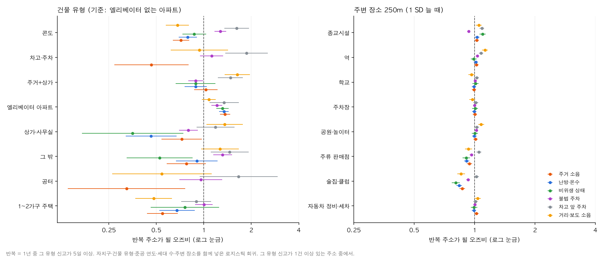

# 어떤 주소가 「반복 신고 주소」가 되는가: 건물 연식·규모·유형과 주변 시설

> 같은 유형의 신고가 1년에 여러 날 반복되는 주소는, 한 번만 신고된 주소와 건물(연식·세대 수·층수·건물 유형)이나 주변 시설이 어떻게 다른가?

- **작성**: 2026-11-26
- **스크립트**: `scripts/poi/repeat_address_profile.py`
- **결과 파일**: `reports/repeat_profile/` (표 5개, 그림 1개, `repeat_profile_results.json`)
- **자료**: 311 신고 + PLUTO(건물 정보) + OpenStreetMap(주변 시설, © OpenStreetMap contributors, ODbL). 새로 받은 자료는 없습니다.
- **보존**: 원본·전처리 결과는 읽기만 했습니다.
- **수정 (2026-11-28)**: 드문 범주 처리 방식을 고쳐 두 해 모두 다시 계산했습니다. 핵심 결과는 바뀌지 않았습니다(맨 아래 「수정 기록」).

---

## 0. 요약

**[사실] 반복 주소를 가장 잘 가르는 것은 건물 규모(세대 수)입니다.**
- 대상은 주거 소음·난방·비위생 상태 신고가 1건 이상 있는 주소입니다.
- 자치구·건물 유형·연식·주변 시설을 함께 맞춘 뒤에도 차이가 큽니다.

| 세대 수 (기준: 6~19세대) | 주거 소음 | 난방·온수 | 비위생 상태 |
|---|---:|---:|---:|
| 3~5세대 | ×0.54 | ×0.40 | ×0.43 |
| 20~49세대 | ×1.62 | ×1.92 | ×1.90 |
| 50~99세대 | ×2.29 | ×2.99 | ×3.22 |
| 100세대 이상 | **×2.87** | **×2.89** | **×3.51** |

- 값은 「반복 주소(1년 중 5일 이상 신고)가 될 오즈(가능성의 비)」의 배수입니다. 1보다 크면 반복 주소가 되기 쉽다는 뜻입니다.
- **[주의] 일부는 구조적으로 생기는 관계입니다.** 세대가 많으면 신고할 사람도 많아서, 신고가 있었던 날이 늘어나기 쉽습니다. 「큰 건물이 문제가 더 많다」는 뜻이 아닙니다.

**[사실] 같은 규모라도 엘리베이터 아파트가 반복되기 쉽고, 1~2가구 주택은 덜 반복됩니다.** 기준은 엘리베이터 없는 아파트입니다.

| 건물 유형 | 주거 소음 | 난방·온수 | 비위생 상태 | 거리·보도 소음 |
|---|---:|---:|---:|---:|
| 엘리베이터 아파트 | ×1.36 | ×1.34 | ×1.32 | ×1.08 |
| 1~2가구 주택 | ×0.55 | ×0.68 | ×0.76 | ×0.48 |
| 주거+상가 | ×1.03 | ×0.89 | ×0.89 | **×1.63** |
| 상가·사무실 | ×0.72 | ×0.46 | ×0.35 | ×1.35 |

**[사실] 규모를 맞추면, 1947년 이후 건물은 난방·비위생 반복이 적습니다.**
- 난방: 1947~73년 ×0.66, 1974~2000년 ×0.57, 2001년 이후 ×0.57 (기준 1920~46년)
- 비위생 상태: 1947~73년 ×0.65
- 단순 비교에서는 1947~73년 건물의 반복 비율(32.9%)이 1920~46년(32.3%)과 같아 보입니다. 1947~73년 건물이 더 크기 때문이고, 규모를 맞추면 차이가 드러납니다.

**[사실] 건물 조건을 맞춰도 브롱크스 주소는 반복되기 쉽습니다.** 기준은 브루클린입니다.
- 주거 소음 ×1.35, 난방 ×1.44, 비위생 ×1.33, 거리 소음 ×1.54

**[사실] 주변 시설의 영향은 작습니다.**
- 250m 안의 시설 수가 1 표준편차 늘 때 반복 주소가 될 오즈의 변화는 대부분 ×0.8~1.15 사이입니다.
- 그나마 일관된 것은 두 가지입니다.
  - **술집·클럽이 많은 곳**: 주거 소음(×0.87)·난방(×0.84)·비위생(×0.80)·거리 소음(×0.86) 모두 반복이 **적습니다**. 상업 지역이라 큰 주거 건물이 적고, 신고가 여러 주소로 흩어지기 때문일 수 있습니다(가능한 설명).
  - **역·공원이 많은 곳**: 거리·보도 소음 반복이 조금 많습니다(역 ×1.13, 공원 ×1.08).

**[사실] 주차 신고는 다른 모습입니다.**
- **불법 주차**: 100세대 이상(×1.76)·콘도(×1.27)·엘리베이터 아파트(×1.21)에서 반복되기 쉽고, 맨해튼(×0.82)·스태튼아일랜드(×0.55)에서는 덜 반복됩니다.
- **차고 앞 주차**: 차고·주차 건물(×1.87)·주거+상가(×1.48)·콘도(×1.62)에서 반복되기 쉽습니다.

**[해석]**
- 반복 신고 주소는 「오래되고(1946년 이전) 세대가 많은 엘리베이터 아파트, 특히 브롱크스」에 몰립니다.
- 주변 시설보다 **건물 자체의 특성**이 훨씬 많은 것을 설명합니다. 이는 집중 주소 분석(`poi_report.md`)의 결론과 같습니다.
- 다만 건물 규모의 효과에는 「신고할 사람이 많다」는 구조적인 몫이 섞여 있어, 문제의 심각성 차이로 읽으면 안 됩니다.

---

## 1. 방법

| 항목 | 기준 |
|---|---|
| 대상 | 번지 주소 중 그 유형 신고가 1건 이상 있는 주소. 건물 = 그 주소의 가장 흔한 건물 번호(BBL) |
| 유형 | 주거 소음, 난방·온수, 비위생 상태, 불법 주차, 차고 앞 주차, 거리·보도 소음 |
| 반복 주소 | 1년 중 그 유형 신고가 **5일 이상** (확인: 10일 이상) |
| 건물 정보 (PLUTO) | 준공 연도(5구간), 주거 세대 수(7구간), 층수, 건물 유형(9묶음: 1~2가구 주택 A·B, 엘리베이터 없는 아파트 C, 엘리베이터 아파트 D, 콘도 R, 주거+상가 S, 상가·사무실 K·O, 차고·주차 G, 공터 V, 그 밖) |
| 주변 시설 (OSM) | 250m 안의 술집·클럽, 학교, 공원·놀이터, 역, 종교시설, 주차장, 자동차 정비·세차, 주류 판매점 수 (로그 후 표준화) |
| 모델 | 로지스틱 회귀: 반복 여부 ~ 자치구 + 건물 유형 + 연식 + 세대 수 + 주변 시설 8종. 기준: 브루클린, 엘리베이터 없는 아파트, 1920~46년, 6~19세대 |
| 판정 | 기본(5일), 10일 기준, 신고 상위 30개 주소 제외 세 가지 모두 같은 방향이고 기본의 95% 구간이 1을 포함하지 않으면 「유지」 |

**[주의] 이 분석의 질문**
- 질문은 「이미 1건 이상 신고된 주소 중에서 어떤 주소가 반복되나」입니다.
- 「어떤 건물에 처음 신고가 생기나」는 답하지 않습니다.

**연결 범위** (`tables/coverage.csv`)

| 유형 | 주소 | PLUTO 연결 | 반복 주소 (5일+) | 10일+ |
|---|---:|---:|---:|---:|
| 주거 소음 | 70,243 | 94.2% | 10,172 | 4,629 |
| 난방·온수 | 42,674 | 98.0% | 12,299 | 6,152 |
| 비위생 상태 | 31,439 | 99.1% | 5,292 | 1,673 |
| 불법 주차 | 165,279 | 91.9% | 17,676 | 7,264 |
| 차고 앞 주차 | 81,176 | 96.6% | 6,586 | 1,672 |
| 거리·보도 소음 | 46,988 | 92.7% | 4,455 | 1,770 |

---

## 2. 반복 주소 vs 1일만 신고된 주소 (`tables/profile_repeated_vs_oneday.csv`)

| 유형 | 묶음 | 준공 연도 중앙값 | 세대 수 중앙값 | 층수 중앙값 | 1~2가구 주택 | 엘리베이터 없는 아파트 | 엘리베이터 아파트 |
|---|---|---:|---:|---:|---:|---:|---:|
| 주거 소음 | 반복 | 1931 | **42** | 6 | 13% | 31% | **44%** |
| 주거 소음 | 1일만 | 1930 | 3 | 3 | 38% | 31% | 11% |
| 난방·온수 | 반복 | 1928 | **37** | 5 | 4% | 48% | **40%** |
| 난방·온수 | 1일만 | 1929 | 5 | 3 | 22% | 46% | 12% |
| 비위생 상태 | 반복 | 1929 | **47** | 6 | 3% | 43% | **46%** |
| 비위생 상태 | 1일만 | 1929 | 7 | 4 | 20% | 51% | 16% |
| 불법 주차 | 반복 | 1931 | 2 | 2.5 | 33% | 19% | 14% |
| 불법 주차 | 1일만 | 1930 | 2 | 2.5 | 41% | 21% | 8% |
| 거리·보도 소음 | 반복 | 1928 | 28 | 5 | 5% | 34% | 35% |
| 거리·보도 소음 | 1일만 | 1930 | 3 | 3 | 21% | 29% | 17% |

- 준공 연도 중앙값은 거의 같습니다(뉴욕시 주거 건물 대부분이 1920~30년대). 차이는 주로 **규모와 건물 유형**에서 납니다.

---

## 3. 모델 결과 (`tables/logit_odds_ratios.csv`, `tables/logit_summary.csv`)

- 왼쪽은 건물 유형, 오른쪽은 주변 시설입니다. 점은 오즈비, 선은 95% 구간입니다.
- 주변 시설은 거의 모두 1 근처에 모여 있습니다.

**주변 시설** (1 표준편차 늘 때, 기본 / 10일 기준 / 상위 30 제외)

| 시설 | 주거 소음 | 난방·온수 | 비위생 상태 | 불법 주차 | 차고 앞 주차 | 거리·보도 소음 |
|---|---|---|---|---|---|---|
| 술집·클럽 | **0.87** | **0.84** | **0.80** | 0.93 | 1.02 | **0.86** |
| 주류 판매점 | 0.94 | 0.91 | 0.91 | 0.96 | 1.05 | 0.93 |
| 역 | 1.02 | 1.01 | 0.99 | 1.03 | 1.08 | **1.13** |
| 공원·놀이터 | 1.01 | 1.00 | 1.00 | 1.02 | 1.02 | **1.08** |
| 종교시설 | 1.03 | 1.03 | 1.10 | 0.94 | 1.09 | 1.05 |
| 학교 | 0.99 | 0.99 | 1.01 | 1.01 | 1.02 | 0.96 |
| 주차장 | 1.00 | 0.99 | 1.00 | 1.00 | 1.01 | 0.97 |
| 자동차 정비·세차 | 1.02 | 0.99 | 0.99 | 1.00 | 1.01 | 1.03 |

- 굵은 글씨는 세 기준 모두에서 같은 방향이고 95% 구간이 1을 포함하지 않는 것(「유지」) 가운데 비교적 큰 것입니다.

---

## 4. 가능한 설명 (확인되지 않음)

| 결과 | 가능한 설명 |
|---|---|
| 세대가 많을수록 반복 | 신고할 사람이 많음(구조적). 큰 건물의 공용 설비(보일러) 문제는 여러 세대에 동시에 영향 |
| 엘리베이터 아파트가 반복되기 쉬움 | 세대 구간 안에서도 더 큰 건물, 중앙 난방, 위아래층 소음 전달 |
| 1947년 이후 건물의 난방 반복이 적음 | 설비가 더 새로움. 다만 준공 연도는 보일러 교체 여부를 알려 주지 않음 |
| 술집이 많은 곳에서 주거 관련 반복이 적음 | 상업 지역이라 큰 주거 건물이 적고, 신고가 여러 주소로 흩어짐 |
| 브롱크스가 건물 조건을 맞춰도 높음 | 건물 관리 상태, 신고 성향, 소득·임대 구조 등 이 자료에 없는 요인 |

---

## 5. 한계

- **세대 수 효과의 구조적 몫**: 반복을 「신고가 있었던 날 수」로 정의해서, 신고자가 많은 큰 건물이 유리합니다. 세대 대비 신고 비율은 `building_report.md`를 참고하세요.
- **PLUTO = 현재 시점**, **OSM = 2026-07 기준**입니다.
- **조건부 분석**: 신고가 한 번도 없는 건물은 들어 있지 않습니다.
- **인과 아님**: 건물·주변 특성과 반복 신고가 함께 나타나는 관계입니다. 건물주·기관 평가가 아닙니다.
- **빠진 요인**: 임대 형태(공공·임대 안정화), 소득, 건물 관리 회사, 실제 설비 상태는 이 자료에 없습니다.

## 6. 검산

| 검사 | 결과 |
|---|---|
| 유형별 PLUTO 연결 | 91.9~99.1% |
| 모델 계산 | 6개 유형 × 3가지 기준 모두 계산됨 (드물거나 한쪽 결과뿐인 범주는 제외, 예: 비위생 상태의 공터) |
| 단순 비율과 모델 방향 | 세대 수·건물 유형은 같은 방향. 연식은 규모를 맞춘 뒤에 방향이 드러남(2절과 3절 비교) |

---

## 추가 주석: 공공임대주택(NYCHA) (2026-11-26)

- 모델에 NYCHA 여부를 넣었습니다. 기준 이름은 `with_nycha`, `excl_nycha`이고 결과는 `nycha_report.md` 4절에 있습니다.
- NYCHA 건물은 건물 조건을 맞춘 뒤에도 다음과 같았습니다.
  - 주거 소음 반복 ×1.28
  - 거리 소음 반복 ×1.62
  - 불법 주차 반복 ×0.73
- 브롱크스·엘리베이터 아파트·세대 수의 효과는 거의 바뀌지 않았습니다. 이 결과들은 NYCHA 때문이 아닙니다.
- 난방·비위생 상태는 NYCHA 건물의 신고가 이 데이터에 거의 없어서(주소 29곳, 15곳), **민간 건물에 대한 결과**로 읽어야 합니다.

---

## 수정 기록 (2026-11-28)

**무엇이 문제였나**
- 모델은 주소가 30곳 미만이거나 반복·비반복이 5곳 미만인 드문 범주(예: 난방의 「공터」, 「차고·주차」, 세대 수 「미상」)의 변수를 뺐습니다.
- 그런데 그 범주의 **주소는 모델에 남겨 두었습니다.** 그래서 이 주소들이 기준 범주(브루클린 · 엘리베이터 없는 아파트 · 1920~46년 · 6~19세대)에 섞여 들어갔습니다.

**어떻게 고쳤나**
- 드문 범주에 속한 주소를 그 모델에서 **빼고** 계산합니다. 빼고 나서 다른 범주가 드물어지면 같은 처리를 반복합니다.
- 뺀 범주와 주소 수는 결과 표(`logit_odds_ratios.csv`)의 `dropped_rare`, `n_all`과 `n` 열에 남깁니다.

**영향 (기본 모델)**

| | 올해 | 지난해 |
|---|---|---|
| 뺀 주소 (가장 많은 유형) | 난방 178곳(0.43%), 비위생 81곳(0.26%) | 비위생 63곳(0.22%), 난방 62곳(0.16%) |
| 오즈비 변화의 중앙값 | 0.02% | 0.02% |
| 크게 바뀐 항목 | 작은 범주: 세대 0(×0.94 → ×1.33, 비위생), 상가·사무실(난방 ×0.57 → ×0.46, 비위생 ×0.46 → ×0.35), 그 밖 | 같은 종류의 작은 범주 |
| 판정이 바뀐 항목 | 9개. 모두 1 근처이거나 구간이 1을 포함하는 작은 범주(「흔들림」 ↔ 「방향만 유지」 등) | 7개, 같은 성격 |

- **[사실] 핵심 결과는 그대로입니다.**
  - 100세대 이상 ×2.87~3.51
  - 엘리베이터 아파트 ×1.32~1.36
  - 브롱크스 ×1.33~1.54
  - 1947년 이후 건물의 난방 ×0.57~0.66
  - 모두 「유지」입니다.
- 두 해 비교에서 같은 방향인 오즈비는 182개 중 166개(전에는 167개), 효과가 큰 항목은 82개 중 80개(전에는 80개 중 78개)입니다.
- 고치기 전 결과: `backup/20261128_before_sparse_fix/`

