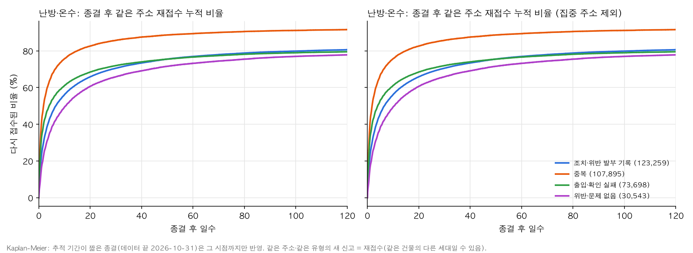

# 종결 후 재접수율과 생존 분석

> 1. 신고가 종결된 뒤 같은 주소·같은 유형의 신고가 얼마나 다시 들어오고, 종결 문구에 따라 다른가?
> 2. 아직 닫히지 않은 신고까지 넣으면(생존 분석) 지금까지의 종료 시간 결론이 달라지는가?

- **작성**: 2026-11-25
- **스크립트**: `scripts/rereport/rereport_survival_analysis.py`
- **결과 파일**: `reports/rereport/` (표 12개, 그림 1개, `rereport_results.json`)
- **보존**: 원본·전처리 결과는 읽기만 했습니다. 대시보드에는 반영하지 않았습니다.

---

## 0. 요약

### 재접수율

- **[사실] 종결 후 다시 접수되는 비율은 꽤 높습니다.** 기준은 번지 주소의 종결 신고 338만 건입니다.

  | 단위 | 1일 | 7일 | 30일 |
  |---|---:|---:|---:|
  | 종결된 신고 한 건씩 | 17.4% | 32.9% | 46.3% |
  | 같은 날·장소·유형 묶음당 한 번 | 9.0% | 24.7% | 39.0% |

- **[사실] 유형마다 크게 다릅니다.** 30일 재접수율(신고 한 건 기준)은 다음과 같습니다.
  - 난방·온수 75.5%, 주거 소음 72.1%, 상업시설 소음 67.7%
  - 배관 34.9%, 거리 오염 25.6%, 눈·얼음 16.8%
- **[사실] 난방·온수에서 「출입·확인 실패」로 종결된 뒤에는 더 빨리 다시 접수됩니다.**
  - 「조치·위반 발부」로 종결된 경우와 같은 조건으로 맞춰 비교했습니다. 조건은 세부 유형, 증상(난방 없음 / 온수 없음 / 둘 다), 접수 월, 자치구입니다.
  - 7일 안 재접수: 59.2% vs 49.1%, **+10.1%p** (묶음 단위로는 +4.8%p)
  - 30일 안: 73.8% vs 68.7%, +5.1%p (묶음 단위로는 +1.4%p). 방향은 같지만 크기는 기준에 따라 달라집니다.
  - 해석: 출입 실패 뒤의 재접수는 **더 빨리** 오지만, 한 달쯤 지나면 차이가 많이 줄어듭니다.
- **[사실] 「중복」으로 종결된 신고 뒤의 재접수율이 가장 높습니다.**
  - 난방·온수 30일 86% vs 조치 70%, 맞춘 비교 **+16.4%p**로 모든 기준에서 유지됐습니다.
  - 배관(+13.6%p), 상수도(+23.6%p), 환경보호국 소음(+14.7%p)도 같습니다.
  - 「중복」 종결은 같은 문제로 신고가 여러 건 들어온 곳에서 생깁니다. 그래서 이것은 종결의 결과라기보다 **이미 신고가 활발한 주소**라는 표시로 보입니다.
- **[사실] 주거 소음은 「출입 실패」(+11.6%p)와 「위반 없음」(+9.8%p) 뒤에 재접수가 더 많습니다.** 둘 다 모든 기준에서 유지됐습니다.

### 생존 분석 (종료까지 걸린 시간)

- **[사실] 아직 열려 있는 신고를 넣어도 자치구 순서는 거의 그대로입니다.**
  - 상위 15개 유형 중 13개는 자치구 순위가 완전히 같습니다.
  - 나머지 2개(페인트·벽, 도로 상태)도 가장 느린 자치구는 같습니다.
- **[사실] 오래 걸리는 업무는 「종료된 건만」 계산한 값이 실제보다 짧게 나옵니다.**

  | 유형 | 열린 비율 | 절반 시점: 종료 건만 → 생존 분석 | 90% 시점: 종료 건만 → 생존 분석 |
  |---|---:|---|---|
  | 도로 상태 | 6.6% | 36 → 44시간 (×1.22) | **270 → 625시간** |
  | 배관 | 4.7% | 212 → 237시간 | 1,385 → 1,792시간 |
  | 비위생 상태 | 4.9% | 282 → 306시간 | 1,269 → 1,586시간 |
  | 난방·온수 | 4.2% | 43 → 45시간 | 89 → 102시간 |
  | 경찰청 소음·주차 | 0.1% 미만 | 차이 없음 | 차이 없음 |

  - 「90% 시점」은 특히 크게 줄어 보였습니다. 기존 보고서의 90% 값은 「종료 건 기준」이라는 단서를 꼭 붙여야 합니다.
- **[해석] 지금까지의 결론(어느 자치구가 상대적으로 오래 걸리는가)은 유지됩니다.** 다만 시간 값 자체, 특히 오래 걸리는 꼬리는 과소 추정돼 있었습니다.

---

## 1. 정의

| 항목 | 기준 |
|---|---|
| 대상 | 기본 분석 대상(중복 의심 제외), 접수 2025-11-01 ~ 2026-10-31 |
| 장소 | 번지 주소: 자치구 + 주소 비교 키, 주소 유형 ADDRESS, 숫자로 시작(반복 주소 보고서와 같음) |
| 종결 | 종료 시각이 있고, 접수 이후이며, 2026-11-11 00:00 전 (처리 시간 보고서 v2와 같은 가정) |
| 재접수 | 종결 시각 **이후** 같은 장소·같은 유형으로 처음 들어온 새 신고 |
| 추적 끝 | 신규 접수 자료의 끝 **2026-10-31 21:09**. 종료 기록 마감(11-11)이 아님 |
| N일 재접수율 | 분모 = 종결 후 N일을 끝까지 지켜볼 수 있었던 종결(종결 시각 + N일 ≤ 추적 끝) |
| 종결 문구 | 처리 시간 보고서 v2의 분류를 그 스크립트에서 그대로 읽어 씀 |
| 단위 | ① 종결된 신고 한 건씩 ② 같은 날·장소·유형·세부 유형 묶음당 한 번. 묶음의 마지막 종결 시각과 그 문구를 쓰고, 묶음 안에 열린 신고가 있으면 제외(6,912개) |
| 맞춘 비교 | 세부 유형 × 추가 설명(증상) × 접수 월 × 자치구가 같은 칸끼리. 두 집단의 칸 비중 평균으로 가중. 칸마다 양쪽 3건 이상 |
| 판정 (30일) | 단위 2가지 × 집중 주소 포함·제외 4가지 모두 같은 방향이고 2.5%p 이상이면 「유지」 |
| 생존 분석 | Kaplan-Meier. 재접수: 추적 끝에서 중단. 종료 시간: 2026-11-11에 아직 열린 신고는 그 시점에서 중단 |

**[주의] 재접수는 「해결 실패」가 아닙니다.**
- 같은 건물의 다른 세대일 수 있습니다. 특히 난방은 건물 단위 문제입니다.
- 새로 생긴 문제일 수도 있고, 같은 사람이 다시 신고한 것일 수도 있습니다.
- 그래서 지표 이름은 「종결 후 재접수율」입니다.

---

## 2. 재접수율

### 2-1. 유형별 (상위 15개, 종결 건수 순)

| 유형 | 종결 | 1일 | 7일 | 30일 | 30일 (묶음 단위) |
|---|---:|---:|---:|---:|---:|
| 불법주차 | 572,160 | 21.7% | 42.0% | 56.8% | 50.9% |
| 주거 소음 | 412,220 | 39.8% | 58.7% | 72.1% | 59.9% |
| 난방·온수 | 336,211 | 29.5% | 58.3% | 75.5% | 70.2% |
| 차고 앞 주차 | 194,102 | 10.0% | 21.1% | 35.3% | 31.6% |
| 거리·보도 소음 | 158,454 | 21.0% | 40.7% | 57.3% | 47.5% |
| 비위생 상태 | 129,355 | 6.1% | 20.7% | 43.0% | 41.2% |
| 배관 | 83,385 | 5.0% | 16.8% | 34.9% | 33.0% |
| 방치 차량 | 66,690 | 14.3% | 26.8% | 35.6% | 30.6% |
| 페인트·벽 | 66,187 | 4.5% | 15.2% | 34.3% | 33.2% |
| 거리 오염 | 63,458 | 4.7% | 14.9% | 25.6% | 24.7% |
| 상업시설 소음 | 59,259 | 25.6% | 50.5% | 67.7% | 60.5% |
| 눈·얼음 | 54,925 | 6.1% | 9.5% | 16.8% | 13.8% |
| 소음 (DEP) | 54,379 | 8.5% | 20.0% | 31.7% | 28.1% |
| 상수도 | 51,517 | 12.0% | 20.9% | 27.2% | 22.5% |
| 문·창문 | 50,729 | 3.3% | 14.2% | 31.7% | 30.7% |

- 소음·주차처럼 **같은 날 여러 건**이 들어오는 유형은 「한 건씩」과 「묶음 단위」의 차이가 큽니다.
  - 예: 주거 소음의 1일 재접수율은 신고 한 건 기준 39.8%, 묶음 기준 16.1%입니다.
- 집중 주소(655 East 230th St)를 빼면 전체 재접수율이 약 1%p 낮아집니다(7일 32.9% → 31.9%).
  - 이 주소의 종결 47,094건은 대부분 같은 날 묶음 146개에 몰려 있어서, 묶음 단위에서는 거의 영향이 없습니다.

### 2-2. 난방·온수: 종결 문구별

| 종결 문구 | 종결 | 1일 | 7일 | 30일 | 재접수 절반 시점 |
|---|---:|---:|---:|---:|---:|
| 조치·위반 발부 기록 | 123,267 | 22.3% | 51.0% | 70.6% | 6.6일 |
| 중복 | 107,898 | 40.0% | 71.4% | 85.8% | 1.8일 |
| 출입·확인 실패 | 73,702 | 31.9% | 57.2% | 72.1% | 4.0일 |
| 위반·문제 없음 | 30,546 | 15.7% | 43.7% | 66.0% | 10.5일 |

- **재접수 절반 시점**: 그 문구로 종결된 신고의 절반이 다시 접수되기까지 걸린 시간입니다(생존 분석).
- 난방·온수에는 집중 주소의 신고가 거의 없어서, 포함·제외 결과가 같습니다(그림의 두 칸).

**증상별** (30일)

| 증상 | 조치 | 출입 실패 | 위반 없음 | 중복 |
|---|---:|---:|---:|---:|
| 난방 없음 | 73.1% | 73.9% | 68.9% | 88.7% |
| 난방·온수 둘 다 없음 | 73.5% | 76.1% | 70.2% | 85.2% |
| 온수만 없음 | 56.8% | 61.2% | 51.2% | 75.7% |

- 온수만 없는 경우는 재접수가 상대적으로 적습니다. 난방 없음은 건물 전체 문제인 경우가 많아서일 수 있습니다(확인 안 됨).

**맞춘 비교** (「조치·위반 발부 기록」과 비교, 신고 한 건 기준)

| 종결 문구 | 7일 | 30일 | 30일 판정 |
|---|---|---|---|
| 중복 | 71.8% vs 50.3% (**+21.5%p**) | 86.2% vs 69.8% (**+16.4%p**) | 유지 |
| 출입·확인 실패 | 59.2% vs 49.1% (**+10.1%p**) | 73.8% vs 68.7% (+5.1%p) | 방향만 유지 (+1.4~+5.1%p) |
| 위반·문제 없음 | 45.5% vs 48.8% (-3.4%p) | 67.8% vs 68.5% (-0.8%p) | 기준에 따라 방향이 바뀜 |

- 출입 실패의 차이는 7일에서 크고(묶음 단위로도 +4.8%p), 30일이면 줄어듭니다.

### 2-3. 다른 유형의 맞춘 비교 (30일, 「유지」만)

| 유형 | 종결 문구 | 조치 대비 |
|---|---|---|
| 상수도 | 중복 | +23.6%p |
| 소음 (DEP) | 중복 | +14.7%p |
| 배관 | 중복 | +13.6%p |
| 주거 소음 | 출입·확인 실패 | +11.6%p |
| 주거 소음 | 위반·문제 없음 | +9.8%p |
| 비위생 상태 | 점검 (결과 불명) | +9.9%p |
| 방치 차량 | 위반·문제 없음 | +7.5%p |
| 눈·얼음 | 위반·문제 없음 | **-9.7%p** |
| 거리 오염 | 위반·문제 없음 | -4.5%p |
| 거리·보도 소음 | 위반·문제 없음 | -3.4%p |
| 불법주차 | 관할 아님·다른 기관 | -6.8%p |

- 「위반 없음」 뒤의 재접수는 유형마다 방향이 다릅니다.
  - 주거 소음은 많고, 눈·얼음과 거리 오염은 적습니다.
- 전체 표: `reports/rereport/tables/matched_wording_assessment_30d.csv`

---

## 3. 생존 분석: 종료까지 걸린 시간

| 유형 | 신고 | 열린 비율 | 절반 시점 (종료 건만 → 생존) | 90% 시점 (종료 건만 → 생존) |
|---|---:|---:|---|---|
| 불법주차 | 618,150 | 0.02% | 1.5 → 1.5시간 | 6.9 → 6.9 |
| 주거 소음 | 416,552 | 0.02% | 1.2 → 1.2 | 6.3 → 6.3 |
| 난방·온수 | 351,779 | 4.2% | 43.0 → 44.6 | 88.5 → 102.3 |
| 비위생 상태 | 139,424 | 4.9% | 281.7 → 306.1 | 1,268.7 → 1,586.3 |
| 도로 상태 | 122,726 | 6.6% | 36.3 → 44.3 | 270.4 → 625.3 |
| 배관 | 89,115 | 4.7% | 212.4 → 236.7 | 1,385.2 → 1,792.1 |
| 거리 오염 | 69,624 | 1.9% | 30.3 → 31.0 | 116.0 → 123.8 |
| 페인트·벽 | 69,376 | 2.6% | 197.2 → 202.1 | 1,058.7 → 1,180.4 |
| 상수도 | 64,149 | 1.4% | 2.1 → 2.4 | 239.1 → 293.5 |

- 전체 표(유형 × 자치구): `tables/km_closure_time_by_type_borough.csv`
- **자치구 순서 비교** (`tables/km_borough_order_check.csv`): 15개 유형 중 13개는 순위가 완전히 같습니다(순위 상관 1.0). 페인트·벽 0.6, 도로 상태 0.9이고, 가장 느린 자치구는 모두 같습니다.
- 같은 업무끼리 맞춘 비교(처리 시간 보고서 v2)는 생존 분석으로 다시 하지 않았습니다.
  - 그 보고서는 「7일·30일 안에 종료 기록 없음」 비율도 함께 보았습니다. 이 비율은 열린 신고를 포함하는 지표라서, 결론이 바뀔 가능성은 낮습니다.

---

## 4. 가능한 설명 (확인되지 않음)

| 결과 | 가능한 설명 | 확인 방법 |
|---|---|---|
| 출입 실패 뒤 빠른 재접수 (난방) | 세입자가 방문 시 집에 없어 다시 신고 | 같은 신고자 여부는 데이터에 없음. 재접수의 종결 문구가 조치로 바뀌는지 연결해 보기 |
| 중복 종결 뒤 높은 재접수 | 이미 여러 세대가 신고 중인 건물. 중복 종결은 결과가 아니라 「신고가 활발한 곳」의 표시 | 종결 전 같은 주소 신고 수로 맞춰서 다시 비교 |
| 주거 소음 「위반 없음」 뒤 재접수 많음 | 경찰 도착 시 소음이 멈췄지만 다시 시작 | 재접수 시간대 분포 |
| 눈·얼음 「위반 없음」 뒤 재접수 적음 | 눈이 녹아 문제 자체가 사라짐 | 날씨 자료 연결 |

---

## 5. 한계

- **[주의] 재접수 ≠ 해결 실패.** 세대·신고자 정보가 없어서, 같은 문제의 반복인지 새 문제인지 구분할 수 없습니다.
- **[주의] 인과가 아닙니다.** 종결 문구가 재접수를 만든 것이 아닙니다. 어떤 건물·상황에서 그 문구가 나오는지가 함께 작용합니다.
  - 특히 「중복」은 신고가 많은 건물에서 생깁니다.
- 추적 기간은 최대 1년이고, 연말에 종결된 신고는 짧게만 지켜봤습니다. 고정 기간 비율은 지켜볼 수 있는 건만, 생존 곡선은 모두를 반영합니다. 두 방법의 7일 값은 32.84%와 32.87%로 거의 같습니다.
- 자료가 시작되기 전(2025-11 이전)의 신고는 없습니다. 그래서 기간 초반에 들어온 신고가 「앞 신고가 종결된 뒤의 재접수」인지는 알 수 없습니다. 다만 재접수율은 종결 뒤를 보는 지표라서 영향이 작습니다.
- 맞춘 비교의 조건에 건물 규모(세대 수)는 없습니다.

## 6. 검산

| 검사 | 결과 |
|---|---|
| 「다음 신고」 연결을 2,000건 무작위로 직접 다시 찾아 비교 | 일치 |
| 1일 ≤ 7일 ≤ 30일 재접수율 | 통과 |
| 7일 값: 고정 기간 비율 vs 생존 곡선 | 32.87% vs 32.84% |
| 재접수 시각이 모두 종결 이후 | 통과 |
| 종결 문구 분류 = 처리 시간 보고서 v2 | 같은 정의를 그 스크립트에서 읽어 씀 |
