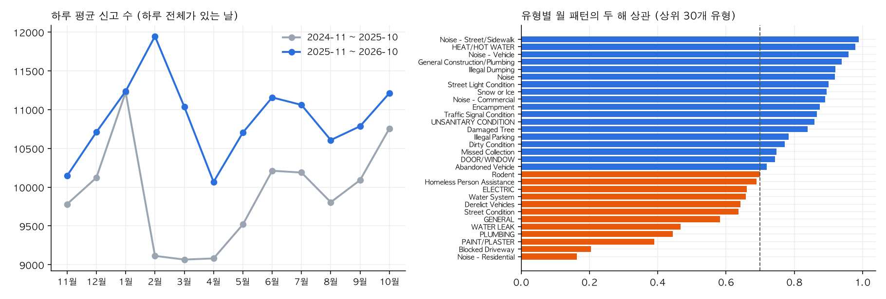

# 두 해 비교 재검증: 지금까지의 결론은 지난해에도 반복되는가

> 2025-11 ~ 2026-10(지금까지 분석한 해, 이하 **올해**)의 주요 결론이 2024-11 ~ 2025-10(**지난해**)에도 나타나는가?

- **작성**: 2026-11-26
- **스크립트**: `scripts/revalidation/two_year_check.py`
- **결과 파일**: `reports/revalidation/` (표 14개, 그림 1개, `two_year_results.json`)
- **자료**: 두 해 모두 같은 전처리(엄격한 자치구 채우기)를 쓴 `data/processed/20241101_20251031_strict/`, `data/processed/20251101_20261031_strict/`
  - 기본 분석 대상: 지난해 3,624,333건, 올해 3,962,168건
- **보존**: 기존 데이터·보고서·대시보드는 바꾸지 않았습니다.

---

## 0. 한눈에 보기

| 결론 (올해 분석) | 지난해에도? | 판단 |
|---|---|---|
| 지역마다 많이 들어오는 신고 종류가 다름 | 자치구 × 유형 상대 비중의 두 해 상관 **0.98**, 93%가 같은 방향 | **반복됨** |
| 난방은 1월에 몰림 | 두 해 모두 1월(22~23%) | **반복됨** |
| 포트홀은 3월에 몰림 | 두 해 모두 3월이 가장 많음. 다만 3월 비중은 지난해 11%, 올해 30% | **방향은 반복, 크기는 올해가 특별** |
| 눈·얼음은 2월 폭설 때 급증 | 지난해는 신고가 7분의 1(8,808건)이고 1월에 가장 많음 | **올해 겨울의 특수성** |
| 소화전 긴급 신고는 7월 더위에 몰림 | 지난해는 6월(67%), 올해는 7월(74%) | **여름 한 달에 몰리는 점은 반복, 달은 다름** |
| 한 주소(655 East 230th St)가 결과를 바꿈 | 지난해에는 **더 많았음**: 104,261건(번지 주소 신고의 3.2%) | **반복됨, 더 큼** |
| 신고 상위 주소들은 매일 꾸준히 반복 | 상위 10개 주소 중 6곳이 두 해 모두 상위 10위 | **반복됨** |
| 처리 시간의 자치구 차이는 대부분 업무 구성 차이 | 「7일 안 종료 기록 없음」은 같은 업무끼리 맞추면 두 해 모두 차이가 ±3%p 안으로 작아짐. 절반 시점은 맞춘 뒤에도 지난해 브롱크스 9.2 vs 5.2시간(올해 8.6 vs 8.3) (2026-11-28 추가, `year_dashboard_report.md` 4-1절) | **반만 반복됨** |
| 세대 대비 난방 신고 상위 지역 | 상위 5곳(브롱크스 7·4·5, 맨해튼 10·12)이 두 해 같음. 59곳 순위 상관 0.99 | **반복됨** |
| 난방 「출입 실패」 뒤 재접수가 빠름 | 7일: 지난해 +3.2%p, 올해 +6.2%p. 다만 결과 불명 문구가 섞인 묶음이었고, 명시적 출입 실패만 보면 맞춘 차이가 -6.4 / -5.6%p (2026-11-28 수정) | **결론 수정: 두 해 모두 오히려 적음** |
| 2026-07 유형 이름 변경(상수도·하수·유해 물질) | 지난해에는 옛 이름이 1년 내내 쓰임 | **올해 처음 생긴 변화가 맞음** |
| 2026-10 노숙 거처 담당 기관 변경 | 지난해에는 경찰청·노숙인서비스국이 1년 내내 나눠 받음 | **올해 처음 생긴 변화가 맞음** |
| 2026-01-24부터 HPD가 난방 신고를 「열어 둔 채」 둠 | **지난해에도 있었음**: 2024-11 3.1%, 2025-03~05 1.4~5.8%. 2025-06 ~ 2026-01 중순에만 거의 없었음 | **결론 수정 필요**: 「새로 시작」이 아니라 「멈췄다가 다시 나타남」 |

---

## 1. 신고량과 월별 패턴 (`tables/01`, `02`, `03`)

- 하루 평균 신고는 올해가 모든 달에서 지난해 이상입니다(같은 달 대비 0 ~ +31%). 특히 2월(9,114 → 11,946)과 3월(9,066 → 11,038)이 많이 늘었습니다.
- 상위 30개 유형 중 18개는 두 해의 월 패턴 상관이 0.7 이상입니다(설치류 0.699 포함 시 19개).
  - 예: 난방 0.98, 거리 소음 0.99, 차량 소음 0.96

**상관이 낮은 유형**

| 유형 | 상관 | 이유로 보이는 것 |
|---|---:|---|
| 주거 소음 | 0.16 | 집중 주소의 급증 달이 해마다 다름(지난해 1월·10월, 올해 11~12월) |
| 차고 앞 주차 | 0.20 | 가장 많은 달이 지난해 9월, 올해 2월. 폭설 때 제설 관련일 수 있음(확인 안 됨) |
| 페인트·배관·누수 | 0.39~0.47 | 가장 많은 달이 1~2월로 비슷하지만, 달 사이의 모양이 다름 |

**이름이 붙은 계절 결론** (`tables/03_named_peaks.csv`)

| 묶음 | 지난해 가장 많은 달 (비중) | 올해 |
|---|---|---|
| 난방·온수 | 1월 (22%) | 1월 (23%) |
| 포트홀 | 3월 (11%) | 3월 (30%) |
| 눈·얼음 | 1월 (59%), 1년 8,808건 | 2월 (48%), 1년 63,941건 |
| 소화전 긴급 | 6월 (67%) | 7월 (74%) |

**[해석]** 「겨울 난방, 3월 포트홀, 여름 소화전」이라는 계절 구조는 반복됩니다. 다만 크기와 정확한 달은 그해 날씨(올해 2월 폭설, 혹한)에 따라 크게 달라집니다. 날씨 분석의 결론과 맞습니다.

---

## 2. 지역 구성 (`tables/04`, `05`)

- 상위 30개 유형 × 5개 자치구의 상대 비중(로그) 상관: **0.98**
- 150칸 중 93%가 두 해 모두 같은 쪽(1보다 큼/작음)

| 확인한 문장 | 지난해 | 올해 | 뉴욕시 전체 (지난해 / 올해) |
|---|---:|---:|---|
| 퀸스의 불법 주차 비중 | 20.4% | 19.9% | 15.6% / 15.6% |
| 브루클린의 불법 주차 비중 | 20.9% | 19.9% | 같음 |
| 브롱크스의 주거 소음 비중 | 24.0% | 17.3% | 12.4% / 10.5% |
| 브롱크스의 난방·온수 비중 | 13.4% | 14.3% | 8.5% / 8.9% |
| 맨해튼의 차고 앞 주차 비중 | 0.6% | 0.6% | 4.7% / 5.0% |

- 브롱크스 주거 소음은 지난해가 더 높습니다. 집중 주소의 신고가 지난해 두 배 이상이었기 때문입니다.

---

## 3. 주소 집중 (`tables/06`)

| | 지난해 | 올해 |
|---|---:|---:|
| 1위 주소 비중 (번지 주소 신고 중) | **3.2%** | 1.3% |
| 상위 10개 주소 비중 | 5.0% | 2.9% |
| 2건 이상 신고된 주소에서 나온 신고 | 92.4% | 92.8% |
| 두 해 모두 상위 10위인 주소 | 6곳 | |

**655 East 230th St (브롱크스)**

| | 지난해 | 올해 |
|---|---:|---:|
| 신고 | **104,261** (주거 소음 103,797) | 47,105 |
| 신고가 있었던 날 | 108일 | 128일 |
| 많았던 달 | 2025-01 (40,029), 2025-10 (18,678), 2024-12 (19,733) | 2025-11 ~ 12 |
| 접수 경로 | 모바일 앱 99.6% | 모바일 앱 99.8% |

- 바로 옆 661 East 230th St도 지난해 3위(8,523건)였습니다.
- **[해석]** 이 주소의 집중은 한 해의 일시적 현상이 아닙니다. 2024년 가을부터 2025년 연말까지 같은 방식(앱, 연속 접수)으로 이어졌습니다. 신고자를 추정하는 근거로 쓰지 않는 원칙은 같습니다.

---

## 4. 종료 기록: 같은 관찰 기간 비교 (`tables/07`, `08`)

- **방법**: 「접수 후 N일 안에 종료 기록이 없는 비율」을 비교했습니다. 두 해 모두 N일을 지켜볼 수 있었던 접수만 넣었습니다.
- **전체**: 7일 안에 종료 기록 없음은 지난해 17.7%, 올해 20.3%입니다. 30일은 8.9% vs 9.7%입니다.
- **자치구 비교 (7일)**: 같은 유형·세부 유형끼리 맞춘 차이(해당 자치구 − 나머지 4곳)입니다.

| 자치구 | 단순 차이 (지난해 / 올해) | 맞춘 차이 (지난해 / 올해) |
|---|---|---|
| 맨해튼 | +4.1 / +3.3%p | **-0.3 / -0.8%p** |
| 퀸스 | -2.9 / -3.6%p | -0.5 / -0.1%p |
| 브롱크스 | -1.0 / +0.7%p | +0.6 / -0.2%p |
| 브루클린 | 0.0 / +0.4%p | +0.1 / +0.7%p |
| 스태튼아일랜드 | +0.9 / -1.0%p | **-2.1 / -3.0%p** |

- **[사실]** 두 해 모두 단순 차이(최대 4%p)가 맞춘 뒤에는 대부분 1%p 안팎으로 줄어듭니다. 「자치구 차이는 대부분 어떤 업무가 많은가의 차이」라는 결론이 반복됩니다.
- 스태튼아일랜드는 맞춘 뒤에도 두 해 모두 2~3%p 빨리 종료 기록이 남습니다.
- 1일 기준에서는 브롱크스·퀸스의 방향이 두 해에 다릅니다. 차이가 ±1%p 안이라 판단하지 않습니다.

---

## 5. 기록 방식 변화 (`tables/09` ~ `12`)

**HPD 난방 「조건이 아직 남아 있음」으로 열어 둔 기록** (난방 신고 중 비율)

| 접수 월 | 11 | 12 | 1 | 2 | 3 | 4 | 5 | 6 | 7 | 8 | 9 | 10 |
|---|---|---|---|---|---|---|---|---|---|---|---|---|
| 지난해 (2024-11 ~ 2025-10) | 3.1% | 0.7% | 0.1% | 0.4% | 1.4% | 2.9% | 5.8% | 0.1% | 0.0% | 0.2% | 0.7% | 0.5% |
| 올해 (2025-11 ~ 2026-10) | 0.1% | 0.1% | 3.1% | 7.4% | 8.8% | 6.6% | 4.3% | 4.5% | 6.6% | 6.0% | 5.9% | 10.3% |

- **[사실]** 이 기록은 2026년에 처음 생긴 것이 아닙니다. 2024-11과 2025-03 ~ 05에도 있었고, **2025-06 ~ 2026-01 중순에 거의 사라졌다가** 2026-01-24부터 다시 많아졌습니다.
- 다른 HPD 유형도 올해 비율이 높습니다(지난해 약 1%, 올해 2~4%).
- **[결론 수정]** `heat_record_change_report.md`의 「2026-01-24부터 새로 시작」은 「한동안 거의 없다가 2026-01-24부터 다시 많아짐」으로 고쳐야 합니다. 「종료 지연이 아니라 열어 둔 기록」이라는 핵심 해석은 그대로입니다.

**유형 이름 변경** (`tables/11`)
- 지난해에는 `Water System`·`Sewer`·`Hazardous Materials`가 1년 내내 쓰였습니다. `Water Maintenance`·`Sewer Maintenance`는 한 달 50~120건 수준이었습니다.
- 올해 2026-07 말 전환은 실제로 그때 생긴 변화입니다.

**노숙 거처 담당 기관** (`tables/12`)
- 지난해에는 경찰청(월 1,600~3,900건)과 노숙인서비스국(월 650~1,600건)이 1년 내내 함께 받았습니다.
- 2026-10 경찰청 0건은 올해 처음 생긴 변화가 맞습니다.

---

## 6. 난방 재접수: 종결 문구별 (`tables/13`)

- 재접수는 다음 해 파일까지 이어서 찾았습니다. 지난해 종결 뒤의 재접수가 올해 파일에 있어도 셉니다.

| 종결 문구 | 7일 재접수 (지난해 / 올해) | 30일 (지난해 / 올해) |
|---|---|---|
| 조치·위반 발부 기록 | 51.3% / 51.0% | 71.6% / 70.6% |
| 출입·확인 실패 | **54.5% / 57.2%** | 71.7% / 72.1% |
| 위반·문제 없음 | 44.1% / 43.7% | 65.7% / 66.0% |
| 중복 | 71.9% / 71.4% | 87.2% / 85.8% |

- 단순 비교입니다(같은 업무끼리 맞추지 않음).
- 「출입 실패 뒤 재접수가 조금 더 빠르다」는 두 해 모두 같은 방향입니다. 7일 차이는 지난해 +3.2%p, 올해 +6.2%p입니다.
- **(2026-11-28 수정)** 이 묶음에는 결과가 적히지 않은 「점검을 했거나 시도했다」 문구가 약 40% 섞여 있었습니다. HPD가 「들어가지 못해 닫음」이라고 명시한 종결만 보면, 같은 조건으로 맞춘 7일 재접수가 지난해 -6.4%p, 올해 -5.6%p로 두 해 모두 **오히려 적습니다**. 위 결론은 철회합니다(`no_access_revisit_proposal.md`).
- 「중복 종결 뒤 재접수가 가장 많다」, 「30일이면 차이가 거의 없다」도 두 해 모두 같습니다.

---

## 7. 세대 대비 난방 신고 (`tables/14`)

- 기준: PLUTO 주거 세대 1,000곳당 난방 신고일(NYCHA 세대 제외)
- 59개 세부 지역 순위 상관은 **0.99**입니다.
- 상위 5곳은 두 해 모두 브롱크스 7·4·5, 맨해튼 10·12이고, 순서만 4·5위가 바뀌었습니다.
- 브롱크스 7: 지난해 187일, 올해 203일

---

## 8. 이번에 확인하지 않은 것

- **날씨 분석**: (2026-11-28 갱신) 이후 지난해 날씨 자료를 받아 두 해로 확인했습니다(`year_dashboard_report.md` 2-1절).
- **같은 업무끼리 맞춘 비교의 세부 조사 대상**(자치구 × 유형 × 세부 유형), **신고 급증과 지연**, **장소 주변 신고**, **반복 주소 모델**: 이번에는 다시 계산하지 않았습니다.
- **요일 구성 차이**: 두 해의 같은 날짜는 요일이 하루씩 다릅니다. 하루 평균 비교에서 요일 구성을 맞추지 않았습니다.

## 9. 권장

1. `heat_record_change_report.md`에 지난해 결과를 반영해 「새로 시작」 표현을 고칩니다.
2. 대시보드·보고서의 「1년 자료라 계절성인지 알 수 없음」 단서를 일부 갱신할 수 있습니다. 난방 1월, 포트홀 3월, 지역 구성, 세대 대비 상위 지역은 두 해 반복이 확인됐습니다.
3. 집중 주소 설명에 「2024년 가을부터 이어짐」을 추가합니다.
4. ~~(선택) 지난해 날씨 자료를 받아 날씨 분석도 두 해로 확인합니다.~~ 완료(2026-11-26).
