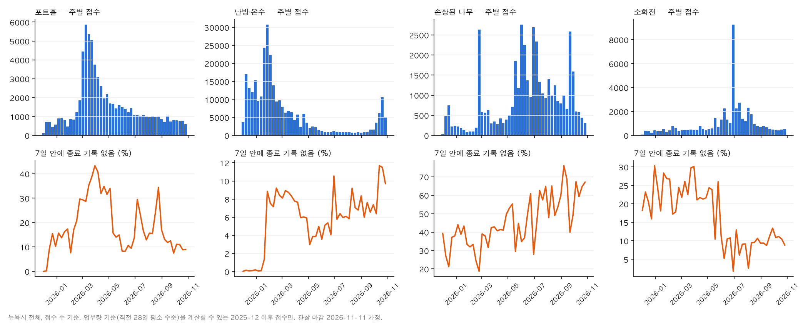

# 신고가 몰리면 종료가 늦어지는가

> 같은 자치구·같은 업무에서 신고가 평소보다 몰렸을 때 접수된 신고는, 종료 기록까지 더 오래 걸렸는가?

- **작성**: 2026-11-25
- **스크립트**: `scripts/surge_delay/surge_delay_analysis.py`
- **결과 파일**: `reports/surge_delay/` (표 6개, 그림 1개, `surge_delay_results.json`)
- **보존**: 원본·전처리 결과는 읽기만 했습니다. 대시보드에는 반영하지 않았습니다.

---

## 0. 요약

**[사실] 업무마다 방향이 다릅니다.**
- 같은 자치구·세부 유형·접수 월끼리 맞춘 비교입니다.
- 값은 「7일 안에 종료 기록이 없는 비율」입니다.

| 업무 | 신고가 몰렸을 때 (평소의 2배 이상) | 평소 | 차이 | 판정 |
|---|---:|---:|---:|---|
| 난방·온수 | 8.0% | 4.1% | +4.0%p (늦어 보임) | **방향만 유지 (+1.0~+5.3)** — 기록 방식 영향 (아래) |
| 소화전 | 8.3% | 5.4% | **+3.0%p (늦어짐)** | 유지 (+2.5~+3.7) |
| 손상된 나무 | 40.7% | 47.6% | **-6.9%p (빨라짐)** | 유지 (-9.4~-6.2) |
| 포트홀 | 28.4% | 35.1% | -6.6%p (빨라짐) | 기준에 따라 방향이 바뀜 (3절) |

- 30일 기준도 방향은 같습니다.
  - 난방 +3.2%p(기록 방식 영향, 아래), 소화전 +1.2%p, 나무 -5.6%p(유지), 포트홀 -7.9%p

**[사실, 2026-11-25 추가] 난방의 「몰리면 늦어짐」은 대부분 기록 방식 변화 때문입니다** (`heat_record_change_report.md`).
- 2026-01-24부터 HPD가 난방 신고의 일부(3~10%)를 「조건이 아직 남아 있음」 문구와 함께 **열어 둔 채** 두는 기록이 다시 많아졌습니다(지난해 3~5월에도 있었고 2025-06 ~ 2026-01 중순에만 거의 없었음, `revalidation_report.md`).
- 이 기간은 신고가 몰린 1월 말 혹한과 겹칩니다.
- 이 기록을 빼면 차이가 7일 +1.0%p, 30일 0.0%p로 거의 사라집니다.
- 그래서 판정을 「유지」에서 「방향만 유지」로 낮췄습니다. 다른 기준 4가지에 「열어 둔 기록 제외」를 더한 결과입니다.

**[사실] 날씨 분석의 「소화전은 더울 때 빨리 닫혔다」는 업무 구성 차이 때문이었습니다.**
- 단순 비교에서는 신고가 몰렸을 때 소화전이 더 빨리 닫혔습니다(5.3% vs 13.1%).
- 하지만 몰릴 때는 바로 닫히는 「소화전 긴급(FHE)」 신고가 많습니다. 세부 유형을 맞추면 오히려 **늦어졌습니다**(+3.0%p).
- 날씨 보고서의 해당 내용은 「단순 비교」라는 단서가 꼭 필요합니다.

**[사실] 나무는 신고가 몰려도 빨리 닫혔습니다.**
- 그때는 「안내·접수 확인」으로 닫힌 비율이 +3.9%p, 「조치」로 닫힌 비율이 +1.0%p 높았습니다.
- 「위반·문제 없음」은 -3.8%p 낮았습니다.
- 종결 방식이 크게 바뀐 것은 아니어서, 처리 속도가 실제로 빨라졌는지는 판단할 수 없습니다.

**[사실] 난방은 신고가 몰리면 「중복」 종결이 늘었습니다**(40.0% vs 32.2%, +7.8%p).
- 같은 건물에서 여러 세대가 동시에 신고하기 때문으로 보입니다.

**[해석] 「신고가 몰리면 늦어진다」는 업무에 따라 다릅니다.**
- 소화전은 함께 늦어지는 경향이 있습니다(+3%p, 크지 않음). 난방은 기록 방식 변화를 빼면 차이가 거의 없습니다.
- 나무는 반대입니다. 폭풍 뒤 신고는 쓰러진 나무처럼 현장 확인이 쉬운 건이 많아서일 수 있습니다(가능한 설명).
- 원인을 말할 수는 없습니다. 신고가 몰린 때는 날씨·업무 난도·작업 일정이 함께 바뀝니다.

---

## 1. 정의

| 항목 | 기준 |
|---|---|
| 대상 | 기본 분석 대상, 자치구 있음, 접수 2025-11-01 ~ 2026-10-31 |
| 업무 | 포트홀, 난방·온수, 손상된 나무, 소화전(상수도·상수도 유지보수 중 세부 유형에 hydrant). 이름 변경 전후를 합침 |
| 업무량 | 접수일 **직전 7일** 동안 같은 자치구·같은 업무로 들어온 신고 수 (결과보다 앞선 값) |
| 평소 수준 | 그 업무량의 **직전 28일** 중앙값 |
| 신고 몰림 정도 | 업무량 ÷ 평소 수준. 평소 = 1.25 미만, 조금 많음 = 1.25~2, **몰림 = 2 이상** |
| 제외 | 평소 수준을 계산할 수 없는 처음 35일 (2025-11-01 ~ 12-05 접수) |
| 결과 | 7일·30일 안에 종료 기록 없음 (관찰 마감 2026-11-11 가정, 지켜볼 수 있었던 접수만), 생존 분석 절반 시점, 종결 문구 |
| 맞춘 비교 | 자치구 × 세부 유형 × 접수 월이 같은 칸끼리. 두 집단의 칸 비중 평균으로 가중. 칸마다 양쪽 3건 이상 |
| 다른 기준 4가지 | 평소 수준 56일, 몰림 기준 1.5배, 같은 날·장소·유형 묶음당 1건, HPD가 「조건이 아직 남아 있음」으로 열어 둔 기록 제외(2026-11-25 추가) |
| 판정 | 5가지 기준 모두 같은 방향이고 2.5%p 이상이면 「유지」 |

**[주의] 이 분석의 「업무량」은 접수량입니다.**
- 기관의 실제 작업량, 인력, 출동 횟수는 데이터에 없습니다.
- 「밀린 신고 수」(그날 아침까지 열려 있던 신고)도 계산했지만, 자료 시작(2025-11-01) 전에 접수된 신고는 빠져서 초반이 적게 잡힙니다. 보조 지표로만 씁니다.

---

## 2. 단순 비교 (`tables/plain_by_level.csv`)

| 업무 | 수준 | 신고 | 주로 언제 | 7일 안에 종료 기록 없음 | 30일 | 절반 시점 (생존 분석) |
|---|---|---:|---|---:|---:|---:|
| 포트홀 | 평소 | 51,455 | 4~6월 | 23.0% | 12.1% | 22.7시간 |
| 포트홀 | 몰림 | 14,326 | 3월, 12월, 2월 | 31.0% | 7.7% | 45.0시간 |
| 난방·온수 | 평소 | 178,047 | 1~3월 | 4.7% | 4.6% | 42.4시간 |
| 난방·온수 | 몰림 | 42,486 | 10월, 1월, 2월 | 8.7% | 4.8% | 63.3시간 |
| 손상된 나무 | 평소 | 22,250 | 6~8월 | 50.8% | 34.8% | 179시간 |
| 손상된 나무 | 몰림 | 13,893 | 6월, 2월, 7월 | 34.8% | 23.6% | 73시간 |
| 소화전 | 평소 | 24,515 | 7~9월 | 13.1% | 5.3% | 5.6시간 |
| 소화전 | 몰림 | 9,881 | 7월, 6월, 5월 | 5.3% | 1.9% | 0시간 (즉시 종결 많음) |

단순 비교에는 계절과 세부 유형 차이가 섞여 있습니다. 예를 들어 소화전 몰림 때는 즉시 종결되는 소화전 긴급 신고가 많습니다. 그래서 판단은 아래의 맞춘 비교로 합니다.

---

## 3. 맞춘 비교 (`tables/assessment.csv`, `tables/matched_comparisons.csv`)

**신고 몰림(2배 이상) vs 평소**

| 업무 | 지표 | 몰림 | 평소 | 차이 | 기준을 바꾼 범위 | 판정 |
|---|---|---:|---:|---:|---|---|
| 난방·온수 | 7일 | 8.0% | 4.1% | +4.0%p | +1.0 ~ +5.3 | 방향만 유지 (열어 둔 기록 제외 시 +1.0) |
| 난방·온수 | 30일 | 6.3% | 3.1% | +3.2%p | +0.0 ~ +4.7 | 방향만 유지 (열어 둔 기록 제외 시 +0.0) |
| 소화전 | 7일 | 8.3% | 5.4% | +3.0%p | +2.5 ~ +3.7 | 유지 |
| 소화전 | 30일 | 3.2% | 2.0% | +1.2%p | +0.7 ~ +1.8 | 방향만 유지 |
| 손상된 나무 | 7일 | 40.7% | 47.6% | -6.9%p | -9.4 ~ -6.2 | 유지 |
| 손상된 나무 | 30일 | 26.7% | 32.3% | -5.6%p | -7.4 ~ -4.7 | 유지 |
| 포트홀 | 7일 | 28.4% | 35.1% | -6.6%p | -6.6 ~ **+14.8** | 기준에 따라 방향이 바뀜 |
| 포트홀 | 30일 | 7.5% | 15.4% | -7.9%p | -8.4 ~ **+7.7** | 기준에 따라 방향이 바뀜 |

**포트홀이 흔들리는 이유**
- 「평소 수준 56일」 기준에서만 방향이 바뀝니다.
- 그 기준에서는 같은 칸에 비교할 신고가 양쪽 모두 있는 경우가 몰림 신고의 12%뿐입니다. 3월 급증 전 56일이 모두 겨울이라 평소 수준이 낮게 잡히기 때문입니다.
- 나머지 세 기준(포함률 100%)은 모두 「몰릴 때 더 빨리 닫힘」(-4~-8%p)입니다.
- 그래도 판정 규칙대로 「판단 보류」로 둡니다.
- 몰릴 때 포트홀은 「조치」 종결이 +7.2%p 많고 「중복」 종결이 -7.4%p 적었습니다.

**조금 많을 때(1.25~2배)**: 난방 +2.0%p(열어 둔 기록 제외 시 0.0%p, 기준에 따라 방향이 바뀜), 소화전 +1.7%p, 나무 -5.0%p(유지). 방향은 몰림 때와 같고 크기는 작습니다.

**신고가 몰렸을 때의 종결 문구 비중** (종결된 신고, 몰림 vs 평소)

| 업무 | 중복 | 안내·접수 확인 | 위반·문제 없음 | 출입·확인 실패 | 조치·위반 발부 |
|---|---:|---:|---:|---:|---:|
| 난방·온수 | **+7.8%p** | 0 | -3.1%p | -3.2%p | -1.5%p |
| 포트홀 | **-7.4%p** | 0 | 0 | 0 | **+7.2%p** |
| 손상된 나무 | 0 | +3.9%p | -3.8%p | 0 | +1.0%p |
| 소화전 | -0.7%p | 0 | +3.2%p | 0 | -2.7%p |

---

## 4. 밀린 신고 수와 지연 (보조, 2026-01 이후, `tables/weekly_rank_correlation.csv`)

자치구·업무별로 주 단위로 계산했습니다.

- **포트홀**: 주초에 밀린 신고가 많던 주에 7일 미종결 비율도 높은 경향이 있습니다.
  - 스태튼아일랜드 0.80, 맨해튼 0.63, 브롱크스 0.58, 브루클린 0.37 (순위 상관)
  - 퀸스만 -0.47로 반대입니다.
  - 반면 「직전 7일 접수량」과는 상관이 약하거나 반대입니다.
  - 그래서 포트홀 지연은 **새로 들어온 양보다 이미 밀려 있던 양**과 더 함께 움직입니다.
- **손상된 나무**: 브루클린 0.75, 퀸스 0.50으로 밀린 신고와 함께 움직입니다.
- **소화전**: 밀린 신고와 반대로 움직입니다(브루클린 -0.79). 밀린 신고가 많은 여름에 오히려 빨리 닫히기 때문입니다.
- **[주의]** 밀린 신고 수는 시간이 지날수록 쌓이는 값이라, 계절 흐름과 섞여 있습니다. 같은 업무끼리 맞춘 비교가 아닌 참고 지표입니다.

**[확인 필요] 난방·온수의 7일 미종결 비율이 2026-01 중순 전까지 거의 0%였다가, 그 뒤 6~12%로 올라갑니다.**
- 기록 방식이나 처리 절차가 바뀌었을 가능성이 있습니다.
- 맞춘 비교는 같은 달끼리 비교하므로 이 변화의 영향을 덜 받습니다.

---

## 5. 가능한 설명 (확인되지 않음)

| 결과 | 가능한 설명 | 확인 방법 |
|---|---|---|
| 난방: 몰리면 늦어 보이고 중복이 늘어남 | 늦어 보이는 것은 대부분 2026-01-24 이후 HPD가 열어 둔 기록 때문. 중복 증가는 여러 세대가 동시에 신고하기 때문일 수 있음 | HPD 점검·위반 기록(외부 자료) |
| 소화전: 몰리면 조금 늦어짐 | 더위 때 출동 요청이 몰림 | 세부 유형별로 나눠 보기 |
| 나무: 몰리면 빨리 닫힘 | 폭풍 뒤 신고는 현장이 분명한 건(쓰러진 나무)이 많고, 일괄 출동 | 세부 유형(쓰러짐 vs 상태 불량) 비중 |
| 포트홀: 밀린 신고와 지연이 함께 움직임 | 3월 급증 뒤 처리할 건이 쌓여 수 주 동안 늦어짐 | 다른 해의 자료 |

## 6. 한계

- **인과 아님**: 신고가 몰린 때는 날씨·계절·업무 난도·작업 일정이 함께 바뀝니다. 같은 달 안에서 비교해도 그 달 안의 날씨 차이는 남습니다.
- **접수량 ≠ 작업량**: 기관의 인력·출동 기록은 데이터에 없습니다.
- **1년치**: 큰 급증이 몇 번뿐입니다(3월 포트홀, 1~2월 난방, 7월 소화전, 폭풍 때 나무).
- **종료 기록 ≠ 해결**: 빨리 닫혔다고 빨리 해결됐다는 뜻이 아닙니다.

## 7. 검산

| 검사 | 결과 |
|---|---|
| 직전 7일 업무량의 합 ≈ 일별 신고 수 × 7 | 일치 (경계 오차 2% 미만) |
| 종료 시간 음수 없음 (종료가 접수보다 빠른 기록 제외) | 통과 |
| 맞춘 비교 포함률 | 주 기준 86~100% (포트홀 56일 기준만 12%) |
