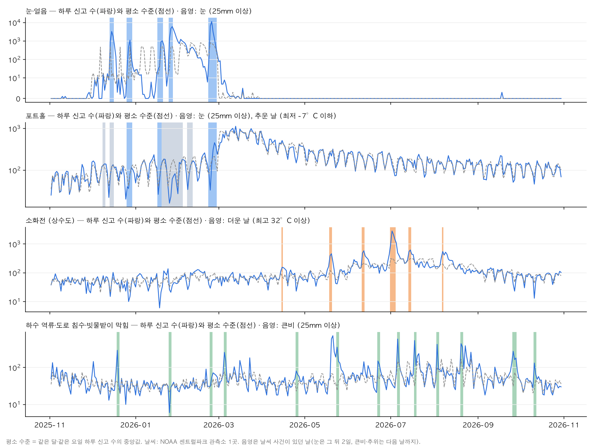

# 날씨와 신고 급증

> 눈·추위·더위·큰비가 있던 날, 관련 민원이 평소보다 늘었는가? 그때 종료 기록은 늦어졌는가?

- **작성**: 2026-11-25
- **스크립트**: `scripts/weather/weather_analysis.py`
- **결과 파일**: `reports/weather/` (표 5개, 그림 1개, `weather_results.json`)
- **날씨 자료**: NOAA NCEI 일별 기상, 센트럴파크 관측소(USW00094728), 2025-11-01 ~ 2026-10-31
  - 받은 파일: `data/external/noaa_centralpark/` (출처·단위는 `SOURCE.md`)
- **보존**: 원본·전처리 결과는 읽기만 했습니다. 날씨 자료도 받은 그대로 둡니다.

---

## 0. 요약

**[사실] 날씨 사건이 있던 날, 관련 민원이 평소보다 뚜렷하게 늘었습니다.**
- 「평소」는 같은 달·같은 요일의 하루 신고 수 중앙값입니다.
- 「유지」는 가장 큰 하루를 빼도, 집중 주소를 빼도 결과가 같다는 뜻입니다.

| 민원 | 날씨 사건 | 평소 대비 (사건 날 ÷ 다른 날) | 판정 |
|---|---|---:|---|
| 눈·얼음 | 눈 25mm 이상 (그날~2일 뒤) | **×14.4** | 유지 |
| 눈·얼음 | 최저 -7°C 이하 (그날~다음 날) | ×11.8 | 유지 |
| 소화전 (상수도) | 최고 32°C 이상 | **×3.4** | 유지 |
| 하수 역류·도로 침수·빗물받이 막힘 | 비 25mm 이상 (그날~다음 날) | **×2.6** | 유지 |
| 손상된 나무 | 비 25mm 이상 | ×2.3 | 유지 |
| 손상된 나무 | 바람 센 날 (평균 풍속 상위 5%) | ×2.0 | 유지 |
| 난방·온수 | 최저 -7°C 이하 | **×1.9** | 유지 |
| 모든 신고 | 최저 -7°C 이하 | ×1.3 | 유지 |

**[사실] 포트홀은 눈·추위·큰비가 온 날에 오히려 적었습니다**(×0.8).
- 포트홀 신고가 가장 많았던 날은 2026-02-26~28입니다. 2월 22~23일 폭설(50cm) 뒤 눈이 녹던 때입니다.
- 「얼었다 녹은 날」 수와의 상관은 약합니다(14일 합계, 7일 시차에서 순위 상관 0.13).
- 3월에 포트홀이 몰리는 현상은 그날그날의 날씨보다 **겨울이 끝난 뒤 한꺼번에 드러나는** 모습에 가깝습니다(가능한 설명, 확인 안 됨).

**[사실] 소음 신고는 날씨와 거의 무관합니다.**
- 거리·보도 소음은 비·추위·바람 센 날에 적었습니다(×0.7). 더운 날에는 ×1.2로 차이가 작습니다.
- 주거 소음은 어느 날씨에서도 ×0.9~1.2입니다.

**[사실] 신고가 몰려도 종료 기록이 늦어지지 않은 경우가 많았습니다.** 단순 비교로, 7일 안에 종료 기록이 없는 비율입니다.
- 소화전(더운 날): 2.1% vs 같은 달 다른 날 11.6%
- 손상된 나무(큰비): 29.6% vs 47.8%
- 하수·침수(큰비): 5.9% vs 6.7%
- 반대로 늦어진 경우
  - 난방·온수(추운 날): 5.5% vs 2.2%
  - 포트홀(눈 온 뒤): 21.8% vs 12.6%
- 단순 비교라서 세부 유형·지역 구성의 차이가 섞여 있습니다.
- **[추가 2026-11-25]** 「신고 급증과 지연」 분석(`surge_delay_report.md`)에서 세부 유형·자치구·월을 맞추니 결과가 달라졌습니다.
  - 소화전은 신고가 몰릴 때 오히려 **늦어졌습니다**(+3.0%p). 위의 「빨리 닫힘」은 즉시 종결되는 소화전 긴급 신고가 몰린 영향이었습니다.
  - 손상된 나무가 빨리 닫힌 것은 맞춘 뒤에도 유지됐습니다(-6.9%p).
  - 난방·온수가 추운 날 늦어진 것(5.5% vs 2.2%)은 2026-01-24부터 HPD가 일부 난방 신고를 열어 둔 채 두는 기록이 다시 많아진 시기와 겹칩니다(`heat_record_change_report.md`).

**[주의] 원인으로 읽으면 안 됩니다.**
- 관측소 1곳의 날씨로 뉴욕시 전체를 대표했습니다.
- 날씨 사건은 서로 겹칩니다. 예를 들어 2026-01-25와 02-23은 눈·큰비·바람이 동시였습니다.
- 그래서 「눈·얼음 ↔ 큰비」(×1.8), 「나무 ↔ 눈」(×2.2) 같은 결과는 사건이 겹쳐서 생긴 것으로 보입니다.

---

## 1. 방법

| 항목 | 기준 |
|---|---|
| 날짜 | 하루 전체가 포함된 날 2025-11-02 ~ 2026-10-30 (363일, EDA와 같음) |
| 평소 수준 | 같은 달·같은 요일의 하루 신고 수 중앙값 |
| 하루 배율 | (그날 신고 + 1) ÷ (평소 + 1). 달과 요일의 영향을 뺀 값 |
| 비교 | 사건 기간 날들의 배율 기하평균 ÷ **같은 달**의 다른 날 배율 기하평균 |
| 판정 | 기본, 가장 큰 하루 제외, 집중 주소 제외 세 가지 모두 ≥ ×1.25면 「많음 (유지)」, 모두 ≤ ×0.8이면 「적음 (유지)」 |
| 포트홀 | 1~4월, 최근 14일 동안 「얼었다 녹은 날」(최저 < 0°C, 최고 > 0°C) 수와 하루 배율의 순위 상관. 시차 0·7·14·21일 |
| 종료 기록 | 7일 안에 종료 기록이 없는 비율. 관찰 마감 2026-11-11 가정. 사건 기간 접수 vs 같은 달 다른 날 접수 (단순 비교) |

**날씨 사건** (센트럴파크, 1년 동안)

| 사건 | 기준 | 날 수 | 비교에 쓴 기간 |
|---|---|---:|---|
| 눈 | 새로 내린 눈 25mm(1인치) 이상 | 9일 | 그날 ~ 2일 뒤 |
| 큰비 | 강수 25mm 이상 | 14일 | 그날 ~ 다음 날 |
| 더운 날 | 최고 32°C 이상 | 12일 | 그날 |
| 추운 날 | 최저 -7°C 이하 | 19일 | 그날 ~ 다음 날 |
| 바람 센 날 | 하루 평균 풍속 상위 5% (4.4 m/s 이상) | 20일 | 그날 ~ 다음 날 |

---

## 2. 결과

- 그림의 파란 선은 하루 신고 수, 회색 점선은 평소 수준입니다.
- 음영은 날씨 사건이 있던 날입니다.

### 2-1. 관련 날씨와의 비교 (전체 표: `tables/event_comparison.csv`)

| 민원 | 사건 | 사건 날 수 | 사건 기간 배율 | 같은 달 다른 날 | 비교 | 가장 큰 하루 제외 | 집중 주소 제외 |
|---|---|---:|---:|---:|---:|---:|---:|
| 눈·얼음 | 눈 | 20 | 6.27 | 0.44 | ×14.4 | ×11.9 | ×14.5 |
| 눈·얼음 | 추운 날 | 24 | 4.80 | 0.41 | ×11.8 | ×9.9 | ×11.7 |
| 난방·온수 | 추운 날 | 24 | 1.60 | 0.85 | ×1.9 | ×1.8 | ×1.9 |
| 포트홀 | 눈 | 20 | 0.79 | 0.96 | ×0.83 | ×0.78 | ×0.83 |
| 포트홀 | 추운 날 | 24 | 0.77 | 0.97 | ×0.79 | ×0.76 | ×0.79 |
| 포트홀 | 큰비 | 27 | 0.80 | 0.99 | ×0.81 | ×0.79 | ×0.82 |
| 소화전 | 더운 날 | 12 | 3.42 | 1.01 | ×3.4 | ×3.1 | ×3.3 |
| 하수·침수 | 큰비 | 27 | 2.64 | 1.01 | ×2.6 | ×2.4 | ×2.6 |
| 손상된 나무 | 큰비 | 27 | 2.35 | 1.02 | ×2.3 | ×2.0 | ×2.3 |
| 손상된 나무 | 바람 센 날 | 33 | 1.91 | 0.98 | ×2.0 | ×1.7 | ×2.0 |
| 거리·보도 소음 | 더운 날 | 12 | 1.17 | 0.99 | ×1.18 | ×1.08 | ×1.18 |
| 주거 소음 | 더운 날 | 12 | 0.92 | 1.00 | ×0.92 | ×0.89 | ×0.91 |
| 주거 소음 | 추운 날 | 24 | 1.08 | 0.94 | ×1.15 | ×1.11 | ×0.95 |

- 주거 소음의 「추운 날」은 집중 주소를 빼면 ×1.15가 ×0.95로 바뀝니다. 집중 주소 신고가 12월에 몰려 있기 때문입니다.

### 2-2. 신고가 가장 많았던 날과 그날의 날씨 (`tables/top_days_with_weather.csv`)

| 민원 | 날짜 | 신고 (평소) | 그날·전날 날씨 |
|---|---|---|---|
| 눈·얼음 | 2025-12-15 (월) | 3,296 (12) | 전날 눈 74mm, 최저 -7.2°C |
| 눈·얼음 | 2026-01-29 (목) | 2,522 (28) | 쌓인 눈 178mm, 최저 -11.7°C |
| 난방·온수 | 2026-01-25 (일) | 5,598 (1,718) | 눈 290mm, 최저 -12.2°C |
| 난방·온수 | 2026-02-07 (토) | 3,843 (1,060) | 최저 -14.4°C, 바람 센 날 |
| 난방·온수 | 2026-10-18·22·23 | 평소의 3~5배 | 최저 5~9°C. 난방 시즌(10월) 시작 무렵, 날씨 사건 없음 |
| 소화전 | 2026-07-02 (목) | 2,854 (299) | 최고 37.8°C |
| 하수·침수 | 2026-07-18 (토) | 542 (32) | 비 41mm |
| 손상된 나무 | 2026-02-23 (월) | 1,496 (18) | 눈 277mm (전날 224mm), 비 27mm |
| 손상된 나무 | 2026-06-07 (일) | 1,373 (129) | 전날 비 6.6mm. 큰 사건 없음 (센트럴파크 밖의 국지적 폭풍일 수 있음) |
| 포트홀 | 2026-02-26~28 | 평소의 2~2.6배 | 2월 폭설 직후, 기온이 영상으로 오르던 때 |

### 2-3. 날씨 사건 때 종료 기록 (`tables/closure_7d_event_vs_other.csv`, 단순 비교)

| 민원 | 사건 | 사건 기간 접수 | 7일 안에 종료 기록 없음: 사건 기간 | 같은 달 다른 날 |
|---|---|---:|---:|---:|
| 눈·얼음 | 눈 | 44,757 | 10.8% | 15.4% |
| 눈·얼음 | 추운 날 | 33,353 | 21.5% | 1.9% |
| 난방·온수 | 추운 날 | 90,125 | 5.5% | 2.2% |
| 포트홀 | 눈 | 2,468 | 21.8% | 12.6% |
| 소화전 | 더운 날 | 11,254 | 2.1% | 11.6% |
| 하수·침수 | 큰비 | 5,301 | 5.9% | 6.7% |
| 손상된 나무 | 큰비 | 8,767 | 29.6% | 47.8% |
| 손상된 나무 | 바람 센 날 | 6,505 | 27.5% | 47.8% |

- 눈·얼음의 「추운 날」은 1월 말 폭설 뒤의 혹한 기간과 겹칩니다. 「눈」 기간과의 차이는 사건이 겹친 영향일 수 있습니다.
- 단순 비교라서 세부 유형·지역 구성의 차이가 섞여 있습니다. 같은 업무끼리 맞춘 비교는 하지 않았습니다.

---

## 3. 가능한 설명 (확인되지 않음)

| 결과 | 가능한 설명 | 확인 방법 |
|---|---|---|
| 소화전·나무는 급증 때 오히려 빨리 종료 | 급증 때 일괄 처리하거나, 현장 확인 없이 종결 문구로 닫았을 수 있음 | 사건 기간의 종결 문구(중복·안내) 비중 비교 |
| 난방은 추운 날 종료가 늦음 | 점검 요청이 몰려 처리 대기가 생김 | 세부 유형·자치구를 맞춘 비교 |
| 포트홀은 눈·추위 당일 적고 뒤에 늘어남 | 눈이 덮여 있거나 사람들이 덜 다니다가, 녹은 뒤 한꺼번에 드러남 | 시차를 더 길게 둔 분석, 다른 해의 자료 |
| 10월 난방 급증 | 난방 시즌 시작(10월 1일) 뒤 첫 쌀쌀한 날들 | 다른 해 같은 시기 비교 |

---

## 4. 한계

- **관측소 1곳**: 자치구마다 눈·비의 양이 다를 수 있습니다(특히 국지성 폭우).
- **1년치**: 큰 사건이 몇 번뿐입니다. 예를 들어 눈 25mm 이상은 9일, 더운 날은 12일입니다.
- **사건이 겹침**: 눈·큰비·바람·추위가 같은 날에 몰려 있어 어느 날씨 때문인지 나눌 수 없습니다.
- **인과 아님**: 날씨와 신고가 같은 날 함께 움직였다는 관찰입니다. 공휴일(예: 7월 4일, 더운 날과 겹침)도 섞여 있습니다.
- **평소 수준에 사건 날이 포함됨**: 중앙값이라 영향은 작지만, 눈이 많이 온 달은 평소 수준이 높아져 배율이 작게 나올 수 있습니다(보수적).

## 5. 검산

| 검사 | 결과 |
|---|---|
| 날씨 자료 날짜 | 363일 모두 있음 (풍속 1일, 쌓인 눈 4일 빈 값 — 해당 사건 판정에서만 빠짐) |
| 하루 신고 수 합계 = 기간 내 기본 분석 대상 신고 수 | 일치 |
